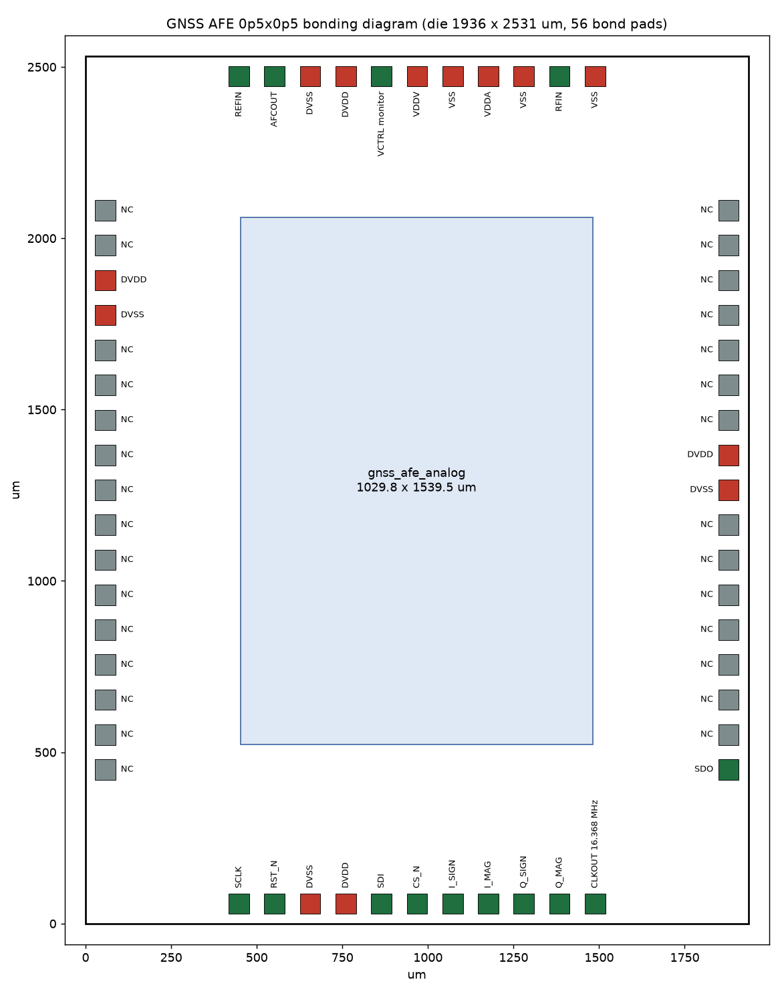

# GNSS アナログフロントエンド (GPS L1 C/A + Galileo E1) — GF180MCU 設計提案 rev.3

対象: Wafer.Space シャトル (GlobalFoundries GF180MCU, `gf180mcuD`, 3.3 V デバイス)
用途: 衛星軌道投入ロケット (Falcon 9 / H-IIA / H3 クラス) 搭載 GNSS 受信機
参照: MAX2769 相当 (インダクタレス雑音キャンセル LNA 内蔵)。チップは wafer.space のクオーターサイズ (slot 0p5x0p5、3.15 節) です。GLONASS 対応版 (rev.1) は `doc/report_rev1_glonass.md` に残しています
英語版: `doc/report_EN.md` (内容は本書と同じ)

rev.2 の変更点 (ご回答反映):

| 項目 | rev.1 | rev.2 |
|---|---|---|
| 対応衛星 | GPS + Galileo + GLONASS | **GPS L1 C/A + Galileo E1** |
| ADC / 出力 | I/Q 2 bit × 98.208 MS/s (392.8 Mbit/s) | **I/Q 2 bit × 16.368 MS/s (65.5 Mbit/s, 1/6)** |
| IF 帯域 | 0.67–37 MHz | **0.82–7.1 MHz** |
| 外部 LNA | ≥ 25 dB を仮定 | **20 dB** → ミキサ gm を 2 倍、IF 利得を +32 dB |
| 制御 | 並列 16 本 | **SPI (24 bit、書き込み 3 線 + 読み出し SDO) + パワーオンリセット** |
| ピン数 | 28 | **15** |
| 電源 / 温度 | — | **3.3 V ±5 % / −20…+85 °C** |
| **rev.3** | ミキサ直入力 (差動 100 Ω) | **インダクタレス雑音キャンセル LNA 内蔵、RF 入力はシングルエンド 50 Ω (1 ピン、外付けバラン不要)**。システム NF 2.45 → **1.61 dB**、ピン数 **14** |

本書の数値は、特記のない限り xschem 回路図から生成したネットリストを ngspice-47 + GF180MCU 公式モデル
(typical, 27 °C) でシミュレーションした結果です。「推定」と書いたものは解析式によるもので、トランジスタシミュレーションではありません。

---

## 1. アーキテクチャ

```
 active antenna/LNA 20 dB + SAW
            |
 RFIN -------> [lna_nc] --> [mixer_iq] --I--> [VGA1]-[SK]-[VGA2]-[SK]-[VGA3]-[VGA4..7 fixed] --> [adc2b] --> I_SIGN, I_MAG
 (50 ohm SE)   (NC balun)        ^        --Q--> (same if_chain)                                 --> [adc2b] --> Q_SIGN, Q_MAG
                    | LO 0/90/180/270                                                      ^ 16.368 MHz
 REFIN 16.368 --> [refbuf]->[PFD]-[CP]-[LF]-VCTRL->[vco_ring4 1571.328 MHz]->[divbuf]->[/96 TSPC]--FB/FS--> CLKOUT
 SCLK/SDI/CS_N -> [spi_regs + POR] -> VCO band, IF gain, AFC code -> [afc_dac] -> AFCOUT (VCTCXO Vc)
```

| 項目 | 内容 |
|---|---|
| LO | 内蔵リング VCO + 整数 N PLL (16.368 MHz TCXO, N = 96 固定) → 1571.328 MHz |
| IF | GPS/Galileo とも +4.092 MHz (複素低 IF、MAX2769 と同じ) |
| サンプリング | fs = fLO/96 = **16.368 MHz** (PLL の比較クロックをそのまま利用) |
| 出力フォーマット | I/Q 各 sign/magnitude 2 bit + CLKOUT 16.368 MHz (LVCMOS 3.3 V) — MAX2769 の I/Q 2 bit モードと同じレート |

リング VCO を選んだ理由 (rev.1 から変更なし): 外付けインダクタやボンディングワイヤを使う LC-VCO は、打ち上げ振動で L が変動して LO に FM が乗ります。
リング VCO + 1.1 MHz 帯域の PLL で位相雑音は十分 (積分 1.2° rms) なので、外付け部品と振動リスクを増やす理由がありません。

---

## 2. ピン配置 (16 本)

| # | ピン | 方向 | 説明 |
|---|---|---|---|
| 1 | RFIN | in | RF 入力 (シングルエンド 50 Ω)。内部で約 1.0 V にバイアスしているので**外部 AC 結合 (例: 10 pF) 必須**。隣に GND パッドを置くことを推奨 |
| 3 | REFIN | in | 16.368 MHz TCXO/VCTCXO (クリップドサイン、AC 結合) |
| 4 | SCLK | in | SPI クロック (mode 0) |
| 5 | SDI | in | SPI データ (MSB first) |
| 6 | CS_N | in | SPI チップセレクト (内部 100 kΩ プルアップ) |
| 17 | SDO | out | SPI の読み出しデータ (2026-11-14 追加、チップのパッド `bidir[5]`)。CS_N = High の間はハイインピーダンス (パッド内蔵のプルダウンで Low)。デジタル部 (`chip_core.sv`) だけにあり、アナログ部 `gnss_afe_top` にはありません |
| 7–10 | I_SIGN, I_MAG, Q_SIGN, Q_MAG | out | 2 bit I/Q データ (符号 + 大きさ)。**チップのパッドでは I + jQ の +fIF (+4.092 MHz) に信号が来ます** (チップの `chip_core` で Q_SIGN を反転。下記) |
| 11 | CLKOUT | out | 16.368 MHz サンプルクロック |
| 12 | AFCOUT | out | AFC DAC 出力 (VCTCXO Vc へ) |
| 13 | VCTRL | out | PLL 制御電圧のモニタ (テスト/ロック監視用)。2026-11-13 からバッファ (`vmon_buf`) + 10 kΩ 経由で、ピンの負荷は PLL に影響しません (3.15 節 (9)) |
| 14, 15 | VDD, VSS | — | 3.3 V ±5 % |
| 16 | VDDV | — | VCO 専用電源 (外部の低雑音 LDO、3.13 節 (7))。ピン番号はアナログ部 `gnss_afe_top` の 15 本目 |
| 18 | RST_N | in | デジタル部のリセット (Low でリセット、チップのパッド `rst_n`、アナログ部 `gnss_afe_top` にはありません)。**プルアップ / プルダウンなし。電源投入時に基板で Low に保ち、電源が安定してから High にしてください** (3.16 節 (6)) |

**I/Q の符号 (2026-11-09 決定)**: アナログ部 (`gnss_afe_top` / マクロ) の出力は、Q が I より 90° 進みます (VCO の相の並び順で決まり、コーナーによらず +89.5〜+90.8°)。
RF (1575.42 MHz) は LO (1571.328 MHz) より上なので、マクロの I + jQ では信号が −4.092 MHz に出ます (スペクトル反転)。
チップでは `chip_core.sv` で Q_SIGN を反転してパッドに出すので、**パッドの I + jQ は反転なし (+4.092 MHz、ドップラーの符号もそのまま)** です。
符号 + 大きさの 2 bit なので、符号ビットの反転は −Q と同じです (MAG はそのまま)。回路図のテストベンチ (`tb_full` など) はマクロの出力を見ているので反転前の向きです。

実チップでは RF / VCO / IF / デジタル・I/O で電源を分けることを推奨します (4 組にすると +6 本で 21 本)。

### SPI レジスタ (24 bit、`spi_regs`) — 2026-11-04 に 16 → 24 bit (ICP2 追加)、2026-11-13 に BWW / BWN 追加、2026-11-14 に読み出し (SDO) 追加
- mode 0 (SCLK アイドル Low、立ち上がりで取り込み)、MSB first、CS_N = Low の間に 24 クロック (3 バイト) 送り、**CS_N の立ち上がりで一括反映**します。

| bit | 23…19 | 18 | 17 | 16 | 15…8 | 7 | 6 | 5 | 4 | 3 | 2 | 1 | 0 |
|---|---|---|---|---|---|---|---|---|---|---|---|---|---|
| 名前 | 予約 (0 を書く) | BWN | BWW | ICP2 | AFC[7:0] XOR 0x80 | B1 | B0 | IG3B | IG3A | IG2B | IG2A | IG1B | IG1A |

- AFC フィールドは符号付きです (0x00 = DAC 中央値、0x7F = 最大、0x80 = 最小)。
- BWW / BWN は IF フィルタ (Sallen-Key 2 段) の帯域トリムです (3.15 節 (9))。BWW = 1 で C2 が 0.64 倍になり帯域が広がります (遅いチップ用)。BWN = 1 で C2 が 1.6 倍になり帯域が狭まります (速いチップ用)。両方 0 が標準です。
  アナログマクロのピンは BWK (= BWW の反転) と BWN で、反転はデジタル側 (`chip_core.sv` の標準セル、`gnss_afe_top` では `inv_dig`) で行います。
- ICP2 = 1 でチャージポンプ電流を 2 倍にします (3.6 節)。予約 bit はシフト段だけで出力ラッチはありません。
- リセット後は全 bit 0 → VCO バンド 00、IF 利得最小、AFC 中央値、Icp × 1 になります。**チップのリセットはパッド RST_N だけで、パワーオンリセットはありません** (RC 200 kΩ × 10 pF のリセットは回路図の `spi_regs` にだけあり、チップには入っていません。3.16 節 (6))。
- **読み出し (2026-11-14 追加、チップの `chip_core.sv`、3.15 節 (10))**: CS_N = Low の間、SDO に 24 bit を MSB first で出します。内容は `{ID = 10101, 制御ワードの bit 18…0}` で、制御ワードは**いま有効な値 (前回のフレームで書いた値)** です。
  - 書き込みと同じフレームで読めます。今回のフレームで送った値は、次のフレームで読めます。読むだけの専用コマンドはないので、値を変えたくないときは同じ値をもう一度書きます。
  - SDO は SCLK の立ち下がりで変わります (最初のビットは CS_N の立ち下がりで出ます)。マスタは SCLK の立ち上がりで取り込みます (mode 0)。
  - 上位 5 bit の ID (10101) は固定値で、配線の断線や短絡 (全 0、全 1) と区別するためのものです。リセット直後は 0xA88000 が読めます。
  - 25 クロック目以降は 0 を出します。CS_N = High の間、SDO はハイインピーダンスです (パッドのプルダウンで Low)。
  - **読み出しは SCLK 5 MHz 以下で使ってください。** 書き込みは従来どおりです (タイミング制約 25 MHz)。SCLK 立ち下がりから SDO パッドまでの遅延は、タイミング解析の最悪条件 (SS、125 °C、4.5 V) で 14.9 ns ですが、標準セルのライブラリは 4.5–5.5 V 用で、3.3 V で動かすこのチップでは遅延がこれより大きくなります。3.3 V での遅延はトランジスタレベルのシミュレーションで求め、最悪 24.1 ns です (SS、125 °C、3.0 V、負荷 30 pF。3.15 節 (10))。5 MHz の半周期 100 ns に対して 76 ns の余裕があります。
  - 読み出しはアナログマクロの `spi_regs` (トランジスタレベル) にはなく、`tb_spi` の対象外です。cocotb (`chip/cocotb/gnss_spi_tb.py`) の RTL とゲートレベルで確認しました。
- `tb_spi` で検証済み: POR 解除 1.8 µs、POR 後の初期値は全 19 出力が期待どおり、10 MHz SCLK で 0x853A96 (予約 bit 23 = 1、BWN = 1、ICP2 = 1) を書き込んで全 19 出力が一致。

---

## 3. ブロック設計とシミュレーション結果

### 3.0 雑音キャンセル LNA (`lna_nc`, `tb_lna`, `tb_rx`) — rev.3 で追加
インダクタを使わない CG-CS バラン型です。
- M1 (ゲート接地) で入力を 50 Ω に整合します (gm1 + gmb1 + 1/RS)。
- M1 のチャネル雑音は入力ノードと M1 の出力に同符号で現れるので、M2 (ソース接地) で反転させると差動出力で打ち消し合います (キャンセル条件 gm2·R2 = R1/Rs)。
- M1・M2 は縮小レプリカ + PB ミラー電流でバイアスし、M2 のゲートは AC 結合です。
- 出力は 4 pF でミキサに AC 結合しています。ミキサの入力は 50 Ω 終端をやめ、5 kΩ のバイアス抵抗にしました。

| 項目 (1.575 GHz、負荷 = 実ミキサ) | 結果 |
|---|---|
| 入力インピーダンス / S11 | 46.4 − j16 Ω / −15.3 dB |
| 差動電圧利得 | 14.4 dB |
| 出力バランス | 振幅 0.38 dB、位相 167° (180° から 13° ずれ) |
| **NF (`.noise` 解析)** | **1.46 dB** |
| 消費電流 | 16 mA (M1 3.2 mA、M2 12.6 mA、レプリカ 0.55 mA) |
| RF 入力 → IF (LNA + ミキサ、tran、理想 LO 0–2 V) | **変換利得 28.7 dB**、I/Q 差 0.15 dB / 88.0° |

上表は 2026-11-03 の値で、ミキサの LO を AC 結合にした後です (3.10 節)。`tb_lna` は LO を DC で固定するので、
AC 結合後は I/Q のスイッチがすべて 1.6 V のバイアスで半分オンの状態になります (以前は片側オン)。そのため S11・利得・NF が少し変わりました
(以前は 43.9 − j18 Ω / 13.7 dB / 1.34 dB、`tb_rx` 27.85 dB、I/Q 0.025 dB / 89.78°、3 mV 入力まで線形)。

### 3.1 ミキサ (`mixer_iq`)
rev.3 では LNA が前段で利得を持つので、Gm 段を rev.1 のサイズ (80u、テール 2 mA/ミキサ、負荷 1.3 kΩ ∥ 4 pF) に戻し、LNA から見た負荷容量を半分にしました。
下表は rev.2 (Gm 2 倍、ミキサ直入力) の値です。rev.3 の RF 入力からの総合値は 3.0 節を参照してください。
2026-11-03 から、LO は 2 pF で AC 結合し、各スイッチのゲートを 20 kΩ で 1.6 V (VDD の分圧、50 pF でデカップリング) にバイアスしていました (3.10 節)。
**現在の版 (2026-11-09 以降) はサブハーモニックミキサです** (3.15 節)。LO は fLO/2 = 785.664 MHz の 8 相で、上段のスイッチは 1.8 V、下段のスイッチ対は 1.2 V にバイアスしています。この節の表と 1.6 V の記述は当時のギルバートミキサの値です。

| 項目 | 結果 |
|---|---|
| gm (片側) | 14.7 mS (rev.1: 7.4 mS) |
| 入力インピーダンス | 102 − j34 Ω (S11 = −15.7 dB)。外付けの直列 L ≈ 3.4 nH で改善できます |
| 変換利得 | **14.2 dB** |
| I/Q 振幅差 / 位相 (理想 LO) | 0.04 dB / 90.00° |
| 圧縮 | −9.5 dBm 入力で 0.3 dB |
| NF (推定) | ≈ 13.5 dB (rev.1: 16 dB) |

### 3.2 IF チェーン (`if_chain`: 可変 VGA × 3 + 固定利得 × 2 + Sallen-Key × 2。当初は VGA × 7)
- SK LPF は 4 次 Butterworth、f0 = 7.5 MHz に容量を数値最適化しました (`scripts/tune_sk.py`)。MIM の 1 辺は 25–107 µm です。
- 固定利得段は 3 段 (VGA4–6) です。rev.2 では 4 段でしたが、rev.3 では LNA の利得の分 1 段減らしています。
- 各段が AC 結合 (HPF) なので、DC オフセットと 1/f 雑音は構造的に除去されます。

| ゲインコード (G1=G2=G3) | 4.092 MHz | 6.6 MHz (Galileo 上端) | 11.25 MHz (GPS 帯の折り返し元) | 16.368 MHz | −3 dB 帯域 |
|---|---|---|---|---|---|
| 00 | 41.4 dB | 39.3 dB | 27.9 dB | 15.1 dB | 0.77 – 6.97 MHz |
| 01 | 51.9 dB | 49.9 dB | 38.7 dB | 25.9 dB | 0.77 – 7.03 MHz |
| 10 | 63.4 dB | 61.4 dB | 50.6 dB | 37.9 dB | 0.77 – 7.13 MHz |
| 11 | 66.4 dB | 64.5 dB | 53.8 dB | 41.2 dB | 0.77 – 7.16 MHz |

(2026-11-04 のバイアス変更後、TT 27 °C 3.3 V。変更前は 40.8 / 51.1 / 62.5 / 65.5 dB。)

- **バイアス (2026-11-04 変更、`bias_if`)**: VGA のテール電流と SK フォロワの電流源を、定 gm バイアス (NB/PB) から専用の比例バイアスに切り替えました。
  基準電流は Iref = (0.288 VDD) / RREF です。RREF は VGA 負荷と同じ単位抵抗 (ポリ 1 µm × 2 µm、端部抵抗込み) の 9 直列で、PMOS 入力 OTA + NMOS で V-I 変換します。
  テール電流は Iref の 20 倍 (約 1.05 mA) で、I·RL = 0.64 VDD がプロセス・温度によらず一定になり、VGA 出力の動作点は 0.363 VDD (TT 1.20 V) に固定されます。
  定 gm バイアスのままでは、SS 85 °C 3.135 V で出力が 0.53 V に下がって利得が 35 dB 不足し (3.11 節)、SK フォロワの電流源も FF 85 °C で 2.2 mA まで増えて線形領域に入っていました。
- **PVT 18 点 (TT/SS/FF × −20/27/85 °C × 3.135/3.465 V) の利得 (コード 01、4 MHz)**: **47.7–54.3 dB** (変更前は SS 85 °C で 16.4 dB)。VGA 出力の動作点は 1.12–1.27 V です。

  | | −20 °C | 27 °C | 85 °C |
  |---|---|---|---|
  | TT (3.135 / 3.465 V) | 53.4 / 53.9 | 51.6 / 52.1 | 49.4 / 49.9 |
  | SS | 53.8 / 54.3 | 52.2 / 52.6 | 50.3 / 50.6 |
  | FF | 52.3 / 52.7 | 50.3 / 50.6 | 47.7 / 48.1 |

  残りのばらつきは主に温度による gm の低下 (−20→85 °C で約 −4 dB) で、AGC (64 通り、約 3.5 dB ステップ) で吸収できます。
  −3 dB 帯域の上端は SS 5.1–5.6 MHz、TT 6.7–7.3 MHz、FF 9.0–9.8 MHz です (SK の R・C のプロセスばらつきで、バイアス変更とは無関係)。
  SS では Galileo E1 帯の上端 (6.6 MHz) が −3 dB を超えて落ちます。2026-11-13 に SK 容量のトリム (SPI の BWW / BWN) を追加しました (3.15 節 (9))。

- 各段 2 bit を独立に設定でき、64 通り (≈ 3.5 dB ステップ) です。
- 入力換算雑音: 7.9 nV/√Hz (最大利得) – 30 nV/√Hz (最小利得)。
- 折り返し雑音による C/N0 劣化 (サンプリング後の雑音 PSD 増加、`scripts/gnss_sysim.py`): **GPS 帯 0.14 dB / Galileo 帯 0.23 dB**。

### 3.3 リンクバジェットと AGC (LNA 20 dB, NF 1.5 dB, SAW 2 dB)

| 項目 | 値 |
|---|---|
| チップ NF (LNA 1.46 dB [sim] + ミキサ 16 dB [推定] / LNA 利得 14.4 dB) | 4.5 dB |
| システム NF | **1.60 dB** (外部 LNA 単体の 1.5 dB に対し +0.10 dB。rev.2 は 2.45 dB) |
| チップ NF の再計算 (2026-11-13、LO 高調波の折り返し込み、複素 I/Q、`scripts/review/mixer_nf.py`、3.15 節 (9)) | 5.62 dB (TT) / 7.25 dB (SS) / 4.40 dB (FF) |
| 上の再計算値でのシステム NF | **約 1.65 dB** (TT) / 1.72 dB (SS) |
| ADC 入力の雑音 σ: コード 00 / 01 / 10 / 11 (チップの変換利得 28.5 dB、3.10 節、11-04 の IF バイアス変更後) | 0.049 / **0.165** / 0.62 / 0.88 V |
| ADC 閾値 (2 bit 最適 ≈ 1σ) | 0.157 V |

公称ではコード 01 のほぼ真上 (01 から −0.4 dB) が最適点です。AGC の余裕は、利得を上げる側に +15.0 dB、下げる側に −10.1 dB あります (変更前は σ 0.152 V、+14.2 / −10.7 dB)。
(LO の AC 結合前、チップの変換利得 25.4 dB の版では σ = 0.032 / 0.106 / 0.40 / 0.56 V、余裕 +11.1 / −13.8 dB でした。)

### 3.3.1 IF + ADC + SPI 通しシミュレーション (`tb_ifadc`, ngspice, 80 µs, `doc/ifadc.png`)
ミキサ出力相当の白色雑音 (帯域内 0.41 mV rms) と、雑音より 10 dB 低いトーン (4.13 MHz = IF + 38 kHz ドップラー) を入力し、
SPI でゲインを書き換えながら 2 bit 出力を評価しました (2026-11-04、IF バイアス変更後・24 bit SPI)。
入力レベルは rev.3 (固定段 3 段) のリンクバジェットに合わせ直しました。これまでの表は rev.2 (固定段 4 段) の入力 0.126 mV rms のままで、rev.3 の回路では 10 dB 低い出力になっていました。

| 区間 | IF 出力雑音 rms | MAG=1 比率 | トーン検出 |
|---|---|---|---|
| SPI: G1=G2=G3=01 | 0.169 V (リンクバジェット予測 0.165 V) | **32.5 %** (1σ 閾値の理論値 31.7 %) | 雑音床の 4.2 倍 |
| SPI: G1=G2=G3=00 | 0.050 V (予測 0.049 V) | 0 % | 雑音床の 3.9 倍 |

→ AGC は「MAG=1 の比率 ≈ 1/3」を目標に SPI でゲインを調整します。

### 3.4 2 bit ADC (`adc2b`、16.368 MS/s)
| 項目 | 結果 |
|---|---|
| SIGN 閾値 | +0.8 mV |
| MAG 閾値 | −155.6 / +162.1 mV (設計 ±157 mV、2026-11-04 のラダー中心 1.20 V 版。旧 1.05 V 版は −155.6 / +157.3 mV) |
| 消費 | 0.51 mA |

### 3.5 VCO (`vco_ring4`) — 2026-11-03 に起動回路を追加、B1 電流を 2 倍
4 段擬似差動リング (VR 電流給電) です。2026-11-03 に次の 2 点を変更しました (経緯は 3.10 節)。
- 同相ラッチ対策の起動回路を追加しました。
  - 段 2 のダミーバッファ出力 (dD0/dD1) から p2 = n2 を検出し、RC (約 5 ns) で一時的な一致を無視します。
  - 検出したら、張り付いた側のノードを NMOS 8u で 1 本だけ引き下げます (p1 = n1 = H なら n1、p2 = n2 = H なら n2)。
  - 検出が解けたらすぐにキックを外します。キック付きセル `vco_cellk` (OP 側に同寸のダミー NMOS) は段 1・2 だけに使います。
    重い段と軽い段が d2 + d3 = d1 + d4 の組になるので、直交は保たれます。
- 帯域 B1 の電流枝を m = 4 → 8 にしました (SS の周波数余裕を確保するため。B=00 の TT/FF には影響しません)。

| コーナー (VCO + 60 fF + `divbuf` × 4) | バンド / 1571 MHz の VCTRL | 最高周波数 | I/Q 位相誤差 | 閉ループのロック点 |
|---|---|---|---|---|
| TT 27 °C 3.3 V | B=00 / 2.18 V | 1892 MHz (3 V) | 0.3–0.45° | 2.179 V (約 3 µs) |
| FF −20 °C 3.465 V (MOS/抵抗/MIM ff) | B=00 / 1.39 V | 2052 MHz (2 V) | 0.4–0.55° | 1.327 V (約 1.5 µs) |
| SS 85 °C 3.135 V (MOS/抵抗/MIM ss) | B=11 / 2.40 V | 1610 MHz (3 V、+2.5 %) | 0.3° | 2.417 V (約 7 µs、Icp 2 倍、3.6 節) |

- ラッチ状態 (hi / lo の両方) から始めても、上の全コーナー・VCTRL の全範囲で発振に戻ります。発振中は起動回路が働きません。
- SS は VCTRL 2.4 V 付近から上で VR が電源近く (約 2.9 V) で頭打ちになり、VCO 感度が約 120 MHz/V に下がります (TT は約 480 MHz/V)。
- 位相雑音 (2026-11-03、起動回路込みで再計算): TT −108.1 dBc/Hz @ 1 MHz (rev.1 の −108.0 と同じ)、SS −109.7 dBc/Hz @ 1 MHz。
  ngspice の過渡解析はデバイス雑音を扱わないため、リングの 8 ノードそれぞれに、切り替わり点での 4kT·γ·Σgm (γ = 1、TT 1.92 mS) に相当する白色雑音電流 (`trnoise`) を入れ、
  1 µs (約 1570 周期) の周期ジッタ (TT 62.9 fs、SS 52.8 fs、雑音なしの数値床 0.2 fs) から L = f0³σ_T²/Δf² で求めました。VR レギュレータの雑音は含みません。
  (比較用にキックなしのリングも回しましたが、初期状態のラッチから抜けずに発振しませんでした。)
- rev.1 の表 (LO 負荷 60 fF のみ、起動回路なし) は、TT 1.94 V、FF −40 °C 3.6 V 1.17 V、SS (MOS のみ ss) B=11 2.38 V でした。

### 3.6 PLL / 分周器
- 分周器 /96 (TSPC): TT と SS/85 °C/3.135 V の両方で FB = FS = **16.368 MHz**、消費 0.6 mA。
  /3 段は軽負荷ノードで駆動し、ADC クロックは FB を専用バッファで分岐しています。
- PFD/CP 4.2 µA/ns (実効 Icp 250 µA)、デッドゾーンなし。ループ fc 1.07–1.24 MHz、位相余裕 58–59° (rev.1 の VCO 感度での値。現行の値は下のコーナー評価)。
- 位相雑音: 積分 1.15° rms (1 kHz–50 MHz) → 相関損失 0.002 dB。
- 閉ループのトランジスタレベル過渡 (`tb_pll`: バイアス + VCO + PLL 全体 + ADC クロック負荷、VCTRL 初期値 1.7 V、`doc/pll_lock.png`):
  - **約 2 µs でロック** (1.5 µs で最終値の 7 mV 以内)。定常 VCTRL = 1.935 V (tb_vco の 1.94 V と一致)。
  - 定常の REF–FB 位相差 −0.28 ns (CP 不整合によるオフセット。2026-11-08 に電流ステアリング型 CP にして −0.005〜−0.017 ns、3.12 節 (8)(9))。位相が固定されているので、LO = 96 × 16.368 MHz = 1571.328 MHz です。
    (FS 30 周期の窓から求めた周波数は 1572.5 MHz でしたが、窓が整定中の区間を含むためです。)
  - VCTRL リップルから求めた基準スプリアス: −47.7 dBc @ ±16.368 MHz (2 次 −52.3 dBc)。
- コーナーの閉ループ (2026-11-03、起動回路追加後、VCTRL 0 V から): TT 2.179 V で約 3 µs、FF 1.327 V で約 1.5 µs でロックします。
  SS は引き込み中に位相誤差が 1 周期近くたまり、VCTRL が 2.85 V (1604 MHz) まで行き過ぎてから戻ります。
  その後 2.32 V (6.5 µs) まで下に振れてから減衰振動で収まり、**約 10 µs でロック** します (10 µs 過渡: VCTRL 2.427 V、9.83 µs 以降は ±5 mV 以内、REF–FB 位相差 0.25 ns に収束中)。
- **Icp を 2 倍に切り替えられます (2026-11-03 実装、11-04 に SPI の ICP2 bit で独立に制御するよう変更)。** `cp` に同じ電流源の 2 組目を静的スイッチ (MPE2 / MNE2) 越しに並べ、HI に SPI の ICP2 をつなぎます。
  当初は HI = B0·B1 (B=11 に連動) でしたが、低温の SS で B=11 を選ぶと VCO 感度が 480–640 MHz/V あり、Icp 2 倍で fc 約 2 MHz、位相余裕 45–55° になるため分けました (3.11 節)。
  ファームウェアは、バンド選択後のロック VCTRL が約 2.35 V を超えたら (VCO 感度が下がる領域) ICP2 = 1 にします。対象は実質的に 85 °C 付近の SS チップ (B=11、2.4–2.5 V) です。
  ICP2 分離後の閉ループ確認 (11-04、VCTRL 0 V から): SS (ICP2 = 1) 2.4170 V、TT (ICP2 = 0) 2.1795 V で、連動版と 0.1 mV 以内で一致します。
  TT で ICP2 = 1 にしても 2.1792 V に 2.3 µs でロックします (ICP2 = 0 は 3.1 µs)。設定を誤っても破綻はしません。
  ICP2 が必要な SS 85 °C 3.135 V では VCO 感度が約 120 MHz/V (TT の約 1/4) に下がり、帯域がループフィルタのゼロ点 (1/2πRC1 = 257 kHz) に近づいて位相余裕が落ちるためです。
  `tb_pfdcp` 相当 (VCTRL をロック点に固定、位相差 ±1 ns) で測った実効 Icp:

  | コーナー (VCTRL) | 通常 (HI = 0) | HI = 1 | 比 |
  |---|---|---|---|
  | TT (2.18 V) | 238 µA (3.90 µA/ns) | 548 µA | 2.30 |
  | SS (2.43 V) | 233 µA (3.81 µA/ns) | 479 µA | 2.06 |
  | FF (1.33 V) | 241 µA (3.95 µA/ns) | 568 µA | 2.35 |

- ループ帯域・位相余裕のコーナー評価 (上の実効 Icp、ロック点の VCO 感度は 3.5 節の掃引から。括弧内は R ±15 %、C ±10 %):

  | コーナー | VCO 感度 | Icp | fc | 位相余裕 | 閉ループのピーク | 積分位相雑音 (1 kHz–50 MHz) |
  |---|---|---|---|---|---|---|
  | TT (B=00) | 477 MHz/V | 238 µA | 0.91 MHz | 59° (57–59°) | 1.8 dB | 1.14° rms |
  | FF (B=00) | 855 MHz/V | 241 µA | 1.52 MHz | 56° (52–59°) | 1.3 dB | 1.24° rms |
  | SS (B=11、Icp 2 倍) | 120 MHz/V (2.4 V の前後で 89–155) | 479 µA | 0.51 MHz | **55° (49–58°)** | 2.7 dB | 1.22° rms (感度 89 MHz/V で 1.31°) |
  | (参考) SS、Icp 切り替えなし | 120 MHz/V | 233 µA | 0.29 MHz | 44° (37–50°) | 4.2 dB | 1.52° rms |

- 閉ループ過渡 (Icp 切り替え実装後、VCTRL 0 V から): SS は 7 µs で 2.417 V にロックします (6.5 µs 以降 ±3 mV、REF–FB 位相差 0.41–0.47 ns で一定。切り替えなしでは約 10 µs)。
  引き込み初期は VCO の上限付近 (約 2.9 V、感度が小さい) で周波数を追うので、行き過ぎ (最大 2.99 V) は残ります。
  TT 2.1795 V、FF 1.3266 V で、B=00 の両コーナーは切り替え前 (2.179 / 1.327 V) と同じです。相関損失は全コーナーで 0.003 dB 以下です。
  (積分位相雑音は `pll_design.py` のモデルで、自走リングを保守的な推定値 −104.2 dBc/Hz @ 1 MHz とした値です。)

### 3.7 AFC DAC (`afc_dac`)
8 bit R-2R、100 kΩ 負荷で 0–2.98 V、1 LSB = 11.7 mV、DNL 0.69 LSB、INL 0.35 LSB。

2026-11-13 に抵抗を W 1 µm × L 10 / 20 µm から W 2 µm × L 20.1 / 40 µm (面積 4 倍) に変えました。系統的な DNL は回路図で −0.01 / +0.01 LSB、PEX で −0.01 / +0.33 LSB (INL −0.13 / +0.20 LSB、単調) です。ミスマッチ (AR 2 %·µm) による 127 → 128 の DNL は σ 0.35 LSB で、単調になる確率は 99.8 % です (3.15 節 (9))。

### 3.8 消費電流 (ブロック単体シミュレーション値の合算)
| ブロック | 電流 |
|---|---|
| VCO + LO バッファ | 3.7 mA |
| LNA | 16 mA |
| ミキサ I/Q | 4.0 mA |
| IF チェーン × 2 (可変 VGA 3 段 + 固定利得 2 段 + SK 2 段。当時は VGA 6 段) | 32 mA |
| ADC × 2 | 1.0 mA |
| 分周器 / CP / 基準バッファ / CLKOUT / バイアス / DAC / SPI | 1.6 mA |
| LO 対称化用ダミー `divbuf` × 3 (3.9 節) | 1.3 mA |
| **合計** | **≈ 59 mA (≈ 196 mW @ 3.3 V)** |

`tb_full` (TT、雑音なし) の実測は、`bias_if` 導入後 (11-04) で 59.6 mA です (導入前 61.2 mA、AC 結合と VCO 起動回路の追加前 60.7 mA)。SS 85 °C 3.135 V では 55.7 mA (導入前 64.0 mA) です。

### 3.9 チップ全体の過渡シミュレーション (`tb_full`)

`gnss_afe_top` の全体を、電源投入 (VDD 3.3 V 固定 + `uic`、POR は RC 充電) から 12 µs まで過渡解析しました。
入力は、基準 16.368 MHz、SPI 書き込み (2.5–4.2 µs で利得コード 01 を設定)、RF です。
RF には、外部 LNA + SAW 後相当の白色雑音 (−154 dBm/Hz) と −95 dBm の CW トーン (1575.42 MHz) を入れています。
ngspice-47 と Xyce 7.9 の両方で完走しました。Xyce は trnoise に非対応なので、同じ rms・49.7 ps 間隔のガウス乱数を PWL で与えています (乱数の種は ngspice と異なります)。

| 項目 | ngspice (SPARSE) | Xyce | 期待値 / 備考 |
|---|---|---|---|
| 実行時間 (12 µs) | 5 h 12 min | 8 h 24 min | 1 コア |
| PLL ロック (VCTRL) | 2.03 V (1 µs) → 1.948 V (3 µs 以降一定) | 2.13 V → 2.003 V | 両者の差 55 mV はモデル実装の差 |
| CLKOUT | 16.36799 MHz | 16.36801 MHz | 16.368 MHz |
| 消費電流 | 59.4 mA | 59.5 mA | ブロック合算 58 mA (3.8 節、ダミー追加前) |
| ADC MAG=1 比率 (I / Q、130 サンプル) | 0.146 / 0.262 | 0.123 / 0.138 | IF rms からのガウス期待値: 0.21 / 0.28 (ngspice)、0.17 / 0.18 (Xyce) |
| ADC SIGN 平均 (I / Q) | −0.015 / −0.046 | +0.015 / −0.031 | 0 (rev.2 で起きた「SIGN が 0 に固定」は解消) |
| IF 出力の 16.368 MHz 高調波 (1–16 次) | 0.3–2.1 mV | 0.3–1.8 mV | I/Q 同値。MAG 閾値 157 mV の約 1 % |

- **IF 出力 rms は 115–146 mV で、MAG=1 の比率は 0.12–0.26 でした。** AGC 目標 (1/3) に対しては、利得を 1 ステップ (+3.5 dB) 上げる側です。
  これは公称 (3.3 節でコード 01 付近が最適) と矛盾しません。
- 上の表と次の表は、ダミー `divbuf` を追加する前の回路の結果です。追加後の結果は、この節の最後にあります。
- **I/Q の確認には、雑音なしで別途 5 µs を計算しました。** −95 dBm のトーンは、雑音入りの 8 µs 窓では雑音床 (帯域 125 kHz、IF で約 22 mV) と同程度で、I/Q の振幅比・位相を判定できないためです。

| 雑音なし 5 µs | ngspice | Xyce |
|---|---|---|
| LO (ロック後) 差動振幅 I / Q、Q−I | 2.12 / 2.26 V、−90.3° | 1.97 / 2.10 V、−91.1° |
| LO デューティ比 | 0.491–0.498 | 0.483–0.490 |
| ミキサ出力 (4.4–4.9 µs) I / Q、Q−I | 0.111 / 0.117 mV (+0.47 dB)、87.2° | 0.093 / 0.099 mV (+0.53 dB)、90.3° |
| IF 出力 (3.0–4.0 µs、POR 時の利得 00) Q/I、Q−I | +1.9 dB、86.3° | +3.6 dB、83.3° |
| IF 出力 (4.71 µs〜、利得 01) I / Q、Q−I | 45.8 / 43.4 mV、82.0° | 37.4 / 34.5 mV、83.0° |

- ミキサ出力の変換利得は、−95 dBm 入力 (整合時 5.6 µV peak) に対し 24.4–25.9 dB でした。単体 (`tb_rx`) の 27.85 dB (3.0 節) より 2–3 dB 低い値です。
  原因を切り分けました (LNA + ミキサ、ARF = 100 µV、ngspice、`tb_rx` の条件を 1 つずつチップに近づけたもの):

  | 条件 | fLO | LO 基本波 差動 (I / Q) | 変換利得 I / Q | Q−I |
  |---|---|---|---|---|
  | 理想 LO (0–2.0 V 矩形、エッジ 40 ps) = `tb_rx` | 1571.33 MHz | 2.53 / 2.53 V | 28.62 / 28.62 dB | 90.0° |
  | + IF チェーン 2 本の負荷 (バイアス共有 / 別) | 同上 | 同上 | 28.62 / 28.52 dB (差 ≤ 0.1 dB) | 89.8–90.0° |
  | 実 VCO の LO (VCTRL 1.948 V 固定、バンド 00) | 1580.14 MHz | 2.27 / 2.27 V | 26.49 / 26.48 dB | 89.6° |
  | 実 VCO + PLL (`divbuf` が LOIP だけを負荷) | 1571.22 MHz | **2.12 / 2.26 V** | **26.14 / 26.51 dB** | 87.7° |

  - 現在の PDK では、`tb_rx` 自体が 28.62 dB です (3.0 節の 27.85 dB は旧環境の値)。
  - **主因 (−2.1 dB) は LO 波形です。** リング VCO の LO バッファは VR (約 2 V) 給電で、エッジが鈍く、基本波は理想矩形の 90 % しかありません。`tb_rx` の理想 LO は楽観的でした。
  - **残り (I 側 −0.35 dB) は、分周器入力 `divbuf` が LOIP だけにつながっている負荷の偏りです。** LO I の振幅だけが 0.6 dB 下がり、I/Q 振幅差 +0.4–0.5 dB と直交誤差 2–3° を生みます。
    VCO の周波数も 9 MHz 下がります (VCTRL のロック点が上がる)。
  - IF チェーンの負荷とバイアスの共有は無関係でした。
  - システムへの影響: 外部 LNA 20 dB があるので、NF への影響は小さいです。IF 利得の不足 2–3 dB は、AGC の余裕 (理想 LO 基準で +13.5 dB) の範囲内です。
- **対策: LOIN / LOQP / LOQN に、同じ `divbuf` をダミーとして付けました** (`gen_cells.py` の `top()`、出力は未接続)。
  4 相の LO の負荷が等しくなります。

  | 確認 | 条件 | LO 差動基本波 I / Q、Q−I | ミキサ出力 I / Q、Q−I | 変換利得 |
  |---|---|---|---|---|
  | ブロック (LNA + ミキサ + VCO + PLL) | ダミーなし | 2.12 / 2.26 V、−90.0° | Q/I +0.37 dB、87.7° | 26.14 / 26.51 dB |
  | ブロック (VCTRL 1.995 V、fLO 1570.14 MHz) | ダミーあり | 1.973 / 1.973 V、−89.8° | Q/I −0.02 dB、90.1° | 25.57 / 25.55 dB |
  | `tb_full` 雑音なし 5 µs (ngspice、3.0–4.0 µs) | ダミーなし | 2.12 / 2.26 V、−90.3° | 0.103 / 0.121 mV (+1.42 dB)、86.3° | — |
  | `tb_full` 雑音なし 5 µs (ngspice、3.0–4.0 µs) | **ダミーあり** | **1.971 / 1.976 V、−90.2°** | **0.103 / 0.105 mV (+0.12 dB)、89.5°** | **25.4 dB** (3.5–5 µs 平均) |

  - チップ全体でも、I/Q の振幅差は 0.1 dB 以下、直交誤差は 0.5° 以下になりました。IF 出力 (3.0–4.0 µs、利得 00) も Q/I +0.06 dB、Q−I 91.5° です (ダミーなしでは +1.9 dB、86.3°)。
  - PLL は VCTRL 1.998 V でロックし (ダミーなしは 1.948 V)、CLKOUT は 16.368 MHz です。消費電流は 60.7 mA (+1.35 mA) です。
  - 代償として、LO 振幅が下がり、変換利得は 0.6–1.0 dB 下がります。チップの変換利得は 25.4 dB で、`gnss_sysim.py` の `G_RX_DB` をこの値に改めました。 (11-03 に LO を AC 結合にした後は 28.5 dB、3.10 節)
  - SPI 書き込み後の IF の過渡 (下記) は、ダミーの有無で変わりません。
- **最新回路 (ダミー `divbuf` + LO の AC 結合 + VCO 起動回路) での雑音入り 12 µs (2026-11-03、両方とも完走)**:

  | 項目 | ngspice (SPARSE) | Xyce | 期待値 / 備考 |
  |---|---|---|---|
  | 実行時間 (12 µs、1 コア) | 7 h 15 min | 10 h 18 min | 他のジョブと並行実行のため前回より長い |
  | PLL ロック (VCTRL) | 2.488 V (1 µs) → 2.175 V (3 µs 以降一定、±0.5 mV) | 2.579 V → 2.217 V | 雑音なし 5 µs (ngspice) 2.176 V。両者の差 42 mV はモデル実装の差 (前回 55 mV) |
  | CLKOUT / 消費電流 | 16.36800 MHz / 61.16 mA | 16.36799 MHz / 61.38 mA | 雑音なし 5 µs の 61.19 mA |
  | IF 出力 rms (I / Q、利得コード 01) | 165 / 144 mV | 167 / 163 mV | リンクバジェット (3.3 節、28.5 dB) の σ = 152 mV。8 µs 窓の推定ばらつきは約 ±12 % |
  | ADC MAG=1 比率 (I / Q、132 サンプル) | 0.303 / 0.167 | 0.318 / 0.288 | IF rms からのガウス期待値 0.34 / 0.27 (ngspice)、0.35 / 0.34 (Xyce)。AGC 目標 1/3 |
  | ADC SIGN 平均 (I / Q) | −0.09 / −0.09 | −0.03 / +0.09 | 0 (132 サンプルの統計誤差 ±0.09) |
  | トーン (4–12 µs 相関) ミキサ I / Q、IF I / Q | 0.116 / 0.088 mV、49 / 34 mV | 0.31 / 0.12 mV、109 / 47 mV | 雑音床と同程度のため、I/Q 比・位相は判定できません (乱数の種も異なる。I/Q は雑音なし 5 µs で確認済み) |

  - 変換利得が 3 dB 上がったぶん IF rms が増え、MAG=1 の比率はダミー追加前 (0.15 / 0.26) より AGC 目標の 1/3 に近づきました。IF rms の平均 (ngspice 155 mV、Xyce 165 mV) はリンクバジェットの予測 152 mV と合います。
- **SPI 書き込み中 (クロック送出中〜CS_N 立ち上がりの 4.2 µs) は、IF に I/Q 同相で 70–175 mV の過渡が出ます。** 利得切り替えと、デジタル部から IF への結合が原因とみられます。
  書き込み完了から約 0.5 µs で Q−I は 82–83° に戻り、振幅も期待値 (33–40 mV) に整定します。
  AGC の書き込み直後の約 1 µs (16 サンプル) は、相関に使わないことを推奨します。
- ngspice の注意: `.option klu` (KLU ソルバ) では、数 ns で "Timestep too small" になります。KLU が refactor で古いピボット順を使い回すためで、
  `pivrel=0.1` でも 25 ns で破綻し、`pivrel=1` なら完走します。`tb_full` は SPARSE 1.3 を使っています。
- 解析: `scripts/full_analyze.py` (要約 JSON は `doc/full_ngspice_summary.json` / `doc/full_xyce_summary.json`)、`scripts/full_detail.py` (トーン相関、ADC 統計、高調波)。

### 3.10 コーナー検証 (実 VCO の LO + ミキサ、PLL 閉ループ、VCO 起動) — 2026-11-02、11-03 に対策
条件: SS = MOS/抵抗/MIM すべて ss、85 °C、3.135 V、B=11。FF = すべて ff、−20 °C、3.465 V、B=00。
ブロックは LNA + ミキサ + 実 VCO + PLL 負荷 + ダミー `divbuf` で、VCTRL はロック点付近に固定しています (ngspice)。

**(1) ミキサ変換利得: FF で大きく低下しました → LO の AC 結合で対策済み (11-03)。**

| | 理想 LO (0–2 V 矩形) | 実 LO 差動基本波 | 実 LO の利得 | I/Q |
|---|---|---|---|---|
| TT 27 °C 3.3 V | 28.6 dB | 1.97 V | 25.6 dB | 0.0 dB / 90.1° |
| SS | 27.0 dB | 2.62 V | 26.0 dB | 0.1 dB / 90.3° |
| **FF** | 29.5 dB | **1.54 V** | **12.5–13.7 dB** | 0.0 dB / 89.8° |

- 原因: ミキサは LO を DC 結合で受けているので、LO の High レベルがスイッチ下ノードの電圧を決めます。
  LO バッファは VR 給電で、LO の High は VR とともにコーナーで変わります。FF では VR が 1.6 V しかないので、Gm 段が線形領域に入ります。

  | | LO High | スイッチ下ノード | Gm 段 Vds |
  |---|---|---|---|
  | 理想 LO (TT) | 2.00 V | 0.84 V | 0.47 V |
  | 実 LO (TT) | 1.98 V | 0.58 V | 0.24 V |
  | 実 LO (SS) | 2.64 V | 0.91 V | 0.66 V |
  | 実 LO (FF) | 1.51 V | 0.42 V | **0.06 V** |

  TT で理想 LO より 3 dB 低い (3.9 節) のも、同じ原因です (3.9 節の「エッジが鈍い」という説明は不十分でした)。
- **対策: LO を AC 結合 (2 pF) し、ミキサ側に固定バイアスを 20 kΩ で与えます。** 理想 LO 源で求めたバイアス別の変換利得 (I) は次のとおりです。

  | LO バイアス | FF | TT | SS |
  |---|---|---|---|
  | DC 結合 (現状) | 12.5–13.7 dB | 25.6 dB | 26.0 dB |
  | **1.6 V** | 28.4 dB | 28.4 dB | 25.5 dB |
  | 1.8 V | 28.6 dB | 28.5 dB | 25.0 dB |
  | 2.0 V | 28.8 dB | 28.1 dB | 24.4 dB |
  | 2.3 V | 28.8 dB | 27.2 dB | 23.3 dB |

  バイアス 1.6 V で、コーナー間のばらつきは 13 dB から 3 dB に縮まり、TT も +2.8 dB 改善します。
  SS ではバイアスを上げると下がります (LO 振幅が大きく、スイッチが線形領域に入るため)。
  I/Q は全条件で 0.3 dB / 1.5° 以内です。
- **実装 (11-03)**: `mixer_iq` に CAC* (MIM 31.6 µm 角 ≈ 2 pF)、RAC* (20 kΩ)、バイアス 1.60 V (RLA/RLB の VDD 分圧、CLOB 50 pF) を追加しました。
  実 VCO (起動回路付き) を使ったブロック計算 (VCTRL は 1571 MHz 付近に固定) の結果です。

  | | fLO | 変換利得 I / Q | Q−I | LO 差動基本波 |
  |---|---|---|---|---|
  | TT | 1573.1 MHz | 28.7 / 28.5 dB | 90.6° | 2.05 V |
  | SS | 1566.4 MHz | 25.3 / 25.3 dB | 90.4° | 2.70 V |
  | FF | 1573.0 MHz | 29.4 / 29.4 dB | 92.0° | 1.59 V |

  `tb_full` (TT、雑音なし 5 µs) では、ミキサ出力が対策前の +3.1 dB です。チップの変換利得は 25.4 → **28.5 dB** になりました。
  理想 LO の `tb_rx` は 28.7 dB です。そのほかの `tb_full` の結果は次のとおりです。
  - VCTRL 2.176 V でロック (3.0 µs で 5 mV 以内)、CLKOUT 16.367 MHz
  - LO I/Q 2.039 / 2.054 V、−90.2°
  - ミキサ Q/I −0.63 dB、Q−I 90.0° (3.0–3.98 µs)
  - IF Q/I +0.14 dB、88.0°
  - IDD 61.2 mA
  `gnss_sysim.py` の `G_RX_DB` を 28.5 に更新しました (3.3 節)。

**(2) PLL 閉ループ (60 fF + `divbuf` × 4 + ADC クロック負荷、4 µs): 両コーナーでロックします (起動回路追加前の VCO)。** 追加後の結果は 3.6 節です。
- FF: VCTRL 1.217 V、リップル 23 mV pp
- SS: VCTRL 2.39 V。整定は約 3 µs で、TT (約 2 µs) より遅いです

**(3) VCO の同相ラッチ → 起動回路で対策済み (11-03、3.5 節)。**
- 4 段の擬似差動リングは、同相成分が 4 回反転して正帰還になります。そのため、全ノードが同相に張り付いて発振しない安定状態があります。
- 初期状態 (p4 = 0 V、n4 = 1 V) からの過渡で、この状態に入る範囲は次のとおりです: SS は VCTRL の全範囲 (1.8–3.0 V)、TT は VCTRL ≥ 2.7 V。FF は入りません。
  実際に、SS の VCTRL 2.47 V 固定のブロック計算で、VCO が発振しませんでした。
- 電源投入時は VCTRL が低いところから始まり、TT の全体シミュレーションでも起動しています。
  危険なのは、何かの理由で発振が止まった場合です。PLL は VCTRL を上限まで上げますが、そこではこの状態が安定なので、復帰できない恐れがあります。
- 対策の目安: リング内の交差結合ラッチ (MN3/4、MP3/4) を 2 倍にすると、SS でも張り付きが解消しました。
  ただし VCO が遅くなり、SS の最高周波数が 1425 MHz (1571 MHz 未達) になるので、電流やバンドの再設計とセットになります。
  別の案は、同相状態を検出して片側を引く起動回路です。
- **対策 (11-03)**: 同相状態の検出 + NMOS キックの起動回路を入れました (3.5 節)。途中で試して不採用にした案は次のとおりです。

  | 案 | 結果 |
  |---|---|
  | ラッチ × 2 | ラッチ状態から始めると脱出できない。SS 最高 1425 MHz |
  | NMOS フッタを開いてノードを上げる | 上がりが弱いラッチ経由で遅く、同相全体が反対のラッチ状態に移って行き来する (SS 2.6 V) |
  | キック 8u を全段の ON 側だけに付ける | 脱出は全点 OK。OP/ON 負荷の差で I/Q 誤差が約 1° |
  | キック + ダミー 8u を全段に付ける | I/Q 0.05° だが SS 最高 1548 MHz (1571 MHz 未達) |
  | キック + ダミー 4u を全段に付ける | キックが弱く、SS の全点でラッチから抜けない |
  | **キック + ダミー 8u を段 1・2 だけに付ける (採用)** | 全コーナー・hi/lo 全点で脱出、SS 最高 1610 MHz、I/Q 0.3–0.55° |

### 3.11 追加検証 (2026-11-03〜04): 電源立ち上げ、バンド選択の PVT 網羅、ミスマッチ MC、電源リップル
作業用ネットリストはリポジトリ外 (scratchpad) で、すべて ngspice です。

**(1) 電源立ち上げ (VDD 0 → 公称値、立ち上がり 1 µs / 10 µs、チップ全体の PLL + バイアス + VCO): 4 条件ともロックします。**

| | 立ち上がり | 最終 VCTRL | 整定 (VDD 90 % から、参照周期平均で ±5 mV) | 途中の VCTRL 最大 |
|---|---|---|---|---|
| TT 27 °C 3.3 V B=00 | 1 µs | 2.1789 V | 2.6 µs | 2.57 V |
| TT | 10 µs | 2.1789 V | 2.1 µs | 2.66 V |
| SS 85 °C 3.135 V B=11 | 1 µs | 2.4170 V | 5.9 µs | 2.98 V |
| SS | 10 µs | 2.4169 V | 6.1 µs | 3.09 V |

- バイアス (nb) と VR は VDD に追従して立ち上がり、ブートストラップの失敗や VCO の張り付きはありません。SS では B0/B1 も VDD と一緒に上げています (SPI リセット値の代わり)。
- 最終値は定常計算 (3.6 節) と 0.1 mV 以内で一致します。VCTRL リップルは 14–18 mV pp です。

**(2) バンド選択の PVT 網羅 (VCO + PLL 負荷、VCTRL 1.0–3.0 V を 0.4 V 刻み、1571.3 MHz になる VCTRL を補間)。**

| コーナー | B=00 | B=01 | B=10 | B=11 |
|---|---|---|---|---|
| TT −20…85 °C、3.135/3.465 V | **2.05–2.39 V** (K 370–550) | 1.81–2.08 V | 1.44–1.60 V | 1.36–1.51 V |
| FF −20…85 °C | **1.0–1.50 V** (K 580–740) | 1.0–1.29 V | ≈ 1.0 V 以下 | 1.0 V 以下 |
| SS −20 / 27 °C | 届かない | 2.63–2.95 V | **2.03–2.20 V** (K 340–620) | 1.91–2.08 V (K 550–640) |
| SS 85 °C 3.465 V | 届かない | 届かない | **2.26 V** (K 320) | 2.11 V (K 480) |
| SS 85 °C 3.135 V | 届かない | 届かない | 2.65 V (K 66) | **2.46 V** (K 122) |

K は MHz/V (0.4 V 刻みの差分なので概算)。太字は「VCTRL ≤ 約 2.5 V になる最も低いバンド」を選んだ場合です。
- TT と FF は B=00 で全温度・全電源に入ります。FF の B=00 は VCTRL 1.2–1.5 V と低めです。
  VCTRL 1.0 V では低いバンドで発振しない点がありますが、PLL は FB エッジがなければ UP を出すので復帰します。
- SS で B=11 が必要なのは **85 °C・3.135 V 付近だけ** です。そこでの周波数余裕は、VCTRL 2.6 V で 1589 MHz (+1.1 %)、3.0 V で 1610 MHz (+2.5 %) です。
- **Icp 2 倍を B=11 に連動させた場合の問題 (→ 11-04 に SPI の ICP2 bit に分離済み)**: SS でも低温では B=11 の Kvco が 480–640 MHz/V あり、Icp 2 倍だと fc 1.7–2.1 MHz、位相余裕 51–55° (R・C ばらつきで 45–58°、fref/fc ≈ 8) になります。
  動作はしますが、低温の SS チップでは B=10 (Icp × 1、fc 約 1.1 MHz) を選ぶ方が良いです。
  ファームウェアのバンド選択は「VCTRL (現在の版では専用の VCTRL モニタピン、当時は AFCOUT 経由) が約 2.5 V を超えたらバンドを 1 つ上げる」という規則にしてください。
  また、低温で B=10 を選んだ SS チップが 85 °C まで温まると VCTRL が 2.65 V (K 66 MHz/V) に達します。そのため、動作中も VCTRL を監視して再選択する必要があります。
  これを受けて、Icp 2 倍は SPI の ICP2 bit で独立に制御するよう変更しました (2 章 SPI レジスタ、3.6 節)。

**(3) ミスマッチ Monte Carlo (`sw_stat_mismatch=1`、MOS のみ。抵抗・容量のミスマッチはモデルなし)。**

| 項目 | 試行数 | 結果 |
|---|---|---|
| IF 出力オフセット (差動、AGC 全コード) | 100 | σ 9.1 mV、最大 27 mV。信号 σ ≈ 152 mV に対して小さい。AC 結合のため最終 VGA 段だけで決まり、利得コードによらない |
| ADC SIGN 比較器オフセット | 40 | σ 13.1 mV |
| ADC MAG 閾値 | 40 | −157.1 ± 17.4 / +158.0 ± 15.7 mV (ラダー抵抗のミスマッチは含まず) |
| VCO 起動 (H/L 張り付き初期状態から) | TT 60 / SS 60 | 全試行で発振。同じシードなら初期状態によらず周波数は同じ |
| VCO 周波数 (VCTRL 固定) | TT / SS | σ 7.1 / 2.2 MHz → VCTRL 換算 15–18 mV で、PLL で吸収 |
| LO I/Q 位相誤差 | TT / SS | σ 0.73° / 0.53°、最大 1.8° / 1.3° (公称 0.2–0.3°) |
| LO I と IB の位相誤差 | TT / SS | σ 1.1° / 0.84°、最大 2.3° / 1.7° |

- 閾値ばらつき (σ 約 16 mV) は、MAG 閾値 157 mV (信号 σ に対する比 1.0) の ±10 % 相当です。2 bit 量子化の損失への影響は 0.1 dB 未満です (閾値比 0.9–1.1 での損失はほぼ平坦)。
- I/Q 位相誤差 2° 以下は、GNSS 用途 (イメージ除去を使わない複素 IF) では問題ありません。

**(4) VCO の電源感度と電源リップル → VCO 電源に LDO / フィルタが必要です。**
- VCTRL 固定で VDD を ±変化させたときの周波数感度 (pushing) は、TT 157 MHz/V、SS **395 MHz/V** です (SS の Kvco 約 120 MHz/V より大きい)。
  SS では VR が電源近く (3.135 V で 2.85 V) で頭打ちになり、VR 生成段の PSRR がほぼ無くなるためです。
- PLL 閉ループ (TT、チップ全体の VDD に 20 mV ピークの正弦波を重畳、8 µs) で FB エッジのタイミング変調から LO 位相変調を求めた結果です。

  | リップル | FB タイミング変調 | LO 位相変調 (ピーク) | スプリアス | VCTRL 変動 |
  |---|---|---|---|---|
  | なし | 0.7 ps (数値雑音) | 0.007 rad | −50 dBc 以下 | — |
  | 1 MHz 20 mVp | 308 ps | **3.0 rad** | (狭帯域近似が使えない大きさ) | 5.3 mV |
  | 5 MHz 20 mVp | 54 ps | 0.54 rad | −11 dBc | 2.0 mV |

  ループの抑圧は fc (0.91 MHz) 付近では効かず、開ループ見積もり (157 MHz/V × 20 mV / fm) とほぼ一致します。
- スプリアス −40 dBc に必要な電源リップルは、TT で 1 MHz 0.13 mVp、5 MHz 0.75 mVp です。SS は約 8 dB 厳しくなります。
  外部電源だけでは現実的ではないので、**VCO (VR 生成段) の電源に PSRR 40 dB 以上 (〜10 MHz) の内蔵 LDO、または RC フィルタ + 別電源ピンが必要** です。→ 2026-11-08 に VCO 専用電源ピン VDDV と VR 生成段の改良で対策しました (3.13 節)。

**(5) SS コーナーのチップ全体 `tb_full` (雑音なし、14 µs、SPI 0x00D5 = B=11・利得コード 01、ngspice 8 h 04 min) → IF チェーンの利得が約 35 dB 不足していました (11-04 に `bias_if` で対策済み。再計算結果は本項末尾)。**
- ICP2 分離前のネットリストで実行しています (B=11 で HI = 1。ICP2 = 1 と等価)。

| 項目 | SS 結果 | TT (3.9 節) |
|---|---|---|
| VCTRL | 2.69 (2 µs) → 3.02 (4 µs) → 2.38 (6 µs) → **2.4445 V** (8 µs 以降一定) | 2.176 V |
| CLKOUT | 16.3684 MHz | 16.367 MHz |
| IDD | 63.96 mA | 61.2 mA |
| LO I / Q 差動基本波、Q−I | 2.713 / 2.709 V、−90.1° | 2.04 / 2.05 V、−90.2° |
| ミキサ出力 (8–14 µs) | I / Q 0.100 mV、Q/I −0.01 dB、90.2° → 変換利得 約 25.0 dB (ブロック計算 25.3 dB) | 28.5 dB |
| **IF 出力** | I / Q 0.91 / 0.93 mV、+0.21 dB、90.5° → **IF 利得 約 19 dB** | 約 51 dB (コード 01) |
| ADC (99 サンプル) | MAG = 1 なし、SIGN 平均 +0.4 (オフセットが支配) | — |

- PLL・LO・ミキサは SS でも問題ありません (VCTRL はブロック計算の 2.417 V より 27 mV 高い 2.444 V。SS の範囲内)。
- **IF チェーン単体 (`tb_if`、AC) のコーナー計算** (利得 dB @ 4 MHz、括弧は −3 dB 帯域):

  | コード | TT 27 °C 3.3 V | **SS 85 °C 3.135 V** | FF −20 °C 3.465 V |
  |---|---|---|---|
  | 00 | 41.1 (0.77–7.0 MHz) | **13.4** (0.61–6.1 MHz) | 42.2 (1.02–8.9 MHz) |
  | 01 | 51.5 | **16.4** | 53.0 |
  | 10 | 62.9 | **20.3** | 63.7 |
  | 11 | 65.9 | **21.3** | 67.0 |
  | VGA 出力の動作点 | 1.05 V | **0.53 V** | 1.48 V |

- 原因: VGA (`vga`) は抵抗負荷 (2 kΩ、ポリ) とテール電流 (NB、1 mA/側) で出力の動作点が決まります。
  TT でも I·R = 2.25 V で、出力 1.05 V・入力同相 1.4 V と余裕が小さい設計でした。
  SS 85 °C ではバイアス電流の温度上昇 (−20→85 °C で約 2 倍) と抵抗の ss が重なって I·R = 2.61 V になり、電源も 3.135 V に下がります。
  その結果、出力が 0.53 V まで下がって入力対が線形領域に入り、7 段すべてで利得が落ちます。
  これまでのコーナー検証 (3.10 節) は LNA + ミキサ + PLL までで、IF チェーンは対象外でした。
- **対策 (11-04 実施)**: テール電流と SK フォロワの電流源を、比例バイアス `bias_if` (I = 0.288 VDD / 9 RL 単位) から供給するようにしました (3.2 節)。
  VGA 出力の動作点を 0.363 VDD (TT 1.20 V) に固定し、ADC のラダー中心も 0.316 VDD → 0.363 VDD に合わせました (3.4 節)。
  PVT 18 点で IF 利得 (コード 01) は 47.7–54.3 dB です。入力換算雑音は 7.8–29 nV/√Hz で変更前と同じです。
  変更後のチップ全体 (`tb_full`、雑音なし) の再計算結果は下の表のとおりです。

  **変更後の `tb_full` (雑音なし、利得コード 01、11-04 再計算)**: TT 8 µs (0x000015、窓 5.5–8 µs) と SS 12 µs (0x0100D5 = ICP2 = 1・B=11、窓 8–12 µs) を ngspice で実行しました。

  | 項目 | **SS (変更後)** | SS (変更前) | **TT (変更後)** |
  |---|---|---|---|
  | VCTRL | **2.4443 V** | 2.4445 V | **2.1761 V** |
  | CLKOUT | 16.3678 MHz | 16.3684 MHz | 16.3680 MHz |
  | IDD | **55.7 mA** | 64.0 mA | **59.6 mA** (変更前 61.2 mA) |
  | LO I / Q、Q−I | 2.704 / 2.719 V、−90.5° | 2.713 / 2.709 V、−90.1° | 2.041 / 2.052 V、−90.0° |
  | ミキサ出力 I / Q、Q/I、Q−I | 0.082 / 0.083 mV、+0.17 dB、91.8° | 0.100 / 0.100 mV、−0.01 dB、90.2° | 0.147 / 0.150 mV、+0.15 dB、91.1° |
  | **IF 出力 I / Q、Q/I、Q−I** | **26.4 / 26.2 mV、−0.07 dB、90.2°** | 0.91 / 0.93 mV、+0.21 dB、90.5° | **58.3 / 58.0 mV、−0.05 dB、90.8°** |
  | **IF 利得 (IF / ミキサ)** | **50.2 / 49.9 dB** | 約 19 dB | **51.9 / 51.7 dB** (`tb_if` AC 51.9 dB) |
  | IF 出力の DC (差動) | +0.7 / −0.1 mV | — | −4.4 / −5.0 mV |
  | ADC SIGN 平均 (MAG = 1) | −0.09 / −0.09 (0 %) | +0.43 / +0.41 (0 %) | 0.00 / 0.00 (0 %) |

  - IF 利得は SS でも TT とほぼ同じ (差 1.7 dB) に戻りました。`tb_if` の AC コーナー計算 (SS 85 °C 3.135 V、コード 01: 50.3 dB) とも一致します。
  - ADC の SIGN 平均が 0 付近に戻りました。変更前の +0.4 は、IF 利得が低くトーンがオフセット以下だったためです。雑音なしでトーンが MAG 閾値 (±156 mV) より小さいので、MAG = 1 は出ないのが正しい動作です。
  - SS の IDD は 8.3 mA 減りました。IF のテール電流が温度とプロセスで増えなくなったためです (TT でも −1.6 mA)。
  - SS のミキサ出力は変更前より 1.7 dB 小さくなりました (0.100 → 0.082 mV)。VGA1 の利得が戻って、入力のミラー容量がミキサ負荷に加わったためと推定しています (未切り分け)。チップ全体 (RF 入力 → IF) では変更前より +29.2 dB です。


### 3.12 レイアウト後 (PEX) の検証と対策 — 2026-11-06〜07

レイアウトは `scripts/layout/` の Python スクリプトで生成しています (magic で DRC / LVS / 寄生抽出、ngspice)。
アナログマクロ `gnss_afe_analog` は 979.4 × 3681.5 µm で、DRC 0、LVS 一致です。
寄生込み (PEX) の再計算で見つかった 3 件を対策し、PLL の閉ループで確認しました。

**(1) IF 帯域 (Sallen-Key の MIM 容量)。**
- レイアウトの MIM は 5 × 5 µm の単位セルの並列で、周囲長の項 (0.2383 fF/µm) が効くため、回路図の 1 個の値より約 9.6 % 大きくなります。配線容量と合わせて、IF の上端 fh が 6.97 → 5.75 MHz に下がっていました。
- `sk_lpf1` / `sk_lpf2` の容量を 80 % の値で指定しました (`gen_cells.py`: 42.6 / 45.8 pF、95.8 / 23.0 pF)。

| | fh (コード 0–3) | 6.6 MHz の利得 (4 MHz 比) | g4 (コード 0) | fl |
|---|---|---|---|---|
| PEX | 7.08–7.25 MHz | −2.0 dB | 41.07 dB | 708 kHz |
| 回路図 | 8.60–8.83 MHz | — | 41.7 dB | 785 kHz |

**(2) ミキサの LO 負荷の非対称。**
- 位相ごとの LO 負荷が PEX で 123.7–146.0 fF とばらつき、LO の I/Q 誤差が +2.69° ありました。
- スイッチのゲートノードに NMOS ゲート容量のトリム (`MCT*`、W 0.8–4.05 µm、L 2 µm、`gen_cells.py` の `LO_TRIM`) を追加し、151.5–162.2 fF にそろえました。
- 結果: LO の I/Q 誤差はミキサのピンで +0.08° (60 ns)、−0.59° (0.4–1 µs 平均)。ミキサ単体 (理想 LO) では I / Q 7.43 / 7.65 mV、−90.7° です (回路図 8.54 / 8.56 mV、−90.2°)。
- トリムはレイアウトの非対称を補償するためのものなので、回路図だけで計算すると LO の I/Q 誤差は −3.89° になります (正常)。

**(3) fs (ADC クロック) から IF 出力 (ミキサ出力) への結合。**
- トップの配線で fs が `mqn` と約 1 mm 並走していました (48.5 fF)。
- ルータに「加害ネット → 被害ネット」の離隔コストを追加しました (`router.py` の `sep_map`、`auto.py` の `SEP`。fs / fsb / CLKOUT / ckr / REFIN → mip / min / mqp / mqn、±3 トラック)。

| 結合 | 変更前 | 変更後 |
|---|---|---|
| fs → mqn | 48.5 fF | 0.31 fF |
| fs → mip | 10.6 fF | 0.39 fF |
| mqn ↔ mip | 37 fF | 2.35 fF |

**(4) トリム追加後の VCO 同調特性 (VCO PEX + LO 配線 + ミキサ PEX、開ループ 1 µs、0.8–1.0 µs の fLO)。**
トリムの負荷で、VCTRL 2.15 V での fLO が約 17 MHz 下がりました。

| コーナー / バンド | VCTRL → fLO | 1571.328 MHz の VCTRL (補間) | 余裕 |
|---|---|---|---|
| TT / B=00 | 2.1 V → 1507.8、2.3 V → 1613.0 MHz | 約 2.22 V | — |
| SS 85 °C 3.135 V / B=11 | 2.5 V → 1654.3、2.8 V → 1671.3、3.135 V → 1683.1 MHz | 2.5 V 未満 | 最高周波数 +112 MHz (+7.1 %) |
| FF −20 °C 3.465 V / B=00 | 1.2 V → 1306.1、1.6 V → 1690.9 MHz | 約 1.48 V | — |

LO の I/Q 誤差は −0.25 〜 −1.08° です。

**(5) PLL 閉ループ (pll_core PEX + VCO PEX + LO 配線 + ミキサ PEX、`scripts/layout/pex_pllmix.py`、4 µs)。**
`tb_pll` の位相あたり 150 fF の代わりに、実際の LO 配線とミキサをつないでいます。VCTRL とループフィルタのノードは、ロック点付近から始めています。

| コーナー | VCTRL 平均 (2.5–3 / 3–3.5 / 3.5–4 µs) | fLO (2.4–3.8 µs) | REF−FB | VCTRL のスパイク (p-p) | 基準スプリアス (推定) |
|---|---|---|---|---|---|
| TT / B=00、ICP2=0 | 2.1839 / 2.1841 / 2.1841 V | 1571.17 MHz | −0.41 ns | 259 mV | −35 dBc |
| SS / B=11、ICP2=1 | 1.838 / 1.843 / 1.845 V (収束途中) | 1569.33 MHz | −0.60 ns | 438 mV | −25 dBc |
| FF / B=00、ICP2=0 | 1.4453 / 1.4453 / 1.4453 V | 1571.31 MHz | −0.84 ns | 331 mV | −27 dBc |

- 3 コーナーともロックします (SS は 4 µs の時点でまだ数 mV/0.5 µs 動いていますが、1.85 V 付近に収束中です)。
- SS (B=11) のロック点が 1.85 V まで下がったので、バンド規則 (VCTRL ≤ 約 2.5 V の最低バンド) では SS で B=10 も使える可能性があります (未確認)。
- **新たな問題: VCTRL に基準周期ごとの狭いスパイク (幅 0.4–1.3 ns、260–440 mV p-p) が乗ります。** 回路図での揺れは 15–23 mV でした。トリム前の PEX (150 fF 負荷) でも 218 mV あったので、今回の変更が原因ではありません。
  - 基準周期で平均すると TT / FF は 0.1 mV で、ロック自体は安定しています。
  - スパイクの 16.368 MHz 成分は TT 1.15、SS 6.37、FF 1.57 mV です。Kvco (TT 526、SS 約 300、FF 961 MHz/V) で LO の位相変調に換算すると、基準スプリアスは −35 / −25 / −27 dBc です。VCO がスパイクをそのまま受けると仮定した推定で、LO 波形での直接の確認はまだです。
  - 原因 (PEX ネットリストで確認): `pll_core` 内の VCTRL 配線は、CP のスイッチ (MPS/MNS) と VCO へのピンの間が 20–80 Ω です。一方、そこからループフィルタの C2 / RZ までは 285 + 123 Ω あります。CP の電流パルスがこの約 410 Ω に流れて、VCO 側のピンでそのまま電圧スパイクになります。結合容量は最大で FB の 5.9 fF で、原因ではありません。
  - 対策案: `pll_core` / `loop_filter` の VCTRL (VC) を太い配線にして (`auto.py` の `NET_WIDTHS`)、C2 を CP の出力のすぐ近くに置きます。あるいは VCO 側のピンを C2 の端子から取ります。

**(6) スパイク対策と再検証 (2026-11-07)。** 対策は 2 つです。
1. CP の出力ネット (`pll_core` の `vcp`、`loop_filter` の `VC`) を `NET_WIDTHS` で幅 3 にしました。
2. VCO 側のピン VCTRL を C2 の端子から取るようにしました。`loop_filter` に RVT 1 kΩ (rpoly 2/2 µm) と C3 0.8 pF (MIM 20 × 20 µm) を追加しています。

- PEX での経路: CP → C2 は約 115 Ω です。RVT は C2 の極板から約 36 Ω、VCTRL ピンは RVT / C3 から 212 Ω の位置にあります。
- 作り直し後のサイズ: `loop_filter` 421 × 335 µm、`pll_core` 554 × 898 µm、top 979.4 × 3681.5 µm。いずれも DRC 0、LVS 一致です。
- 回路図の `tb_pll` (TT): VCTRL の揺れは 7.3 mV p-p (修正前 15–23 mV)、REF−FB は −0.47 ns です。

PEX の閉ループ (4 µs、3 並列で 4 時間 6 分) の結果です。スプリアスは最後の 9 基準周期 (Hann 窓) で求めています。
- 推定: VCTRL の k·fref 成分 A から、β = Kvco·A/(k·fref)、20·log(β/2) で換算した値です。
- 直接: LO 波形 (l1p−l1n) の fLO ± k·fref の側波帯です。

修正前の値は、保存した波形 `sim/pllmix_before_*` を同じ窓で解析し直しました。

| コーナー | VCTRL 平均 (3.5–4 µs) | fLO | REF−FB | VCTRL p-p (修正前) | C2 p-p | 基準スプリアス k=1: 推定 / 直接 (修正前の推定) | k=2 直接 | k=3 直接 |
|---|---|---|---|---|---|---|---|---|
| TT / B=00、ICP2=0 | 2.1842 V | 1571.35 MHz | −0.41 ns | 61.8 mV (259) | 21.7 mV | −22 / −22.4 dBc (−34) | −45.3 dBc | −35.6 dBc |
| SS / B=11、ICP2=1 | 1.8478 V | 1571.33 MHz | −0.25 ns | 52.4 mV (438) | 24.2 mV | −28 / −29.6 dBc (−28) | −50.8 dBc | −44.3 dBc |
| FF / B=00、ICP2=0 | 1.4452 V | 1571.35 MHz | −0.86 ns | 69.3 mV (331) | 30.8 mV | −17 / −17.5 dBc (−27) | −36.8 dBc | −32.1 dBc |

- 3 コーナーともロックしました。SS も 1.848 V で整定しています。p-p は 4–8 分の 1 になりました。
- **ただし、基準スプリアスの基本波 (k=1) は TT で 12 dB、FF で 10 dB 悪化しました。** SS は変わりません。
  - 推定と LO 側波帯の直接測定は 0.5–2 dB で一致します。
  - 修正前の SS は、未整定の窓で −25 dBc と書いていました。整定後の窓で求め直すと −28 dBc です。
- **原因: VCTRL ノードへのデジタル信号の容量結合です。** 基準周期で平均した波形で確認しました。
  - VCTRL には、周期の 0 ns と 30.5 ns (半周期) に逆極性のキック (TT −23 / +29 mV、FF −16 / +6 mV) が乗っています。キックは約 1–3 ns で減衰します。
  - C2 側には、このキックがありません。C2 の k=1 成分は 2.5–2.9 mV で、CP による三角波です。
  - デューティ 50 % の fref 信号の両エッジで逆極性になるので、奇数次 (k=1、3) が大きく、k=2 は小さくなります。測定結果とも合っています。
  - PEX で、VCTRL ネットは FS と 7.1 fF、FB と 4.0 fF、REFCK と 2.8 fF で結合しています (VSS へは 96 fF)。3.3 V × 約 14 fF / 約 1 pF で約 20–40 mV になり、キックの大きさと合います。
  - 修正前は VCTRL が C2 (10 pF) に直接つながっていて、結合が抑えられていました。今回 VCO 側を RVT 1 kΩ の後ろ (C3 0.8 pF) に移したので、キックが減衰されずに VCO に届きます。
- 対策は (7) で実施しました。目標は、3.11 節の電源リップル基準と同じ −40 dBc です。

**(7) C3 の増量と VCTRL の離隔 (2026-11-07〜08)。**
1. C3 を 0.8 → 4 pF (MIM 45 × 45 µm) にしました。RVT × C3 の極は約 40 MHz です。
2. `pll_core` で FS / FB / REFCK / ck / up / upb / dn / dnb を VCTRL から ±3 トラック離しました (`auto.py` の `SEP["pll_core"]`)。

- PEX での VCTRL への結合は、FS 7.1 → 0.05、FB 4.0 → 0.05、REFCK 2.8 → 0.05 fF になりました。
- `pll_core` は自動の行折り返しで 861 × 668 µm の横長になり、top がコア幅 1052 µm を超えました (1120.8 µm)。`auto.py` の `ROW_WIDTH = {"pll_core": 600000}` で 552 × 940 µm に戻しています。
- top を作り直すと、配線経路が変わって mqn ↔ mip が 38.6 fF に戻りました。`SEP` に mqp / mqn → mip / min (±3 トラック) を追加しています。
  - 結果: mqn ↔ mip 0.55 fF、fs → mip 1.87 fF、vctrl → mqn 0.09 fF (以前は 35.7 fF)。
  - mqp ↔ mqn は同じ差動対どうしで 76 fF です。出力の 4 pF に比べて小さいので、問題にしていません。
- top は 979.4 × 3717.9 µm (高さが 36 µm 増加) で、DRC 0、LVS 一致です。
- 回路図の `tb_pll` (TT): VCTRL 1.476 V、揺れ 2.1 mV p-p (C3 0.8 pF のときは 7.3 mV)、REF−FB −0.47 ns です。

PEX の閉ループ (4 µs、3 並列で 4 時間 24 分)。スプリアスの求め方は (6) と同じで、`scripts/layout/pll_spur.py` を使っています。

| コーナー | VCTRL (3.5–4 µs) | fLO | REF−FB | VCTRL p-p | C2 p-p | 基準スプリアス k=1: 推定 / 直接 | k=2 直接 | k=3 直接 |
|---|---|---|---|---|---|---|---|---|
| TT / B=00、ICP2=0 | 2.1842 V | 1571.37 MHz | −0.41 ns | 2.6 mV | 20.0 mV | −46 / −46.0 dBc | −53.2 dBc | −60.2 dBc |
| SS / B=11、ICP2=1 | 1.8478 V | 1571.36 MHz | −0.24 ns | 3.7 mV | 22.0 mV | −46 / −47.7 dBc | −56.6 dBc | −64.1 dBc |
| FF / B=00、ICP2=0 | 1.4453 V | 1571.36 MHz | −0.86 ns | 5.2 mV | 29.6 mV | −36 / −36.7 dBc | −43.6 dBc | −49.6 dBc |

- 基準スプリアス (k=1、直接測定) の推移:

  | 対策 | TT | SS | FF |
  |---|---|---|---|
  | 最初のレイアウト | −34 dBc | −28 dBc | −27 dBc |
  | (6) RVT 後、C3 0.8 pF | −22.4 dBc | −29.6 dBc | −17.5 dBc |
  | (7) C3 4 pF + 離隔 | −46.0 dBc | −47.7 dBc | −36.7 dBc |
  | (8) 電流ステアリング CP | −60.5 dBc | −48.9 dBc | −67.5 dBc |
  | (9) C3 1.5 pF + PMOS スイッチ 8 µm | −54.2 dBc | −51.7 dBc | −63.1 dBc |

  TT / SS は −40 dBc の目標を満たし、回路図 rev.1 (−47.7 dBc) とほぼ同じです。
- (7) の時点では **FF が −36.7 dBc で、目標まで 3.3 dB 足りませんでした。** Kvco が 961 MHz/V と大きいためです。
  - 残っているのは C2 の CP 三角波 (k=1 は約 2.5–2.9 mV) が RVT / C3 を通って漏れた成分で、VCTRL では 0.52 mV です。
  - 残りの原因は CP の静的オフセット (REF−FB −0.86 ns) で、毎周期 C2 に入る電荷の段差です。対策は (8) で実施しました。
  - RVT を 3 kΩ にする案は、C3 が C2 に負荷としてつながる効果を入れたループモデルで −2.2 dB しか効かず、FF の位相余裕が 43° まで下がるため採用しませんでした。
    なお、C3 を 4 pF にした時点で FF の位相余裕は 53 → 46.7° に下がっています (ループモデル)。

**(8) 電流ステアリング型 CP で静的オフセットを除去 (2026-11-08)。**
- 原因: 旧 CP はスイッチ (MPS / MNS) がオフの間、電流源側のノード nc が 0 V、pc が VDD まで振れていました。
  スイッチがオンになった瞬間にこのノードを充電し直す電荷を OUT から引くため、毎周期 TT 55 fC、FF 123 fC の偏りが出ます。
  CP 単体 (`tb_pfdcp`、ロック点の VCTRL) のオフセットは TT −0.23、SS −0.04、FF −0.52 ns でした。
- 対策 (`gen_cells.py` の `cp`):
  - 各スイッチに相補のダミースイッチ (MPD / MND、増速脚は MPD2 / MND2) を並べ、オフの間は電流をダミーノード vd に流します。電流源は常に電流を流し続けるので、pc / nc は振れません。
  - vd はユニティゲインバッファ (NMOS 差動対 + PMOS カレントミラー、MIM 32 × 32 µm で安定化) で OUT と同じ電位に保ちます。
  - ダミー側は必ず出力側より後に切り替えます。オン時は make-before-break、オフ時は過渡電荷を vd に逃がすためです。
    MPD を UP で直接駆動すると up 側に +30 fC が出たので、`upd = inv(UPB)` で駆動しています (DNB はもともと DN より 1 段遅れ)。
  - CP のピンは UPB / DN / DNB (旧 UP 端子の代わり) です。`gen_tb.py` の `tb_pfdcp` も合わせています。
- CP 単体のオフセット: TT −0.022、SS +0.006、FF −0.006 ns。up / dn の電荷は TT 126.9 / 124.7、SS 192.1 / 192.6、FF 93.5 / 92.5 fC です。vd は OUT に 10–40 mV で追従します。
  - VCTRL を TT 1.5–2.6 V、FF 1.2–2.2 V、SS 1.5 V (ICP2=1) / 2.2 V (ICP2=0) で振っても ±0.025 ns 以内です。
  - 例外: SS、ICP2=1 で VCTRL 2.4 / 2.5 / 2.6 V のとき 0.19 / 0.28 / 0.42 ns。PMOS 電流源の余裕不足で Iup が 373 / 342 / 304 µA (正規 442 µA) に落ちるためで、旧 CP から同じです。
    バンド規則 (VCTRL ≤ 2.5 V) の上限付近だけの問題で、SS のロック点 1.848 V では影響しません。
- 回路図の `tb_pll` (TT): VCTRL 1.476 V (変化なし)、揺れ 2.1 → 0.26 mV p-p、REF−FB −0.47 → −0.017 ns。
- レイアウト: `cp` 134 × 202 µm、`pll_core` 576 × 940 µm、top 979.4 × 3717.9 µm (変化なし)。いずれも DRC 0、LVS 一致です。
  - 作り直しで FB → VCTRL が 14.85 fF に戻りました。ルータの離隔コストは、先に配線されたネットしか見ないためです。
    `SEP["pll_core"]` に `VCTRL → (FS, FB, REFCK, ck, up, upb, dn, dnb)` を逆向きにも追加して、FB 0.07、FS 0.05、REFCK 0.04 fF にしました。
  - top の結合: vctrl → mqp 7.6 fF (IF は 4 pF 負荷で mV 級のため無視できます)、mip ↔ min 8.73 fF、mqp ↔ mqn 38.78 fF、I/Q 間 ≤ 0.65 fF、fs → AFC5 5.45 fF。

PEX の閉ループ (4 µs、3 並列で約 4 時間 25 分):

| コーナー | VCTRL (3.5–4 µs) | fLO | REF−FB | VCTRL p-p | C2 p-p | 基準スプリアス k=1: 推定 / 直接 | k=2 直接 | k=3 直接 |
|---|---|---|---|---|---|---|---|---|
| TT / B=00、ICP2=0 | 2.1841 V | 1571.27 MHz | −0.14 ns | 1.0 mV | 4.9 mV | −60 / −60.5 dBc | −64.0 dBc | −74.4 dBc |
| SS / B=11、ICP2=1 | 1.8473 V | 1570.95 MHz | −0.14 ns | 2.2 mV | 10.8 mV | −48 / −48.9 dBc | −61.6 dBc | −70.3 dBc |
| FF / B=00、ICP2=0 | 1.4453 V | 1571.36 MHz | −0.10 ns | 0.5 mV | 2.8 mV | −67 / −67.5 dBc | −67.5 dBc | −80.5 dBc |

- 直接測定は LO 側波帯の上下のうち大きい方です。fLO は 4 µs 時点の値で、TT / SS はまだわずかに整定中です (位相は固定)。
- 推移に追加: **(8) 電流ステアリング CP — TT −60.5、SS −48.9、FF −67.5 dBc。3 コーナーとも −40 dBc の目標を満たしました。**
  - FF は 30.8 dB、TT は 14.5 dB 改善しました。最悪は SS で、余裕は 8.9 dB です。
  - SS は 1.2 dB しか改善していません。ICP2=1 (Icp 442 µA) で C2 の三角波 (10.8 mV p-p) そのものが大きいためです。
  - PEX の REF−FB は −0.10〜−0.14 ns 残ります (回路図では −0.017 ns)。PFD / 分周器の配線の非対称によるもので、スプリアスへの影響は上の値に含まれています。

**(9) C3 を 1.5 pF に戻し、CP の PMOS スイッチを拡大 (2026-11-08)。**
- C3 4 → 1.5 pF (MIM 27.5 × 27.5 µm、RVT × C3 の極は約 100 MHz)。
  - C3 を大きくしたのは FS / FB / REFCK からの結合 (計約 14 fF) を抑えるためでしたが、離隔で 0.2 fF 以下になったので不要になりました。
  - ループモデル (`scripts/layout/pll_loop.py`: C3 の C2 への負荷込み) で、位相余裕は TT +3.8°、SS +4.0°、FF +4.2–5.0° 戻ります (4 pF → 1.5 pF)。C3 による低下は FF で約 1.5° になります。
- CP の PMOS スイッチ MPS / MPD / MPS2 / MPD2 を 4 → 8 µm (nf=2)、MPE2 を 8 → 24 µm (nf=4) にしました。
  - 原因: 4 µm のスイッチの電圧降下が約 0.4 V あり、SS・ICP2=1 の高 VCTRL で PMOS 電流源が線形領域に入っていました。
  - SS・ICP2=1 の Iup: VCTRL 2.4 / 2.5 / 2.6 V で 373 / 342 / 304 → 435 / 422 / 397 µA (正規 442 µA)。オフセットは 0.19 / 0.28 / 0.42 → 約 0.02 / 0.075 / 0.17 ns です。
  - 12 µm も試しましたが、スイッチの電荷でオフセットが増えるため (TT 2.6 V で −0.13 ns) 8 µm にしました。
  - ロック点のオフセット: TT −0.032、SS +0.022、FF +0.002 ns ((8) では −0.022 / +0.006 / −0.006 ns)。FF 2.2 V −0.041、TT 2.6 V −0.064 ns。
- 回路図の `tb_pll` (TT): VCTRL 1.476 V、揺れ 0.85 mV p-p、REF−FB −0.005 ns。
- レイアウト: `cp` 133 × 205 µm、`loop_filter` 427 × 335 µm、`pll_core` 575 × 940 µm、top 979.4 × 3717.9 µm。いずれも DRC 0、LVS 一致です。
  - top を作り直すと、vctrl に fs が 4.2 fF、mqp が 14.3 fF 結合しました。C3 が小さいと無視できない値なので、top の `SEP` に vctrl を双方向で追加しました (`_TOPCK` / `_MIXOUT` ↔ vctrl)。結合は ≤ 0.04 fF になりました。
  - fs → AFC5 は 10.5 fF ありますが、AFC は SPI でラッチされた静的な線です。

PEX の閉ループ (4 µs、3 並列で 4 時間 23 分):

| コーナー | VCTRL (3.5–4 µs) | fLO | REF−FB | VCTRL p-p | C2 p-p | 基準スプリアス k=1: 推定 / 直接 | k=2 直接 | k=3 直接 |
|---|---|---|---|---|---|---|---|---|
| TT / B=00、ICP2=0 | 2.1842 V | 1571.33 MHz | −0.125 ns | 2.5 mV | 6.2 mV | −54 / −54.2 dBc | −58.1 dBc | −66.3 dBc |
| SS / B=11、ICP2=1 | 1.8477 V | 1571.28 MHz | −0.063 ns | 4.1 mV | 9.9 mV | −50 / −51.7 dBc | −58.8 dBc | −66.3 dBc |
| FF / B=00、ICP2=0 | 1.4453 V | 1571.35 MHz | −0.074 ns | 1.2 mV | 3.4 mV | −63 / −63.1 dBc | −62.0 dBc | −74.7 dBc |

- **3 コーナーとも −40 dBc を満たし、最悪は SS の −51.7 dBc (余裕 11.7 dB) です。** (8) より SS は 2.8 dB 良くなりました。PMOS スイッチの拡大で SS の REF−FB が −0.14 → −0.063 ns に減ったためです。
- TT / FF は (8) から 6.3 / 4.4 dB 悪化しました。C3 を減らした分の C2 三角波の漏れで、見込みどおりです。
- 波形: `sim/pllmix_{tt_b0_i0,ss_b3_i1,ff_b0_i0}`。(8) の波形は `sim/pllmix_steer_4p/` に退避しています。

### 3.13 VCO の電源対策とチップ統合 (2026-11-08)

**(1) 方針。** 3.11 節 (4) の VCO 電源感度への対策として、内蔵 LDO を検討しました。
- SS 高温 (85 °C、3.135 V) では 1571 MHz に VR 2.85 V が必要です。LDO の電圧降下とミラーの動作余裕を引くと 3.135 V からは作れず、成り立ちません。
- SS コーナーのチップは選別で落としてよいという方針になりました (2026-11-08)。
- 採用: **A. VCO 専用の電源ピン VDDV (外部の低雑音 LDO から給電) + C. VR 生成段の電源感度の低減**。内蔵 LDO は不採用です。

**(2) C: VR 生成段の電源感度 (`gen_cells.py` の `vco_ring4`)。**
- VDD → VR の 2.5 kΩ (RMIN、最低電流用) を、NB バイアスからの定電流 MMIN (12u/2u、37.5 µA、ミラーで約 0.6 mA) に置き換えました。ピン NB を追加しています。
- PMOS ミラー (MPD / MPO / MPB0 / MPB1) を L = 0.28 → 0.56 µm (W も 2 倍) にして、出力抵抗を上げました。内部ノード名は `ng` です (ピン NB と SPICE 上で同じノードになるため `nb` から変更)。
- 電源感度 (回路図の `tb_vco`、VCTRL 固定で VDD ±50 mV): TT 184–192 → **42–50 MHz/V**、FF 243–255 → **48 MHz/V**、B=11 228 → 79 MHz/V (約 12 dB)。
  電源リップルの許容値 (−40 dBc、TT、1 MHz) は 0.13 mVp → 約 0.5 mVp に緩む見込みです (チップ全体での再測定は未実施)。
- 同調特性はほぼ同じで (1.55 V 1550 MHz、2.3 V 2260 MHz、2.8 V 2609 MHz)、I/Q 誤差は 0.1–0.5° に下がりました (以前は 1.6–2.8°)。VR の整定は約 50 ns に延びたので、`tb_vco` の測定窓を 55–70 ns にしました。
- 回路図の `tb_pll` (TT): VCTRL 1.559 V でロック、REF−FB −0.008 ns。
- `vco_ring4` は 611 × 357 µm (以前 502 × 364 µm)。

**(3) A: VCO 専用電源ピン VDDV。**
- 回路図: `gnss_afe_analog` / `gnss_afe_top` にピン VDDV を追加し、`vco_ring4` の VDD を VDDV に接続しました (`gnss_afe_top` は 15 ピン)。`tb_full` / `tb_top` では VDDV を VDD に 0 V 源でつないでいます。
- マクロのレイアウト: VCO の行の上側レールを VDDV にしました (`module.floor` の `row_vdd`、`auto.py` の `ROW_VDD`)。上端のレールは下から VDD、VDDV、VSS の順です (`TOP_RAILS`)。
  `power_mesh.py` で、VCO の上を通る VDD ストライプの一部 (4 本) を VDDV にして、VDDV のピンバーを設けています。マクロは 979.4 × 3722.4 µm (11-09 の (10) で 3786.1 µm)、DRC 0、LVS 一致です。
- パッドブロック (`scripts/make_iocells.py`): `[VDD 切れ目] VSS VDDA VSS RF VSS [切れ目] VDDV VSS [切れ目]` (幅 395 → 555 µm)。VDDV は独立したリング区間です。
- チップ側: `chip_top.sv` / `chip_core.sv` / `gnss_afe_analog.v` に VDDV を追加し、ストラップ (`librelane_plugin_gnss/analog_straps.py`) で pad → マクロをつなぎます。

**(4) チップ統合 (LibreLane フルフロー、`chip/`、`make librelane PDK_ROOT=~/pdk`、約 35 分)。** フルフローは今回初めて最後まで通しました。直した点:
1. パッドブロックが広がってパッド位置が変わりました (ブロック x = 418 µm、VCTRL / AFCOUT パッド 1225 / 1334 µm)。`auto.py` の `PAD_X` / `_SIG` を更新しています。
2. マクロの配置が y = 1450 µm でコア上端 (4680 µm) を約 490 µm 超えていたので、y = 926 µm にしました (`macros_gnss.yaml`)。
3. `config.yaml` の手順差し込みの書式が逆でした (`+Odb.RemovePDNObstructions: Odb.GnssAnalogStraps`)。
4. `pdn_cfg.tcl`: テンプレートの SRAM 用グリッド (`i_chip_core.sram_0`) とマクロ用グリッドを外しました。
5. VDDA / VDDV はコアの PDN から外しました。デジタル領域に這わせると雑音を拾うためで、マクロへはパッドからの M2 ストラップだけで給電します。`GND_NETS` は `VDD_NETS` と同数にしています (不足分が名前の空のネットになっていました)。
6. `PDN_OBSTRUCTIONS` (マクロ + 10 µm、M1–M5) を追加しました。ないと VDDA の M4 ストライプがマクロの縁に重なって、マクロの電源レールと短絡していました。
7. `FP_MACRO_VERTICAL_HALO: 40` にしました。マクロ上端とコア上端の間 (31.6 µm) に標準セルの行と電源ビアがあり、ストラップと重なって VDD / VSS / VDDA / VDDV が短絡していました (KLayout の金属接続の追跡で特定)。
8. ストラップのスクリプト:
   - 新しい OpenROAD の API に合わせました (`dbTransform.apply` は Point で使います)。
   - マクロ上端から次の行境界までは横長の短い矩形にしています。縦の特殊配線がマクロの格子にかかると、詳細配置の blocked-layers 検査 (DPL-0010) で落ちるためです。
   - RF の最上位ポートを RF パッドの開口に置きました。
   - アナログパッド (VCTRL / AFCOUT は直線、REFIN は L 字) のストラップを追加しました。
9. MIM の下部電極の共有面積が MIMTM.11 (≤ 10,000 µm²) を超えていました (C1 約 59,000 µm²)。`devices.py` の `mim_array` で、下部電極を 380 単位 (9,500 µm²) ごとの島に分けています (C1 は 7 島、`loop_filter` 438 × 335 µm)。マクロ単体の magic DRC にはこの規則がありません。

結果 (`chip/librelane/runs/RUN_2026-11-09_11-49-34`、(10) の変更後):
- **LVS 一致** (Circuits match uniquely)、magic DRC 0、KLayout アンテナ 0。 (11-09 に Q_SIGN 反転 (`inv_1` 1 個)、(10) の `refbuf` / `decap` / マクロ位置 [468, 862.3] を入れて再実行、結果は同じ。セットアップ / ホールドのスラック 15.5 / 0.48 ns)。
- KLayout DRC 161 件はすべて封止リングの隅 (HRES.1 157、SB.13 4) で、テンプレートの封止リング生成に由来します。
- PSM の 1858 件は、PDN 生成時点 (ストラップ前) のマクロの VSS ピンです。IR ドロップの段階では VDD / VSS とも全形状が接続済み、最大 15 µV です。

**(5) IF チェーンの電源経由の発振 (PEX)。**
- IF チェーン PEX + bias_gen の VDD / VSS を、ボンディングワイヤ (2 nH / 0.3 Ω、5 nH / 0.5 Ω) 経由にしました。最大利得 (コード 3) で入力に 1 mV × 5 ns を加えています。
- 出力は 282 mV p-p (直後) → 6.7 mV (3 µs) → 0.1 mV (5–7 µs) で減衰し、理想電源と同じです。チップ内の電源の揺れは 0.02 mV p-p 以下でした (差動で電源電流がほぼ一定のため)。
- 含まないもの: 基板結合、I/Q 2 チェーンの電源共有、パッケージの相互インダクタンス。

**(6) チップ全体の回帰 (`tb_full`、雑音入り 12 µs、TT、ngspice、2 本並列)。**
「CP / C3 変更後」は (9) まで、「A + C」は本節 (2)(3) を入れた版です。結果は `sim/full_cp/`、`sim/full_ac/` にあります。

| 項目 | 11-03 (3.9 節の再計算) | CP / C3 変更後 | A + C |
|---|---|---|---|
| 実行時間 | 7 h 15 min | 8 h 45 min (並列) | 6 h 05 min (並列) |
| VCTRL (1 µs → 4 µs 以降) | 2.488 → 2.175 V | 1.3475 → **1.3526 V** (±0.03 mV) | 1.4263 → **1.4307 V** (±0.03 mV) |
| CLKOUT | 16.36800 MHz | 16.36800 MHz | 16.36802 MHz |
| 消費電流 (VDD + VDDV) | 61.2 mA | 58.2 mA | 58.2 mA |
| IF rms I / Q | 165 / 144 mV | 160 / 115 mV | 159 / 115 mV |
| ADC MAG=1 比率 I / Q | 0.30 / 0.17 | 0.21 / 0.11 | 0.23 / 0.11 |

- 両版とも 1 µs 以内にロック点の数 mV 以内に入り、以後一定です。A + C で IF・ADC の統計は CP / C3 変更後と同じです (差は雑音のばらつき程度)。
- ロック点は回路図の `tb_pll` より両版とも約 0.12 V 低くなります (1.476 → 1.353 V、1.559 → 1.431 V)。差が一定なので、LO 負荷の違い (`tb_pll` は位相あたり 150 fF、`tb_full` はミキサの回路図) によるものと見ています。
- 消費電流の 3 mA 減は 11-04 の `bias_if` 導入によるものです (3.8 節の 59.6 mA と同程度)。
- トーン位相 (Q−I) はこの雑音入りの短い窓では ±15° / 180° 付近に出て、11-03 の結果と同様に評価に使えません。I/Q の位相は雑音なし計算 (3.9 節) で確認しています。
- 電源は理想 (VDDV = VDD) なので、A の効果 (VDDV 分離) はこの計算では見えません。回帰がないことの確認です。

**(7) VDDV の外部 LDO の推奨仕様 (2026-11-09)。** 回路図の `tb_vco` で VCO の VDDV だけを 2.8–3.465 V に振りました (バイアスと制御は VDD のまま)。

| 測定点 | 電源感度 (VDDV のみ) | I(VDDV) |
|---|---|---|
| TT、VCTRL 1.56 V (ロック点) | 35 MHz/V | 4.4 mA |
| FF −20 °C、VCTRL 1.2 V (ロック点) | 52 MHz/V | 3.4 mA |
| TT、VCTRL 2.5 V | 約 40 MHz/V | 9.3 mA |
| TT、B=11、VCTRL 2.5 V (バンド探索中の最悪) | VR が VDDV − 0.2 V で頭打ち、感度大 | 最大 23 mA |

B=00 は VDDV 2.8 V でも正常に発振します (TT のロック点で −18 MHz)。

| 項目 | 推奨 | 根拠 |
|---|---|---|
| 出力電圧 | 3.3 V ±3 % (5 V などから生成)。3.3 V 系しかない場合は 3.0 V も可 (B=11 の余裕が減る。B=11 は主に選別対象の SS) | 検証条件と同じ |
| 電流 | 定常 3–10 mA、定格 50 mA 以上 | バンド探索中の最大 23 mA |
| ピンでのリップル | 0.3 mVp 以下 (0.3–3 MHz)、1 mVp 以下 (それ以外、〜20 MHz) | −40 dBc、55 MHz/V、ループ帯域 0.9 MHz 付近が最も厳しい |
| 出力雑音密度 | 30 nV/√Hz 以下 (100 kHz–10 MHz)、目安 10 µVrms 以下 (10 Hz–100 kHz) | 1 MHz で −118 dBc/Hz 相当 (VCO 自体 −108 dBc/Hz) |
| PSRR | 40 dB 以上 @ 1 MHz、不足ならフェライトビーズ + 容量の前置 | 入力が DC-DC (10 mVp 程度) でも 0.3 mVp |
| デカップリング | VDDV ピン直近に 1 µF + 100 nF (LDO の安定条件に合うセラミック) | 負荷ステップ 3 → 20 mA |
| 立ち上げ | VDD と同時 | VCO 内のバンド選択インバータが VDD 側の信号を受ける |

候補の例: LT3045 / LT3042、TPS7A20 / TPS7A47 クラス。リップル許容値は開ループ見積もりで、VDDV だけにリップルを乗せた閉ループ過渡は未実施です。スクリプトは scratchpad の `ldo.py` (VDDV を分けた `tb_vco`)。

**(8) 電源リップル → LO スプリアス (閉ループ、2026-11-09、`scripts/layout/supply_spur.py`)。**
回路図の `tb_pll` (TT、B=00) で VCO を VDDV に分け、VDD と VDDV に別々に正弦波を重ねました。LO の位相変調はリング相 l1 のゼロ交差 (2–6 µs) から求め、LO = 2 × リングとして換算しています。

| リップル | 0.5 MHz | 1 MHz | 5 MHz | 16.368 MHz |
|---|---|---|---|---|
| なし (数値の下限) | −79 dBc | −96 dBc | −126 dBc | −56.5 dBc (基準スプリアス) |
| **VDD 20 mVp** (VDDV はきれい) | **−14.9 dBc** | **−8.2 dBc** | **−13.7 dBc** | −42.8 dBc |
| VDDV 1 mVp | −39.9 dBc | −38.2 dBc | −44.2 dBc | −54.1 dBc |

- VDDV: −40 dBc に必要なリップルは 1 MHz で 0.8 mVp です。(7) の推奨 0.3 mVp で約 8 dB の余裕があります。
- **VDD (VDDA) の感度が大きい**: −40 dBc には 1 MHz で 0.5 mVp 以下が必要です。VCO 単体 (開ループ) の VDD 感度は 5 MHz/V しかないので、原因は PLL 側です。
  VDD 20 mVp・1 MHz のまま、ブロックを 1 つずつきれいな 3.3 V に移した結果:

  | きれいな電源に移したブロック | 1 MHz の LO スプリアス |
  |---|---|
  | なし | −8.2 dBc |
  | 基準バッファ `refbuf` | **−30.5 dBc** (22 dB 改善) |
  | 分周器 (`divbuf` + `div48`) / PFD / CP + バイアス | −8.4 / −8.2 / −7.5 dBc (単独では変化なし) |
  | CP だけ (PB は VDD 側のバイアスのまま) | −2.4 dBc (悪化: PMOS ミラーのゲートが VDD 基準のため) |
  | `pll_core` 全体 + `bias_gen` | −96 dBc (なしと同じ) |

  主因は `refbuf` です。TCXO のクリップドサイン (0.8 Vpp) を自己バイアスのインバータで受けているため、しきい値が VDD とともに動くと、エッジの時刻が 1 MHz で変調されます (N = 96 倍されて LO の位相になります)。
  `refbuf` を除いた残り (−30.5 dBc @ 20 mVp) は、分周器・PFD・CP の遅延の電源依存です。
- パッケージを入れた自己雑音 (VDD / VDDV を 2 nH + 0.3 Ω、VSS を 0.7 nH + 0.1 Ω 経由、`tb_full` で求めたチップ全体の交流電流 (0.86 mA rms) を VDD に注入):
  - チップ上の VDD と VSS の間に 200 pF ある場合: VDD 28.6 mVpp (4.9 mVrms、ほとんどが GHz 帯のスパイク)、VDDV 2.7 mVpp。LO スプリアスは 0.8–3 MHz で −51 dBc 以下、16.4 / 32.7 MHz で −57 / −65 dBc、LO 位相の揺れは 1.0° rms です。
  - 寄生容量だけ (30 pF と仮定) の場合: VDD 72.5 mVpp。0.26 MHz に −22 dBc が出ますが、起動直後の LC の過渡が窓に残っているためで、定常値ではありません。
  - 専用のデカップリング容量はマクロにありません。チップ自身の電流による雑音を抑えるには、VDD–VSS 間に 100 pF 以上の MIM を置くのが有効です (MIM 2 fF/µm² で約 0.05 mm²)。→ (10) で 126 pF を追加しました。

**(9) 基板経由の結合 (2026-11-09、`scripts/layout/substrate.py`)。**
NMOS のボディ、ppolyf の基板端子、PEX の対 VSS 寄生容量を、VSS から分けた基板ノードにつなぎ替えました。被害側は基板ノードに電圧を、加害側は基板ノードへ流れ込む電流を求めます。
ブロック間の伝達インピーダンスは、マクロの配置からの集中定数モデルです (各ブロックのタップ: 20 µm ピッチの帯、バルクの広がり抵抗 ρ/(4a)、ブロック間 ρ/(2πd))。

| 被害側 (PEX) | 基板 1 V あたり |
|---|---|
| IF チェーン (4.092 MHz、利得コード 1 / 3) | 差動出力 3.3 / 12.4 V/V、入力換算 8.7 / 6.3 mV/V |
| LNA + ミキサ: 基板 1575.42 MHz | IF 出力 3.2 V/V (RF 入力換算 0.38 V/V) |
| LNA + ミキサ: 基板 4.092 MHz | IF 出力 0.51 / 0.30 V/V (I / Q) |

| 加害側 (回路図) | 基板への電流 |
|---|---|
| VCO + PLL (ロック中) | 785.7 MHz 23 µA、1571.3 MHz 4.7 µA、16.4 / 32.7 MHz 4.1 / 22 µA、交流 99 µA rms |
| IF チェーン + ADC (IF 出力 69 mVpk) | 4.13 MHz 0.14 µA、16.37 MHz 13 µA、交流 138 µA rms |

伝達インピーダンス (ρ = 10 Ω·cm、()内は 50 Ω·cm): VCO → LNA 0.26 (1.3) Ω、VCO → ミキサ 0.39 (1.95) Ω、PLL → IF Q 0.048 Ω、ADC → IF I 0.11 Ω、同じ IF チェーン内 2.7 (13.7) Ω。

- LO の漏れ (VCO → LNA、1571.3 MHz): 1.2 (6) µV → RF 入力換算で −123 (−109) dBm の CW です。fLO ちょうどなので IF では DC になり、AC 結合 (0.82 MHz) で除かれます。
- IF 出力 → IF 入力の帰還: 同じチェーン内の 2.7 Ω を使っても入力換算 3.4 nV で、IF 入力のトーン (92 µV) に対して −89 dB です。発振・利得変化の心配はありません (ρ = 50 Ω·cm でも −75 dB)。
- 基準周波数の高調波 (PLL・ADC) は、RF では fLO + k·fref、IF では k·16.368 MHz に出ます。IF の帯域外で、ADC (16.368 MS/s) では DC に折り返されます。
- 含まないもの: PMOS の n-well と基板の間の接合 (BSIM のモデル外)、I/O パッドのドライバの跳ね返り、チップ裏面の条件、実際の基板抵抗率 (10 Ω·cm を仮定、50 Ω·cm でも余裕あり)。

**(10) VDD 感度の対策: `refbuf` を VDDV へ、VDD デカップリング 126 pF (2026-11-09)。**
(8) の結果から案 A (主因の `refbuf` だけを VDDV へ) を採用しました。案 B (`pll_core` 全体を VDDV へ) は、分周器・PFD・CP のスイッチング電流を VCO の電源 (35 MHz/V) に持ち込むので見送りました。
- 回路: `refbuf` を `pll_core` から出し、マクロのトップで VDDV につなぎました (`XRB`、VCO の行の右端、REFIN ピンの真下)。`pll_core` の入力は REFCK になります。
- ドメイン間の保護: REFCK は VDDV 側から VDD 側の PFD のゲートに入るので、`pll_core` の入口に直列 1 kΩ (ppolyf 2 µm × 2 µm) と、VSS / VDD へのクランプ (W 2 µm) を入れました。クランプのゲートはタイ (ダイオード接続 NMOS → TIEH → TIEL) から取ります。ゲートを電源レールに直結すると、M3 の電源幹線の via3 だけがゲートにつながる形になり、KLayout のアンテナ規則 (ANT.11、178 件) に当たったためです。
- デカップリング: `decap` (95 µm 角の MIM × 7 = 126 pF、120.6 × 901 µm、PLL 行の AFC DAC の右)。
- 配線: REFCK が AFCOUT とマクロの東側を並走していました (32 fF)。ルータの離隔コスト (`auto.py` の `SEP`、refck ↔ AFCOUT、両方向) で離しました。REFCK と VCTRL / ミキサ出力の結合は 0.04 fF 以下です。
- 面積: `pll_core` が 940 → 1002 µm、マクロが 979.4 × 3722.4 → 979.4 × 3786.1 µm になりました。上端の位置を保つため、チップでの配置を [468, 926] → [468, 862.3] に下げ、`PDN_OBSTRUCTIONS` も合わせました。

電源リップル → LO スプリアス (`supply_spur.py` の `a_*`、(8) と同じ条件):

| リップル | 0.5 MHz | 1 MHz | 5 MHz | 16.368 MHz |
|---|---|---|---|---|
| VDD 20 mVp (変更前) | −14.9 dBc | −8.2 dBc | −13.7 dBc | −42.8 dBc |
| **VDD 20 mVp (変更後)** | **−31.9 dBc** | **−30.4 dBc** | **−33.4 dBc** | −42.8 dBc |
| VDDV 1 mVp (変更前) | −39.9 dBc | −38.2 dBc | −44.2 dBc | −54.1 dBc |
| **VDDV 1 mVp (変更後)** | **−41.8 dBc** | **−38.6 dBc** | **−38.6 dBc** | −54.1 dBc |

- −40 dBc に必要なリップル: VDD は 6.6 mVp (変更前 0.5 mVp)、VDDV は 0.85 mVp です。VDDV の推奨 0.3 mVp ((7)) は変えずに、約 9 dB の余裕があります。VDD は普通の LDO で足ります。
- パッケージ込みの自己雑音: 126 pF + 寄生約 30 pF (156 pF) で、チップ上の VDD は 31.5 mVpp です。ボンディングワイヤ (VDD + VSS 2.7 nH) との共振は 245 MHz で、基準の 15 倍高調波 (245.5 MHz) と重なり、VDD が 4 mVp 揺れます。それでも LO スプリアスは 1 / 4.09 / 16.4 / 32.7 MHz で −59.7 / −77.7 / −57.1 / −65.2 dBc なので、減衰抵抗は入れていません。位相の揺れの rms が 2–3 µs で大きいのは、起動直後の PLL の整定です (3–6 µs では 0.4–1.6° rms)。

追加の確認 (`scripts/layout/pll_checks.py`、回路図の `tb_pll`、VCO と `refbuf` を VDDV に分けて):
- FF / −20 °C / 3.465 V: 1.6 µs でロック、VCTRL 1.185 V、fLO 1571.323 MHz。
- 電源の投入順序 (全ノード 0 V から、もう一方を 3 µs 遅らせる):
  - VDD を先に入れた場合: VDDV がない間に VDDV へ流れる電流は 0 です。
  - VDDV を先に入れた場合: VDD がない間に、REFCK のクランプ (PMOS のドレインと n-well の間のダイオード) を通って平均 0.36 mA (最大 0.78 mA) が VDD 側へ流れます。1 kΩ で制限されていて害はありませんが、VDD の LDO の出力が高インピーダンスだと VDD がわずかに持ち上がります。VDD を先、または同時に入れるのが望ましいです。
  - どちらの順序でも、両方そろってから約 3.2 µs でロックしました。
- チップ (`chip/librelane/runs/RUN_2026-11-09_11-49-34`): LVS 一致、magic DRC 0、KLayout アンテナ 0、KLayout DRC は封止リングの隅 161 件のみ (従来と同じ)。
- `tb_full` の回帰 (`sim/full_rb/`、ngspice 12 µs、7.7 h): VCTRL 1.4307 V (1 µs で 1.4263 V、4 µs 以降 ±0.1 mV)、CLKOUT 16.368017 MHz、IDD 58.22 mA。修正前の `sim/full_ac/` (1.4307 V / 16.368017 MHz / 58.22 mA) と一致し、LNA・ミキサ・IF の rms も ±3 % 以内。トーンのピーク値は 12 µs の窓では起動時の過渡に埋もれていて、前回同様ばらつく (IF I 12.5 / Q 49.3 mV)。なお、この netlist のクランプのゲートは電源レールに直結した版で、最終版のタイセル構成と電気的に等価

### 3.14 線で接続した回路図 (2026-11-09、`doc/sch_wired/`)
`xschem/` の回路図は生成スクリプト (`scripts/gen_cells.py`) がネットラベルだけで接続しているので、人が読むには向きません。
そこで、全セルについて**信号ネットを線 (配線) で接続した回路図**を PNG / SVG で作りました。

- 生成: `python3 scripts/schem/wired.py` (全セル) と `python3 scripts/schem/chip_top.py` (チップ全体とパッドフレーム)。
  - `xschem/*.sch` を読み戻し、ELK (layered、直交配線、`scripts/schem/elk_layout.js`) で配置・配線して描画します。
  - トランジスタレベルのセルは上から下 (VDD 側が上、VSS 側が下)、ブロックを並べたセルは左から右に信号が流れる向きです。
  - 準備: node (例: `nix shell nixpkgs#nodejs`) と `cd scripts/schem && npm install` (elkjs)、python の cairosvg。node のパスは環境変数 `NODE` で指定できます。
- 素子は PDK の xschem シンボルの形 (`nfet_03v3` / `pfet_03v3` / `ppolyf_u_1k` / `cap_mim_2f0fF`) で描き、各素子にインスタンス名・モデル名・W / L・nf・m を書き込んでいます。
  - 抵抗にはシート抵抗 (1 kΩ/□) から求めた概算値、MIM 容量には 2 fF/µm² から求めた概算値も併記しています。
  - バルクがソースと同じネットのときはソースへの線で、電源レールのときは「— VSS」などの短いタグで示しています。
- 電源 (VDD / VSS / VDDA / VDDV / DVDD / DVSS) だけは、各ピンに電源記号 (グラウンド記号 = VSS) を付けています。それ以外の信号ネットはすべて線で接続しています。
  ネットにピンが 1 本しかないもの (未使用出力) は「(n.c.)」と表示しています。
- 描画後に自動チェックしています: 各ネットの線が 1 本の木としてすべてのピンにつながること、他のネットの線の上で線が終わらないこと、他のネットと重ならないこと、他のネットのピンの上を通らないこと。
  全 40 セル + チップ全体で問題 0 件です (2026-11-15 の再生成時点)。
- `chip_top.png`: チップ全体の回路図です。パッドフレームのパッドセル (gf180mcu_fd_io の in_s / in_c / bi_24t / asig_5p0 / dvdd / dvss とプロジェクトのパッドブロック `gf180mcu_gnss_io__afe_rf`)、
  デジタルコア (SPI レジスタ、合成した標準セル、`chip_core.sv`)、Q_SIGN の反転、アナログマクロ `gnss_afe_analog` を線で接続しています。
  パッドの制御入力 (OE / IE / PU / PD など) の論理定数は tie-high / tie-low (電源記号) で示しています。
  DVDD / DVSS パッド (各 4 個) は、同じ接続なので 1 つの記号にまとめています。`bidir[5]` (SDO) は、出力イネーブルを作る標準セルのインバータ (`sdo_oe = ~cs_n`) と一緒に描いています (クオーター版、2026-11-15 更新)。
- `padframe.png`: パッドフレームの物理配置図です (slot 0p5x0p5、1936 × 2531 µm。全 56 パッド。SDO は右辺の下端、NC は未使用パッド)。全パッドを実際の並び順で、機能・セル種別ごとに色分けして示しています。マクロとコア領域の位置も描いています。
- `gnss_afe_analog.png` がアナログマクロの最上位で、その下の各セルは `<セル名>.png` です (`gnss_afe_top.png` は xschem のシミュレーション用最上位で、SPI をトランジスタレベルの `spi_regs` で持ちます)。

| 分類 | ファイル (`doc/sch_wired/*.png`) |
|---|---|
| チップ全体 | chip_top, padframe |
| アナログマクロ最上位 | gnss_afe_analog (xschem 最上位: gnss_afe_top) |
| RF | lna_nc, mixer_iq |
| LO / PLL | vco_ring4, vco_core, refbuf, pll_core, pfd, cp, loop_filter, divbuf, div96, div48, div3, div2, tspc_dff, dff_r, inv_lo1, inv_lo2 |
| IF / ADC | if_chain, vga, sk_lpf1, sk_lpf2, adc2b, sa_comp |
| バイアス / AFC / その他 | bias_gen, bias_if, afc_dac, inv_dac, decap |
| デジタル (トランジスタレベル) | spi_regs, dffr_s, latch_s, inv_dig, nand2, nand3, nor2 |

クオーター版 (3.15 節) で追加したセル `vga_fix` (IF の固定利得段) と、その後に追加した `vmon_buf` (VCTRL モニタのバッファ) も `doc/sch_wired/` にあります。
- **旧セル**: `lo_comb`、`vco_cell`、`vco_cellk`、`inv_lod`、`aoi22` は以前の版の回路図で、いまの設計ではどこからも使っていないので、回路図・図・レイアウトを `archive/legacy_cells/` へ移しました (2026-11-15)。11-05 時点の VCO 試作レイアウト `layout/mag_vco/` も同じ場所です。VCO の 4 段は `vco_core` に展開済みで、`div96` は `tb_div` が使うので残しています。
- **図の再生成 (2026-11-15)**: 読み出し (SDO) の追加と 11-13 の IF 帯域トリムの後に作り直していなかった図を、すべて作り直しました。
  - `doc/sch_wired/`: 42 枚 (旧セル 5 個を除いた数)。内容が変わったのは `chip_top`、`padframe`、`gnss_afe_analog`、`gnss_afe_top`、`if_chain`、`sk_lpf1`、`sk_lpf2`、`afc_dac`、`spi_regs`、`vmon_buf` (新規) の 10 枚です。
  - `doc/sch/` (xschem の SVG 出力、`sh scripts/export_svg.sh`): 49 枚 (10-30 時点) → 56 枚 (旧セルを除いた数)。xschem は `PDK_ROOT` と `PDK` が未設定だと何も出力せずに終了するので、スクリプトに既定値 (`$HOME/pdk`、`gf180mcuD`) を入れました。
  - レイアウトの絵 `doc/chip_quarter.png` と `doc/macro_quarter.png` は、最終 GDS から `python3 scripts/layout/render_png.py` (klayout の Python モジュール) で描き直しました。

### 3.15 クオーターサイズ (slot 0p5x0p5) への再設計 (2026-11-09)
チップを wafer.space の 0p5x1 (1936 × 5122 µm) から 0p5x0p5 (1936 × 2531 µm、コア 1052 × 1647 µm) に移しました。
アナログマクロは **979.4 × 3786.1 µm (3.71 mm²) → 1024.1 × 1535.2 µm (1.57 mm²)** で、DRC 0、LVS 一致です。
0p5x1 版のレイアウト・生成スクリプト・チップ設定は `archive/0p5x1/` に残しています (`PACK=0 MIM_MERGE=0` で旧配置の生成も可能)。

**(1) 面積の内訳と方針。** 旧マクロの素子 (トランジスタ・抵抗・容量) は合計 0.57 mm² で、残りは配置の隙間と配線でした。
ガードリングと単位抵抗は残し、容量は値の差が性能に効かないものから統合しました。

**(2) レイアウト生成の変更 (`scripts/layout/`)。**
- 配置: 素子の種類ごとに 1 行ずつ並べるのをやめ、高さの違う素子を混ぜて詰める棚詰め (面積最小の行幅を自動選択、`auto.shelf_pack`) にしました。最上位の形に合わせて行幅を指定するセルもあります (`SHAPE_W`)。
- 小さな論理ゲートの展開: PFD・分周器 (`div48`)・ADC・AFC DAC の中の NAND / NOR / インバータ / TSPC / 比較器は、ゲートごとのモジュールにせずトランジスタとして直接並べます (`FLAT_PARENTS`)。ゲート 1 個に 35 µm 角を使っていたのがなくなりました (PFD 183 × 400 → 127 × 130 µm、ADC 371 × 225 → 186 × 189 µm、AFC DAC 143 × 270 → 94 × 106 µm)。
- VGA は 2 行、VCO (`vco_ring4`) は 3 行の配置にしました。
- MIM の統合 (`lib.MERGE`): 5 µm 角の単位容量を 1 枚の板 (1 枚 ≤ 9500 µm²) にまとめます。単位容量の周囲長による +9.5 % がなくなる分、値が効く容量は板の面積を 1.09 倍にして、抽出後の容量を単位容量版と同じにしています。
  - まとめたもの: バイアス・デカップリング用 (bias_gen、bias_if、VCO の VR、LNA のバイアス、ミキサのバイアス、ADC のしきい値、VGA の vcm、CP の vd)、ループフィルタ C1 / C2、VGA の結合容量 CC1 / CC2、SK フィルタ C1 / C2、ミキサの IF 負荷 CL1 / CL2 (後の 3 つは 1.09 倍)。
  - 単位容量のまま: ミキサの LO 結合 (CAC、LO_TRIM の調整に依存)、LNA の信号結合 (CC2 / COP / CON)、ループフィルタ C3、起動回路の小容量 など。

**(3) 回路の変更 (`scripts/gen_cells.py`)。**
1. **IF の固定利得段を 3 段 → 2 段** (`vga_fix`): VGA から切り替えスイッチを除き、縮退抵抗を固定 (ppolyf W 10.6 µm、L 1 µm) にしたセルです。2 段で旧 VGA4–6 (最大利得) 3 段と同じ利得です (`tb_if`、回路図)。

   | コード | 4.092 MHz 利得 (新 / 旧) | fl | fh |
   |---|---|---|---|
   | 00 | 41.78 / 41.72 dB | 715 kHz (旧 785) | 8.57 MHz (旧 8.60) |
   | 01 | 52.26 / 52.20 dB | 714 kHz | 8.63 MHz |
   | 10 | 63.73 / 63.66 dB | 713 kHz | 8.75 MHz |
   | 11 | 66.77 / 66.71 dB | 713 kHz | 8.80 MHz |

   出力 0.58 V ピークまでの利得低下は 0.13 dB です。AC 結合段が 1 つ減った分、fl が下がりました。
2. **ループフィルタのインピーダンスを 2 倍、CP 電流を半分**: RZ 5 → 10 kΩ、C1 120 → 60 pF、C2 10 → 4.9 pF、RVT 1 → 2 kΩ、C3 1.5 → 0.75 pF、Icp 200 → 100 µA (電流源の並列数 m 4 → 2、ICP2 で 2 倍は同じ)。
   ループは同じで (`pll_design.py`: fc 0.88 MHz、位相余裕 59.1°、積分位相誤差 1.14°)、`tb_pll` (TT、回路図) は VCTRL 1.5585 V でロック、揺れ 1.2 mV p-p、REF−FB −0.001 ns です (変更前 1.559 V、0.85 mV)。
3. **VDD デカップリングを MIM → NMOS ゲート容量**: 反転時 4.0 fF/µm² (MIM の 2 倍)。30 × 5 µm のフィンガー 16 本 × 13 素子で約 125 pF です。フィンガーの RC は約 0.2 ns で、ボンディングワイヤ共振 (245 MHz) より十分速いです。
4. SK フィルタの容量値は変更なしです (単位容量版と同じ抽出値になるよう、板の面積で合わせています)。

**(4) ブロックの寸法 (µm)。**

| ブロック | 0p5x1 版 | クオーター版 |
|---|---|---|
| IF チェーン × 2 | 798 × 818 | 490 × 593 |
| PLL (`pll_core`) | 575 × 1002 | 966 × 208 (電流密度の対策後。対策前は 990 × 208) |
| VCO (`vco_ring4`) | 607 × 357 | 628 × 235 |
| ADC × 2 | 387 × 353 | 339 × 194 (比較器を対称配置に変更後、(7)) |
| ミキサ | 322 × 339 | 419 × 227 |
| VDD デカップリング | 121 × 901 (MIM 126 pF) | 335 × 248 (NMOS 約 125 pF) |
| LNA / AFC DAC | 224 × 179 / 210 × 224 | 222 × 185 / 94 × 106 |
| **マクロ** | **979.4 × 3786.1** | **1024.8 × 1535.2** |

最上位の行 (下から): ADC × 2 + バイアス + AFC DAC + CLKOUT バッファ / IF チェーン × 2 (横並び) / PLL / VCO (VDDV の行) + `refbuf` / LNA + ミキサ + VDD デカップリング。ミキサは VCO の真上で、LO の配線は従来どおり短く等長です。

**(5) チップ (`chip/`、`make librelane` の既定スロットを 0p5x0p5 に変更)。**
- マクロ位置 [452, 522.2] (上端 2057.4 µm はそのまま、下に SPI の標準セル用に 80.2 µm)。`PDN_OBSTRUCTIONS` も合わせました。
- パッド: テンプレートと同じ 56 個を同じ位置に置いています (3.15 節 (12))。北側は左から REFIN、AFCOUT、DVSS、DVDD、VCTRL、アナログパッドブロック (VDDV / VSS / VDDA / VSS / RFIN / VSS)。
  南側は SCLK / RST_N / DVSS / DVDD / SDI / CS_N / I_SIGN / I_MAG / Q_SIGN / Q_MAG / CLKOUT、東西は SDO、電源パッドと未使用パッド (NC) 29 個です (`NUM_BIDIR_PADS 6`、`NUM_ANALOG_PADS 3`、`NUM_NC_PADS 29`)。
  未使用パッドは bidir ではなくアナログパッドセルにしています。bidir を並べると、そのパッド制御用の固定値 (tie) セル約 240 個をパッドの近くに置けず、詳細配置が失敗するためです (マクロがコアの左右をほぼ占めるため)。
- 結果: 最新は `chip/librelane/runs/RUN_2026-11-11_22-11-24` です ((7) 参照)。
  `RUN_2026-11-10_09-26-14` の時点で KLayout DRC 188 件を「封止リング由来」と書いていましたが、誤りでした。実際はマクロ内の抵抗セルの違反で、(7) で修正しています。図: `doc/chip_quarter.png`、`doc/macro_quarter.png`。

**(6) レイアウト後の確認。**
- IF チェーン PEX (`tb_if`): fh 7.50 MHz (0p5x1 版 7.08–7.25)、6.6 MHz の利得 −1.9 dB (4 MHz 比、同 −2.0)、利得 39.9 / 50.3 / 61.7 / 64.7 dB (コード 0–3、同コード 0 で 41.07 dB)。1.2 dB 低い分は AGC の余裕 (+15 dB) の範囲内です。
- PLL 閉ループ PEX (4 µs、3 コーナー並列で約 4 時間。分周器を展開したので速度も含めて確認)。3 コーナーともロックし、基準スプリアスは −40 dBc の目標を満たします。

  | コーナー | VCTRL (3.5–4 µs) | fLO | REF−FB | VCTRL p-p | C2 p-p | 基準スプリアス k=1: 推定 / 直接 | k=2 直接 | k=3 直接 |
  |---|---|---|---|---|---|---|---|---|
  | TT / B=00、ICP2=0 | 2.1743 V | 1571.07 MHz | −0.057 ns | 4.2 mV | 10.0 mV | −45 / −46.7 dBc | −56.2 dBc | −65.2 dBc |
  | SS / B=11、ICP2=1 | 1.8404 V | 1570.58 MHz | −0.022 ns | 8.1 mV | 18.6 mV | −41 / −47.9 dBc | −60.8 dBc | −69.0 dBc |
  | FF / B=00、ICP2=0 | 1.5723 V | 1571.31 MHz | +0.036 ns | 1.9 mV | 5.5 mV | −45 / −46.7 dBc | −60.0 dBc | −69.4 dBc |

  - 最初の PEX では TT −28.6、SS −42.2、FF −22.8 dBc でした。VCTRL の揺れから見積もった値 (−49 / −42 / −47 dBc) よりずっと大きく、VCTRL を通らずに LO が直接変調されていました。
    LO の基本波 (785.7 MHz、l1p − l1n) の側帯波でも TT −34.7、FF −29.0 dBc (0p5x1 版は −66.7 / −73.2 dBc) で、測り方の問題ではありません。
  - 原因: `pll_core` の中で分周器の出力 FS (16.368 MHz の矩形波) が VCO / CP のバイアス線 NB の横を通り、22.1 fF 結合していました (0p5x1 版は 0.1 fF 未満)。NB は `vco_ring4` のリング電流を決めるので、基準周期ごとにリングの遅延が揺れます。
    REFCK → LO の結合 (1.4 fF) を先に疑って離隔を入れました (0.055 fF) が、スプリアスは変わりませんでした。
  - 対策: `auto.SEP["pll_core"]` で NB / PB を PLL のデジタル信号 (FS、FB、REFCK、ck、up / dn など) から ±3 トラック離しました (両方向)。
    FS ↔ NB 22.1 → 0.074 fF、FB ↔ PB 0.45 fF、VCTRL ↔ NB 0.62 fF。`pll_core` は 990 × 208 µm (DRC 0、LVS 一致)、マクロは 1029.7 × 1530.3 µm になりました。
  - top の配線 (`top_wires.py`): nb / pb とクロック (fs、refck) の結合は 0.09 fF 以下です。nb / pb とミキサ出力 (mip / min / mqn) の 6–9 fF は、バイアス線が低インピーダンスで IF 側の負荷 (4 pF) に比べて小さいので、そのままにしています。
  - top の作り直しで refck ↔ pb 4.6 fF、vctrl ↔ LO 配線 最大 1.8 fF も見つかったので、top の `SEP` に追加しました。
- `tb_full` の回帰 (回路図、雑音入り 12 µs): VCTRL 1.4307 V、CLKOUT 16.368001 MHz、IDD 54.24 mA (IF の固定利得段が 1 チェーンあたり 1 段減った分、約 4 mA 減少)、IF 出力 rms I 160 / Q 119 mV で、0p5x1 版と同じ動作です。

**(7) テープアウト前の確認 (2026-11-10〜11)。**
- **ADC 比較器の配置を修正**: マクロ PEX で SIGN のしきい値が +147 mV ずれていました。原因は、展開して詰めた StrongARM 比較器で op / on ノードの容量が非対称になったことです。
  比較器を `sa_comp` モジュールに戻し、左右対称の配置 (`auto.FLOOR["sa_comp"]`、差動対を中央に、ラッチを鏡像に) にしました。
  PEX のしきい値は SIGN 5.8 mV、MAG −150.6 / +157.3 mV (オフセット約 5 mV) です。ADC は 339 × 194 µm (`SHAPE_W["adc2b"]`) です。
- **ミキサの I/Q 対称化と LO 負荷の調整**: 理想 LO で I/Q 振幅 2.4 dB 差、位相 −94.7° でした。
  ミキサを左右対称の配置 (`auto.FLOOR["mixer_iq"]`) にし、LO 結合容量 CAC を LO ピンの真下に VCO と同じ順 (L1、L4、L2、L3) で並べました。
  さらに `scripts/layout/lo_trim.py` で LO ピンごとの負荷 (785.664 MHz の AC) を PEX から測り、`gen_cells.LO_TRIM` (NMOS ゲート容量) を合わせ直しました。LO 負荷は 157.4–158.9 fF (差 1.4 fF) です。
  結果は理想 LO で I / Q 7.72 / 7.80 mV (0.09 dB)、−88.9° です。VCO から来る LO の I/Q 誤差 (ミキサのピンで −1.38°) を足しても、最悪 2.5° 程度です。
- **IF 出力とミキサ出力の結合を除去**: top の配線で IF 出力 (aip / ain / aqp / aqn) とミキサ出力 (mip など) の結合が mip–aip 17.6 fF、mip–aqn 10 fF ありました (40 dB 以上の利得を挟んだ帰還になる経路で、旧クオーター版にもありました)。
  top の `SEP` で両方向に離し、0.1 fF 未満にしました。nb / pb ↔ ミキサ出力も 1.2 fF 以下になりました。
- **LNA PEX**: S11 −14.2 dB、利得 13.5 dB、NF 2.29 dB で、0p5x1 版の PEX と同じです。
- **AFC DAC PEX** (`scripts/layout/pex_adcdac.py`): 単調、INL −0.35 / +0.40 LSB、DNL −0.75 LSB、オフセット 3 mV。
- **マクロ内の IR ドロップ** (`scripts/layout/ir_drop.py`): M5 / via4 / M4 の電源網を 1 µm 格子で解き、ブロック電流は `tb_full` の平均値 (`layout/block_currents.json`) を使いました。

  | ブロック (TT 電流) | VDDA 降下 | VSS 上昇 |
  |---|---|---|
  | LNA (16.5 mA) | 4 mV | 12 mV |
  | ミキサ (4.1 mA) | 29 mV | 18 mV |
  | IF チェーン (6.1 mA × 2)・ADC・バイアス | 最大 44 mV | 最大 41 mV |
  | VCO (VDDV、3.6 mA) | 9.9 mV 以下 | — |

  大きいのは IF チェーンとミキサの MIM のところで M5 の電源ストライプ (幅 10 µm、ピッチ 40 µm) が切れているためです。
  IF チェーンには VDD−VSS で最大約 85 mV の低下になりますが、バイアスは電源に比例する方式です。SS・85 °C で 3.135 V と 3.05 V を比べても IF 利得の差は全コードで 0.15 dB 以下 (例: コード 01 で 50.73 → 50.81 dB)、fh の差は約 60 kHz なので、そのままとしました。
- **PLL の帯域カバー**: SS・85 °C・3.135 V では B=3 の VCTRL 1.84 V で、FF・−20 °C では B=0 の 1.57 V でロックします。VCTRL の使える範囲 (約 1.0–2.5 V) に対して十分な余裕があります。
- **PLL の起動から引き込みまで (PEX、6 µs)**: 両コーナーとも 3 µs 以内にロックします。

  | 条件 | ロック時の VCTRL | ±50 mV 以内 | ±10 mV 以内 | 残留リップル |
  |---|---|---|---|---|
  | TT、B=0、ICP2=0 | 2.103 V | 1.72 µs | 2.51 µs | 4.5 mVpp |
  | SS、B=3、ICP2=1 | 1.741 V | 1.72 µs | 2.76 µs | 7.5 mVpp |

- **PLL 基準スプリアス (PEX 閉ループ、ミキサ配置と LO_TRIM 変更後、4 µs、ロック点から開始)**: 3 コーナーとも −40 dBc の目標を満たします (最悪 SS の k=1 で −46.6 dBc、余裕 6.6 dB)。変更前 (上の 3.15 節の表) とほぼ同じです。

  | コーナー | VCTRL (3.5–4 µs) | fLO | VCTRL p-p | C2 p-p | k=1: 推定 / 直接 | k=2 直接 | k=3 直接 |
  |---|---|---|---|---|---|---|---|
  | TT / B=00、ICP2=0 | 2.1037 V | 1571.29 MHz | 3.9 mV | 9.3 mV | −46 / −46.8 dBc | −56.4 dBc | −65.3 dBc |
  | SS / B=11、ICP2=1 | 1.7408 V | 1570.56 MHz | 8.2 mV | 18.8 mV | −40 / −46.6 dBc | −60.1 dBc | −68.2 dBc |
  | FF / B=00、ICP2=0 | 1.5251 V | 1571.30 MHz | 1.8 mV | 5.4 mV | −45 / −46.8 dBc | −60.1 dBc | −71.9 dBc |

  直接値は LO 側波帯の上下のうち悪いほうです。REF−FB は SS −0.031 ns、FF +0.039 ns です。TT の −122 ns は基準 2 周期分 (122.2 ns) のエッジの対応ずれで、実際の位相差は 0.1 ns 未満です。fLO は 4 µs 窓の推定値で、ずれは測定窓によるものです (分周比 96 で REF にロック)。ログ: `layout/pex_pllmix_final.log`。

- **チップ全体の回帰 `tb_full` (回路図、雑音入り、ngspice 12 µs、7 h 42 min)**: 前回 (ミキサ / LO_TRIM 変更前) と同じ動作です。
  - VCTRL 1.4441 V (1 µs で 1.4402 V、4 µs 以降 ±0.1 mV)、CLKOUT 16.368001 MHz、IDD 54.31 mA (前回 54.24 mA)。
  - VCTRL は前回の 1.4307 V より 13 mV 高くなりました。LO_TRIM の NMOS ゲート容量 (L1P 0.8 → 4.96 µm など) が増えて VCO の負荷が重くなったためで、範囲 (約 1.0–2.5 V) に対しては問題になりません。
  - IF rms は I / Q 161.5 / 123.6 mV (前回 160.2 / 119.4 mV)、MAG=1 の比率 0.23 / 0.14 (前回 0.20 / 0.11) です。
  - 結果: `sim/tb_full_analysis.txt`、`doc/full_ngspice_summary.json`。
- **図の更新**: トップ回路図 `doc/sch_wired/chip_top.png/.svg` とパッドフレーム図を新しいマクロ寸法 (1024.1 × 1535.2 µm) で描き直しました。ボンディング図 (`doc/bonding_quarter.png/.csv`) の西辺の電源パッドは、パッドフレーム図に合わせて DVDD (core VDD) / DVSS (core VSS) と表記しています。

- **チップの KLayout DRC 188 件の修正**: 前回の run の 188 件はすべてマクロ内の抵抗ユニットセルの違反でした。
  - HRES.1 (184 件): 隣り合う hires セグメントの RESISTOR マーカー (62/0) の隙間が 0.3 µm で、規則の 0.4 µm に足りない。
  - SB.13 (4 件): SK フィルタの短いセグメントの SAB (49/0) の面積が 1.87 µm² で、下限の 2 µm² に足りない。
  - 対策: `export_macro.py` で抵抗セルの 2 層を閉じる処理 (広げて縮める) を加え、PDK の注記どおり隙間を埋めて繋げました。隙間はフィールド酸化膜の上だけで、各セグメント上の SAB の長さ (抵抗値) は変わりません。
- **チップの結果** (`chip/librelane/runs/RUN_2026-11-11_22-11-24`):
  - **LVS 一致、magic DRC 0、KLayout DRC 0、KLayout アンテナ 0、配線 DRC 0**。
  - セットアップ / ホールドのスラックは 9.23 / 0.48 ns、違反 0。
  - max cap の 18 件はすべてパッドの外部端子です。パッドセル自身の 3.2–3.5 pF が最上位ポートの既定上限 0.2 pF を超えているだけで、テンプレート由来です。
  - PSM の 1935 件は電源網生成のステップ (22) が数えたもので、マクロの VSS をわざと切り離している段階の値です。直後の `Odb.GnssAnalogStraps` でパッドからの専用配線がつながり、配線後の IR ドロップ解析では VSS も「全形状が接続済み」です。LibreLane も「LVS が一致していれば無視してよい」と表示しています。
  - KLayout DRC は `workers: max` (16 並列) でデッドロックやセグフォルトを起こしたので、`config.yaml` で 4 並列にしました。
- **SPI のゲートレベルシミュレーション** (`chip/cocotb/gnss_spi_tb.py`): アナログマクロを `gnss_afe_analog_model.v` で置き換え、制御ビットを出力パッドに折り返して確認します (I_SIGN = AFC0、I_MAG = AFC1、Q_SIGN = AFC2、Q_MAG = AFC3、CLKOUT = AFC4 ^ REFIN)。
  - 確認内容: リセット値、パッドの対応 (Q_SIGN はパッドで反転)、ランダムな 24 bit 語 40 個、CS_N が Low の間は更新されないこと、動作中のリセット。
  - RTL と、配置配線後のネットリスト (`GL=1`、`chip/final/pnl/chip_top.pnl.v`) の両方で PASS しました。
- **ボンディング図** (`scripts/schem/bond_diagram.py` → `doc/bonding_quarter.png`、`doc/bonding_quarter.csv`): 最終 GDS のパッド開口 (37/0) を DEF のパッドに対応させて描きます。
  ボンディングパッドは 56 個です (南 11、東 17、北 11、西 17。テンプレートと同じ位置。うち 29 個は未使用の NC)。RFIN は VSS で挟んだ GSG 配置で、パッドピッチは南北 104 µm、東西 102 µm です。
- **wafer.space precheck** (`~/tools/gf180mcu-precheck/precheck.py --input chip/final/gds/chip_top.gds --slot 0p5x0p5`、precheck 自身の nix-shell で実行): **合格** (`chip/precheck_q/runs/RUN_2026-11-11_22-25-21`)。トップセル・寸法・ID 生成・密度・ゼロ面積ポリゴン・アンテナ・magic DRC・KLayout DRC のすべてで違反 0、エラー・警告 0。



#### (8) テープアウト前の追加確認 (2026-11-12)

最終レイアウト (0p5x0p5) に対して、これまで見ていなかった 7 項目を確認しました。(6) の電流密度は対策してレイアウトを作り直しました。<!--ADD8-STATUS-->

- **RFIN の入力整合 (パッド込み)**: パッド金属 1.24 pF と ESD ダイオードが付くと、直列 L だけの整合 (パッドなしで 3 nH、S11 −23.4 dB) は成り立ちません (入力抵抗の実部が約 16 Ω)。基板側で次のどちらかにします (`layout/rfin_match.log`)。

  | 整合 (10 pF の信号源側に並列素子) | S11 | 利得 | NF |
  |---|---|---|---|
  | 並列 L 3.3 nH + 直列 1 nH (ボンディングワイヤ) | −28.6 dB | 13.7 dB | 2.35 dB |
  | 並列 L 3.3 nH + 直列 1.5 nH | −17.8 dB | 13.7 dB | 2.19 dB |
  | 並列 L 3.9 nH + 直列 1 nH | −21.3 dB | 13.7 dB | 2.22 dB |
  | 並列 L 3.9 nH + 直列 1.5 nH | −15.3 dB | 13.6 dB | 2.17 dB |
  | 直列 計 6 nH (ワイヤ + 外付け L) + 並列 C 2.7 pF | −21.9 dB | 13.7 dB | 2.20 dB |
  | 直列 計 6 nH + 並列 C 3.3 pF / 2.2 pF | −17.6 / −14.6 dB | 13.7 dB | 2.23 / 2.26 dB |

  並列 L 方式は直列分が 2 nH になると S11 が −11 dB まで悪化します。ワイヤ長が読めない場合は、外付け L で合計を調整できる「直列 6 nH + 並列 C 2.7 pF」が扱いやすいです。パッドなしの場合と比べた NF の悪化は 0.05–0.2 dB です。

- **電源メッシュの電流密度** (`scripts/layout/ir_drop.py`、`layout/ir_drop_em.log`): 上限は GF180MCU の設計規則書 ([DRM 14.2](https://gf180mcu-pdk.readthedocs.io/en/latest/physical_verification/design_manual/drm_14_2.html)) の値を使いました (Metal1–4 は 85 / 110 / 125 °C で 2.09 / 1.0 / 0.67 mA/µm、厚膜 Metal5 は 4.5 / 2.2 / 1.5 mA/µm、ビアとコンタクトは 1 個あたり 0.58 / 0.28 / 0.18 mA)。

  | 網 | M4 最大 | M5 最大 | via4 最大 |
  |---|---|---|---|
  | VDDA | 1.144 mA/µm | 0.521 mA/µm | 0.085 mA |
  | VDDV | 0.211 mA/µm | 0.164 mA/µm | 0.020 mA |
  | VSS | 1.770 mA/µm (幅 3 µm のレール、(94, 1344) 付近) | 0.757 mA/µm | 0.125 mA |

  85 °C の上限には収まります (最大で 85 %)。VSS と VDDA の M4 は 110 °C の上限を超えるので、接合温度は約 90 °C までです。表は 2026-11-14 に現在のレイアウトで再計算した値です (`layout/review/em_r4/ir_drop.log`。それまでの値は VSS の M4 が 1.650 mA/µm、約 93 °C まで)。

- **ブロック内配線の電流密度 (対策済み、2026-11-12、コンタクトとビアの余裕を増やした版 2026-11-13)** (`scripts/layout/em_net.py`、`layout/em/*.spec.json`、結果は `layout/em/*.fixed.log`): 自動配線は幅 0.3 µm・ビア 1 個が基本なので、対策前は mA 級の直流が流れる信号網で上限を大きく超えていました (LNA の on_i と負荷抵抗の VDD 引き出しは 85 °C 上限の 11–23 倍)。GDS から網を抽出し、端子に回路シミュレーションの直流電流を与えて抵抗網を解いた結果です。対策後は**すべての配線が 85 °C の上限以内、すべてのビアとコンタクトが 110 °C の上限 (ビア 0.28 mA、ポリコンタクト 0.21 mA) 以内**です。表の「対策後」は 11-13 の版の値です。

  | ブロック | 網 (直流) | 対策前 (最大) | 対策後の配線 (最大、上限 2.09 mA/µm) | 対策後のビア (最大、上限 0.58 mA) |
  |---|---|---|---|---|
  | LNA | on_i (13.2 mA) | M2 24.0 mA/µm、via2 6.6 mA | M1 1.24、M3 0.85、M2 0.73 mA/µm | via1 0.207、via2 0.216 mA |
  | LNA | VDD 側の負荷抵抗の引き出し (13.2 mA) | M2 26.6 mA/µm、via2 13.2 mA | M1 0.72、M3 0.46 mA/µm | via1 0.164、via2 0.163 mA |
  | LNA | op_i (3.1 mA) | M2 5.5 mA/µm、via2 3.1 mA | M2 1.29 mA/µm | via2 0.166 mA |
  | LNA | RFIN の直流経路 (3.1 mA) | M2 5.3 mA/µm、via2 3.1 mA | M3 1.87、M2 0.84 mA/µm | via2 0.185 mA |
  | LNA | VSS (ブロック内) | M2 5.5 mA/µm、via2 0.80 mA | M3 1.59、M1 1.21、M2 1.08 mA/µm | via2 0.215 mA |
  | ミキサ | テール tI / tQ (2 mA) | M3 / M4 6.7 mA/µm、ビア 2.0 mA | M2 1.60、M3 0.83 mA/µm | via2 0.219 mA |
  | ミキサ | xpI など (1 mA)、mpaI など (0.5 mA) | M3 2.5 mA/µm、ビア 1.0 mA | M3 0.59 / 0.50 mA/µm | via2 0.169 mA |
  | ミキサ | IF 出力 IFIP / IFIN (1 mA)、VDD の引き出し | M3 2.5 mA/µm、ビア 1.0 mA | M3 1.00、M4 0.68 mA/µm | via3 0.254 mA (IFIP) / 0.191 mA (IFIN) |
  | VCO | VR (3.5 mA、リングの電源) | M3 3.7 mA/µm、via2 3.4 mA | M3 1.94、M2 1.13 mA/µm | via2 0.216、via3 0.212 mA |
  | VCO | nb1 (1.6 mA) / nb0 (0.8 mA) | M4 5.3 / 2.7 mA/µm、via3 1.6 / 0.8 mA | M2 1.13 / 0.77 mA/µm | via2 0.166 / 0.137 mA |
  | IF チェーン | VGA の出力 OUTP / OUTN、ソース s1 / s2 (0.46–0.53 mA) | ビア 1 個に 0.46–0.53 mA | M3 0.58 mA/µm 以下 | via2 / via3 0.134 mA 以下 |
  | PLL | 分周器バッファ `divbuf` の b (0.38 mA) | ビア 1 個に 0.38 mA | M1 1.01 mA/µm | via1 / via2 0.191 mA |

  - 対策の内容:
    - 配線幅とビア数: `auto.py` の `NET_WIDTHS` で幅を 2–4 トラックにしました (幅 k は (k−1)·0.7 + 0.3 µm、ビアは k × k 個)。`NONECK` に入れた網は、端子の手前で細くせずに全幅のまま入ります。パッドが配線より狭いときは、片側 1 トラックまでのはみ出しを許します (`router.py`)。
    - 素子側の引き出し: 負荷抵抗の端子パッドを高くしてコンタクトとビアを増やしました (`RES_HEAVY`、`devices.py`)。LNA・ミキサ・VCO では、配線後に幹線の束ねとビアアレイを足します (`em_fix.py`)。LNA の 13.2 mA は幅 6.8 µm の M3 を 2 本と、幅 15 µm の M1 で運びます。
    - 面積に余裕があるところから順にビアを増やしました。優先順は、電流の大きい順に LNA (on_i、VDD 引き出し、VSS、op_i、RFIN)、VCO (VR、nb1、nb0)、ミキサ (テール、IF 出力、xp / xn)、IF チェーンの VGA、分周器バッファです。85 °C の上限 (0.58 mA) に入っていた VGA と分周器バッファのビアも 2 × 2 個にして、110 °C の上限 (0.28 mA) に収めました。
  - 残っている超過は 110 °C の配線上限 (1.0 mA/µm) に対するものだけです: LNA の RFIN M3 1.87、VSS M3 1.59、op_i M2 1.29、on_i M1 1.24、ミキサのテール M2 1.60、VCO の VR M3 1.94 / M2 1.13、nb1 M2 1.13、`divbuf` M1 1.01 mA/µm。電源メッシュと同じく、接合温度 85 °C までの使用が前提です。
  - **コンタクトとビアの余裕を増やす変更 (2026-11-13)**: 11-12 の版では、LNA の負荷抵抗 R2 のポリコンタクトが 1 個あたり 0.412 mA (32 個) で、85 °C の上限 0.43 mA に対して余裕が 4 % でした。ポリコンタクトの数は抵抗の幅で決まる (magic の規則 HRES.7 で 2 列にできない) ので、抵抗値を変えずに幅と長さを大きくしました。あわせて、余裕の少なかったビアも増やしました。

    | 箇所 | 変更 | 1 個あたりの電流 (前 → 後) | 上限 (85 / 110 °C) |
    |---|---|---|---|
    | LNA 負荷抵抗 R2 のポリコンタクト | W 15 µm × L 1 µm → W 30 µm × L 2.17 µm (32 → 64 個) | 0.412 → 0.206 mA | 0.43 / 0.21 mA |
    | ミキサ負荷抵抗 RL のポリコンタクト | W 2 µm × L 2.4 µm → W 4 µm × L 5 µm (4 → 8 個) | 0.250 → 0.125 mA | 0.43 / 0.21 mA |
    | VGA / 固定利得段の負荷抵抗 RL のポリコンタクト | W 1 µm × L 2 µm → W 2 µm × L 4.23 µm (2 → 4 個) | 0.23 / 0.264 → 0.116 / 0.131 mA | 0.43 / 0.21 mA |
    | 固定利得段 OUTP / OUTN、s1 / s2 のビア | 抵抗パッドが広がり、ビア列が 2 倍 | 0.264 → 0.134 mA | 0.58 / 0.28 mA |
    | LNA on_i の via2 | 束ねの櫛歯 8 → 12 本 | 0.232 → 0.216 mA | 0.58 / 0.28 mA |
    | LNA VSS の via2 | 同上 | 0.241 → 0.215 mA | 0.58 / 0.28 mA |
    | VCO VR の via2 | 配線幅 4 → 5 トラック、櫛歯 6 → 10 本 | 0.259 → 0.216 mA | 0.58 / 0.28 mA |
    | ミキサ IFIP の via3 | 変更できず | 0.256 → 0.254 mA | 0.58 / 0.28 mA |

    - LNA の R1 / RS のポリコンタクト (0.148 mA) とミキサのテールの via2 (0.219 mA) は変えていません。
    - ミキサの IF 出力 (IFIP / IFIN) は、幅を 2 → 3 トラックにすると配線が通りませんでした (テール幅 5 トラックも同じ)。IF パッドの上に M4 の板とビア配列を足す方法も試しましたが、最大値は配線途中の 2 × 2 個の via3 で決まっていて変わりませんでした。0.254 mA は 110 °C の上限 0.28 mA 以内です (余裕 9 %)。
    - 抵抗が大きくなっても、ブロックの寸法は変わっていません (`vga_fix` は小さい抵抗 `XR1u_1` をフロア指定の 2 行目に加えて 225.0 × 117.1 µm を保ちました)。`vco_ring4` だけ幅が 623.5 → 624.2 µm になりました。マクロは 1024.8 × 1535.2 µm のままで、配置 [452, 522.2] も同じです。
    - ブロック (`lna_nc`、`mixer_iq`、`vga`、`vga_fix`、`vco_ring4`、`if_chain`、`pll_core`) とマクロは DRC 0、LVS 一致です。
    - チップの再検証 (`chip/librelane/runs/RUN_2026-11-13_07-15-30`): **LVS 一致、magic DRC 0、KLayout DRC 0、KLayout アンテナ 0、配線 DRC 0**、セットアップ / ホールドのスラック 11.86 / 0.47 ns。PSM の 1935 件は従来どおりです。SPI のゲートレベルシミュレーションは PASS。precheck (`chip/precheck_q/runs/RUN_2026-11-13_07-42-38`) も合格です。最終 GDS `chip/final/gds/chip_top.gds` の SHA-256 は `07a533e0c20816d2a228d3ee3e90fe539a73193e2e723985a5611b7620126ded` (85399268 バイト) です。
    - PEX での再確認 (`layout/r2_*.log`):
      - LNA (1.575 GHz): S11 −15.1 dB、利得 13.52 dB、NF 2.30 dB (11-12 の版 −14.3 dB / 13.45 dB / 2.26 dB)。
      - IF チェーン: 4 MHz の利得 41.3 / 51.7 / 63.2 / 66.3 dB、低域 640 kHz、高域 7.17–7.36 MHz。変化なしです。
      - ミキサ単体 (理想 LO): I / Q 7.85 / 7.80 mV (0.06 dB)、−88.3° (11-12 の版 7.81 / 7.83 mV、−88.2°)。
      - LO ピンの負荷: 156.7–161.4 fF (差 4.8 fF、11-12 の版は 6.6 fF)。`LO_TRIM` は変えていません。
      - IF チェーンの安定性 (`if_stab.py`、`layout/r2_if_stab.log`): 5 条件 (TT 理想 / 2 nH / 5 nH、SS 5 nH、FF 5 nH) とも、入力を揺らしている間の I 出力 287 / 197 / 373 mVpp (TT / SS / FF) が 6–7 µs で 0.05–0.16 mVpp まで減衰します。Q 側への漏れは 0.51 mVpp 以下、電源の揺れは 0.013 mVpp 以下で、発振はありません。IDD は 26.7–26.9 / 22.6 / 31.8 mA です。
      - PLL 閉ループ (`pex_pllmix.py`、`layout/r2_pex_pllmix.log` / `r2_pll_spur.log`): TT (B=00、ICP2=0) は VCTRL 2.0930 V、p-p 4.2 mV、基準スプリアス k=1 −48.0 dBc (k=2 / k=3 −55.7 / −69.3 dBc)、REF−FB −0.065 ns。FF は 1.5195 V、p-p 2.2 mV、−43.8 dBc (−59.9 / −68.9 dBc)、+0.018 ns。11-12 の版 (−48.8 / −43.7 dBc) と同等で、−40 dBc の目標を満たします。 SS (B=11、6 µs、`layout/r2_pex_pllmix_ss6.log` / `r2_pll_spur_ss6.log`) は VCTRL 1.4309 V で整定し、ICP2=1 で −43.8 dBc (k=2 / k=3 −53.0 / −64.0 dBc、p-p 5.4 mV)、ICP2=0 で −48.5 dBc (−58.3 / −72.0 dBc、p-p 3.0 mV) です。11-12 の版の 6 µs の値 (−43.8 / −48.3 dBc) と同じで、3 コーナーとも目標を満たします。最小の余裕は SS (ICP2=1) と FF の 3.8 dB です。
<!--R2-MORE-->
  - 寿命の目安 (Black の式、n = 2、Ea = 0.7 eV): 対策前は上限の 11.5 倍で 85 °C・約 750 時間 (0.1 % 故障) でしたが、対策後は全網が上限以内なので、85 °C で規則書の想定寿命を満たします。
  - 残りのブロック: 全 MOS (1394 個) の直流電流を網ごとに集計した結果 (`scripts/em_screen.py`、`sim/em/screen.json`)、上の表以外の信号網は 0.28 mA 未満です (LNA の vb1 / s1r だけ 0.305 mA ですが、幅 2–3 トラックでビアは 4 個以上です)。
  - 再生成したレイアウト: `pll_core` は 966 × 208 µm (しきい値 / クランプ用の小さな MOS を分周器バッファの隣にまとめました。離して置くと 870 µm のゲート配線が KLayout のアンテナ規則 ANT.16 に 3 件かかります)。マクロは 1024.8 × 1535.2 µm (幅 +0.7 µm、高さは同じ) で、チップ内の配置 [452, 522.2] は変えていません。
  - 11-12 の版のチップ検証 (`chip/librelane/runs/RUN_2026-11-12_19-21-25`、11-13 の版で置き換え済み): **LVS 一致、magic DRC 0、KLayout DRC 0、KLayout アンテナ 0、配線 DRC 0**、セットアップ / ホールドのスラック 11.90 / 0.47 ns。PSM の 1935 件は従来どおりです ((7) 参照)。SPI のゲートレベルシミュレーションは PASS。 precheck (`chip/precheck_q/runs/RUN_2026-11-12_19-39-34`) も合格です (KLayout DRC 0)。最終 GDS `chip/final/gds/chip_top.gds` の SHA-256 は `7cf2cd0ebc43e418dcb487b060381f169873449835e7b44947916c7a637abfad` (85321974 バイト) に変わりました。
  - **11-12 の版のレイアウトでの PEX 再確認**:
    - LNA (1.575 GHz): S11 −14.3 dB、利得 13.45 dB、NF 2.26 dB、IDD 20.5 mA (対策前 −14.2 dB / 13.5 dB / 2.29 dB)。変化なしです。
    - IF チェーン: 4 MHz の利得 41.3 / 51.7 / 63.2 / 66.2 dB (回路図 41.8 / 52.3 / 63.7 / 66.8 dB)、低域 640 kHz、高域 7.15–7.34 MHz (`layout/em_pex_blocks.log`)。安定性は下の「IF チェーンの安定性」を参照。
    - ミキサ単体 (理想 LO、`pex_mixer.py --nopex`): I / Q 7.81 / 7.83 mV (0.02 dB)、−88.2° (対策前 7.72 / 7.80 mV、−88.9°)。
    - LO ピンの負荷 (`lo_trim.py --nopex`、`layout/em_lo_trim.log`): 154.4–161.1 fF (差 6.6 fF、対策前 157.4–158.9 fF、差 1.4 fF)。`LO_TRIM` は合わせ直していません (合わせ直すと再びマクロとチップの作り直しになります)。
    - PLL 閉ループ (`pex_pllmix.py`、4 µs、`layout/em_pex_pllmix.log` / `em_pll_spur.log`):

      | コーナー | VCTRL (対策前 → 後) | VCTRL p-p | 基準スプリアス k=1 直接値 (対策前 → 後) | k=2 / k=3 | REF−FB |
      |---|---|---|---|---|---|
      | TT / B=00、ICP2=0 | 2.1037 → 2.0907 V | 4.3 mV | −46.8 → −48.8 dBc | −55.3 / −67.5 dBc | −0.072 ns |
      | FF / B=00、ICP2=0 | 1.5251 → 1.5185 V | 2.2 mV | −46.8 → −43.7 dBc | −59.7 / −68.5 dBc | +0.019 ns |
      | SS / B=11、ICP2=1 | 1.7408 → 約 1.43 V | (整定前) | −46.6 dBc → 未確定 | — | — |

      - TT / FF はロックし、−40 dBc の目標を満たします。FF は 3.1 dB 悪化し、余裕は 3.7 dB です。
      - **SS はロック電圧が 0.31 V 下がりました。** バンドビットで追加される電流枝 (VCO の nb1 / nb0) の配線を太くしたので、B=11 で流れる電流が増えて VCO が速くなったためと見ています (B=00 の TT / FF はほぼ変わりません)。PEX での切り分けはしていません。回路図のチップ全体回帰 (SS、B=11 で 1.035 V) に近づく方向です。
      - **SS の基準スプリアスは対策後のレイアウトではまだ確認できていません。** 従来の開始点 2.3 V からの 4 µs、新しいロック点 1.432 V からの 2.5 µs のどちらも、開始時の位相ずれで VCTRL が 0.64–0.8 V まで振れ、終わりの時点で周波数が +230…+400 ppm (2.5 µs)、−360 ppm (4 µs) ずれていました。この状態での直接値は −28.1 dBc (4 µs)、−33.1 dBc (2.5 µs、ICP2=1)、−33.7 dBc (2.5 µs、ICP2=0) で、目標を満たしていませんが、整定後の値ではありません。6 µs の再実行 (`layout/em_pex_pllmix_ss6.log` / `em_pll_spur_ss6.log`) で確認しました (次項)。
      - **SS の 6 µs の結果 (11-12 の版のレイアウト、ロック点 1.432 V から開始)**: VCTRL は 3 µs 以降 1.431 V で落ち着きます (3–6 µs の変化 0.5 mV 以下)。基準スプリアス k=1 の直接値は **ICP2=1 で −43.8 dBc** (k=2 / k=3 は −52.8 / −63.6 dBc、VCTRL p-p 5.4 mV)、**ICP2=0 で −48.3 dBc** (−58.0 / −71.6 dBc、p-p 3.0 mV) で、どちらも −40 dBc の目標を満たします。対策前 (−46.6 dBc、ICP2=1) より 2.8 dB 悪く、ICP2=1 での余裕は 3.8 dB です。ICP2=0 のほうが 4.5 dB 良い値です。<!--EM-SS-->

- **ADC のミスマッチ (モンテカルロ 40 回、`scripts/mc_mismatch.py adc`)**: SIGN のオフセットは σ 13.7 mV、MAG のしきい値は −159.8 ± 18.2 mV / +158.4 ± 16.4 mV です。IF 出力 (rms 約 120–160 mV) に対して、オフセットは rms の約 1/10、しきい値のばらつきは約 11 % です。
- **デジタル出力から RF への結合** (`scripts/layout/dig_couple.py`、`sim/digc/`): 出力パッド `gf180mcu_fd_io__bi_24t` (PDK の SPICE、SL=1 の低速スルー) 1 個に 16.368 MS/s のランダムなビット列を出力させ、パッドとボンディングワイヤ (1.5 nH)、DVDD / DVSS のワイヤ (0.5 nH) の波形から、1575.42 MHz の 2.046 MHz 帯域に入る成分を求めました。比較の基準は、整合した入力での 50 Ω 信号源の熱雑音 0.65 µV rms です。

  | 条件 (パッド 1 個) | 立上り / 立下り | DVSS の揺れ | ワイヤ電流 (帯域内) | チップ上の DVSS (帯域内) |
  |---|---|---|---|---|
  | 直列抵抗なし、負荷 5 pF | 1.47 / 0.96 ns | 83 mVpp | 7.3 µA | 18.2 µV |
  | 直列抵抗なし、負荷 15 pF | 2.28 / 1.77 ns | 89 mVpp | 11.6 µA | 29.3 µV |
  | 直列 100 Ω + 5 pF | 1.50 / 0.89 ns | 57 mVpp | 2.0 µA | 5.9 µV |
  | 直列 330 Ω + 5 pF | 1.24 / 0.55 ns | 52 mVpp | 1.2 µA | 3.5 µV |

  - 磁気結合: データ 4 本 (無相関なので 2 倍) が RFIN のワイヤに誘起する起電力は、相互インダクタンス 3 pH のとき、抵抗なしで 0.43 µV (熱雑音の −3.5 dB)、100 Ω で 0.12 µV (−15 dB)、330 Ω で 0.07 µV (−19 dB) です。出力パッドは南辺、RFIN は北辺で約 2.4 mm 離れているので、実際の相互インダクタンスは 3 pH よりかなり小さいはずです。
  - グラウンド経由: チップ上の DVSS の雑音は、抵抗なしで 4 本合計 36 µV、100 Ω で 12 µV です。これが LNA の入力に熱雑音より 10 dB 低く (0.2 µV) 見えるには、DVSS からアナログ VSS への分離が抵抗なしで約 45 dB、100 Ω で約 35 dB 必要です。DVSS とアナログ VSS は p 基板を共有しており、この分離量はシミュレーションしていません。実機で確認する項目です。
  - 16.368 MHz の 96 倍 (LO と同じ周波数) の線スペクトルは、ミキサ後は直流になり、IF の交流結合で落ちます。
  - 基板への推奨: I_SIGN / I_MAG / Q_SIGN / Q_MAG / CLKOUT の各ピンのすぐ近くに直列 100–330 Ω を入れ、負荷容量を 5 pF 程度に抑えます。DVSS のリターンは RF のグラウンドと分けてベタに落とし、出力配線を RFIN から離します。
- **そのほかのミスマッチ (モンテカルロ、MOS のみ。`scripts/mc_mismatch.py`、`sim/mc/*.txt`)**:

  | 対象 | 回数 | 結果 |
  |---|---|---|
  | ミキサ (理想 8 相 LO、`mixer`) | 24 | IF の I/Q 利得差 σ 0.03 dB (−0.07…+0.05 dB)、I/Q 位相差 89.31° ± 0.13° (89.07…89.57°)、変換利得 σ 2.4 %、出力の直流オフセット σ 1.3 mV (最大 3.2 mV) |
  | 開ループ VCO (`vcomix`、VCTRL 1.444 V 固定) | 11 | fLO 1577.8 ± 1.8 MHz (1575.1–1580.2 MHz)、LO の I/Q 位相誤差 1.2° ± 1.1° (−0.5…+3.1°)、8 相の最大ずれ 4.2° |
  | PLL 閉ループ TT (`pll`) | 5 | VCTRL 1.558–1.562 V、静的位相誤差 5–28 ps、基準スプリアス k=1 は LO 換算で −54.7…−55.0 dBc (ばらつき 0.3 dB) |
  | PLL 閉ループ SS、B=11、ICP2=1 | 5 | VCTRL 1.091–1.096 V、静的位相誤差 50–75 ps、基準スプリアス k=1 は LO 換算で −47.9…−48.6 dBc (ばらつき 0.7 dB) |

  - チャージポンプのミスマッチによるスプリアスの変動は 1 dB 未満なので、PEX での余裕 (この時点で 6.6 dB、最悪 −46.6 dBc。最終版では 3.8 dB、最悪 −43.8 dBc) はほぼそのまま残ります。スプリアスはリング発振器の基本波 (785.66 MHz) で測った値に、2 倍の LO への換算として 6 dB を足しています。
  - VCO の周波数ばらつき (σ 0.11 %) は PLL が吸収します (VCTRL で数 mV)。
  - I/Q の誤差はミキサよりも LO の位相誤差が支配的で、最大でも 3° 程度です。2 bit の GNSS 受信には影響しません。
  - 開ループ VCO とミキサをつないだ測定では、IF が 2 周期半しか入らず I/Q 利得差が正しく出なかったので、利得差と位相差は理想 LO のミキサ単体で取り直しました。抵抗と容量のミスマッチは含みません。
- **IF チェーンの安定性 (電流密度対策後のレイアウト、`scripts/layout/if_stab.py --nopex`、`layout/if_stab.log`)**: IF チェーンの PEX に、電源のボンディングワイヤ (理想 / 2 nH / 5 nH) を付け、I 側の入力を 2.0–2.5 µs だけ揺らして、そのあとの出力を見ました。5 条件 (TT 理想、TT 2 nH、TT 5 nH、SS 5 nH、FF 5 nH) とも、揺らしている間の I 出力 240 / 162 / 324 mVpp (TT / SS / FF) が 6–7 µs で 0.04–0.15 mVpp まで減衰します。Q 側への漏れは 0.2 mVpp 以下、電源の揺れは 0.014 mVpp 以下です。発振や持続する振動はありません。IDD は 26.8 / 22.5 / 31.8 mA です。
- **コーナーでのチップ全体回帰 (`scripts/corner_full.py run|ana tt ss ff`、回路図、雑音なし、12–14 µs、`sim/full_corner/<case>_summary.json`)**: リセット状態 (SPI の全ビット 0) で起動し、2.5 µs に SPI を書き込みます。入力は 1575.42 MHz の単一トーンです。

  | 条件 | SPI 書き込み前の VCTRL (2.5 µs) | 書き込み後の VCTRL | CLKOUT | IDD | 変換利得 (RFIN → ミキサ出力) | IF 利得 | IF 出力 I / Q | I/Q 位相 (IF 出力) |
  |---|---|---|---|---|---|---|---|---|
  | TT、27 °C、3.3 V、B=00 | 1.444 V | 1.4441 V (p-p 1.0 mV) | 16.36799 MHz | 54.3 mA | 20.9 dB | 52.6 dB | 46.2 / 45.7 mV | −91.3° |
  | SS、85 °C、3.135 V、B=11、ICP2=1 | 1.940 V (B=00 のまま) | 1.035 V (p-p 11.5 mV) | 16.36847 MHz | 50.7 mA | 11.6 dB | 50.9 dB | 22.8 / 23.2 mV | −96.2° |
  | FF、−20 °C、3.465 V、B=00 | 1.096 V | 1.0959 V (p-p 0.5 mV) | 16.36800 MHz | 60.9 mA | 26.0 dB | 53.4 dB | 58.4 / 57.4 mV | −91.1° |

  - 3 条件とも PLL はロックし、I/Q の振幅差は 0.15 dB 以下、位相は −91…−96° です。
  - **SPI を書き込まない状態 (全ビット 0) でも、3 条件とも PLL はロックします。** SS でも B=00 のまま VCTRL 1.94 V でロックし (5 µs まで一定)、B=11 を書くと 1.035 V に移ります。SS で B=00 のままだと VCTRL が高めで余裕が小さいので、起動後に B=11、ICP2=1 を書く手順は変わりません。
  - SS の CLKOUT (10–14 µs の平均) が 16.368 MHz から +29 ppm ずれて見えるのは、B の切り替え (5 µs 付近) のあとの整定が窓に入っているためで、VCTRL は 8 µs 以降 1.033–1.036 V です。VCTRL の p-p 11.5 mV は ICP2=1 のリップルです。
  - SS の変換利得は TT より 9.3 dB 低く出ていますが、この値は RFIN ピンの電圧を基準にしており、SS では同じ信号源でも RFIN の電圧が 17.1 µV (TT 9.7 µV) と高くなります (入力整合のずれ)。同じ信号源に対するミキサ出力の差は 4.4 dB (0.108 → 0.065 mV)、IF 出力の差は 6.1 dB (46.2 → 22.8 mV) です。この回帰の利得設定は 3 段とも符号 01 (`gain_word(1,1,1)`) で、上に 2 段階残っているので VGA で補える見込みですが、SS で雑音を入れた回帰では確認していません。SS のミキサ利得低下の原因 (LO 振幅か、スイッチのオーバードライブか) も切り分けていません。
  - MAG が 0 のままなのは、トーンの振幅 (23–58 mV) が MAG のしきい値 (約 ±159 mV) より小さいためで、雑音なしの試験では正常です。SIGN の平均は −0.06…+0.09 で、偏りはありません。
  - TT の VCTRL 1.4441 V は、雑音入りの回帰 (1.4307 V) より 13 mV 高くなっています。CLKOUT は 16.368 MHz でロックしており、差の原因は調べていません。
<!--ADD8-MORE-->

#### (9) 多角的な再チェックと、その結果による変更 (2026-11-13〜14)

回路構成・レイアウト・シミュレーション内容を見直して出した項目を、(A) 追加シミュレーション → (D) 文書の整合 → (B/C) レイアウト・回路の変更、の順に実施しました。B/C は A の結果で採否を決めています。スクリプトは `scripts/review/`、ログは `layout/review/` にあります。

**(A) 追加シミュレーションの結果**

| 項目 | スクリプト | 結果 | 判断 |
|---|---|---|---|
| A-1 受信系の線形性 (LNA + ミキサ、回路図) | `rx_lin.py` | 変換利得 28.2 dB。帯域内 IIP3 −10.6 dBm (−30 dBm の 2 トーン)、入力 P1dB 約 −13 dBm、帯域外 IIP3 約 −5 dBm。+134 MHz の妨害波による感度低下は −30 dBm で 0.07 dB、−20 dBm で 0.8 dB、−10 dBm で 7.4 dB、0 dBm で 19 dB。LO/2、1.5 × LO の応答は −38 / −51 dB | 変更なし。アンテナ側の SAW (外付け) を前提とします |
| A-2 VCTRL ピンの負荷 (変更前の直結ピン) | `vctrl_load.py`, `vctrl_loop.py` | 基準スプリアスは、開放 −54.5 dBc、10 MΩ プローブ −39 dBc、漏れ 100 nA −42.5 dBc、1 MΩ −19 dBc、100 pF −16…−21 dBc、ADC のサンプリング入力ではロック外れ | **変更 1 (モニタ用バッファ) を採用** |
| A-3 PLL の引き込み (回路図、9 条件) | `pll_acq.py` | VCTRL が VDD / 0 V から、FF B=00・B=11、SS B=11 ICP2=1、VDDV / VDD が 2 µs 遅れる場合、30 µs の電源ランプ (TT / SS) のすべてでロック (TT は約 4–4.5 µs) | 変更なし |
| A-4 LNA の安定性とコーナー | `lna_chk.py` | 全コーナーで安定。S11 −25.0 / −18.4 / −20.2 dB、NF 2.19 / 3.12 / 1.40 dB (TT / SS / FF) | 変更なし |
| A-5 LNA の配線抵抗の雑音寄与 | `lna_chk.py` | on_i → CON の配線が雑音全体の 4.4 % (NF 約 0.1 dB) | 変更なし (下記) |
| A-6 IF チェーンのコーナー (PEX) | `if_corner.py` | TT 0.67–7.08 MHz。SS は高域が 5.0–5.3 MHz に下がり Galileo 帯のリップル 5–6.6 dB。FF 85 °C は高域が 8.9 MHz に広がりエイリアスによる雑音増 1.0–1.2 dB | **変更 2 (帯域トリム) を採用** |
| A-7 抵抗のミスマッチ (モンテカルロ) | `r_mismatch.py` | AFC DAC (旧寸法 1 × 10 / 20 µm、AR 2 %·µm): 127 → 128 の DNL σ 0.71 LSB、単調になる確率 92 %。面積 4 倍相当なら σ 0.35 LSB、99.8 %。ADC のしきい値ラダーは σ 0.37 mV で問題なし | **変更 3 (DAC 抵抗の面積 4 倍) を採用** |
| A-8 ミキサ込みの NF (LO 高調波の折り返しを含む) | `mixer_nf.py` | チップ単体の NF (複素 I/Q) 5.62 / 7.25 / 4.40 dB (TT / SS / FF)。外付け LNA 20 dB (NF 1.5 dB) + SAW 2 dB 込みのシステム NF は約 1.65 dB (TT) / 1.72 dB (SS) | 変更なし。3.3 節の数値を更新 |
| A-9 受信系全体の PEX (マクロ PEX、3 コーナー) | `rx_pex.py` | PLL 閉ループ + 実 LO + LNA・ミキサの PEX、基板の整合 (並列 3.3 nH、ワイヤ 1 nH) とパッド込み、−70 dBm 入力。RFIN ポートから IF までの利得は 24.2 / 20.1 / 25.4 dB (TT / SS B=11 ICP2=1 / FF)、I/Q の振幅差 0.17 / 0.09 / 0.18 dB、位相差 91.2 / 91.7 / 90.2°。3 コーナーともロック (VCTRL 2.135 / 1.457 / 1.545 V)。LNA の利得は 12.6 / 12.2 / 14.7 dB。回路図 (28.2 dB) より TT で 4 dB 低い | 変更なし。IF の利得余裕 (+15 dB) で補えます。変更前のマクロの PEX での値です (RF 経路のセルは変えていません) |

**(B/C) 採用した変更 (3 件)**

1. **VCTRL のモニタ用バッファ `vmon_buf`**: ループの節点 `vctrl` をマクロ内部に閉じ、ピン VCTRL には単位利得バッファ (VDDV 給電、VCO の行に配置) + 直列 10 kΩ (`XRMON`) を通した電圧を出します。
   - 理由: A-2 のとおり、直結のピンは 10 MΩ のプローブでも −40 dBc の目標を割り、マイコンの ADC をつなぐとロックが外れます。ファームウェアのバンド選択は VCTRL を読む手順なので、測定そのものが PLL を乱す構成でした。
   - 結果 (`vmon_load.py`、`vmon_buf` は PEX): 開放、10 MΩ、1 MΩ、漏れ 100 nA、100 pF、ADC のサンプリング入力のどの負荷でも、ループ側の VCTRL は 1.5585 V、基準スプリアスは −53.9…−54.8 dBc で変わりません。モニタの誤差は +0.9 mV (開放)。1 MΩ の負荷では直列 10 kΩ との分圧で −20 mV になります。100 pF を付けると整定に 5 µs 以上かかります (直流の読み取りには支障ありません)。
   - 注意: ピン VCTRL は出力専用になりました。外から VCTRL を強制する試験はできません。
2. **IF フィルタの帯域トリム (SPI ビット 17 BWW、ビット 18 BWN)**: Sallen-Key の C2 を切り替えます。BWW=1 で C2 × 0.64 (広帯域、遅いチップ用)、BWN=1 で C2 × 1.6 (狭帯域、速いチップ用)、どちらも 0 が標準です。SPI の制御出力は 19 本になりました (ビット 23…19 は予約)。マクロのピンは BWK (= BWW の反転、デジタル側で反転) と BWN です。
   - 理由: A-6 のとおり、帯域は RC の絶対値で決まるので、SS では Galileo E1 の帯域端が落ち、FF ではエイリアスが増えます。どちらも SPI から直せます。
   - 結果 (変更後のレイアウトの PEX、`if_trim.py`、利得符号 0。カッコ内はトリムなし):

     | コーナー | トリム | 帯域 (−3 dB) | Galileo 帯のリップル | エイリアスによる雑音増 (GPS / Galileo) |
     |---|---|---|---|---|
     | TT 27 °C | なし | 0.67–6.68 MHz | 2.6 dB | 0.15 / 0.23 dB |
     | SS 85 °C | BWW=1 | 0.56–7.08 MHz (0.53–5.31) | 2.1 dB (5.9) | 0.17 / 0.26 dB |
     | SS −20 °C | BWW=1 | 0.53–6.68 MHz (0.47–5.01) | 2.7 dB (7.4) | — |
     | FF 85 °C | BWN=1 | 0.89–6.68 MHz (0.94–8.91) | 2.9 dB | 0.25 / 0.37 dB (0.86 / 0.99) |
     | FF −20 °C | BWN=1 | — | — | 0.13 / 0.22 dB (0.55 / 0.68) |

     TT で BWW=1 にすると 0.71–8.91 MHz (エイリアス 0.58 / 0.70 dB)、BWN=1 にすると 0.60–4.73 MHz (Galileo リップル 7.1 dB) になるので、TT のチップでは使いません。4.092 MHz の利得は TT で 41.1 dB (符号 0) / 66.1 dB (符号 3) です。
   - ファームウェアでの使い方: バンド選択の結果からチップの速さがわかります。B=11 が必要なチップ (遅い) は BWW=1、ロック VCTRL が低い B=00 のチップ (速い) は BWN=1 にします。それ以外は両方 0 です。
3. **AFC DAC の抵抗の面積を 4 倍に**: R / 2R を W 1 µm × L 10 / 20 µm から **W 2 µm × L 20.1 / 40 µm** にしました (抵抗値は同じ)。
   - 理由: A-7 のとおり、旧寸法では MSB の切り替わり (127 → 128) で単調性を失う確率が 8 % ありました。面積 4 倍で σ が半分になり、単調になる確率は 99.8 % です。
   - R の長さを 20 µm ではなく 20.1 µm にしたのは、各 2R の脚に直列に入るドライバのオン抵抗と配線抵抗を打ち消すためです。20 µm のままでは 127 → 128 の系統的な DNL が回路図 −0.42 LSB、PEX −0.76 LSB、20.2 µm では +0.40 / +0.75 LSB でした (`afc_geom.py`)。20.1 µm では回路図 −0.01 / +0.01 LSB、PEX で DNL −0.01 / +0.33 LSB、INL −0.13 / +0.20 LSB、単調です (`pex_adcdac_r2.log`)。

**採用しなかった項目と理由**

- LNA の on_i → CON 配線の拡幅 (A-5): 効果は NF で約 0.1 dB です。整合と安定性を確認済みのブロックを作り直す手間とリスクに見合わないと判断しました。
- SPI の読み出し (リードバック): この時点では採用しませんでした。「ピンが足りない」という理由は誤りで、パッドは 3 個空いていました。2026-11-14 に追加しました ((10))。
- PLL の変更: A-3 で引き込みの問題は見つかりませんでした。
- 電流密度 (EM) の再計算: この時点では行いませんでした (mA 級の電流が流れるリーフセルは変えていないため)。2026-11-14 に再計算しました ((11))。

**変更後の検証**

- マクロ `gnss_afe_analog`: **1029.8 × 1539.4 µm** (変更前 1024.8 × 1535.2 µm)、DRC 0、LVS 一致 (`layout/review/top_r3.log`)。LO ピンの負荷は 156.7–161.4 fF (差 4.8 fF) で変わらず、`LO_TRIM` もそのままです。
- チップ (`chip/librelane/runs/RUN_2026-11-13_23-44-07`、`chip/final/` にコピー): LVS 一致、magic DRC 0、KLayout DRC 0、アンテナ 0、配線 DRC 0、XOR 0、セットアップ / ホールドの余裕 13.81 / 0.46 ns。電源グリッドの PSM 違反 1935 件は従来どおりです (アナログマクロ内の電源を見られないため)。
- SPI: トランジスタレベルの `tb_spi` (19 出力、POR 1.79 µs、ワード 0x853A96)、RTL とゲートレベルの cocotb (`chip/cocotb/gnss_spi_tb.py`) が合格。
- precheck (`gf180mcu-precheck`、slot 0p5x0p5): 合格 (`chip/precheck_q/runs/RUN_2026-11-14_00-26-59`)。実行には nix-shell の中で `PDK_ROOT=$HOME/pdk PDK=gf180mcuD` の指定が必要です。
- ADC (PEX): SIGN のオフセット 5.8 mV、MAG のしきい値 −150.6 / +157.3 mV (回路図 −155.6 / +162.1 mV)、0.51 mA。
- IF チェーンの安定性 (変更後の PEX + ボンディングワイヤ、`layout/review/r3_if_stab.log`): 5 条件 (TT 理想 / 2 nH / 5 nH、SS 5 nH、FF 5 nH) とも、2.0–2.5 µs に与えた揺れ (I 出力 274 / 188 / 355 mVpp) が 6–7 µs で 0.05–0.2 mVpp に減衰します。発振はありません。IDD 26.7–26.8 / 22.6 / 31.8 mA。
- PLL 閉ループ (変更後のマクロ配置での PEX、`r3_pex_pllmix.log` / `r3_pll_spur.log`): 3 コーナーともロックし、基準スプリアス k=1 の直接値は TT −48.0、SS (B=11、ICP2=1) −43.8、FF −43.8 dBc で、−40 dBc の目標を満たします (最悪の余裕 3.8 dB)。VCTRL は 2.093 / 1.431 / 1.519 V、p-p 4.2 / 5.5 / 2.2 mV。11-12 の版 (TT −48.8、SS −43.8、FF −43.7 dBc) から 1 dB 以内で、モニタ用バッファの追加による悪化はありません。
- **GDS** (この時点の版。(10) で置き換え済み): 86,099,462 バイト、SHA-256 `afbc447a8c6956a5ed01ec58c14ac16d0a26ac423a0aaa15584ff3f5aede10ec`。
<!--ADD9-MORE-->

#### (10) SPI の読み出し (SDO) の追加 (2026-11-14) — パッドフレームは (12) で作り直し

SPI は書き込み専用で、書いた値を直接確かめる手段がありませんでした。空いていたパッド `bidir[5]` を SDO にして、読み出しを追加しました。変更はデジタル部 (`chip/src/chip_core.sv`) とパッド配置だけで、アナログマクロ `gnss_afe_analog` は変えていません。

**仕様** (2 章の SPI レジスタの節と同じ)

- CS_N = Low の間、SDO に `{ID = 10101, 制御ワード bit 18…0}` を MSB first で出します。制御ワードはいま有効な値 (前回のフレームで書いた値) です。
- SDO は SCLK の立ち下がりで変わり、マスタは立ち上がりで取り込みます。CS_N = High の間はハイインピーダンスです。25 クロック目以降は 0 です。
- 読み出しは SCLK 5 MHz 以下で使います。書き込み側の動作とタイミング制約 (25 MHz) は変えていません。

**実装**

- 5 bit のカウンタ (SCLK の立ち下がりで +1、CS_N = High で非同期リセット) で、24 bit のうち出すビットを選びます。追加したフリップフロップは 5 個です。
- パッド `bidir[5]`: 出力イネーブル = CS_N の反転、入力バッファは切、プルダウンは常時入。プルダウンを常時入にしたのは、CS_N に従う制御線を出力イネーブルの 1 本だけにするためです (下記の 2 回目)。SDO が High を出している間だけ、プルダウンに電流が流れます。
- SDO のパッドは下辺の右端 (従来 `inputs[3]` があった位置) に置き、`inputs[3]` は右辺に移しました。ほかのパッドの位置は変わりません。ボンディング図 (`doc/bonding_quarter.png` / `.csv`) を更新しました。
- 未使用の入力パッド (`inputs[2]`、`inputs[3]`) は、これまでプルなしで浮いていたので、プルダウンを入れました。
- タイミング制約 (`chip/librelane/chip_top.sdc`): SDO への経路をマルチサイクル (セットアップ 2、ホールド 1) にしました。SCLK の立ち下がりで出して次の立ち上がりで取り込むので、25 MHz の半周期 (20 ns) と外部遅延 8 ns の組み合わせでは満たせないためです。

**配置配線は 3 回行いました**

| 回 | 実行 | 内容 | 結果 |
|---|---|---|---|
| 1 | `RUN_2026-11-14_10-43-27` | SDO を右辺のパッドに配置 | スルー違反 25 件 (SDO パッドまでの配線が長く 4.5 ns)、セットアップ違反 3 件 (−1.82 ns) |
| 2 | `RUN_2026-11-14_16-43-49` | SDO を下辺に移動、マルチサイクル制約を追加 | セットアップ違反 0、スルー違反 3 件 (SDO パッドのプルダウン制御 1.83 ns / 上限 1.0 ns ほか)。原因は CS_N から作るパッド制御線 |
| 3 | `RUN_2026-11-14_16-56-53` | SDO パッドの入力バッファとプルダウンの制御を定数に変更 | スルー違反 0 (採用) |

**検証 (3 回目、`chip/librelane/runs/RUN_2026-11-14_16-56-53`、`chip/final/` にコピー)**

- LVS 一致、magic DRC 0、KLayout DRC 0、アンテナ 0、配線 DRC 0、XOR 0、スルー違反 0。
- セットアップ / ホールドの余裕 0.73 / 0.46 ns (違反 0)。セットアップの最悪経路は、CS_N から読み出しカウンタのリセット解除までの経路 (SCLK の立ち下がりに対するリカバリ検査、入力遅延 8 ns) です。(9) の 13.81 ns より小さいのは、立ち下がりで動くカウンタが加わったためです。
- SCLK 立ち下がり → SDO パッドの遅延: 14.9 ns (SS、125 °C、4.5 V)。
- 最大容量の違反 18 件 (パッドの端子、従来と同じ)、電源グリッドの PSM 違反 1935 件 (従来と同じ) は残っています。
- cocotb (`chip/cocotb/gnss_spi_tb.py`): RTL とゲートレベルが合格。確認した内容は、乱数 40 語の書き込みと次フレームでの読み出しの一致、リセット直後の値、CS_N = High で SDO を駆動しないこと、32 bit フレーム (25 クロック目以降 0)、12 bit の短いフレーム (書き込まれず、上位 12 bit が読める) です。
- precheck (`gf180mcu-precheck`、slot 0p5x0p5): 合格 (`chip/precheck_q/runs/RUN_2026-11-14_17-09-52`、`layout/review/precheck_r4.log`)。
- **3.3 V での SDO の遅延 (`scripts/layout/sdo_delay.py run|ana`、`sim/sdo/`、ngspice)**: 上の最悪経路を、PDK の SPICE ネットリスト (標準セルとパッド) でトランジスタレベルにして計算しました。経路は、SCLK の入力パッド → クロックバッファ 2 段 → カウンタのフリップフロップ (`cnt[0]`) → 選択回路 4 段 → バッファ 5 段 → SDO パッド → ボンディングワイヤ (1.5 nH) → 負荷です。各ネットにはタイミング解析の容量を付けています (次段の入力容量を二重に数えるので、遅い側の見積もりです)。値は、SCLK の立ち下がり (パッド、50 %) から SDO が 0.7 VDD (立ち上がり) または 0.3 VDD (立ち下がり) に達するまでの時間の、遅いほうです。

  | モデル / 温度 / 電源 | 負荷 5 pF | 15 pF | 30 pF |
  |---|---|---|---|
  | TT / 27 °C / 3.3 V | 11.4 ns | 12.2 ns | 13.2 ns |
  | SS / 85 °C / 3.135 V | 18.5 ns | 19.7 ns | 21.3 ns |
  | SS / 125 °C / 3.135 V | 19.8 ns | 21.1 ns | 22.8 ns |
  | SS / 125 °C / 3.0 V | 20.9 ns | 22.3 ns | **24.1 ns** |
  | FF / −40 °C / 3.465 V | 7.4 ns | 7.9 ns | 8.5 ns |
  | SS / 125 °C / 4.5 V (タイミング解析との照合用) | 13.6 ns | 14.5 ns | 15.7 ns |

  - 最悪は 24.1 ns です。SCLK 5 MHz (半周期 100 ns) では、マスタのセットアップと基板の遅延に 76 ns 残ります。仕様 (5 MHz 以下) はこのままにします。10 MHz (半周期 50 ns) でも 26 ns 残りますが、仕様にはしていません。
  - 4.5 V の条件は 5 pF で 13.6 ns で、タイミング解析の 14.9 ns (負荷 3.5 pF) と近い値です。モデルの組み方は妥当と判断しました。
  - 最小は 7.3 ns (FF、5 pF、50 % では 7.1 ns) です。マスタは立ち上がりで取り込むので、ホールドの問題はありません。
  - 計算したのは、4.5 V のタイミング解析で最悪だった 1 経路です。ほかのビットの経路や、CS_N の立ち下がりから最初のビットが出るまでの経路 (出力イネーブル) は計算していません。段数は同程度です。
- **この時点で確認していなかったこと** ((11) で実行): アナログを含むチップ全体のシミュレーションでの読み出し、SDO の切り替わりが RF / IF に与える影響。SDO は CS_N = Low の間だけ動き、そのあいだは SCLK / SDI も動いているので、既知の「SPI 書き込み中の IF の過渡」(3.9 節) と同じ時間帯に限られます。
- **GDS (最終)**: `chip/final/gds/chip_top.gds`、86,227,586 バイト、SHA-256 `1da43f4ea471dff0eb9df7805c477003da8d6b22f742445fa11dc426a16d7a8b`。
<!--ADD10-MORE-->

#### (11) 残っていた確認項目の実行 (2026-11-14)

(10) までで「確認していない」としていた 4 項目を実行しました。チップの GDS は変えていません (SHA-256 は (10) と同じ `1da43f4e…`)。

- **デジタルコア全体のトランジスタレベル・シミュレーション (3.3 V、書き込みと読み出し)** (`scripts/layout/core_spice.py`、`sim/core/`、`layout/review/r4_core_spice.log`): 配置配線後のネットリスト `chip/final/pnl/chip_top.pnl.v` を SPICE に変換し (標準セル 509 個とパッド 12 個は PDK の SPICE、各ネットに SPEF (max) の配線容量、アナログマクロは入力を 30 fF の負荷、出力 (I/Q と CLKOUT) を信号源に置き換え)、リセット → 3 フレーム (W1 書き込み、W2 書き込み、W2 書き込み) を SCLK 10 MHz で与えました。出力パッドはすべてワイヤ 1.5 nH + 30 pF の負荷で、データパッドと CLKOUT も動かしています。判定は 0.7 / 0.3 × VDD です。

  | 条件 | SDO の読み出し (3 フレーム) | 制御出力 19 本 | SCLK 立下り → SDO 確定 (最大) | CS_N 立下り → 先頭ビット確定 | 立上りエッジまでの余裕 (10 MHz) |
  |---|---|---|---|---|---|
  | SS、125 °C、3.0 V | A88000 / AAA5A5 / AD5A5A (期待どおり) | 2A5A5 → 55A5A (期待どおり、フルスイング) | 23.2 ns | 19.4 ns | 26.8 ns |
  | TT、27 °C、3.3 V | 同上 | 同上 | 12.6 ns | 10.5 ns | 37.4 ns |
  | FF、−40 °C、3.465 V | 同上 | 同上 | 8.1 ns | 6.7 ns | 41.9 ns |

  - 24 ビットすべての経路と、CS_N からの先頭ビットの経路を含みます。最悪の 23.2 ns は、(10) で 1 本の経路だけを計算した値 (24.1 ns) と合っています。仕様の 5 MHz (半周期 100 ns) では余裕は 76 ns 以上です。
  - CS_N = High に戻ると SDO は 0 V (プルダウン) になります。
  - この作業で、本文 2 章の「リセット直後の読み出し値」の誤記を直しました (0xA80000 → 0xA88000。リセット値は AFC7 = 1 なので bit 15 が立ちます。RTL とテストは最初から 0xA88000 です)。
  - 含まないもの: アナログ回路そのもの (マクロは負荷と信号源に置き換え)、電源のインピーダンス (理想電源)、配線抵抗 (容量だけ)。5 MHz での実行は省きました (10 MHz で通れば余裕が増えるだけです)。

- **SDO の切り替わりが RF に与える影響** (`scripts/layout/dig_couple.py` の `sdo*` ケース、`sim/digc/`、`layout/review/r4_sdo_couple.log`): データパッドと同じ方法 (この節の「デジタル出力から RF への結合」) で、SDO パッドがランダムなデータを出すときに 1575.42 MHz の 2.046 MHz 帯域に入る成分を求めました。

  | 条件 (パッド 1 個、直列抵抗なし) | 立上り / 立下り | DVSS の揺れ | ワイヤ電流 (帯域内) | チップ上の DVSS (帯域内) |
  |---|---|---|---|---|
  | データパッド、16.368 Mbit/s、15 pF (比較用、既存) | 2.28 / 1.77 ns | 89 mVpp | 11.6 µA | 29.3 µV |
  | SDO、5 Mbit/s、15 pF | 2.28 / 1.76 ns | 88 mVpp | 6.9 µA | 16.6 µV |
  | SDO、5 Mbit/s、30 pF | 3.14 / 2.89 ns | 95 mVpp | 8.0 µA | 19.9 µV |
  | SDO、10 Mbit/s、30 pF | 3.14 / 2.89 ns | 95 mVpp | 11.2 µA | 28.4 µV |

  - 5 Mbit/s の SDO 1 本は、データパッド 1 本の約 0.6–0.7 倍です。常時動いているデータ 4 本 (合計でパッド 1 個の 2 倍) に SDO を足すと、合計は 4–6 % (0.3–0.5 dB) 増えるだけで、しかも読み出し中 (CS_N = Low) に限られます。
  - SDO のパッドは南辺の右端で、RFIN (北辺) からはデータパッドと同程度かそれ以上離れています。データパッドに入れる直列抵抗 (100–330 Ω) を SDO にも入れれば、同じ割合で下がります。
  - 結論: SDO による追加の結合は、すでに評価済みのデータ出力の結合に比べて小さく、新しい対策は不要です。受信中に読み出しを繰り返さないという運用 (SPI 書き込みと同じ) は変わりません。
  - 含まないもの: 結合係数そのもの (相互インダクタンス、基板の分離) は従来と同じ仮定値です。IF (ベースバンド) への直接の結合はシミュレーションしていません。

- **IF ブロック単体の PEX シミュレーション** (`scripts/layout/pex_blocks.py if`、`layout/review/r4_pex_if.log`): 現在のレイアウト (帯域トリム追加後) の `if_chain` を抽出し、回路図と比べました (TT、トリムなし)。

  | 利得コード | 回路図 4 MHz 利得 | PEX 4 MHz 利得 | PEX 6.6 MHz (4 MHz 比) | PEX 帯域 (−3 dB) |
  |---|---|---|---|---|
  | 0 | 41.73 dB | 41.14 dB | −2.2 dB | 0.64–6.87 MHz |
  | 1 | 52.21 dB | 51.60 dB | −2.1 dB | 0.64–6.9 MHz |
  | 2 | 63.68 dB | 63.04 dB | −2.0 dB | 0.64–7.0 MHz |
  | 3 | 66.73 dB | 66.11 dB | −2.0 dB | 0.64–7.06 MHz |

  - 利得の差は −0.6 dB、帯域の上端は回路図 8.5–8.7 MHz に対して 6.9–7.1 MHz で、チップ全体の PEX で得ていた値 (TT で 0.67–7.08 MHz) と一致します。出力の動作点は 1.199 V (回路図 1.201 V) です。
  - スクリプトの不具合を 1 件直しました: 回路図と PEX の 2 スレッドが同じネットリストファイルを同時に作り直して、ときどき失敗していました (ネットリストを先に 1 回だけ作るように変更)。

- **電流密度 (EM) の再計算** (`layout/review/em_r4/*.log`): 現在のアナログマクロの GDS に対して、ブロック内配線 (`em_net.py`: `divbuf`、`lna_nc`、`mixer_iq`、`vco_ring4`、`vga_fix`) と電源メッシュ (`ir_drop.py`) をやり直しました。
  - ブロック内配線: 結果は対策後の値 (`layout/em/*.fixed.log`) と同じでした。`vco_ring4` は抽出のネット番号が 1 つずれていたので、`layout/em/vco_ring4.spec.json` のネット指定を直しました (レイアウトの変更ではありません)。
  - 電源メッシュ: 値が少し変わりました (3.15 節の「電源メッシュの電流密度」の表を更新)。VSS の M4 の最大は 1.650 → 1.770 mA/µm、VDDA の M4 は 1.043 → 1.144 mA/µm です。85 °C の上限 (2.09 mA/µm) に対して最大 85 % で、収まっています。110 °C の上限 (1.0 mA/µm) を超えるのは従来どおりで、許容できる接合温度の目安は約 93 °C から約 90 °C に下がりました。電圧降下は VDDA 49.5 mV、VDDV 8.3 mV、VSS 31.3 mV です。

- **この時点でまだ確認していなかったこと**: アナログとデジタルを 1 つにしたチップ全体のトランジスタレベル・シミュレーション (上のコアのシミュレーションはアナログを負荷と信号源に置き換えています) と SDO から IF への直接の結合は、(13) で実行しました。実測は行いません (2026-11-15 に決定)。

<!--ADD11-MORE-->

#### (12) パッドフレームの作り直し: 全 56 パッドをテンプレートの固定位置に (2026-11-15) — 現在の最終版

(10) までのチップは、使わないパッドを削除し、残したパッドの位置も動かしていました (ボンディングパッド 30 個)。
パッドの位置はパッケージのボンディング設定で決まる固定のものなので、wafer.space のテンプレート (slot 0p5x0p5) と同じ **56 個すべてを同じ位置**に戻しました。使わないパッドも残しています。

- **確認**: 最終 GDS のパッド開口 (37/0) の中心 56 点が、テンプレートの 56 点と完全に一致します (`layout/review/padframe/new_pads.txt` と `template_0p5x0p5_pads.txt`)。ピッチは南北 104 µm、東西 102 µm です。
- **並び** (`chip/librelane/slots/slot_0p5x0p5.yaml`、図は `doc/bonding_quarter.png` / `.csv` と `doc/sch_wired/padframe.png`):

| 辺 | パッド数 | 並び |
|---|---|---|
| 南 (左→右) | 11 | SCLK、RST_N、DVSS、DVDD、SDI、CS_N、I_SIGN、I_MAG、Q_SIGN、Q_MAG、CLKOUT |
| 東 (下→上) | 17 | SDO、NC × 7、DVSS、DVDD、NC × 7 |
| 北 (左→右) | 11 | REFIN、AFCOUT、DVSS、DVDD、VCTRL、VDDV、VSS、VDDA、VSS、RFIN、VSS |
| 西 (下→上) | 17 | NC × 13、DVSS (コア VSS)、DVDD (コア VDD)、NC × 2 |

- **電源パッド**: テンプレートの電源パッド 8 個 (各辺に DVSS / DVDD 1 組) は、セル (`gf180mcu_fd_io__dvss` / `__dvdd`) も位置もテンプレートのままです (パッケージで VDD / VSS の固定ピンになるため変更しません。位置ごとにセル名を照合済み)。アナログ電源 VDDA / VDDV はフレームの VDD を使わず、提供された `fill10_noVDD` で DVDD / VDD リングを AFE ブロックの両端で切り離して専用にしています。VSS はフレームのものを共用します。
- **未使用パッド (NC、29 個)**: アナログパッドセル `gf180mcu_fd_io__asig_5p0` を置き、コアには接続していません (トップのポート `nc_PAD[28:0]`)。制御信号が要らないので、(8) で問題になった固定値セルは増えません。ボンディングしなくても構いません。
- **パッドセルの種類の変更**: 未使用入力 `inputs[2]`、`inputs[3]` は廃止して NC にしました (`NUM_INPUT_PADS 2`、`NUM_BIDIR_PADS 6`、`NUM_ANALOG_PADS 3`、`NUM_NC_PADS 29`)。北辺の AFE ブロック `afe_rf_pad` はテンプレートのピッチに合わせて 6 パッド (VDDV / VSS / VDDA / VSS / RFIN / VSS) に作り直しました (`scripts/make_iocells.py`)。RFIN は引き続き VSS で挟んだ GSG です。
- **アナログマクロ**: 上辺のピン位置を新しいパッドに合わせて作り直しました (`scripts/layout/auto.py` の `EDGE_PINS`)。1029.8 × 1539.4 µm、DRC 0、LVS 一致。チップ上では左右反転 (FN) で配置しています。
- **配置配線の設定** (`chip/librelane/config.yaml`): パッドが固定位置になり、標準セル領域 (マクロの下の幅 1052 µm、10 行) の配線が最大約 600 µm と長くなったので、(a) 配線前の見積もり用の配線容量を抽出値に合わせ (0.22 fF/µm)、(b) 修復を ss コーナーで行い、(c) 遅延セル `dly*` をバッファとして使わせない設定にしました。(c) が決め手でした (遅延セルを使うと ss でスルー違反 11〜18 件、セットアップ余裕 −0.1〜+1.7 ns)。

**検証 (`chip/librelane/runs/RUN_2026-11-15_18-44-39`、`chip/final/` にコピー)**

- LVS 一致、magic DRC 0、KLayout DRC 0、アンテナ 0、XOR 0、スルー違反 0、セットアップ余裕 +3.51 ns (ss 125 °C 4.5 V)、ホールド余裕 +0.41 ns (全コーナーの最小)。
- cocotb `gnss_spi_tb.test_spi`: RTL、ゲートレベルとも PASS。
- precheck (`gf180mcu-precheck`、slot 0p5x0p5): 合格 (`chip/precheck_q/runs/RUN_2026-11-15_19-09-55`、`layout/review/padframe/precheck.log`)。
- **GDS (最終)**: `chip/final/gds/chip_top.gds`、86,597,382 バイト、SHA-256 `5dc43f34bc8e9d5964c2a791bb2c6bd7913a1ccf1866c3bbc3ef57630751c1c1`。以前の版は `archive/padframe_v1/macro_and_final.tgz` にあります。
- **新しいマクロでの寄生抽出後 (PEX) の確認 (2026-11-15)**: (a) ブロックの形状: マクロ内の 13 種のブロックセルは以前のマクロと XOR 差分 0、トップの 16 インスタンスの配置も同じです。ブロック単位の PEX ネットリストは変わらないので、ブロック単位の PEX 結果 (IF、LNA、ミキサ、PLL / VCO、ADC、AFC DAC) はそのまま有効です。トップ階層の差分は上辺のピン周辺 (y ≈ 1285–1539 µm) だけです。 (b) トップ配線の寄生 (`top_wires.py`、54 ネット) を抽出し直しました。変わったのは 3 ネットだけです: RFIN は 41.1 → 23.9 fF、0.3 → 1.2 Ω、REFIN は 38.7 → 39.5 fF、260 → 265 Ω、VCTRL モニタは 26.2 → 21.6 fF、169 → 141 Ω。LO と PLL 内部のネットは同じなので、PLL 閉ループとスプリアスの結果は変わりません。 (c) 電源メッシュの IR ドロップ (`ir_drop.py`) は以前と同じ値です (最大は IF チェーンの VDDA 49.5 mV、VSS 31.3 mV)。このモデルは M4 / M5 のメッシュを扱い、上辺のピンの引き出し (長さ 9–18 µm) は含みません。ピンの帯の本数は VDDA 6、VDDV 6 で同じ、VSS は 20 → 14 本です。 (d) RFIN の入力整合 (`rfin_match.py`、TT、パッドと ESD 込み) をやり直しました。同じ LNA ネットリストで配線だけを新旧で比べると、並列 L 3.3 nH + ワイヤ 1 nH は S11 −23.7 → −22.1 dB、利得 13.80 → 13.71 dB、NF 2.37 → 2.45 dB、並列 L 3.9 nH + ワイヤ 1 nH は S11 −23.7 → −25.9 dB、利得 13.80 → 13.54 dB、NF 2.24 → 2.40 dB、直列 6 nH + 並列 C 2.7 pF は S11 −25.0 → −27.1 dB、利得 13.80 → 13.72 dB、NF 2.19 → 2.26 dB です。RFIN 配線の抵抗が 0.9 Ω 増えたぶん NF が 0.07–0.16 dB 悪くなりますが、基板の整合部品の値は (8) のままで使えます (COB 基板に載せる場合の値は、2 つ下の項目で求め直しました)。配線は直さず、このままとします (2026-11-15 に決定)。 (e) 受信系全体 (`rx_pex.py`、PLL 閉ループ + LNA + ミキサ、3 コーナー): 旧マクロとの差は利得 −0.1 dB だけです。TT: ポート→IF の利得 24.2 / 24.1 → 24.1 / 24.0 dB (I / Q)、LNA 12.6 → 12.5 dB。SS: 20.1 / 20.0 → 20.0 / 19.9 dB、LNA 12.2 → 12.1 dB。FF: 25.4 / 25.2 → 25.3 / 25.1 dB、LNA 14.7 → 14.6 dB。I/Q の振幅差 (0.17 / 0.09 / 0.18 dB)、位相差 (91.2 / 91.7 / 90.2°)、ロック時の VCTRL (2.135 / 1.457 / 1.545 V)、LO 周波数は変わりません。旧マクロの結果は `archive/padframe_v1/rx_pex.log` です。 ログは `layout/review/padframe/` (`top_wires.log`、`ir_drop.log`、`rfin_match.log`、`rfin_match_oldwire.log`、`rx_pex.log`)。チップ全体のトランジスタレベルシミュレーション ((11)) は以前のフレームのネットリストのままです。
- **wafer.space の run-2 チップオンボード基板との照合 (2026-11-15)**: [wafer-space/chip-on-board-wire-bonded-pcbs](https://github.com/wafer-space/chip-on-board-wire-bonded-pcbs) の `run-2/0p5x0p5-cob/0p5x0p5-cob.kicad_pcb` (パッドリング U102、70 ピンのメザニンコネクタ U101) と照合しました。基板のボンディングパッド 1–56 は南西の角から反時計回りで、`doc/bonding_quarter.csv` の番号と同じ順です。基板で固定されている電源 8 本 (南 3 / 4 = GND / VDD_IO_3、東 20 / 21 = GND / VDD_IO_1、北 37 / 36 = GND / VDD_IO_2、西 43 / 42 = GND / VDD_CORE_1) は、チップの `dvss` / `dvdd` セル 8 個と位置が一致します (`bond_diagram.py` が assert で検査)。それ以外のパッドは自由に使えます。アナログ側は北辺の自由なパッドを使います: RFIN = bidir_23 (コネクタ 49 番)、VDDA = bidir_25 (47)、VDDV = an_0 (42)、アナログ VSS = bidir_22 / 24 / 26 (50 / 48 / 43)、VCTRL モニタ = an_1 (41)、AFCOUT = an_2 (40)、REFIN = an_3 (31)。CSV に基板のネット名とコネクタのピン番号の列を足しました。マザーボード側の注意: (1) 基板の VDD 4 本 (VDD_IO_1 / 2 / 3、VDD_CORE_1) はチップ内のリングでつながっているので、4 本とも同じ 3.3 V を与えます。(2) 基板の GND は裏面のダイパッドも含めて 1 つで、アナログ VSS のパッド 3 個は基板では信号線なので、マザーボードで GND につなぎます。(3) 基板のデカップリングコンデンサは固定の VDD 4 本にしかなく、VDDA と VDDV にはありません。マザーボードのコネクタの近くに置きます。(4) RFIN の整合部品はマザーボードに置くことになり、ワイヤに基板の配線とコネクタの分が直列に加わります。この分を含めた部品の値は次の項目で求めました。(5) NC の 29 パッドは基板ではコネクタにつながります。マザーボードでは開放にします。
- **COB 基板の経路を含めた RFIN 整合の再計算 (2026-11-16)** (`scripts/layout/rfin_cob.py`、`layout/review/padframe/rfin_cob.log`、TT、1575.42 MHz、LNA は PEX + ミキサ負荷): マザーボードの整合部品から LNA までを、コネクタ → 基板の配線 /bidir_23 → ビア → ボンディングワイヤ → パッド (ESD 込み) → マクロ内の RFIN 配線の順にモデルにしました。基板の配線は KiCad のデータから幅 0.1 mm、表面 4.79 mm + 裏面 4.30 mm、GND 面までの距離 0.196 mm (FR4、比誘電率 4.5) で、計算すると特性インピーダンス 94 Ω、合計 5.0 nH / 0.57 pF / 0.94 Ω です (12 区間の LC はしごで表現)。次の値は仮定です (データシートや実測ではありません): ワイヤ 3.0 nH / 0.5 Ω (長さ約 3 mm)、ビア 0.4 nH / 0.1 pF、コネクタ 0.6 nH / 0.15 pF、チップの GND からボードの GND までのワイヤ 0.5 nH。直列インダクタンスは合計で約 9 nH になり、チップ単体で検討したときの最大 6 nH より大きいので、整合の形が変わります。(a) 整合なし (10 pF の結合コンデンサだけ) では、コネクタから見たインピーダンスは 36.6 + j73.6 Ω (誘導性)、S11 −3.6 dB、利得 10.95 dB、NF 4.42 dB で、そのままでは使えません。(b) 直列のインダクタンスを直列コンデンサで打ち消すのが有効です。E12 系列の部品 2016 通り (信号源側の並列部品 × 直列部品、直列部品 × コネクタ側の並列部品) を調べ、S11 < −10 dB は 58 通りでした。推奨は「10 pF の結合コンデンサを 1.8 pF に替え、その信号源側に並列 1.0 pF」で、S11 −19.2 dB、利得 13.37 dB、NF 2.46 dB (1550 / 1600 MHz でも S11 −22.3 / −16.3 dB) です。代案は「直列 1.0 pF + 信号源側に並列 6.8 nH」(S11 −18.8 dB、利得 13.36 dB、NF 2.46 dB)。部品 1 個なら「直列 1.0 pF だけ」で S11 −12.1 dB、利得 13.14 dB、NF 3.07 dB です。(c) 仮定への感度 (推奨の部品のまま、1575.42 MHz): ワイヤ 2.5 / 3.5 nH で S11 −20.0 / −13.5 dB、GND のワイヤ 0 / 1 nH で −20.0 / −13.5 dB、配線の L と C を ±20 % で −14.9 / −10.4 dB、コネクタ 0.3 / 1.0 nH で −22.3 / −16.1 dB、コネクタ 0.05 / 0.3 pF で −17.8 / −14.7 dB。この範囲で利得は 13.01–13.39 dB、NF は 2.42–2.84 dB です。GND 側のワイヤのインダクタンスは信号側のワイヤと同じ効き方をします (電流の帰り道になるため)。(d) まとめ: チップ単体での最良値 (S11 −22〜−27 dB、利得 13.5–13.7 dB、NF 2.26–2.45 dB) に比べ、基板の経路で利得は約 0.2–0.4 dB 下がり、NF は約 0.1–0.2 dB 上がります。部品の値は仮定に左右されるので、マザーボードには RFIN のコネクタのすぐ近くに「並列 – 直列 – 並列」の 3 つの部品位置 (0402 以下) を用意し、上の値から始めて実測で合わせるのがよいです。含まないもの: コネクタとワイヤの実際の値、マザーボード側の配線、隣の線との結合。SS / FF コーナーとワイヤ長のばらつきは 3.16 節 (11) にあります。この段落の数値は、3.16 節 (11) のスクリプト修正の後で計算し直したものです (推奨部品の値の変化は 0.1 dB 以下、GND のワイヤ 1 nH だけ −12.8 → −13.5 dB)。チップと GDS は変えていません。

#### (13) チップ全体 (アナログ + デジタル) のトランジスタレベル・シミュレーション (2026-11-16)

(11) で「まだ確認していない」としていた、アナログとデジタルを 1 つにしたシミュレーションです (`scripts/layout/chip_spice.py`、`sim/chip/`、ログ `layout/review/r4_chip_spice.log`、`r4_chip_spice_pex.log`、`r4_chip_spice_var.log`)。**対象は (12) の作り直しの前のパッドフレーム (旧版) です。** (12) で変わったのはパッドの位置とマクロのピンだけで、デジタルコアの論理とアナログのブロックは同じなので、やり直していません (2026-11-15 に決定)。

- **構成**: デジタルは配置配線後のネットリスト (標準セル + パッド、SPEF の配線容量)、アナログはマクロ全体 (PLL、LNA、ミキサ、IF、ADC、AFC DAC) で、TT、27 °C、3.3 V です。電源は理想ではなく、電源グループごとにボンディングワイヤ (1 本 1.5 nH、アナログ VSS 4 本、デジタル VSS 4 本) を入れ、チップ上のアナログ側とデジタル側の VSS は 0.5 Ω (仮定) でつなぎました。RF 入力は 1575.42 MHz、11.2 µV の CW (雑音なし)、I/Q と CLKOUT のパッドの負荷は 5 pF です。SCLK 10 MHz で SPI を 1 フレーム (0.5–2.95 µs) 送り、その後の静かな区間 (3.2–4.2 µs) を評価しました。
- **6 通り**: 回路図のアナログで SDO 負荷 30 pF / なし (6.9 µs、2 フレーム)、アナログを寄生抽出後 (PEX) のブロックとトップ配線に替えて SDO 負荷 30 pF / なし (4.2 µs、1 本あたり約 27 時間)、回路図のままでチップ上の VSS を分離 (1 MΩ)、回路図のままで全出力ピンに基板上の直列抵抗 330 Ω。

  | 実行 | SPI の読み出しと制御出力 19 本 | SCLK 立下り → SDO 確定 | VCTRL / CLKOUT (3.2–4.2 µs) | 電流 (アナログ / デジタル) | IF の 4.092 MHz 成分 I / Q | IF のそれ以外 I / Q (rms) | ミキサ出力 I / Q (rms) | アナログ VSS (rms) |
  |---|---|---|---|---|---|---|---|---|
  | 回路図、SDO 30 pF | 期待どおり | 12.5 ns | 1.447 V / 16.3673 MHz | 54.1 / 1.5 mA | 80 / 45 mV | 385 / 278 mV | 2.67 / 2.91 mV | 2.23 mV |
  | 回路図、SDO 負荷なし | 期待どおり | 10.1 ns | 1.447 V / 16.3673 MHz | 54.1 / 1.4 mA | 34 / 156 mV | 290 / 255 mV | 2.24 / 2.73 mV | 2.37 mV |
  | PEX、SDO 30 pF | 期待どおり | 12.0 ns | 2.139 V / 16.3682 MHz | 58.0 / 1.3 mA | 33 / 131 mV | 197 / 353 mV | 4.23 / 2.73 mV | 2.20 mV |
  | PEX、SDO 負荷なし | 期待どおり | 9.8 ns | 2.139 V / 16.3681 MHz | 58.0 / 1.4 mA | 70 / 68 mV | 221 / 171 mV | 4.29 / 2.08 mV | 2.14 mV |
  | 回路図、VSS 分離 | 期待どおり | 12.0 ns | 1.447 V / 16.3673 MHz | 54.1 / 1.0 mA | 57 / 53 mV | 24 / 21 mV | 0.34 / 0.58 mV | 0.85 mV |
  | 回路図、直列 330 Ω | 期待どおり | 22.2 ns | 1.447 V / 16.3673 MHz | 54.1 / 1.2 mA | 54 / 88 mV | 51 / 37 mV | 0.78 / 0.83 mV | 1.50 mV |

- **デジタルと PLL は問題なし**: 6 通りとも、SDO の読み出し (0xA88000、2 フレーム目は 0xA88015) とマクロの制御入力 19 本は期待どおりです。SDO の確定は最大 12.5 ns (直列 330 Ω + 30 pF では 22.2 ns、10 MHz の立上りエッジまでの余裕 27.8 ns) です。PLL は SPI の通信中もロックし、CLKOUT は 16.368 MHz、VCTRL は回路図 1.447 V、PEX 2.139 V (受信系だけの PEX の 2.135 V と同じ) です。アナログの電流は回路図 54.1 mA、PEX 58.0 mA です。
- **重要な結果: 自分のデジタル出力が IF に回り込みます。** チップ上で VSS を共有し、出力ピンに直列抵抗がない 4 通りでは、SPI が止まっている区間でも IF 出力に信号 (4.092 MHz、約 55 mV) 以外の成分が 170–385 mV rms あり、信号が埋もれます。成分は 1–9 MHz で、IF の帯域の中です。SDO の負荷の有無では変わらないので、原因は SDO ではなく、常に動いている I/Q の 4 本と CLKOUT のパッドです (ADC の出力 → パッドの切り替え電流 → 共有の VSS とワイヤ → ミキサ出力と IF 入力 → ADC、という一巡)。VSS を分離すると 21–24 mV rms、基板上の直列抵抗 330 Ω では 37–51 mV rms に下がり、ミキサ出力の揺れも 2.7 mV → 0.3–0.8 mV rms に下がります。
- **判断**: (a) この節の「デジタル出力から RF への結合」で勧めていた I/Q と CLKOUT の直列抵抗は、「あるとよい」ではなく「必須」です。値は 330 Ω 以上とし、受け側の入力容量を小さく (バッファをコネクタの近くに) します。(b) 330 Ω でも残りは 37–51 mV rms で、チップ単体の熱雑音の概算 (IF 出力で 10–15 mV rms 程度) より大きい可能性があります (11-17 訂正: 比べる相手はこの値ではありません。実際の使い方では前段の LNA (20 dB) が増幅したアンテナ雑音が入り、利得コード 01 での IF 出力の雑音は σ ≈ 152 mV です。雑音入りの確認は下の追記を見てください)。ただし評価区間が 1 µs しかなく、起動時の過渡の残り (VSS 分離でも 21–24 mV rms) と区別できないので、残りの大きさは確定していません。(c) チップ側の対策 (VSS の分離、出力パッドの駆動を弱くする) はレイアウトの変更になるので、今回の GDS には入れていません。
- **長い実行での確定 (2026-11-17 追記、`chip_long.py` → `r4_chip_spice_long.log`)**: 判断 (b) の「残り」を確定させるため、回路図のアナログで 10 µs の実行を 3 本行いました (直列 330 Ω、直列 1 kΩ、VSS 分離。SPI は 1 フレームだけで、4.2 µs 以降は静かな区間。VSS 分離は 9.19 µs で収束せず停止、評価には十分)。5.2 µs 以降の IF 出力から 4.092 MHz を除いた残りは、330 Ω で I 30.2 / Q 16.1 mV rms、1 kΩ で 26.4 / 14.9 mV rms、VSS 分離で 13.2 / 15.9 mV rms です。1 µs ごとに区切っても値は変わらないので、**残りは起動時の過渡ではなく定常的な成分です。** (1) VSS 分離との差は I 側だけにあり、その 8 割は 8.18 MHz (IF の 2 倍、MAG 出力が切り替わる周波数) です。高調波 5 次までを除くと 3 本とも 10–12 mV rms で同じになり、これは 16.37 MHz (サンプリングクロック) などアナログ内部の成分です。(2) 信号そのものの振幅も変わります: I / Q は VSS 分離で 44 / 68 mV、330 Ω で 78 / 51 mV、1 kΩ で 78 / 41 mV です。つまり、自分の SIGN / MAG 出力が信号と同じ周波数で IF に戻っており、その大きさは信号の数割です。(3) **330 Ω を 1 kΩ にしてもほとんど変わりません** (ミキサ出力の揺れ 0.72 / 0.82 → 0.74 / 0.81 mV rms、アナログ VSS 1.57 → 1.67 mV rms。VSS 分離は 0.33 / 0.47 mV、0.78 mV)。330 Ω より先で残るのは、外の負荷ではなくパッド自身の切り替え電流です。**結論: 基板の直列抵抗は 330 Ω とします** (1 kΩ は利点がなく、SDO は 30 pF で確定 46.3 ns、10 MHz では余裕 3.7 ns になります)。330 Ω でも回り込みは残り、これを消せるのはチップ側の VSS 分離だけです (今回の GDS には入れていません)。実際の衛星信号は雑音より小さく、ADC 出力は雑音で切り替わるので、この回り込みは「トーン」ではなく ADC 出力の一部が IF に戻る形になります。感度 (C/N0) への影響は雑音入りの長い解析か実測でしか決まりません。**雑音入りのチップ全体の実行で確認しました (2026-11-19 追記、`chip_noise.py` → `r4_chip_spice_noise.log`)。結論: 今のチップ (VSS 共通、直列 330 Ω) での感度 (C/N0) の劣化は約 0.5 dB 以下で、GDS の変更は不要です。** 方法: tb_full と同じ RF 雑音 (IF 出力で σ ≈ 147 mV、MAG のデューティ 0.23–0.27) を入れ、雑音だけ (`nz_*`) と同じ雑音 + CW (`ns_*`) を 11 µs ずつ、3 条件 (ser = 直列 330 Ω、iso = VSS 分離、ref = VSS 分離 + アナログ電源のワイヤなし = 回り込みのない基準) で実行しました。雑音の系列は全実行で同じなので、差 ns − nz が信号の応答になります (`ns_ref` は 3 回とも「Timestep too small」で止まったので、基準の信号は雑音なしの `cw_ref` を使用。`ns_ser` は 9.41 µs、`ns_iso` は 9.86 µs で停止、評価は 4.5 µs 以降)。(1) 基準: I / Q の信号 45.7 / 45.1 mV、位相差 −91.3°、イメージ −37.6 dB、I + jQ の C/N0 は 58.9 dB-Hz で信号源の値 (58.9 dB-Hz) と同じです (この長さでの絶対値の不確かさは約 1 dB)。(2) 信号 (I + jQ の希望側): ref 45.4 / iso 45.6 / ser 54.5 mV、イメージ −37.6 / −30.1 / −24.4 dB。差 ns − nz からトーンを除いた残りは帯域内 (4.092 ± 1.5 MHz) で 0.12 / 5.5 / 19.7 mV rms で、回り込みがあると信号で変わった ADC の判定が雑音のように戻ります。(3) 雑音だけの実行を基準と比べ (4.5–11 µs)、基準の雑音に比例する成分 (利得の変化、信号にも同じにかかるので C/N0 は変わらない) とそれ以外 (新しい雑音) に分けると、利得の変化は iso +0.5 dB / ser +0.4 dB、新しい雑音は iso −20.4 dB / ser −9.7 dB (帯域やブロック幅を変えても −9.2 … −10.6 dB)、イメージから入る雑音は −23.6 / −21.2 dB → C/N0 は iso −0.06 dB、ser −0.47 dB。既知の合成データでの確認ではこの方法は新しい雑音を約 3 dB 大きく出すので、高めの見積もりです。(4) 信号の振幅と帯域の雑音から直接求めた C/N0 の差は iso −0.4 dB、ser +1.6 dB で、不確かさ (約 1 dB) の範囲で劣化は見えません。限界: 雑音の系列は 1 本、評価は 6.5 µs (帯域内の独立な周波数点は約 20)、TT・利得コード 01・アナログは回路図の 1 条件だけです。なお `nz_ser` の出力ファイルは 5.93 µs 付近の 53 行が壊れていたので、その前後 8.8 ns を除いて読みました (`chip_spice.py` の `load`)。
- **含まないもの / 仮定**: チップ上の VSS の抵抗 0.5 Ω とワイヤの値は仮定、ボードの GND は理想、基板 (サブストレート) 経由の結合は入っていません。雑音なしの過渡解析で、区間は 4.2–6.9 µs だけです (IF のハイパスの時定数に対して短い)。SS / FF、(12) の新しいパッドフレーム、PEX での VSS 分離 / 直列抵抗の組み合わせは実行していません。

### 3.16 最終チェック (2026-11-16)

テープアウト用 GDS (`chip/final/gds/chip_top.gds`、86,597,382 バイト、SHA-256 `5dc43f34…51c1c1`) は変更していません。この節は、回路図の全素子とレイアウトを改めて確認した結果です。スクリプトは `scripts/review/final_*.py`、ログは `layout/review/final/` です。

| # | 確認 | 結果 | 判定 |
|---|---|---|---|
| 1 | 全素子のサイズ (静的ルール) | 違反 0 | 合格 |
| 2 | 動作点 (TT / SS / FF) | 信号経路の FET はすべて飽和。余裕の小さい箇所 3 つ (下記) | 合格 (注意点あり) |
| 3 | LO 駆動中のミキサ | 電流 2.0 mA を 3 コーナーで維持。SS でテール電流源が飽和の端 | 合格 (注意点あり) |
| 4 | 抵抗 / MIM のモデル値 | 短い抵抗はシート抵抗の概算より 12–20 % 高い (シミュレーションには反映済み) | 合格 (リスクとして記録) |
| 5 | 電圧ストレス | 分周器と比較器の内部ノードが VDD を 0.3–0.4 V 超える (3.3 V で最大 3.68 V、3.63 V で 4.02 V) | **要注意** (VDD は 3.3 V 以下を推奨) |
| 6 | リセット | チップにパワーオンリセットはない。RST_N を基板で駆動する必要あり | **基板で対応が必要** (本文 2 章を訂正) |
| 7 | GDS の中のマクロ / LVS | マクロ単体の GDS と XOR 0、GDS から抽出して LVS 一致 | 合格 |
| 8 | PEX ネットリストの鮮度 | 全ブロックが最終 GDS と同一形状、素子合計も回路図と一致 | 合格 |

**(1) 全素子の静的チェック** (`final_devices.py` → `devices.log`): `gnss_afe_top` の階層を全部たどり、素子を 1 つずつ一覧にしました (W、L、フィンガー数、m、接続先)。使っている素子は nfet_03v3、pfet_03v3、ppolyf_u_1k、cap_mim_2f0_m4m5_noshield の 4 種類だけです。
- 確認したルール: FET の L ≥ 0.28 µm、フィンガー幅 0.22–100 µm、抵抗の W ≥ 0.8 µm / L ≥ 1 µm、MIM の辺 5–100 µm。**違反は 0 です。** バルクの接続と電流ミラーの L は一覧を目で確認し、誤りはありませんでした (接続そのものは (7) の LVS で確認)。
- L の使い分け: RF、スイッチ、ロジックは 0.28 µm、VCO の PMOS 電流源は 0.56 µm、電流源とミラーは 2 µm、IF の低雑音が必要な箇所は 5 µm、バイアス回路の起動用の弱い PMOS だけ 20 µm (W 1 µm) です。

**(2) 動作点** (`final_op.py` → `op.log`、回路図、TT 27 °C 3.3 V / SS 85 °C 3.135 V / FF −20 °C 3.465 V、VCO と分周器を除く静的ブロック): 全 FET の Id、Vgs、Vds、Vdsat、飽和の余裕 (Vds − Vdsat) を出しました。
- 静的な電源電流は 35.7 / 32.7 / 40.1 mA、基準電流は 50.5 / 55.1 / 49.8 µA です。LNA は M1 3.17 mA、M2 12.6 mA で、全 FET が飽和しています (最小の余裕は SS の XMP1 で 0.24 V)。
- 余裕の小さい箇所 1: `bias_if` の誤差アンプの出力段 (XMI2) は余裕 0.02 / −0.02 / 0.05 V で、飽和の端です。ループの中なので、結果は基準電圧の誤差 1–1.5 % に収まっています。
- 余裕の小さい箇所 2: VGA と固定利得段のテール電流源は余裕 0.23 / 0.08 / 0.37 V (電流 942 / 794 / 1127 µA) です。SS の利得と帯域は 3.15 節のコーナー解析に入っています。
- 余裕の小さい箇所 3: チャージポンプの上下電流の差は VCTRL 0.6 V で +3.5 µA、1.7 V で −0.2 µA、2.6 V で −3.2 µA (SS −9.2 µA) です。レプリカバッファは 1.2 V 以下で三極管領域になるので、使える VCTRL は約 1.2–2.5 V です (PEX のロック点は 1.46–2.14 V で範囲内)。

**(3) LO 駆動中のミキサ** (`final_tran.py mixer` → `mixer.log`、`tb_mixer`、250–300 ns の平均): ミキサは DC の動作点では評価できないので、LO を入れた過渡解析で見ました。
- テール電流は 2.008 / 2.051 / 1.996 mA、Gm FET は 1.00 mA ずつで余裕 +0.37 / +0.49 / +0.19 V、IF のコモンモードは 1.99 / 1.63 / 2.35 V です。
- テール電流源の余裕は +0.135 / −0.063 / +0.310 V です。SS では Vds 0.265 V < Vdsat 0.328 V でわずかに三極管領域ですが、電流は 2.05 mA を保っています。SS の変換利得と雑音は既存の PEX コーナー解析 (受信系の利得 20.0 dB) に含まれます。
- LO ゲートの最大電圧は 3.09 / 3.61 / 2.87 V です。SS の 3.61 V は、このテストベンチで LO の High レベルを 2.85 V に置いたときの値で、VDD 3.135 V を 0.48 V 超えます (AC 結合 + バイアスのため)。ゲート–バルク間 3.61 V は定格 3.63 V の内側で、ゲート–ソース間は約 2.1 V です。LO のスイッチ FET はオンの間に三極管領域になりますが、スイッチなので正常です。

**(4) 抵抗と MIM のモデル値** (`final_res.py` → `res.log`): 回路図で使っている全サイズの抵抗と MIM を、モデルで 3 コーナー × 3 温度 (−20 / 27 / 85 °C) について測りました。
- 長い抵抗はシート抵抗 (1 kΩ/□) の概算の 1.03 倍です。短い抵抗は端部の抵抗が効いて高くなります: 1 × 1 µm 1202 Ω (1.20 倍)、10.6 × 1 µm 110 Ω (1.17 倍)、10 × 1.4 µm 157 Ω (1.12 倍)、2 × 2 µm 1098 Ω、10 × 2 µm 217 Ω、10 × 3 µm 317 Ω、30 × 2.17 µm 77.9 Ω。
- コーナーと温度による幅は抵抗 −24〜+29 %、MIM ±10.1 % です。これまでのシミュレーションはすべてこのモデル値で行っているので、設計値のずれはありません。
- リスクは「2 □ 未満の抵抗で、端部抵抗のモデルがどこまで正しいか」です。該当するのは ADC のラダー (比で決まるので影響小)、IF フィルタの 1 × 1 µm (BWW / BWN のトリムで吸収)、LNA の負荷 (利得が数 % 変わる程度) です。

**(5) 電圧ストレス** (`final_tran.py stress` / `stress_nom` → `stress.log` / `stress_nom.log`、`tb_full`、300–340 ns、全ノードと全 FET 1435 個の端子間電圧):
- **FF、−20 °C、VDD = VDDV = 3.63 V (3.3 V + 10 %)**: −0.3 V〜VDD + 0.3 V の外に出るノードは 10 個で、すべてクロックで動く回路の内部ノードです。÷48 分周器のフリップフロップ (最大 4.005 V、最小 −0.145 V) と、ADC の比較器 `sa_comp` の内部ノード n1 (最大 3.995 V) です。
- FET の端子間電圧が VDD を超えるのは 288 個、VDD + 0.3 V を超えるのは 16 個で、最大は |Vgd| 4.016 V (分周器 5 段目)、|Vds| 4.005 V (分周器 1 段目) です。VDD + 0.3 V を超えている時間は、周期の 15–30 % です。
- 原因は、浮いている瞬間のダイナミックノードがゲート–ドレイン間容量でクロックの振幅分だけ持ち上がることです (容量性の突き上げ)。DC の電流は流れません。VDD からの超過 0.3–0.4 V は PMOS のドレイン–N ウェル接合の順方向電圧 (約 0.6 V) より低いので、大きな注入電流も流れません。
- **TT、27 °C、VDD = VDDV = 3.3 V (公称)**: 同じ 10 ノードが VDD + 0.3 V を超え、最大は 3.678 V (分周器)、比較器は 3.634 V です。FET の端子間電圧の最大は |Vgd| 3.679 V で、定格 3.63 V を 0.05 V 超えます。3.63 V を超えている時間は周期の 9–15 % です。
- **判断**: 公称電源では超過は 0.05 V で、試作チップの評価には問題ありません。電源を上げると超過がそのまま増え、ゲート酸化膜の寿命 (TDDB) とホットキャリアの余裕を削ります。**VDD と VDDV は 3.3 V (またはそれ以下) で使い、3.465 V 以上で長時間動かさないことを勧めます。** レイアウトは変更しません。

**(6) リセット** (`final_tran.py por` → `por.log`): 回路図の `spi_regs` にある RC のパワーオンリセット (200 kΩ × 10 pF) を、VDD の立ち上がり時間を変えて調べました。
- 立ち上がり 1 µs ではリセットが 1.48 µs 出ますが、10 µs / 100 µs / 1 ms ではリセット信号が 0.98 / 0.34 / 0.25 V までしか上がらず、**リセットはかかりません** (一般的な電源の立ち上がりは 100 µs 以上です)。シミュレーションでは出力が初期値になりましたが、これは保証ではありません。
- **ただし、この RC リセットはチップには入っていません。** チップの SPI は `chip_core.sv` の合成ロジックで、リセットはパッド **RST_N** (Low でリセット、プルアップ / プルダウンなし) だけです。したがって上の弱点は試作チップには影響しません。
- **基板への要求**: 電源投入時に RST_N を Low に保ち、電源が安定してから High にします (RC + シュミットバッファ、リセット IC、またはマイコンの GPIO)。RST_N、SCLK、SDI はプルがないので、浮かせないでください (CS_N はパッドのプルアップ、SDO はプルダウンがあります)。本文 2 章のピン表に RST_N を追加し、パワーオンリセットの記述を直しました。

**(7) レイアウト: GDS の中のマクロと LVS** (`final_gds.py` → `gds.log`、`gdslvs/run.sh` → `gdslvs/lvs.rpt`、`final_lvsum.py` → `lvsum.log`):
- 最終 GDS からアナログマクロ (配置 `m90 1481.8,522.2`、1029.8 × 1539.5 µm、505 セル) を切り出し、マクロ単体の `layout/gds/gnss_afe_analog.gds` と XOR しました。**51 レイヤすべてで差分 0** です。チップに入っているマクロは検証したマクロと同じものです。
- 切り出した GDS を magic で読み込んで抽出し、今日の回路図から作ったネットリストと netgen で比較しました。**"Circuits match uniquely"**、並列・直列をまとめた後で素子 959 個 / ネット 482 本、プロパティの誤り 0 です。
- まとめる前の合計も一致します: NMOS のゲート幅は L 0.28 µm 4446 µm、L 2 µm 7932 µm、L 5 µm 6240 µm。PMOS は L 0.28 µm 3033 µm、L 0.56 µm 4240 µm、L 2 µm 5928 µm。MIM 223,758 µm²、抵抗 (W 1 µm) 3750 □。17 グループのうち 0.5 % を超える差は 0 です。
- チップ全体は、最終の LibreLane 実行 (`RUN_2026-11-15_18-44-39`) で magic DRC 0、KLayout DRC 0、アンテナ 0、密度 0、LVS 0、配線 DRC 0、セットアップ / ホールドの余裕 3.51 / 0.41 ns、wafer.space のプリチェック合格です (3.15 節 (12))。

**(8) PEX** (`final_pexcur.py` → `pexcur.log`、`pexdev.log`): PEX のネットリストが最終 GDS と同じレイアウトから作られているかを確認しました。
- 11 ブロック (lna_nc、mixer_iq、if_chain、adc2b、afc_dac、vco_ring4、pll_core、vmon_buf、bias_gen、refbuf、decap) は、PEX を抽出した時点のマクロと最終のマクロで **XOR 0** です。変わったのはトップの配線だけ (メタル 3–5 とビア、差分 9631) で、これは 11-15 に抽出し直した `top_wires.json` に入っています。
- PEX ネットリストの素子合計 (FET の幅、抵抗の □ 数、MIM の面積) は、8 ブロックとも回路図と一致します。寄生素子が加わっただけで、素子の抜けや重複はありません。
- 最終レイアウトでの PEX の結果 (3.15 節) は有効です: 受信系の利得 24.1 / 20.0 / 25.3 dB、I–Q 位相差 91.2 / 91.7 / 90.2°、基準スプリアス −48.0 / −43.8 / −43.8 dBc、IR ドロップ最大 31 mV、EM はメタル 5 で 0.757 mA/µm (上限 1.0)。

**(9) 追加で勧める検証** (どれも GDS の変更は不要で、(a)(b) は基板設計の前に必要です。(c)(d) は実施済みで、結果は (10)(11) にあります):
- (a) 基板のリセット回路と、浮かせてはいけない入力 (RST_N、SCLK、SDI) の処理。(b) 出力の直列抵抗の値は、自己干渉の長時間シミュレーション 3 本 (3.15 節 (13) の 11-17 の追記) で 330 Ω に決めました (1 kΩ でも変わらない)。回り込みそのものは残りますが、雑音入りのチップ全体の実行 (同 11-19 の追記) で感度 (C/N0) の劣化は約 0.5 dB 以下と確認しました。
- (c) ミキサ、チャージポンプ、ADC 比較器のミスマッチのモンテカルロ (I/Q の利得差、スプリアス、オフセットの分布)。(d) RFIN の整合を SS / FF とボンディングワイヤ長のばらつきで確認 (TT は確認済み)。
- (e) サブストレート経由の結合 (デジタル I/O → LNA) は今のフローでは抽出できないので、評価基板での測定項目にします。(f) ESD とラッチアップは PDK の I/O セルに依存しており、マクロ内部の独自の確認はしていません (RFIN は asig_5p0 パッドの ESD のみ)。

**(10) ミスマッチのモンテカルロ (最終の回路図でやり直し)** (`scripts/review/final_mc.py`、`final_mc_stat.py` → `mc_adc.log`、`mc_mixer.log`、`mc_cpdc.log`、各回の値は `sim/mc/final_*.txt`): PDK のミスマッチモデル (`sw_stat_mismatch=1`、MOS のみ。抵抗と容量のミスマッチはモデルがありません) を使いました。同じ測定は 11-12 にもしていますが (40 / 24 / 5 回、3.15 節)、今回は最終の回路図で回数を増やし、チャージポンプの電流の測定を加えました。
- **ADC 比較器 (TT、200 回)**: SIGN のオフセットは平均 −0.2 mV、σ 15.1 mV (−41.0…+43.1 mV、30 mV を超えたのは 9 回)。MAG のしきい値は −159.3 ± 18.1 mV / +158.2 ± 15.1 mV、しきい値の幅 (正側 − 負側) は 317.5 ± 24.4 mV (253.9–385.7 mV、σ 7.7 %)、幅の中心のずれは σ 11.3 mV です。IF 出力は rms 120–160 mV なので、オフセットの σ は rms の約 1/10 です。1 ビット (SIGN) の SN 比の損失に直すと σ で約 0.03 dB、最悪の 43 mV でも 0.1–0.2 dB (計算値) です。幅の −20…+22 % は、2 ビット量子化の損失を 0.1 dB も変えません。対策は不要です。
- **ミキサ (TT、理想 8 相 LO、100 回)**: I/Q の利得差は σ 0.031 dB (−0.074…+0.074 dB)、I/Q の位相差は 89.34° ± 0.13° (89.02–89.64°)、変換利得のばらつきは σ 2.2 % (I) / 2.4 % (Q)、出力の直流オフセットは σ 1.3 mV (最大 4.4 mV) です。最悪の組み合わせ (0.074 dB、0.98°) でもイメージ抑圧に直すと約 40 dB です (LO 側の位相誤差は別で、3.15 節)。11-12 の 24 回の結果 (σ 0.03 dB、± 0.13°) と同じです。
- **チャージポンプ (300 回 × 3 コーナー、DC、出力 1.7 V、バイアス回路込み)**: 「差」は、吐き出しと吸い込みを両方 ON にしたときに出力に残る電流 (吸い込み − 吐き出し) で、PLL の静的位相誤差と基準スプリアスの元になります。値は 平均 ± σ (最小…最大) です。

  | コーナー | 吐き出し電流 (µA) | 吸い込み電流 (µA) | 差、ICP2 = 0 (µA) | 差、ICP2 = 1 (µA) |
  |---|---|---|---|---|
  | TT 27 °C 3.3 V | 101.7 ± 2.6 (94.5…108.5) | 101.8 ± 2.0 (97.2…109.4) | +0.12 ± 1.17 (−2.75…+3.52) | +0.18 ± 2.31 (−5.97…+6.68) |
  | SS 85 °C 3.135 V | 110.2 ± 2.3 (103.8…116.4) | 110.9 ± 1.9 (106.7…117.8) | +0.71 ± 1.03 (−1.85…+3.74) | +1.34 ± 2.04 (−4.23…+7.16) |
  | FF −20 °C 3.465 V | 101.2 ± 3.0 (92.8…108.9) | 100.8 ± 2.3 (95.6…109.5) | −0.36 ± 1.36 (−3.72…+3.57) | −0.78 ± 2.70 (−7.83…+6.72) |

- 差の σ は電流の 0.9–1.4 % (最悪で 3.7 %) で、ICP2 = 1 (電流 2 倍) でも割合は同じです。電流そのもののばらつきは σ 1.7–2.9 % (最大 −8 % / +8 %) で、ループ帯域が同じ割合だけ動きます (位相余裕への影響は無視できます)。公称の差は出力 1.2…2.2 V で −0.65…+0.94 µA (TT) です。
- **PLL の閉ループ (`final_mc.py pll` → `mc_pll.log`、TT 8 回、SS / FF 各 5 回、回路図レベル)**: 全 18 回でロックしました (周波数は公称と同じ、VCTRL のドリフト 0)。VCTRL は TT 1.557–1.562 V、SS 1.091–1.096 V、FF 1.185–1.189 V で、公称からのずれは 4 mV 以下です。静的位相誤差は TT −13…+28 ps (公称 9 ps)、SS 50–75 ps (公称 58 ps)、FF 25–45 ps (公称 29 ps)。基準スプリアス (k = 1) は TT −60.4…−61.0 dBc、SS −53.9…−54.6 dBc、FF −65.1…−65.6 dBc で、ミスマッチによる動きは 0.7 dB 以下です。スプリアスを決めているのはミスマッチではなくコーナー (公称値) です。寄生込みの値は 3.15 節 (−48.0 / −43.8 / −43.8 dBc) を見てください。

**(11) RFIN の整合: SS / FF とボンディングワイヤ長のばらつき** (`scripts/layout/rfin_cob.py corners` → `rfin_corners.log`、`rfin_cob.py search` → `rfin_search.log`): 3.15 節の COB 基板の経路のモデル (TT) を、SS (85 °C、3.135 V) と FF (−20 °C、3.465 V) に広げました。1575.42 MHz、LNA は PEX + ミキサ負荷、NF は 290 K ではなく 300 K の信号源に対する値です。
- **スクリプトの誤りを 2 つ直しました。** (i) 「部品なし」を表す 1 H のコイルが LNA 入力の直流バイアス (1.0 V) を GND に落としていました (直列に直流カットのコンデンサを追加)。(ii) PEX の LNA は動作点が通常の反復で求まらず、ngspice が代わりに使う過渡解析の途中の値は正確ではありませんでした (rfp と rfn が 0.3 mV までずれ、点によって利得が 13.3 dB でなく 11.6 dB になるなど)。保存した動作点を `.nodeset` で与えて反復で収束させ、2 種類の行列ソルバで同じ結果になることを確認しました。TT のログ (`padframe/rfin_cob.log`) も作り直し、3.15 節の数値を直しています (古いログは `rfin_cob_before_opfix.log`)。
- **整合なしのインピーダンス (コネクタから)**: TT 36.6 + j73.6 Ω、SS 31.1 + j72.2 Ω、FF 42.3 + j76.4 Ω。動くのは実部で、原因はプロセスです (プロセスだけ SS / FF で 31.6 / 42.1 Ω。温度だけ、電源電圧だけでは 35.9–36.8 Ω)。
- **推奨の部品 (信号源側に並列 1.0 pF + 直列 1.8 pF) のまま、ワイヤのインダクタンスを変えた結果** (1 nH はワイヤ約 1 mm):

  | コーナー | S11 (dB): ワイヤ 2.0 nH | 2.5 nH | 3.0 nH (公称) | 3.5 nH | 4.0 nH | 利得 (dB) | NF (dB) |
  |---|---|---|---|---|---|---|---|
  | TT | −14.1 | −20.0 | −19.2 | −13.5 | −9.9 | 12.97–13.37 | 2.43–2.89 |
  | SS | −11.3 | −14.8 | −16.2 | −13.1 | −9.8 | 12.47–12.82 | 3.02–3.67 |
  | FF | −18.5 | −29.4 | −17.8 | −12.3 | −9.2 | 13.09–13.62 | 2.11–2.38 |

- ワイヤ 2.5–3.5 nH (長さ ±0.5 mm) なら、部品を替えなくても 3 コーナーとも S11 は −12 dB 以下です (1550–1600 MHz の全体でも −10.8 dB 以下、利得 12.55–13.66 dB、NF 2.11–3.42 dB)。4.0 nH では −9.2…−9.9 dB になりますが、部品を「直列 1.0 pF だけ」に替えると −18…−25 dB、2.0 nH では「並列 1.2 pF + 直列 2.2 pF」で −14…−27 dB に戻ります。
- **仮定を全部同時に振った 100 通り** (ワイヤ 2.5–3.5 nH、GND のワイヤ 0.25–0.75 nH、基板の配線 ±10 %、コネクタ 0.3–1.0 nH / 0.05–0.3 pF、一様分布): 推奨の部品で S11 の中央値は −17.1 / −14.5 / −16.6 dB (TT / SS / FF)、最悪は −9.3 / −9.6 / −8.5 dB で、−10 dB を超えたのは 100 通りのうち 2 / 2 / 7 通りです。利得は 12.89–13.41 / 12.43–12.88 / 12.98–13.63 dB、NF は 2.42–2.95 / 2.96–3.76 / 2.10–2.41 dB。代案の「並列 6.8 nH + 直列 1.0 pF」は 10 / 7 / 20 通り、「直列 1.0 pF だけ」は 20 / 45 / 8 通りが −10 dB を超え、推奨の部品がいちばん安定です。
- **部品の選び直し (230 通り × 3 コーナー)**: 3 コーナーを同じ部品で通すなら「並列 1.2 pF + 直列 1.8 pF」が少し良く、S11 −22.3 / −19.5 / −18.0 dB、NF 2.46 / 3.06 / 2.14 dB です (推奨の 1.0 pF では −19.2 / −16.2 / −17.8 dB、NF 2.46 / 3.09 / 2.11 dB)。並列は 1.0–1.2 pF のどちらでもよく、基板で合わせます。
- **結論**: 整合は SS / FF とワイヤ長 ±0.5 mm で成り立ち、チップと GDS の変更は不要です。SS の NF 3.1 dB は整合ではなく LNA 自身の温度特性です (85 °C だけで 2.98 dB、プロセスだけ SS では 2.55 dB)。基板に「並列 – 直列 – 並列」の部品位置を用意する方針 (3.15 節) は変わりません。ワイヤ、ビア、コネクタの値は引き続き仮定です。

---

## 4. ドップラー対策 (GPS/Galileo 版)

### 4.1 ドップラー量 (`scripts/doppler.py`)
| システム | 最大ドップラー | 最大変化率 |
|---|---|---|
| GPS L1 | ±38.4 kHz | 153 Hz/s (加速中の 5 g 相当で ≈ 260 Hz/s) |
| Galileo E1 | ±39.9 kHz | 154 Hz/s |
| TCXO ±2.5 ppm | ±3.9 kHz | — |

### 4.2 フロントエンド側 (実装済み)
1. **帯域マージン**: GPS 帯 (3.02–5.17 MHz) と Galileo 帯 (1.54–6.64 MHz) に ±50 kHz を加えても、IF 通過帯 (0.82–7.1 MHz) の内側に収まります。
   Galileo 上端 (6.6 MHz) の減衰は 4 MHz 比 −2.0 dB で、BOC のサイドローブ端なので影響は小さいです。
2. **AFC DAC (SPI 経由)**: 全衛星に共通するクロックドリフトを VCTCXO で補正し、ドップラー探索窓の中心を合わせます。
3. **ADC クロックを PLL の比較クロック (fLO/96) と共通化**: LO とサンプルクロックが同じ TCXO から生成されるので、
   コードドップラーとキャリアドップラーの比が厳密に保たれ、ベースバンドの支援計算が単純になります。

### 4.3 ベースバンド側 (提案)
- 捕捉: ±60 kHz を探索します (GPS: 500 Hz ビン、1 ms × 4 非コヒーレント / Galileo: 4 ms コヒーレント、125 Hz ビン)。
  システムシミュレーション (回路 sim の IF 特性 + 2 bit ADC、16.368 MS/s、C/N0 44 dB-Hz) で:
  - GPS PRN1 (見かけ上 +34.9 kHz) → +35.0 kHz ビンで検出。ピーク/平均 11.1 dB (量子化なしでは 11.9 dB)
  - Galileo E1 BOC(1,1) (見かけ上 −43.0 kHz) → −43.1 kHz ビンで検出。ピーク/平均 17.4 dB (量子化なしでは 17.9 dB)
  - Galileo の拡散符号はランダム符号で代用し、E1-B/C のパイロット/データ分離は省略しています。
- 追尾: FLL 補助 3 次 PLL (FLL ≈ 10 Hz、PLL 15–20 Hz)。段間分離などジャークの大きい区間は FLL 単独に切り替えます。
- 軌道/IMU 支援: 予測ドップラーとその変化率を NCO に与えると、再捕捉が速くなります。

### 4.4 振動 (g 感度)
TCXO の g 感度は PLL でそのまま LO に伝わり、チップ内では除去できません。

| g 感度 | 10 g・20 Hz | 10 g・100 Hz |
|---|---|---|
| 1 ppb/g | 45° | 9° |
| 0.1 ppb/g | 4.5° | 0.9° |

→ **低 g 感度 (≤ 0.1 ppb/g) の TCXO と防振マウント**を推奨します。

---

## 5. 未検証事項・リスク

- レイアウトはアナログマクロ (クオーター版 1029.8 × 1539.4 µm、DRC 0、LVS 一致) と、チップ全体の LibreLane フロー (slot 0p5x0p5、LVS 一致、magic DRC 0、KLayout は封止リングのみ) まで済んでいます (3.13、3.15 節)。PEX で見つかった IF 帯域・LO 負荷の非対称・fs の結合は対策済みです (3.12 節)。
  - VCTRL の基準周期スパイクと、VCTRL への FS / FB / REFCK の結合は対策済みです。対策は VCO 側を C2 から RVT 2 kΩ + C3 0.75 pF 経由 (最終値、3.15 節の 2)で取ることと、離隔です (3.12 節 (6)(7)(9))。
  - CP の静的オフセットは電流ステアリング型 CP で除去しました (3.12 節 (8))。C3 は 1.5 pF に戻して位相余裕を回復し (その後インピーダンスを 2 倍にして最終値は 0.75 pF)、PMOS スイッチを広げて SS の高 VCTRL での電流低下を直しました ((9))。
  - 基準スプリアス (PEX 閉ループ、LO 側波帯の直接測定) は、最終版のレイアウトで TT −48.0、SS −43.8、FF −43.8 dBc で、3 コーナーとも −40 dBc の目標を満たします (余裕 3.8 dB、3.15 節 (9)。3.12 節 (9) の時点では −54.2 / −51.7 / −63.1 dBc でした)。
  - 残り: SS・ICP2=1 で VCTRL 2.6 V のときオフセット 0.17 ns (バンド規則の上限 2.5 V の外)。PEX の REF−FB は −0.06〜−0.13 ns 残ります (回路図 −0.005 ns)。
  - IF 利得が最大 77 dB と高い件は、IF チェーン PEX + ボンディングワイヤで発振しないことを確認しました (3.13 節 (5))。基板結合は未確認です。
- チップ全体の過渡解析 (3.9 節) で、2 つのことがわかりました。
  - ミキサの変換利得が単体より 2–3 dB 低い (主因は実 VCO の LO 波形)。分周器負荷の偏りによる I/Q 不平衡は、ダミー `divbuf` で解消済みです
    (変換利得は 25.4 dB、消費電流 +1.3 mA)。その後、LO の AC 結合で 28.5 dB に回復しました (3.10 節)
  - SPI 書き込み中に IF へ同相の過渡が出る
  レイアウト後の寄生込みでも再確認が必要です。
- コーナー検証 (3.10 節) で見つかった 2 つの問題は、2026-11-03 に対策しました。
  - FF でのミキサ利得の低下 → LO を AC 結合にし、全コーナーで 25.3–29.4 dB
  - VCO の同相ラッチ → 起動回路を追加し、全コーナーで脱出を確認
  残っている事項は次のとおりです。
  - SS で VCO の周波数余裕が +2.5 % と小さい (85 °C 3.135 V。VCTRL 2.6 V までなら +1.1 %)
  - IF チェーン (VGA) の利得が SS 85 °C 3.135 V で約 35 dB 不足していた件は、比例バイアス `bias_if` で対策しました (PVT 18 点で 47.7–54.3 dB、3.2・3.11 節)。SS では IF 帯域の上端が 5.0–5.3 MHz に下がりますが、SPI の BWW=1 で 6.7–7.1 MHz に戻せます (3.15 節 (9))
  - VCO の電源感度 (TT 157、SS 395 MHz/V) は、VR 生成段の改良で約 1/4 (TT 42–50 MHz/V、回路図) にしました。VCO は専用電源ピン VDDV から給電します (外部の低雑音 LDO を想定、3.13 節)。SS コーナーは選別で落とす前提です
  - SS の位相余裕は Icp を 2 倍 (SPI の ICP2) にして 55° (49–58°) に戻しました。ファームウェアのバンド選択 (VCTRL ≤ 約 2.5 V の最低バンド)、ICP2 の設定 (ロック VCTRL > 約 2.35 V で 1)、温度変化時の再選択が前提です (3.6、3.11 節)
- ミキサ NF と VCO の近傍位相雑音は、ngspice に PSS/PNOISE がないため推定値です。
- バイアス電流の温度依存 (−20→85 °C で約 2 倍) は改善余地があります。CP 不整合による基準スプリアスは 3.12 節 (8)(9) で対策済みです。
- RF 入力はパッド容量と ESD 込みで再整合しました。基板では並列 L 3.3–3.9 nH、または直列 6 nH + 並列 C 2.7 pF を使います (3.15 節 (8))。
- 515 m/s・18 km を超えて動作する GNSS 受信機は輸出管理の対象です (主にファームウェア側の話ですが、事前に確認してください)。

---

## 6. ファイル構成と再現手順

```
xschem/   回路図 (.sch) / シンボル (.sym) / xschemrc
          gnss_afe_top (14 ピン), lna_nc, spi_regs, dffr_s, latch_s, vco_ring4, vco_core, pll_core, pfd, dff_r, cp,
          loop_filter, refbuf, divbuf, div96, div2, div3, tspc_dff, mixer_iq, if_chain, vga, sk_lpf1/2,
          adc2b, sa_comp, bias_gen, bias_if, afc_dac, inv_*, nand2/3, nor2
          tb_*.sch   テストベンチ (tb_vco, tb_mixer, tb_mixer_zin, tb_if, tb_adc, tb_div, tb_pfdcp, tb_pll,
                     tb_bias, tb_afc, tb_spi, tb_top, tb_lna, tb_rx, tb_ifadc, tb_full)
scripts/  gen_cells.py / gen_tb.py / xsch.py (回路図ジェネレータ = 設計の一次ソース), run.py,
          tune_sk.py, doppler.py, pll_design.py, gnss_sysim.py, vco_pn.py, plots.py, export_svg.sh,
          to_xyce.py, run_full.sh, full_analyze.py, full_detail.py (チップ全体の過渡解析)
          review/   再チェックの追加シミュレーション (3.15 節 (9)): rx_lin, vctrl_load, vctrl_loop, vmon_load, pll_acq,
                    lna_chk, if_corner, if_trim, sk_trim, r_mismatch, afc_geom, mixer_nf, rx_pex
          layout/   レイアウト生成 (build_all.py → top_build.py → top_wires.py → export_macro.py)、PEX、各種チェック
          schem/    線で接続した回路図の生成 (wired.py、chip_top.py、elk_layout.js、3.14 節)
sim/      ネットリストとシミュレーション結果
layout/   アナログマクロの mag / gds / lef / spice
chip/     wafer.space テンプレートによるチップ統合 (LibreLane、chip/src/*.sv)
doc/      本書 (日本語 report.md、英語 report_EN.md)、図 (png)、
          回路図 SVG (doc/sch/、ラベル接続)、線で接続した回路図 PNG / SVG (doc/sch_wired/)
```

```sh
export PDK_ROOT=~/pdk PDK=gf180mcuD
python3 scripts/gen_cells.py && python3 scripts/gen_tb.py
python3 scripts/run.py tb_if          # 例
python3 scripts/gnss_sysim.py         # 捕捉 + 折り返し + リンクバジェット
xschem --rcfile xschem/xschemrc xschem/gnss_afe_top.sch
python3 scripts/schem/wired.py        # 線で接続した回路図 (doc/sch_wired/、node + elkjs が必要)
python3 scripts/schem/chip_top.py     # チップ全体 + パッドフレーム
```
