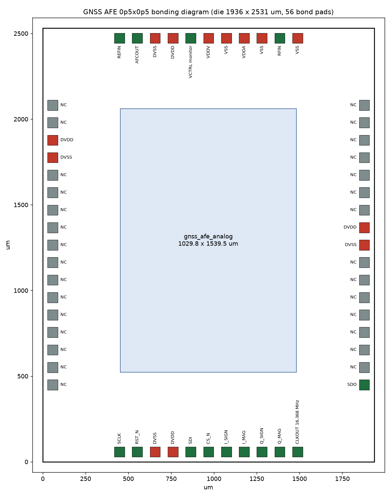

# GNSS Analog Front End (GPS L1 C/A + Galileo E1) — GF180MCU Design Proposal rev.3

Target: Wafer.Space shuttle (GlobalFoundries GF180MCU, `gf180mcuD`, 3.3 V devices)
Application: GNSS receiver on orbital launch vehicles (Falcon 9 / H-IIA / H3 class)
Reference: MAX2769 equivalent (with an on-chip inductorless noise-cancelling LNA). The chip uses the wafer.space quarter slot (slot 0p5x0p5, section 3.15). The GLONASS version (rev.1) is kept in `doc/report_rev1_glonass.md` (English: `doc/report_rev1_glonass_EN.md`)
Japanese original: `doc/report.md` (same content as this document)

Changes in rev.2 (reflecting the answers received):

| Item | rev.1 | rev.2 |
|---|---|---|
| Constellations | GPS + Galileo + GLONASS | **GPS L1 C/A + Galileo E1** |
| ADC / output | I/Q 2 bit × 98.208 MS/s (392.8 Mbit/s) | **I/Q 2 bit × 16.368 MS/s (65.5 Mbit/s, 1/6)** |
| IF bandwidth | 0.67–37 MHz | **0.82–7.1 MHz** |
| External LNA | ≥ 25 dB assumed | **20 dB** → mixer gm doubled, IF gain +32 dB |
| Control | 16 parallel lines | **SPI (24 bit, 3-wire write + SDO readback) + power-on reset** |
| Pin count | 28 | **15** |
| Supply / temperature | — | **3.3 V ±5 % / −20…+85 °C** |
| **rev.3** | Direct mixer input (100 Ω differential) | **On-chip inductorless noise-cancelling LNA, single-ended 50 Ω RF input (1 pin, no external balun)**. System NF 2.45 → **1.61 dB**, pin count **14** |

Unless stated otherwise, the numbers in this document are ngspice-47 simulations of netlists generated from the xschem schematics,
with the official GF180MCU models (typical, 27 °C). Values marked "estimate" come from analytic formulas, not from transistor simulation.

---

## 1. Architecture

```
 active antenna/LNA 20 dB + SAW
            |
 RFIN -------> [lna_nc] --> [mixer_iq] --I--> [VGA1]-[SK]-[VGA2]-[SK]-[VGA3]-[VGA4..7 fixed] --> [adc2b] --> I_SIGN, I_MAG
 (50 ohm SE)   (NC balun)        ^        --Q--> (same if_chain)                                 --> [adc2b] --> Q_SIGN, Q_MAG
                    | LO 0/90/180/270                                                      ^ 16.368 MHz
 REFIN 16.368 --> [refbuf]->[PFD]-[CP]-[LF]-VCTRL->[vco_ring4 1571.328 MHz]->[divbuf]->[/96 TSPC]--FB/FS--> CLKOUT
 SCLK/SDI/CS_N -> [spi_regs + POR] -> VCO band, IF gain, AFC code -> [afc_dac] -> AFCOUT (VCTCXO Vc)
```

| Item | Description |
|---|---|
| LO | On-chip ring VCO + integer-N PLL (16.368 MHz TCXO, N = 96 fixed) → 1571.328 MHz |
| IF | +4.092 MHz for both GPS and Galileo (complex low IF, same as the MAX2769) |
| Sampling | fs = fLO/96 = **16.368 MHz** (the PLL comparison clock is used directly) |
| Output format | I/Q sign/magnitude 2 bit each + CLKOUT 16.368 MHz (LVCMOS 3.3 V) — same rate as the MAX2769 I/Q 2-bit mode |

Why a ring VCO (unchanged from rev.1): an LC-VCO with external inductors or bond wires gets FM on the LO because launch vibration modulates L.
A ring VCO + a PLL with 1.1 MHz bandwidth gives sufficient phase noise (1.2° rms integrated), so there is no reason to add external parts and vibration risk.

---

## 2. Pinout (16 pins)

| # | Pin | Dir | Description |
|---|---|---|---|
| 1 | RFIN | in | RF input (single-ended 50 Ω). Biased internally at about 1.0 V, so **external AC coupling (e.g. 10 pF) is required**. A GND pad next to it is recommended |
| 3 | REFIN | in | 16.368 MHz TCXO/VCTCXO (clipped sine, AC coupled) |
| 4 | SCLK | in | SPI clock (mode 0) |
| 5 | SDI | in | SPI data (MSB first) |
| 6 | CS_N | in | SPI chip select (internal 100 kΩ pull-up) |
| 17 | SDO | out | SPI readback data (added 2026-11-14, chip pad `bidir[5]`). High impedance while CS_N = high (held low by the pull-down in the pad). It exists only in the digital part (`chip_core.sv`), not in the analog part `gnss_afe_top` |
| 7–10 | I_SIGN, I_MAG, Q_SIGN, Q_MAG | out | 2-bit I/Q data (sign + magnitude). **At the chip pads the signal is at +fIF (+4.092 MHz) of I + jQ** (Q_SIGN is inverted in the chip's `chip_core`, see below) |
| 11 | CLKOUT | out | 16.368 MHz sample clock |
| 12 | AFCOUT | out | AFC DAC output (to the VCTCXO Vc) |
| 13 | VCTRL | out | Monitor of the PLL control voltage (test / lock monitor). Since 2026-11-13 it goes through a buffer (`vmon_buf`) + 10 kΩ, so a load on the pin does not affect the PLL (section 3.15 (9)) |
| 14, 15 | VDD, VSS | — | 3.3 V ±5 % |
| 16 | VDDV | — | Dedicated VCO supply (external low-noise LDO, section 3.13 (7)). The pin number is the 15th pin of the analog part `gnss_afe_top` |
| 18 | RST_N | in | Reset of the digital part (active low, chip pad `rst_n`; not present on the analog `gnss_afe_top`). **No pull-up or pull-down: the board must hold it low at power-up and release it after the supply is stable** (section 3.16 (6)) |

**I/Q sign (decided 2026-11-09)**: at the outputs of the analog part (`gnss_afe_top` / macro), Q leads I by 90° (set by the order of the VCO phases; +89.5 to +90.8° at every corner).
RF (1575.42 MHz) is above the LO (1571.328 MHz), so in the macro's I + jQ the signal appears at −4.092 MHz (inverted spectrum).
The chip inverts Q_SIGN in `chip_core.sv` before the pad, so **I + jQ at the pads is not inverted (+4.092 MHz, Doppler sign unchanged)**.
With sign + magnitude 2-bit data, inverting the sign bit is the same as −Q (MAG unchanged). The schematic testbenches (`tb_full` etc.) look at the macro outputs, i.e. before the inversion.

For a real chip, separate supplies for RF / VCO / IF / digital and I/O are recommended (4 pairs add 6 pins, 21 in total).

### SPI register (24 bit, `spi_regs`) — 16 → 24 bit on 2026-11-04 (ICP2 added), BWW / BWN added on 2026-11-13, readback (SDO) added on 2026-11-14
- Mode 0 (SCLK idles low, data captured on the rising edge), MSB first; send 24 clocks (3 bytes) while CS_N = low; **all bits take effect together on the rising edge of CS_N**.

| bit | 23…19 | 18 | 17 | 16 | 15…8 | 7 | 6 | 5 | 4 | 3 | 2 | 1 | 0 |
|---|---|---|---|---|---|---|---|---|---|---|---|---|---|
| Name | Reserved (write 0) | BWN | BWW | ICP2 | AFC[7:0] XOR 0x80 | B1 | B0 | IG3B | IG3A | IG2B | IG2A | IG1B | IG1A |

- The AFC field is signed (0x00 = DAC mid-scale, 0x7F = maximum, 0x80 = minimum).
- BWW / BWN trim the bandwidth of the IF filter (two Sallen-Key stages) (section 3.15 (9)). BWW = 1 makes C2 0.64 times and widens the band (for slow chips). BWN = 1 makes C2 1.6 times and narrows the band (for fast chips). Both 0 is the standard setting.
  The pins of the analog macro are BWK (= inverted BWW) and BWN; the inversion is done on the digital side (a standard cell in `chip_core.sv`, `inv_dig` in `gnss_afe_top`).
- ICP2 = 1 doubles the charge-pump current (section 3.6). The reserved bits exist only in the shift stages and have no output latches.
- After reset all bits are 0 → VCO band 00, minimum IF gain, AFC mid-scale, Icp × 1. **The chip is reset only by the pad RST_N; it has no power-on reset** (the RC reset, 200 kΩ × 10 pF, exists only in the schematic `spi_regs` and is not on the chip; section 3.16 (6)).
- **Readback (added 2026-11-14, in the chip's `chip_core.sv`, section 3.15 (10))**: While CS_N = low, SDO sends 24 bits, MSB first. The content is `{ID = 10101, bits 18…0 of the control word}`, and the control word is **the value in use now (the one written by the previous frame)**.
  - It is read in the same frame as a write. The value sent in this frame can be read in the next frame. There is no read-only command, so to keep the value unchanged, write the same value again.
  - SDO changes on the falling edge of SCLK (the first bit appears on the falling edge of CS_N). The master samples on the rising edge of SCLK (mode 0).
  - The upper 5 bits, ID (10101), are fixed and distinguish a working link from an open or shorted wire (all 0, all 1). Right after reset the readback is 0xA88000.
  - From the 25th clock on, SDO sends 0. While CS_N = high, SDO is high impedance (held low by the pad pull-down).
  - **Use readback at SCLK 5 MHz or below.** Writing is as before (timing constraint 25 MHz). The delay from the SCLK falling edge to the SDO pad is 14.9 ns at the worst timing-analysis corner (SS, 125 °C, 4.5 V), but the standard-cell libraries are for 4.5–5.5 V, and this chip runs at 3.3 V, where the delay is larger. The delay at 3.3 V was obtained by transistor-level simulation; the worst value is 24.1 ns (SS, 125 °C, 3.0 V, 30 pF load; section 3.15 (10)). That leaves 76 ns of the 100 ns half period at 5 MHz.
  - Readback is not in the `spi_regs` of the analog macro (transistor level) and is outside the scope of `tb_spi`. It was checked with cocotb (`chip/cocotb/gnss_spi_tb.py`) at RTL and gate level.
- Verified in `tb_spi`: POR release at 1.8 µs, all 19 outputs at their expected values after POR, writing 0x853A96 (reserved bit 23 = 1, BWN = 1, ICP2 = 1) at 10 MHz SCLK gives all 19 outputs correct.

---

## 3. Block design and simulation results

### 3.0 Noise-cancelling LNA (`lna_nc`, `tb_lna`, `tb_rx`) — added in rev.3
A CG-CS balun type without inductors.
- M1 (common gate) matches the input to 50 Ω (gm1 + gmb1 + 1/RS).
- The channel noise of M1 appears with the same sign at the input node and at the M1 output, so after inversion by M2 (common source) it cancels in the differential output (cancellation condition gm2·R2 = R1/Rs).
- M1 and M2 are biased by scaled replicas + PB mirror currents; the gate of M2 is AC coupled.
- The outputs are AC coupled to the mixer with 4 pF. The mixer input no longer has a 50 Ω termination; it has 5 kΩ bias resistors instead.

| Item (1.575 GHz, load = real mixer) | Result |
|---|---|
| Input impedance / S11 | 46.4 − j16 Ω / −15.3 dB |
| Differential voltage gain | 14.4 dB |
| Output balance | amplitude 0.38 dB, phase 167° (13° off 180°) |
| **NF (`.noise` analysis)** | **1.46 dB** |
| Supply current | 16 mA (M1 3.2 mA, M2 12.6 mA, replicas 0.55 mA) |
| RF input → IF (LNA + mixer, tran, ideal LO 0–2 V) | **Conversion gain 28.7 dB**, I/Q difference 0.15 dB / 88.0° |

The table shows the values of 2026-11-03, after the mixer LO was AC coupled (section 3.10). `tb_lna` holds the LO at DC, so
after AC coupling all I/Q switches sit half on at the 1.6 V bias (before, one side was on). That changed S11, gain and NF slightly
(before: 43.9 − j18 Ω / 13.7 dB / 1.34 dB, `tb_rx` 27.85 dB, I/Q 0.025 dB / 89.78°, linear up to 3 mV input).

### 3.1 Mixer (`mixer_iq`)
In rev.3 the LNA provides gain in front, so the Gm stage is back at the rev.1 size (80u, tail 2 mA per mixer, load 1.3 kΩ ∥ 4 pF), halving the load capacitance seen by the LNA.
The table below holds the rev.2 values (Gm doubled, direct mixer input). For the overall values from the rev.3 RF input see section 3.0.
From 2026-11-03 the LO was AC coupled with 2 pF and each switch gate was biased at 1.6 V through 20 kΩ (VDD divider decoupled with 50 pF) (section 3.10).
**The current version (since 2026-11-09) is a sub-harmonic mixer** (section 3.15). The LO has 8 phases at fLO/2 = 785.664 MHz, the upper switches are biased at 1.8 V and the lower switch pairs at 1.2 V. The table in this section and the 1.6 V figures are the values of the Gilbert mixer of that time.

| Item | Result |
|---|---|
| gm (one side) | 14.7 mS (rev.1: 7.4 mS) |
| Input impedance | 102 − j34 Ω (S11 = −15.7 dB). An external series L ≈ 3.4 nH improves it |
| Conversion gain | **14.2 dB** |
| I/Q amplitude difference / phase (ideal LO) | 0.04 dB / 90.00° |
| Compression | 0.3 dB at −9.5 dBm input |
| NF (estimate) | ≈ 13.5 dB (rev.1: 16 dB) |

### 3.2 IF chain (`if_chain`: variable VGA × 3 + fixed gain × 2 + Sallen-Key × 2; originally VGA × 7)
- The SK LPF is a 4th-order Butterworth with f0 = 7.5 MHz; the capacitors were numerically optimized (`scripts/tune_sk.py`). The MIM side lengths are 25–107 µm.
- There are 3 fixed-gain stages (VGA4–6). rev.2 had 4; rev.3 drops one to account for the LNA gain.
- Every stage is AC coupled (HPF), so DC offset and 1/f noise are removed by construction.

| Gain code (G1=G2=G3) | 4.092 MHz | 6.6 MHz (Galileo upper edge) | 11.25 MHz (source of GPS-band aliasing) | 16.368 MHz | −3 dB bandwidth |
|---|---|---|---|---|---|
| 00 | 41.4 dB | 39.3 dB | 27.9 dB | 15.1 dB | 0.77 – 6.97 MHz |
| 01 | 51.9 dB | 49.9 dB | 38.7 dB | 25.9 dB | 0.77 – 7.03 MHz |
| 10 | 63.4 dB | 61.4 dB | 50.6 dB | 37.9 dB | 0.77 – 7.13 MHz |
| 11 | 66.4 dB | 64.5 dB | 53.8 dB | 41.2 dB | 0.77 – 7.16 MHz |

(After the bias change of 2026-11-04, TT 27 °C 3.3 V. Before the change 40.8 / 51.1 / 62.5 / 65.5 dB.)

- **Bias (changed 2026-11-04, `bias_if`)**: the VGA tail currents and the SK follower current sources were switched from the constant-gm bias (NB/PB) to a dedicated proportional bias.
  The reference current is Iref = (0.288 VDD) / RREF. RREF is 9 units in series of the same unit resistor as the VGA load (poly 1 µm × 2 µm, including end resistance); a PMOS-input OTA + NMOS does the V-I conversion.
  The tail current is 20 × Iref (about 1.05 mA), so I·RL = 0.64 VDD stays constant over process and temperature, and the VGA output operating point is fixed at 0.363 VDD (1.20 V at TT).
  With the constant-gm bias the output dropped to 0.53 V at SS 85 °C 3.135 V and the gain was 35 dB short (section 3.11), and the SK follower current sources rose to 2.2 mA at FF 85 °C and entered the linear region.
- **Gain at 18 PVT points (TT/SS/FF × −20/27/85 °C × 3.135/3.465 V) (code 01, 4 MHz)**: **47.7–54.3 dB** (before the change 16.4 dB at SS 85 °C). VGA output operating point 1.12–1.27 V.

  | | −20 °C | 27 °C | 85 °C |
  |---|---|---|---|
  | TT (3.135 / 3.465 V) | 53.4 / 53.9 | 51.6 / 52.1 | 49.4 / 49.9 |
  | SS | 53.8 / 54.3 | 52.2 / 52.6 | 50.3 / 50.6 |
  | FF | 52.3 / 52.7 | 50.3 / 50.6 | 47.7 / 48.1 |

  The remaining spread is mainly the temperature drop of gm (about −4 dB from −20 to 85 °C), which the AGC (64 settings, about 3.5 dB steps) absorbs.
  The upper −3 dB edge is SS 5.1–5.6 MHz, TT 6.7–7.3 MHz, FF 9.0–9.8 MHz (process spread of the SK R and C, unrelated to the bias change).
  At SS the upper edge of the Galileo E1 band (6.6 MHz) falls beyond −3 dB. A trim of the SK capacitors (BWW / BWN over SPI) was added on 2026-11-13 (section 3.15 (9)).

- Each stage has its own 2 bits, 64 settings (≈ 3.5 dB steps).
- Input-referred noise: 7.9 nV/√Hz (maximum gain) – 30 nV/√Hz (minimum gain).
- C/N0 degradation from aliased noise (increase of noise PSD after sampling, `scripts/gnss_sysim.py`): **GPS band 0.14 dB / Galileo band 0.23 dB**.

### 3.3 Link budget and AGC (LNA 20 dB, NF 1.5 dB, SAW 2 dB)

| Item | Value |
|---|---|
| Chip NF (LNA 1.46 dB [sim] + mixer 16 dB [estimate] / LNA gain 14.4 dB) | 4.5 dB |
| System NF | **1.60 dB** (+0.10 dB over the 1.5 dB of the external LNA alone; rev.2 2.45 dB) |
| Chip NF recalculated (2026-11-13, with folding of the LO harmonics, complex I/Q, `scripts/review/mixer_nf.py`, section 3.15 (9)) | 5.62 dB (TT) / 7.25 dB (SS) / 4.40 dB (FF) |
| System NF with the recalculated value | **about 1.65 dB** (TT) / 1.72 dB (SS) |
| Noise σ at the ADC input: code 00 / 01 / 10 / 11 (chip conversion gain 28.5 dB, section 3.10, after the IF bias change of 11-04) | 0.049 / **0.165** / 0.62 / 0.88 V |
| ADC threshold (2-bit optimum ≈ 1σ) | 0.157 V |

Nominally the optimum lies almost exactly on code 01 (−0.4 dB from 01). The AGC margin is +15.0 dB towards more gain and −10.1 dB towards less (before the change σ 0.152 V, +14.2 / −10.7 dB).
(In the version before the AC-coupled LO, with a chip conversion gain of 25.4 dB, σ = 0.032 / 0.106 / 0.40 / 0.56 V and the margins were +11.1 / −13.8 dB.)

### 3.3.1 IF + ADC + SPI end-to-end simulation (`tb_ifadc`, ngspice, 80 µs, `doc/ifadc.png`)
White noise equivalent to the mixer output (0.41 mV rms in band) and a tone 10 dB below the noise (4.13 MHz = IF + 38 kHz Doppler) are applied,
and the 2-bit outputs are evaluated while the gain is rewritten over SPI (2026-11-04, after the IF bias change, 24-bit SPI).
The input level was re-aligned with the rev.3 link budget (3 fixed stages). The earlier table still used the rev.2 input (4 fixed stages) of 0.126 mV rms, which gives a 10 dB lower output with the rev.3 circuit.

| Interval | IF output noise rms | MAG=1 ratio | Tone detection |
|---|---|---|---|
| SPI: G1=G2=G3=01 | 0.169 V (link budget prediction 0.165 V) | **32.5 %** (theory for a 1σ threshold 31.7 %) | 4.2 × the noise floor |
| SPI: G1=G2=G3=00 | 0.050 V (prediction 0.049 V) | 0 % | 3.9 × the noise floor |

→ The AGC adjusts the gain over SPI with "MAG=1 ratio ≈ 1/3" as the target.

### 3.4 2-bit ADC (`adc2b`, 16.368 MS/s)
| Item | Result |
|---|---|
| SIGN threshold | +0.8 mV |
| MAG thresholds | −155.6 / +162.1 mV (design ±157 mV, version with ladder center 1.20 V of 2026-11-04; the old 1.05 V version gave −155.6 / +157.3 mV) |
| Supply current | 0.51 mA |

### 3.5 VCO (`vco_ring4`) — start-up circuit added and B1 current doubled on 2026-11-03
A 4-stage pseudo-differential ring (current fed through VR). Two changes on 2026-11-03 (background in section 3.10):
- A start-up circuit against the common-mode latch was added.
  - p2 = n2 is detected from the stage-2 dummy buffer outputs (dD0/dD1); an RC (about 5 ns) ignores momentary equality.
  - When detected, one stuck node is pulled down by an 8u NMOS (n1 if p1 = n1 = H, n2 if p2 = n2 = H).
  - The kick is removed as soon as the detection clears. The kick cell `vco_cellk` (same-size dummy NMOS on the OP side) is used only in stages 1 and 2.
    Heavy and light stages pair up as d2 + d3 = d1 + d4, so the quadrature is preserved.
- The current branch of band B1 went from m = 4 to 8 (to secure frequency margin at SS; no effect on TT/FF with B=00).

| Corner (VCO + 60 fF + `divbuf` × 4) | Band / VCTRL at 1571 MHz | Maximum frequency | I/Q phase error | Closed-loop lock point |
|---|---|---|---|---|
| TT 27 °C 3.3 V | B=00 / 2.18 V | 1892 MHz (3 V) | 0.3–0.45° | 2.179 V (about 3 µs) |
| FF −20 °C 3.465 V (MOS/resistor/MIM ff) | B=00 / 1.39 V | 2052 MHz (2 V) | 0.4–0.55° | 1.327 V (about 1.5 µs) |
| SS 85 °C 3.135 V (MOS/resistor/MIM ss) | B=11 / 2.40 V | 1610 MHz (3 V, +2.5 %) | 0.3° | 2.417 V (about 7 µs, Icp doubled, section 3.6) |

- Starting from the latched state (both hi and lo), the ring returns to oscillation at all corners above and over the whole VCTRL range. While oscillating, the start-up circuit does not act.
- At SS, from about VCTRL 2.4 V upwards, VR saturates near the supply (about 2.9 V) and the VCO gain drops to about 120 MHz/V (about 480 MHz/V at TT).
- Phase noise (2026-11-03, recomputed with the start-up circuit): TT −108.1 dBc/Hz @ 1 MHz (same as −108.0 of rev.1), SS −109.7 dBc/Hz @ 1 MHz.
  The ngspice transient does not handle device noise, so a white noise current (`trnoise`) equivalent to 4kT·γ·Σgm at the switching point (γ = 1, 1.92 mS at TT) was injected into each of the 8 ring nodes,
  and L = f0³σ_T²/Δf² was computed from the period jitter over 1 µs (about 1570 periods) (TT 62.9 fs, SS 52.8 fs, numerical floor without noise 0.2 fs). The noise of the VR regulator is not included.
  (For comparison a ring without the kick was also run; it did not leave the initial latch and did not oscillate.)
- The rev.1 table (LO load 60 fF only, no start-up circuit) had TT 1.94 V, FF −40 °C 3.6 V 1.17 V, SS (MOS ss only) B=11 2.38 V.

### 3.6 PLL / dividers
- Divider /96 (TSPC): FB = FS = **16.368 MHz** at both TT and SS/85 °C/3.135 V, 0.6 mA.
  The /3 stage is driven from a lightly loaded node, and the ADC clock branches off FB through a dedicated buffer.
- PFD/CP 4.2 µA/ns (effective Icp 250 µA), no dead zone. Loop fc 1.07–1.24 MHz, phase margin 58–59° (values with the rev.1 VCO gain; current values in the corner evaluation below).
- Phase noise: 1.15° rms integrated (1 kHz–50 MHz) → correlation loss 0.002 dB.
- Closed-loop transistor-level transient (`tb_pll`: bias + VCO + whole PLL + ADC clock load, VCTRL initial value 1.7 V, `doc/pll_lock.png`):
  - **Locks in about 2 µs** (within 7 mV of the final value at 1.5 µs). Steady-state VCTRL = 1.935 V (agrees with 1.94 V of tb_vco).
  - Steady-state REF–FB phase difference −0.28 ns (offset from CP mismatch; with the current-steering CP of 2026-11-08 it is −0.005 to −0.017 ns, section 3.12 (8)(9)). Since the phase is locked, LO = 96 × 16.368 MHz = 1571.328 MHz.
    (The frequency computed from a window of 30 FS periods was 1572.5 MHz, because the window included part of the settling.)
  - Reference spur from the VCTRL ripple: −47.7 dBc @ ±16.368 MHz (2nd −52.3 dBc).
- Closed loop at the corners (2026-11-03, after adding the start-up circuit, from VCTRL 0 V): TT locks at 2.179 V in about 3 µs, FF at 1.327 V in about 1.5 µs.
  At SS the phase error accumulates to almost one period during pull-in, and VCTRL overshoots to 2.85 V (1604 MHz) before coming back.
  It then swings down to 2.32 V (6.5 µs), settles with a damped oscillation and **locks in about 10 µs** (10 µs transient: VCTRL 2.427 V, within ±5 mV after 9.83 µs, REF–FB phase difference converging to 0.25 ns).
- **Icp can be doubled (implemented 2026-11-03, changed on 11-04 to independent control by the SPI ICP2 bit).** `cp` has a second set of the same current sources behind static switches (MPE2 / MNE2), with HI connected to the SPI ICP2 bit.
  At first HI = B0·B1 (tied to B=11), but choosing B=11 at cold SS gives a VCO gain of 480–640 MHz/V, and doubling Icp then gives fc of about 2 MHz and 45–55° phase margin, so the two were separated (section 3.11).
  The firmware sets ICP2 = 1 when the lock VCTRL after band selection exceeds about 2.35 V (where the VCO gain drops). In practice this means SS chips near 85 °C (B=11, 2.4–2.5 V).
  Closed-loop check after separating ICP2 (11-04, from VCTRL 0 V): SS (ICP2 = 1) 2.4170 V, TT (ICP2 = 0) 2.1795 V, within 0.1 mV of the tied version.
  At TT with ICP2 = 1 it still locks at 2.1792 V in 2.3 µs (3.1 µs with ICP2 = 0). A wrong setting does not break the loop.
  The reason ICP2 is needed: at SS 85 °C 3.135 V the VCO gain drops to about 120 MHz/V (about 1/4 of TT), the bandwidth approaches the loop filter zero (1/2πRC1 = 257 kHz) and the phase margin drops.
  Effective Icp measured as in `tb_pfdcp` (VCTRL held at the lock point, phase difference ±1 ns):

  | Corner (VCTRL) | Normal (HI = 0) | HI = 1 | Ratio |
  |---|---|---|---|
  | TT (2.18 V) | 238 µA (3.90 µA/ns) | 548 µA | 2.30 |
  | SS (2.43 V) | 233 µA (3.81 µA/ns) | 479 µA | 2.06 |
  | FF (1.33 V) | 241 µA (3.95 µA/ns) | 568 µA | 2.35 |

- Corner evaluation of loop bandwidth and phase margin (effective Icp above, VCO gain at the lock point from the sweep in section 3.5; in parentheses R ±15 %, C ±10 %):

  | Corner | VCO gain | Icp | fc | Phase margin | Closed-loop peaking | Integrated phase noise (1 kHz–50 MHz) |
  |---|---|---|---|---|---|---|
  | TT (B=00) | 477 MHz/V | 238 µA | 0.91 MHz | 59° (57–59°) | 1.8 dB | 1.14° rms |
  | FF (B=00) | 855 MHz/V | 241 µA | 1.52 MHz | 56° (52–59°) | 1.3 dB | 1.24° rms |
  | SS (B=11, Icp doubled) | 120 MHz/V (89–155 around 2.4 V) | 479 µA | 0.51 MHz | **55° (49–58°)** | 2.7 dB | 1.22° rms (1.31° with 89 MHz/V) |
  | (reference) SS, no Icp switch | 120 MHz/V | 233 µA | 0.29 MHz | 44° (37–50°) | 4.2 dB | 1.52° rms |

- Closed-loop transient (after implementing the Icp switch, from VCTRL 0 V): SS locks at 2.417 V in 7 µs (±3 mV after 6.5 µs, REF–FB phase difference constant at 0.41–0.47 ns; about 10 µs without the switch).
  In the early pull-in the frequency is tracked near the VCO upper limit (about 2.9 V, low gain), so the overshoot (up to 2.99 V) remains.
  TT 2.1795 V and FF 1.3266 V; both B=00 corners are the same as before the switch (2.179 / 1.327 V). Correlation loss is ≤ 0.003 dB at every corner.
  (The integrated phase noise comes from the `pll_design.py` model with the free-running ring at a conservative estimate of −104.2 dBc/Hz @ 1 MHz.)

### 3.7 AFC DAC (`afc_dac`)
8-bit R-2R, 0–2.98 V into a 100 kΩ load, 1 LSB = 11.7 mV, DNL 0.69 LSB, INL 0.35 LSB.

On 2026-11-13 the resistors were changed from W 1 µm × L 10 / 20 µm to W 2 µm × L 20.1 / 40 µm (4× the area). The systematic DNL is −0.01 / +0.01 LSB in the schematic and −0.01 / +0.33 LSB in PEX (INL −0.13 / +0.20 LSB, monotonic). The DNL at 127 → 128 from mismatch (AR 2 %·µm) has σ 0.35 LSB, and the probability of being monotonic is 99.8 % (section 3.15 (9)).

### 3.8 Supply current (sum of block-level simulation values)
| Block | Current |
|---|---|
| VCO + LO buffers | 3.7 mA |
| LNA | 16 mA |
| Mixer I/Q | 4.0 mA |
| IF chain × 2 (3 variable VGA stages + 2 fixed-gain stages + 2 SK stages; 6 VGA stages at that time) | 32 mA |
| ADC × 2 | 1.0 mA |
| Divider / CP / reference buffer / CLKOUT / bias / DAC / SPI | 1.6 mA |
| Dummy `divbuf` × 3 for LO symmetry (section 3.9) | 1.3 mA |
| **Total** | **≈ 59 mA (≈ 196 mW @ 3.3 V)** |

Measured in `tb_full` (TT, no noise): 59.6 mA after introducing `bias_if` (11-04) (61.2 mA before; 60.7 mA before the AC coupling and the VCO start-up circuit). At SS 85 °C 3.135 V: 55.7 mA (64.0 mA before).

### 3.9 Whole-chip transient simulation (`tb_full`)

The whole `gnss_afe_top` was simulated in transient from power-up (VDD fixed at 3.3 V + `uic`, POR from its RC charging) to 12 µs.
Inputs: 16.368 MHz reference, SPI write (gain code 01 set at 2.5–4.2 µs) and RF.
The RF is white noise equivalent to the output of the external LNA + SAW (−154 dBm/Hz) plus a −95 dBm CW tone (1575.42 MHz).
It ran to completion in both ngspice-47 and Xyce 7.9. Xyce does not support trnoise, so Gaussian random values with the same rms at 49.7 ps spacing are applied as a PWL (the random seed differs from ngspice).

| Item | ngspice (SPARSE) | Xyce | Expected / remarks |
|---|---|---|---|
| Run time (12 µs) | 5 h 12 min | 8 h 24 min | 1 core |
| PLL lock (VCTRL) | 2.03 V (1 µs) → 1.948 V (constant after 3 µs) | 2.13 V → 2.003 V | The 55 mV difference between the two is due to the model implementations |
| CLKOUT | 16.36799 MHz | 16.36801 MHz | 16.368 MHz |
| Supply current | 59.4 mA | 59.5 mA | Block sum 58 mA (section 3.8, before adding the dummies) |
| ADC MAG=1 ratio (I / Q, 130 samples) | 0.146 / 0.262 | 0.123 / 0.138 | Gaussian expectation from the IF rms: 0.21 / 0.28 (ngspice), 0.17 / 0.18 (Xyce) |
| ADC SIGN mean (I / Q) | −0.015 / −0.046 | +0.015 / −0.031 | 0 (the "SIGN stuck at 0" seen in rev.2 is gone) |
| 16.368 MHz harmonics at the IF output (orders 1–16) | 0.3–2.1 mV | 0.3–1.8 mV | Same on I and Q. About 1 % of the 157 mV MAG threshold |

- **The IF output rms was 115–146 mV and the MAG=1 ratio 0.12–0.26.** Relative to the AGC target (1/3), the AGC would step the gain up by one step (+3.5 dB).
  This is consistent with the nominal analysis (section 3.3 puts the optimum near code 01).
- The table above and the next one are results of the circuit before the dummy `divbuf`s were added. The results after adding them are at the end of this section.
- **For the I/Q check, a separate 5 µs run without noise was made.** In the 8 µs window with noise, the −95 dBm tone is about as large as the noise floor (125 kHz bandwidth, about 22 mV at the IF), so the I/Q amplitude ratio and phase cannot be judged.

| No noise, 5 µs | ngspice | Xyce |
|---|---|---|
| LO (after lock) differential amplitude I / Q, Q−I | 2.12 / 2.26 V, −90.3° | 1.97 / 2.10 V, −91.1° |
| LO duty cycle | 0.491–0.498 | 0.483–0.490 |
| Mixer output (4.4–4.9 µs) I / Q, Q−I | 0.111 / 0.117 mV (+0.47 dB), 87.2° | 0.093 / 0.099 mV (+0.53 dB), 90.3° |
| IF output (3.0–4.0 µs, gain 00 after POR) Q/I, Q−I | +1.9 dB, 86.3° | +3.6 dB, 83.3° |
| IF output (from 4.71 µs, gain 01) I / Q, Q−I | 45.8 / 43.4 mV, 82.0° | 37.4 / 34.5 mV, 83.0° |

- The conversion gain at the mixer output was 24.4–25.9 dB for the −95 dBm input (5.6 µV peak when matched), 2–3 dB below the 27.85 dB of the block test (`tb_rx`, section 3.0).
  The cause was isolated (LNA + mixer, ARF = 100 µV, ngspice, the `tb_rx` conditions moved towards the chip one at a time):

  | Condition | fLO | LO fundamental, differential (I / Q) | Conversion gain I / Q | Q−I |
  |---|---|---|---|---|
  | Ideal LO (0–2.0 V square, 40 ps edges) = `tb_rx` | 1571.33 MHz | 2.53 / 2.53 V | 28.62 / 28.62 dB | 90.0° |
  | + load of the two IF chains (shared / separate bias) | same | same | 28.62 / 28.52 dB (difference ≤ 0.1 dB) | 89.8–90.0° |
  | LO from the real VCO (VCTRL fixed at 1.948 V, band 00) | 1580.14 MHz | 2.27 / 2.27 V | 26.49 / 26.48 dB | 89.6° |
  | Real VCO + PLL (`divbuf` loads only LOIP) | 1571.22 MHz | **2.12 / 2.26 V** | **26.14 / 26.51 dB** | 87.7° |

  - With the current PDK, `tb_rx` itself gives 28.62 dB (the 27.85 dB of section 3.0 is from the old environment).
  - **The main cause (−2.1 dB) is the LO waveform.** The LO buffers of the ring VCO are fed from VR (about 2 V); the edges are slow and the fundamental is only 90 % of an ideal square wave. The ideal LO of `tb_rx` was optimistic.
  - **The rest (−0.35 dB on the I side) is the unbalanced loading: the divider input `divbuf` is connected only to LOIP.** Only the LO I amplitude drops by 0.6 dB, giving an I/Q amplitude difference of +0.4–0.5 dB and a quadrature error of 2–3°.
    The VCO frequency also drops by 9 MHz (the VCTRL lock point rises).
  - The IF chain load and the shared bias were unrelated.
  - System impact: with the 20 dB external LNA, the NF impact is small. The 2–3 dB of missing IF gain is within the AGC margin (+13.5 dB relative to the ideal LO).
- **Fix: identical `divbuf`s were added as dummies on LOIN / LOQP / LOQN** (`top()` in `gen_cells.py`, outputs unconnected).
  The four LO phases now see equal loads.

  | Check | Condition | LO differential fundamental I / Q, Q−I | Mixer output I / Q, Q−I | Conversion gain |
  |---|---|---|---|---|
  | Block (LNA + mixer + VCO + PLL) | no dummies | 2.12 / 2.26 V, −90.0° | Q/I +0.37 dB, 87.7° | 26.14 / 26.51 dB |
  | Block (VCTRL 1.995 V, fLO 1570.14 MHz) | with dummies | 1.973 / 1.973 V, −89.8° | Q/I −0.02 dB, 90.1° | 25.57 / 25.55 dB |
  | `tb_full` no noise 5 µs (ngspice, 3.0–4.0 µs) | no dummies | 2.12 / 2.26 V, −90.3° | 0.103 / 0.121 mV (+1.42 dB), 86.3° | — |
  | `tb_full` no noise 5 µs (ngspice, 3.0–4.0 µs) | **with dummies** | **1.971 / 1.976 V, −90.2°** | **0.103 / 0.105 mV (+0.12 dB), 89.5°** | **25.4 dB** (3.5–5 µs average) |

  - In the whole chip too, the I/Q amplitude difference is now ≤ 0.1 dB and the quadrature error ≤ 0.5°. The IF output (3.0–4.0 µs, gain 00) is Q/I +0.06 dB, Q−I 91.5° (without dummies +1.9 dB, 86.3°).
  - The PLL locks at VCTRL 1.998 V (1.948 V without dummies), CLKOUT is 16.368 MHz. Supply current 60.7 mA (+1.35 mA).
  - The price: the LO amplitude drops and the conversion gain is 0.6–1.0 dB lower. The chip conversion gain is 25.4 dB, and `G_RX_DB` in `gnss_sysim.py` was changed to this value. (28.5 dB after the LO was AC coupled on 11-03, section 3.10)
  - The IF transient after the SPI write (below) does not change with or without the dummies.
- **12 µs with noise on the latest circuit (dummy `divbuf` + AC-coupled LO + VCO start-up circuit) (2026-11-03, both completed)**:

  | Item | ngspice (SPARSE) | Xyce | Expected / remarks |
  |---|---|---|---|
  | Run time (12 µs, 1 core) | 7 h 15 min | 10 h 18 min | Longer than last time because other jobs ran in parallel |
  | PLL lock (VCTRL) | 2.488 V (1 µs) → 2.175 V (constant after 3 µs, ±0.5 mV) | 2.579 V → 2.217 V | 2.176 V without noise, 5 µs (ngspice). The 42 mV difference is due to the model implementations (55 mV last time) |
  | CLKOUT / supply current | 16.36800 MHz / 61.16 mA | 16.36799 MHz / 61.38 mA | 61.19 mA without noise, 5 µs |
  | IF output rms (I / Q, gain code 01) | 165 / 144 mV | 167 / 163 mV | Link budget (section 3.3, 28.5 dB) σ = 152 mV. Estimation spread of an 8 µs window about ±12 % |
  | ADC MAG=1 ratio (I / Q, 132 samples) | 0.303 / 0.167 | 0.318 / 0.288 | Gaussian expectation from the IF rms 0.34 / 0.27 (ngspice), 0.35 / 0.34 (Xyce). AGC target 1/3 |
  | ADC SIGN mean (I / Q) | −0.09 / −0.09 | −0.03 / +0.09 | 0 (statistical error of 132 samples ±0.09) |
  | Tone (4–12 µs correlation) mixer I / Q, IF I / Q | 0.116 / 0.088 mV, 49 / 34 mV | 0.31 / 0.12 mV, 109 / 47 mV | About as large as the noise floor, so the I/Q ratio and phase cannot be judged (the random seeds also differ; I/Q was confirmed with 5 µs without noise) |

  - The 3 dB increase in conversion gain raised the IF rms, and the MAG=1 ratio moved closer to the AGC target of 1/3 than before the dummies (0.15 / 0.26). The mean IF rms (ngspice 155 mV, Xyce 165 mV) agrees with the 152 mV predicted by the link budget.
- **During the SPI write (from the clock burst to the CS_N rising edge at 4.2 µs), a common-mode transient of 70–175 mV appears on I and Q of the IF.** The gain switching and coupling from the digital part into the IF are the likely causes.
  About 0.5 µs after the write, Q−I is back at 82–83° and the amplitude settles to the expected value (33–40 mV).
  It is recommended not to use about 1 µs (16 samples) right after an AGC write for correlation.
- ngspice note: with `.option klu` (KLU solver) the run fails with "Timestep too small" within a few ns. KLU reuses an old pivot order on refactor;
  even `pivrel=0.1` fails at 25 ns, while `pivrel=1` completes. `tb_full` uses SPARSE 1.3.
- Analysis: `scripts/full_analyze.py` (summary JSON in `doc/full_ngspice_summary.json` / `doc/full_xyce_summary.json`), `scripts/full_detail.py` (tone correlation, ADC statistics, harmonics).

### 3.10 Corner verification (real-VCO LO + mixer, PLL closed loop, VCO start-up) — 2026-11-02, fixed on 11-03
Conditions: SS = MOS/resistor/MIM all ss, 85 °C, 3.135 V, B=11. FF = all ff, −20 °C, 3.465 V, B=00.
The block is LNA + mixer + real VCO + PLL load + dummy `divbuf`, with VCTRL fixed near the lock point (ngspice).

**(1) Mixer conversion gain: large drop at FF → fixed by AC-coupling the LO (11-03).**

| | Ideal LO (0–2 V square) | Real LO differential fundamental | Gain with real LO | I/Q |
|---|---|---|---|---|
| TT 27 °C 3.3 V | 28.6 dB | 1.97 V | 25.6 dB | 0.0 dB / 90.1° |
| SS | 27.0 dB | 2.62 V | 26.0 dB | 0.1 dB / 90.3° |
| **FF** | 29.5 dB | **1.54 V** | **12.5–13.7 dB** | 0.0 dB / 89.8° |

- Cause: the mixer receives the LO DC coupled, so the LO high level sets the voltage of the node under the switches.
  The LO buffers are fed from VR, and the LO high level moves with VR over the corners. At FF, VR is only 1.6 V, so the Gm stage enters the linear region.

  | | LO high | Node under the switches | Gm stage Vds |
  |---|---|---|---|
  | Ideal LO (TT) | 2.00 V | 0.84 V | 0.47 V |
  | Real LO (TT) | 1.98 V | 0.58 V | 0.24 V |
  | Real LO (SS) | 2.64 V | 0.91 V | 0.66 V |
  | Real LO (FF) | 1.51 V | 0.42 V | **0.06 V** |

  The 3 dB loss against the ideal LO at TT (section 3.9) has the same cause (the "slow edges" explanation in section 3.9 was incomplete).
- **Fix: AC-couple the LO (2 pF) and apply a fixed bias on the mixer side through 20 kΩ.** Conversion gain (I) for each bias, computed with an ideal LO source:

  | LO bias | FF | TT | SS |
  |---|---|---|---|
  | DC coupled (current) | 12.5–13.7 dB | 25.6 dB | 26.0 dB |
  | **1.6 V** | 28.4 dB | 28.4 dB | 25.5 dB |
  | 1.8 V | 28.6 dB | 28.5 dB | 25.0 dB |
  | 2.0 V | 28.8 dB | 28.1 dB | 24.4 dB |
  | 2.3 V | 28.8 dB | 27.2 dB | 23.3 dB |

  With a 1.6 V bias the spread over the corners shrinks from 13 dB to 3 dB, and TT also improves by +2.8 dB.
  At SS the gain drops as the bias rises (the LO amplitude is large and the switches enter the linear region).
  I/Q is within 0.3 dB / 1.5° under all conditions.
- **Implementation (11-03)**: CAC* (MIM 31.6 µm square ≈ 2 pF), RAC* (20 kΩ) and a 1.60 V bias (VDD divider RLA/RLB, CLOB 50 pF) were added to `mixer_iq`.
  Results of block runs with the real VCO (with start-up circuit), VCTRL fixed near 1571 MHz:

  | | fLO | Conversion gain I / Q | Q−I | LO differential fundamental |
  |---|---|---|---|---|
  | TT | 1573.1 MHz | 28.7 / 28.5 dB | 90.6° | 2.05 V |
  | SS | 1566.4 MHz | 25.3 / 25.3 dB | 90.4° | 2.70 V |
  | FF | 1573.0 MHz | 29.4 / 29.4 dB | 92.0° | 1.59 V |

  In `tb_full` (TT, no noise, 5 µs) the mixer output is +3.1 dB over the value before the fix. The chip conversion gain went from 25.4 to **28.5 dB**.
  `tb_rx` with the ideal LO gives 28.7 dB. Other `tb_full` results:
  - Lock at VCTRL 2.176 V (within 5 mV at 3.0 µs), CLKOUT 16.367 MHz
  - LO I/Q 2.039 / 2.054 V, −90.2°
  - Mixer Q/I −0.63 dB, Q−I 90.0° (3.0–3.98 µs)
  - IF Q/I +0.14 dB, 88.0°
  - IDD 61.2 mA
  `G_RX_DB` in `gnss_sysim.py` was updated to 28.5 (section 3.3).

**(2) PLL closed loop (60 fF + `divbuf` × 4 + ADC clock load, 4 µs): locks at both corners (VCO before the start-up circuit).** Results after adding it are in section 3.6.
- FF: VCTRL 1.217 V, ripple 23 mV pp
- SS: VCTRL 2.39 V. Settling about 3 µs, slower than TT (about 2 µs)

**(3) VCO common-mode latch → fixed with the start-up circuit (11-03, section 3.5).**
- In a 4-stage pseudo-differential ring the common-mode component is inverted 4 times, i.e. positive feedback. So there is a stable state where all nodes stick at the same level and the ring does not oscillate.
- In transients from the initial state (p4 = 0 V, n4 = 1 V), the ring enters this state for: SS over the whole VCTRL range (1.8–3.0 V), TT for VCTRL ≥ 2.7 V. FF does not enter it.
  In fact, in a block run at SS with VCTRL fixed at 2.47 V the VCO did not oscillate.
- At power-up VCTRL starts low, and the TT whole-chip simulation also starts up.
  The danger is when oscillation stops for some reason. The PLL then drives VCTRL to its upper limit, where this state is stable, so it may not recover.
- Rough fix: doubling the cross-coupled latches in the ring (MN3/4, MP3/4) removed the sticking even at SS.
  However, the VCO becomes slower and the SS maximum frequency drops to 1425 MHz (short of 1571 MHz), so it would have to come with a redesign of currents and bands.
  Another option is a start-up circuit that detects the common-mode state and pulls one side.
- **Fix (11-03)**: a start-up circuit with common-mode detection + NMOS kick was added (section 3.5). Alternatives tried and rejected along the way:

  | Option | Result |
  |---|---|
  | Latch × 2 | Cannot escape when starting from the latched state. SS max 1425 MHz |
  | Open an NMOS footer to raise the nodes | Slow, through the weakly rising latch; the whole common mode moves to the opposite latched state and back (SS 2.6 V) |
  | 8u kick only on the ON side of every stage | Escapes at every point. The OP/ON load difference gives about 1° of I/Q error |
  | Kick + 8u dummy on every stage | I/Q 0.05°, but SS max 1548 MHz (short of 1571 MHz) |
  | Kick + 4u dummy on every stage | Kick too weak; does not leave the latch at any SS point |
  | **Kick + 8u dummy only on stages 1 and 2 (adopted)** | Escapes at every corner and every hi/lo point, SS max 1610 MHz, I/Q 0.3–0.55° |

### 3.11 Additional checks (2026-11-03 to 04): power-up, PVT coverage of band selection, mismatch MC, supply ripple
The work netlists are outside the repository (scratchpad); everything is ngspice.

**(1) Power-up (VDD 0 → nominal, rise time 1 µs / 10 µs, whole-chip PLL + bias + VCO): locks under all 4 conditions.**

| | Rise | Final VCTRL | Settling (from VDD 90 %, ±5 mV on the reference-period average) | Maximum VCTRL on the way |
|---|---|---|---|---|
| TT 27 °C 3.3 V B=00 | 1 µs | 2.1789 V | 2.6 µs | 2.57 V |
| TT | 10 µs | 2.1789 V | 2.1 µs | 2.66 V |
| SS 85 °C 3.135 V B=11 | 1 µs | 2.4170 V | 5.9 µs | 2.98 V |
| SS | 10 µs | 2.4169 V | 6.1 µs | 3.09 V |

- The bias (nb) and VR follow VDD up; there is no bootstrap failure and no VCO sticking. At SS, B0/B1 are raised together with VDD (instead of the SPI reset value).
- The final values agree with the steady-state runs (section 3.6) within 0.1 mV. VCTRL ripple 14–18 mV pp.

**(2) PVT coverage of band selection (VCO + PLL load, VCTRL 1.0–3.0 V in 0.4 V steps, VCTRL for 1571.3 MHz interpolated).**

| Corner | B=00 | B=01 | B=10 | B=11 |
|---|---|---|---|---|
| TT −20…85 °C, 3.135/3.465 V | **2.05–2.39 V** (K 370–550) | 1.81–2.08 V | 1.44–1.60 V | 1.36–1.51 V |
| FF −20…85 °C | **1.0–1.50 V** (K 580–740) | 1.0–1.29 V | ≈ 1.0 V or below | below 1.0 V |
| SS −20 / 27 °C | out of reach | 2.63–2.95 V | **2.03–2.20 V** (K 340–620) | 1.91–2.08 V (K 550–640) |
| SS 85 °C 3.465 V | out of reach | out of reach | **2.26 V** (K 320) | 2.11 V (K 480) |
| SS 85 °C 3.135 V | out of reach | out of reach | 2.65 V (K 66) | **2.46 V** (K 122) |

K in MHz/V (approximate, from 0.4 V differences). Bold marks the choice "lowest band with VCTRL ≤ about 2.5 V".
- TT and FF fit in B=00 at every temperature and supply. FF in B=00 sits low at VCTRL 1.2–1.5 V.
  At VCTRL 1.0 V some low-band points do not oscillate, but the PLL issues UP when there are no FB edges, so it recovers.
- SS needs B=11 **only around 85 °C and 3.135 V**. There the frequency margin is 1589 MHz (+1.1 %) at VCTRL 2.6 V and 1610 MHz (+2.5 %) at 3.0 V.
- **Problem with doubling Icp tied to B=11 (→ separated into the SPI ICP2 bit on 11-04)**: even at SS, B=11 at low temperature has a Kvco of 480–640 MHz/V, and doubling Icp gives fc 1.7–2.1 MHz and 51–55° phase margin (45–58° with R, C spread, fref/fc ≈ 8).
  It works, but cold SS chips are better off with B=10 (Icp × 1, fc about 1.1 MHz).
  Make the firmware band selection follow the rule "step up one band when VCTRL (the dedicated VCTRL monitor pin in the current version, via AFCOUT at that time) exceeds about 2.5 V".
  Also, an SS chip that selected B=10 when cold reaches VCTRL 2.65 V (K 66 MHz/V) when it warms up to 85 °C, so VCTRL must be monitored during operation and the band reselected.
  In response, Icp doubling is now controlled independently by the SPI ICP2 bit (chapter 2 SPI register, section 3.6).

**(3) Mismatch Monte Carlo (`sw_stat_mismatch=1`, MOS only; the resistors and capacitors have no mismatch model).**

| Item | Runs | Result |
|---|---|---|
| IF output offset (differential, all AGC codes) | 100 | σ 9.1 mV, max 27 mV. Small against the signal σ ≈ 152 mV. Because of the AC coupling only the last VGA stage matters, independent of the gain code |
| ADC SIGN comparator offset | 40 | σ 13.1 mV |
| ADC MAG thresholds | 40 | −157.1 ± 17.4 / +158.0 ± 15.7 mV (ladder resistor mismatch not included) |
| VCO start-up (from H/L stuck initial states) | TT 60 / SS 60 | Oscillates in every run. With the same seed the frequency is the same regardless of the initial state |
| VCO frequency (VCTRL fixed) | TT / SS | σ 7.1 / 2.2 MHz → 15–18 mV of VCTRL, absorbed by the PLL |
| LO I/Q phase error | TT / SS | σ 0.73° / 0.53°, max 1.8° / 1.3° (nominal 0.2–0.3°) |
| LO I vs IB phase error | TT / SS | σ 1.1° / 0.84°, max 2.3° / 1.7° |

- The threshold spread (σ about 16 mV) corresponds to ±10 % of the 157 mV MAG threshold (ratio 1.0 to the signal σ). The effect on the 2-bit quantization loss is below 0.1 dB (the loss is almost flat for threshold ratios 0.9–1.1).
- An I/Q phase error of 2° or less is no problem for GNSS (complex IF without image rejection).

**(4) VCO supply sensitivity and supply ripple → the VCO supply needs an LDO / filter.**
- The frequency sensitivity to VDD with VCTRL fixed (pushing) is TT 157 MHz/V and SS **395 MHz/V** (larger than the SS Kvco of about 120 MHz/V).
  At SS, VR saturates near the supply (2.85 V at 3.135 V) and the PSRR of the VR generator is almost gone.
- Result of the PLL closed loop (TT, a 20 mV peak sine added to the whole-chip VDD, 8 µs), with the LO phase modulation derived from the timing modulation of the FB edges:

  | Ripple | FB timing modulation | LO phase modulation (peak) | Spur | VCTRL variation |
  |---|---|---|---|---|
  | none | 0.7 ps (numerical noise) | 0.007 rad | below −50 dBc | — |
  | 1 MHz 20 mVp | 308 ps | **3.0 rad** | (too large for the narrowband approximation) | 5.3 mV |
  | 5 MHz 20 mVp | 54 ps | 0.54 rad | −11 dBc | 2.0 mV |

  The loop gives no suppression around fc (0.91 MHz), and the result almost matches the open-loop estimate (157 MHz/V × 20 mV / fm).
- The supply ripple allowed for −40 dBc spurs is 0.13 mVp at 1 MHz and 0.75 mVp at 5 MHz at TT. SS is about 8 dB stricter.
  This is not realistic with an external supply alone, so **the supply of the VCO (VR generator) needs an on-chip LDO with ≥ 40 dB PSRR (up to ~10 MHz), or an RC filter + a separate supply pin**. → Addressed on 2026-11-08 with the dedicated VCO supply pin VDDV and an improved VR generator (section 3.13).

**(5) Whole-chip `tb_full` at the SS corner (no noise, 14 µs, SPI 0x00D5 = B=11 and gain code 01, ngspice 8 h 04 min) → the IF chain gain was about 35 dB short (fixed with `bias_if` on 11-04; rerun results at the end of this item).**
- Run with the netlist before ICP2 was separated (B=11 gives HI = 1, equivalent to ICP2 = 1).

| Item | SS result | TT (section 3.9) |
|---|---|---|
| VCTRL | 2.69 (2 µs) → 3.02 (4 µs) → 2.38 (6 µs) → **2.4445 V** (constant after 8 µs) | 2.176 V |
| CLKOUT | 16.3684 MHz | 16.367 MHz |
| IDD | 63.96 mA | 61.2 mA |
| LO I / Q differential fundamental, Q−I | 2.713 / 2.709 V, −90.1° | 2.04 / 2.05 V, −90.2° |
| Mixer output (8–14 µs) | I / Q 0.100 mV, Q/I −0.01 dB, 90.2° → conversion gain about 25.0 dB (block run 25.3 dB) | 28.5 dB |
| **IF output** | I / Q 0.91 / 0.93 mV, +0.21 dB, 90.5° → **IF gain about 19 dB** | about 51 dB (code 01) |
| ADC (99 samples) | no MAG = 1, SIGN mean +0.4 (dominated by offset) | — |

- PLL, LO and mixer are fine at SS too (VCTRL 2.444 V, 27 mV above the 2.417 V of the block run, within the SS range).
- **Corner runs of the IF chain alone (`tb_if`, AC)** (gain in dB @ 4 MHz, −3 dB bandwidth in parentheses):

  | Code | TT 27 °C 3.3 V | **SS 85 °C 3.135 V** | FF −20 °C 3.465 V |
  |---|---|---|---|
  | 00 | 41.1 (0.77–7.0 MHz) | **13.4** (0.61–6.1 MHz) | 42.2 (1.02–8.9 MHz) |
  | 01 | 51.5 | **16.4** | 53.0 |
  | 10 | 62.9 | **20.3** | 63.7 |
  | 11 | 65.9 | **21.3** | 67.0 |
  | VGA output operating point | 1.05 V | **0.53 V** | 1.48 V |

- Cause: in the VGA (`vga`) the output operating point is set by the resistive load (2 kΩ, poly) and the tail current (NB, 1 mA per side).
  Even at TT, I·R = 2.25 V with the output at 1.05 V and the input common mode at 1.4 V — a design with little headroom.
  At SS 85 °C the temperature rise of the bias current (about 2 × from −20 to 85 °C) and the ss resistors add up to I·R = 2.61 V, while the supply drops to 3.135 V.
  As a result the output falls to 0.53 V, the input pairs enter the linear region, and all 7 stages lose gain.
  The earlier corner verification (section 3.10) covered LNA + mixer + PLL only; the IF chain was not included.
- **Fix (done 11-04)**: the tail currents and the SK follower current sources now come from the proportional bias `bias_if` (I = 0.288 VDD / 9 RL units) (section 3.2).
  The VGA output operating point is fixed at 0.363 VDD (1.20 V at TT), and the ADC ladder center was moved from 0.316 VDD to 0.363 VDD to match (section 3.4).
  Over 18 PVT points the IF gain (code 01) is 47.7–54.3 dB. The input-referred noise is 7.8–29 nV/√Hz, the same as before the change.
  The rerun of the whole chip after the change (`tb_full`, no noise) is in the table below.

  **`tb_full` after the change (no noise, gain code 01, rerun 11-04)**: TT 8 µs (0x000015, window 5.5–8 µs) and SS 12 µs (0x0100D5 = ICP2 = 1 and B=11, window 8–12 µs) in ngspice.

  | Item | **SS (after)** | SS (before) | **TT (after)** |
  |---|---|---|---|
  | VCTRL | **2.4443 V** | 2.4445 V | **2.1761 V** |
  | CLKOUT | 16.3678 MHz | 16.3684 MHz | 16.3680 MHz |
  | IDD | **55.7 mA** | 64.0 mA | **59.6 mA** (before 61.2 mA) |
  | LO I / Q, Q−I | 2.704 / 2.719 V, −90.5° | 2.713 / 2.709 V, −90.1° | 2.041 / 2.052 V, −90.0° |
  | Mixer output I / Q, Q/I, Q−I | 0.082 / 0.083 mV, +0.17 dB, 91.8° | 0.100 / 0.100 mV, −0.01 dB, 90.2° | 0.147 / 0.150 mV, +0.15 dB, 91.1° |
  | **IF output I / Q, Q/I, Q−I** | **26.4 / 26.2 mV, −0.07 dB, 90.2°** | 0.91 / 0.93 mV, +0.21 dB, 90.5° | **58.3 / 58.0 mV, −0.05 dB, 90.8°** |
  | **IF gain (IF / mixer)** | **50.2 / 49.9 dB** | about 19 dB | **51.9 / 51.7 dB** (`tb_if` AC 51.9 dB) |
  | IF output DC (differential) | +0.7 / −0.1 mV | — | −4.4 / −5.0 mV |
  | ADC SIGN mean (MAG = 1) | −0.09 / −0.09 (0 %) | +0.43 / +0.41 (0 %) | 0.00 / 0.00 (0 %) |

  - The IF gain at SS is back to almost the TT value (1.7 dB difference). It also agrees with the AC corner run of `tb_if` (SS 85 °C 3.135 V, code 01: 50.3 dB).
  - The ADC SIGN mean is back near 0. The +0.4 before the change was because the IF gain was low and the tone was below the offset. Without noise the tone is smaller than the MAG threshold (±156 mV), so no MAG = 1 is the correct behaviour.
  - The SS IDD dropped by 8.3 mA, because the IF tail currents no longer grow with temperature and process (−1.6 mA at TT as well).
  - The SS mixer output is 1.7 dB smaller than before the change (0.100 → 0.082 mV). Presumably the input Miller capacitance of VGA1, now with its gain restored, adds to the mixer load (not isolated). For the whole chip (RF input → IF) it is +29.2 dB over the value before the change.


### 3.12 Post-layout (PEX) verification and fixes — 2026-11-06 to 07

The layout is generated by the Python scripts in `scripts/layout/` (magic for DRC / LVS / parasitic extraction, ngspice).
The analog macro `gnss_afe_analog` is 979.4 × 3681.5 µm, DRC 0, LVS match.
Three issues found in the reruns with parasitics (PEX) were fixed and checked with the PLL closed loop.

**(1) IF bandwidth (Sallen-Key MIM capacitors).**
- The layout MIMs are parallel 5 × 5 µm unit cells, and the perimeter term (0.2383 fF/µm) makes them about 9.6 % larger than the single value of the schematic. Together with the wiring capacitance, the IF upper edge fh had dropped from 6.97 to 5.75 MHz.
- The capacitors of `sk_lpf1` / `sk_lpf2` are now specified at 80 % (`gen_cells.py`: 42.6 / 45.8 pF, 95.8 / 23.0 pF).

| | fh (codes 0–3) | Gain at 6.6 MHz (vs 4 MHz) | g4 (code 0) | fl |
|---|---|---|---|---|
| PEX | 7.08–7.25 MHz | −2.0 dB | 41.07 dB | 708 kHz |
| Schematic | 8.60–8.83 MHz | — | 41.7 dB | 785 kHz |

**(2) Asymmetric LO load of the mixer.**
- The LO load per phase spread over 123.7–146.0 fF in PEX, giving +2.69° of LO I/Q error.
- NMOS gate-capacitance trims (`MCT*`, W 0.8–4.05 µm, L 2 µm, `LO_TRIM` in `gen_cells.py`) were added on the switch gate nodes, equalizing them to 151.5–162.2 fF.
- Result: LO I/Q error at the mixer pins +0.08° (60 ns), −0.59° (0.4–1 µs average). Mixer alone (ideal LO) I / Q 7.43 / 7.65 mV, −90.7° (schematic 8.54 / 8.56 mV, −90.2°).
- The trims compensate the layout asymmetry, so a schematic-only run shows an LO I/Q error of −3.89° (this is expected).

**(3) Coupling from fs (ADC clock) into the IF output (mixer output).**
- At the top level fs ran alongside `mqn` for about 1 mm (48.5 fF).
- An "aggressor net → victim net" separation cost was added to the router (`sep_map` in `router.py`, `SEP` in `auto.py`; fs / fsb / CLKOUT / ckr / REFIN → mip / min / mqp / mqn, ±3 tracks).

| Coupling | Before | After |
|---|---|---|
| fs → mqn | 48.5 fF | 0.31 fF |
| fs → mip | 10.6 fF | 0.39 fF |
| mqn ↔ mip | 37 fF | 2.35 fF |

**(4) VCO tuning curve after adding the trims (VCO PEX + LO wiring + mixer PEX, open loop 1 µs, fLO over 0.8–1.0 µs).**
The trim load lowered fLO at VCTRL 2.15 V by about 17 MHz.

| Corner / band | VCTRL → fLO | VCTRL for 1571.328 MHz (interpolated) | Margin |
|---|---|---|---|
| TT / B=00 | 2.1 V → 1507.8, 2.3 V → 1613.0 MHz | about 2.22 V | — |
| SS 85 °C 3.135 V / B=11 | 2.5 V → 1654.3, 2.8 V → 1671.3, 3.135 V → 1683.1 MHz | below 2.5 V | maximum frequency +112 MHz (+7.1 %) |
| FF −20 °C 3.465 V / B=00 | 1.2 V → 1306.1, 1.6 V → 1690.9 MHz | about 1.48 V | — |

The LO I/Q error is −0.25 to −1.08°.

**(5) PLL closed loop (pll_core PEX + VCO PEX + LO wiring + mixer PEX, `scripts/layout/pex_pllmix.py`, 4 µs).**
Instead of the 150 fF per phase of `tb_pll`, the real LO wiring and mixer are connected. VCTRL and the loop filter nodes start near the lock point.

| Corner | VCTRL average (2.5–3 / 3–3.5 / 3.5–4 µs) | fLO (2.4–3.8 µs) | REF−FB | VCTRL spikes (p-p) | Reference spur (estimate) |
|---|---|---|---|---|---|
| TT / B=00, ICP2=0 | 2.1839 / 2.1841 / 2.1841 V | 1571.17 MHz | −0.41 ns | 259 mV | −35 dBc |
| SS / B=11, ICP2=1 | 1.838 / 1.843 / 1.845 V (still converging) | 1569.33 MHz | −0.60 ns | 438 mV | −25 dBc |
| FF / B=00, ICP2=0 | 1.4453 / 1.4453 / 1.4453 V | 1571.31 MHz | −0.84 ns | 331 mV | −27 dBc |

- All 3 corners lock (SS still moves by a few mV per 0.5 µs at 4 µs, but is converging near 1.85 V).
- The SS (B=11) lock point dropped to 1.85 V, so under the band rule (lowest band with VCTRL ≤ about 2.5 V) SS might also be able to use B=10 (not checked).
- **New problem: narrow spikes (0.4–1.3 ns wide, 260–440 mV p-p) appear on VCTRL every reference period.** In the schematic the ripple was 15–23 mV. The PEX before the trims (150 fF load) already showed 218 mV, so this change is not the cause.
  - Averaged over a reference period, TT / FF move by 0.1 mV, and the lock itself is stable.
  - The 16.368 MHz component of the spikes is TT 1.15, SS 6.37, FF 1.57 mV. Converted into LO phase modulation with Kvco (TT 526, SS about 300, FF 961 MHz/V) the reference spurs are −35 / −25 / −27 dBc. This estimate assumes the VCO sees the spikes unfiltered; it has not yet been confirmed directly on the LO waveform.
  - Cause (confirmed in the PEX netlist): inside `pll_core` the VCTRL wiring between the CP switches (MPS/MNS) and the pin to the VCO is 20–80 Ω, while from there to the loop filter C2 / RZ it is 285 + 123 Ω. The CP current pulses flow through these ~410 Ω and appear directly as voltage spikes at the VCO-side pin. The largest coupling capacitance is 5.9 fF from FB, which is not the cause.
  - Proposed fixes: make VCTRL (VC) in `pll_core` / `loop_filter` a wide wire (`NET_WIDTHS` in `auto.py`) and put C2 right next to the CP output, or take the VCO-side pin from the C2 terminal.

**(6) Spike fix and re-verification (2026-11-07).** Two fixes:
1. The CP output nets (`vcp` in `pll_core`, `VC` in `loop_filter`) set to width 3 with `NET_WIDTHS`.
2. The VCO-side pin VCTRL is taken from the C2 terminal. `loop_filter` gets RVT 1 kΩ (rpoly 2/2 µm) and C3 0.8 pF (MIM 20 × 20 µm).

- Path in PEX: CP → C2 about 115 Ω. RVT sits about 36 Ω from the C2 plate, and the VCTRL pin 212 Ω from RVT / C3.
- Sizes after the rebuild: `loop_filter` 421 × 335 µm, `pll_core` 554 × 898 µm, top 979.4 × 3681.5 µm. All DRC 0, LVS match.
- Schematic `tb_pll` (TT): VCTRL ripple 7.3 mV p-p (before 15–23 mV), REF−FB −0.47 ns.

PEX closed loop (4 µs, 3 in parallel, 4 h 6 min). The spurs are computed over the last 9 reference periods (Hann window).
- Estimate: from the k·fref component A of VCTRL, β = Kvco·A/(k·fref), converted as 20·log(β/2).
- Direct: the fLO ± k·fref sidebands of the LO waveform (l1p−l1n).

The values before the fix come from re-analysing the saved waveforms `sim/pllmix_before_*` with the same window.

| Corner | VCTRL average (3.5–4 µs) | fLO | REF−FB | VCTRL p-p (before) | C2 p-p | Reference spur k=1: estimate / direct (estimate before) | k=2 direct | k=3 direct |
|---|---|---|---|---|---|---|---|---|
| TT / B=00, ICP2=0 | 2.1842 V | 1571.35 MHz | −0.41 ns | 61.8 mV (259) | 21.7 mV | −22 / −22.4 dBc (−34) | −45.3 dBc | −35.6 dBc |
| SS / B=11, ICP2=1 | 1.8478 V | 1571.33 MHz | −0.25 ns | 52.4 mV (438) | 24.2 mV | −28 / −29.6 dBc (−28) | −50.8 dBc | −44.3 dBc |
| FF / B=00, ICP2=0 | 1.4452 V | 1571.35 MHz | −0.86 ns | 69.3 mV (331) | 30.8 mV | −17 / −17.5 dBc (−27) | −36.8 dBc | −32.1 dBc |

- All 3 corners lock; SS also settles at 1.848 V. The p-p values dropped by a factor of 4–8.
- **However, the fundamental of the reference spur (k=1) got 12 dB worse at TT and 10 dB worse at FF.** SS is unchanged.
  - The estimate and the direct LO sideband measurement agree within 0.5–2 dB.
  - The earlier SS value of −25 dBc came from an unsettled window. Recomputed over a settled window it is −28 dBc.
- **Cause: capacitive coupling of digital signals into the VCTRL node.** Confirmed with the waveform averaged over a reference period.
  - VCTRL shows kicks of opposite polarity at 0 ns and 30.5 ns (half period) of each period (TT −23 / +29 mV, FF −16 / +6 mV). The kicks decay in about 1–3 ns.
  - The C2 side has no such kicks. The k=1 component of C2 is 2.5–2.9 mV, the triangle wave from the CP.
  - Opposite polarity on both edges of a 50 % duty fref signal makes the odd orders (k=1, 3) large and k=2 small, which matches the measurement.
  - In PEX, the VCTRL net couples 7.1 fF to FS, 4.0 fF to FB and 2.8 fF to REFCK (96 fF to VSS). 3.3 V × about 14 fF / about 1 pF gives about 20–40 mV, matching the kick size.
  - Before the fix VCTRL was connected directly to C2 (10 pF), which suppressed the coupling. Moving the VCO side behind RVT 1 kΩ (C3 0.8 pF) lets the kicks reach the VCO unattenuated.
- The fix was done in (7). The target is −40 dBc, the same as the supply ripple criterion of section 3.11.

**(7) Larger C3 and VCTRL separation (2026-11-07 to 08).**
1. C3 from 0.8 to 4 pF (MIM 45 × 45 µm). The RVT × C3 pole is at about 40 MHz.
2. In `pll_core`, FS / FB / REFCK / ck / up / upb / dn / dnb are kept ±3 tracks away from VCTRL (`SEP["pll_core"]` in `auto.py`).

- In PEX the coupling into VCTRL went to FS 7.1 → 0.05, FB 4.0 → 0.05, REFCK 2.8 → 0.05 fF.
- The automatic row wrapping made `pll_core` a wide 861 × 668 µm, pushing the top beyond the 1052 µm core width (1120.8 µm). `ROW_WIDTH = {"pll_core": 600000}` in `auto.py` brings it back to 552 × 940 µm.
- Rebuilding the top changed the routing and brought mqn ↔ mip back to 38.6 fF. mqp / mqn → mip / min (±3 tracks) were added to `SEP`.
  - Result: mqn ↔ mip 0.55 fF, fs → mip 1.87 fF, vctrl → mqn 0.09 fF (35.7 fF before).
  - mqp ↔ mqn is 76 fF within the same differential pair; small compared with the 4 pF at the output, so not treated as a problem.
- The top is 979.4 × 3717.9 µm (36 µm taller), DRC 0, LVS match.
- Schematic `tb_pll` (TT): VCTRL 1.476 V, ripple 2.1 mV p-p (7.3 mV with C3 0.8 pF), REF−FB −0.47 ns.

PEX closed loop (4 µs, 3 in parallel, 4 h 24 min). The spurs are computed as in (6), with `scripts/layout/pll_spur.py`.

| Corner | VCTRL (3.5–4 µs) | fLO | REF−FB | VCTRL p-p | C2 p-p | Reference spur k=1: estimate / direct | k=2 direct | k=3 direct |
|---|---|---|---|---|---|---|---|---|
| TT / B=00, ICP2=0 | 2.1842 V | 1571.37 MHz | −0.41 ns | 2.6 mV | 20.0 mV | −46 / −46.0 dBc | −53.2 dBc | −60.2 dBc |
| SS / B=11, ICP2=1 | 1.8478 V | 1571.36 MHz | −0.24 ns | 3.7 mV | 22.0 mV | −46 / −47.7 dBc | −56.6 dBc | −64.1 dBc |
| FF / B=00, ICP2=0 | 1.4453 V | 1571.36 MHz | −0.86 ns | 5.2 mV | 29.6 mV | −36 / −36.7 dBc | −43.6 dBc | −49.6 dBc |

- History of the reference spur (k=1, direct measurement):

  | Fix | TT | SS | FF |
  |---|---|---|---|
  | First layout | −34 dBc | −28 dBc | −27 dBc |
  | (6) behind RVT, C3 0.8 pF | −22.4 dBc | −29.6 dBc | −17.5 dBc |
  | (7) C3 4 pF + separation | −46.0 dBc | −47.7 dBc | −36.7 dBc |
  | (8) current-steering CP | −60.5 dBc | −48.9 dBc | −67.5 dBc |
  | (9) C3 1.5 pF + 8 µm PMOS switches | −54.2 dBc | −51.7 dBc | −63.1 dBc |

  TT / SS meet the −40 dBc target and are about the same as the rev.1 schematic (−47.7 dBc).
- At (7) **FF was −36.7 dBc, 3.3 dB short of the target**, because Kvco is as large as 961 MHz/V.
  - What remains is the CP triangle wave on C2 (k=1 about 2.5–2.9 mV) leaking through RVT / C3, 0.52 mV at VCTRL.
  - The remaining cause is the static CP offset (REF−FB −0.86 ns), a step of charge into C2 every period. The fix was done in (8).
  - Making RVT 3 kΩ only gave −2.2 dB in the loop model including the C3 load on C2, and lowered the FF phase margin to 43°, so it was not adopted.
    Note that with C3 at 4 pF the FF phase margin had already dropped from 53 to 46.7° (loop model).

**(8) Static offset removed with a current-steering CP (2026-11-08).**
- Cause: in the old CP, while the switches (MPS / MNS) were off, the current-source-side node nc swung to 0 V and pc to VDD.
  The charge needed to recharge these nodes when the switch turned on was drawn from OUT, giving a bias of TT 55 fC and FF 123 fC every period.
  The CP-only offset (`tb_pfdcp`, VCTRL at the lock point) was TT −0.23, SS −0.04, FF −0.52 ns.
- Fix (`cp` in `gen_cells.py`):
  - Each switch gets a complementary dummy switch (MPD / MND, MPD2 / MND2 for the boost leg) that steers the current into a dummy node vd while the output switch is off. The current sources always conduct, so pc / nc do not swing.
  - vd is held at the potential of OUT by a unity-gain buffer (NMOS differential pair + PMOS current mirror, stabilized with a 32 × 32 µm MIM).
  - The dummy side always switches after the output side: make-before-break when turning on, and the transient charge goes into vd when turning off.
    Driving MPD directly from UP produced +30 fC on the up side, so it is driven by `upd = inv(UPB)` (DNB is one stage later than DN anyway).
  - The CP pins are UPB / DN / DNB (replacing the old UP pin). `tb_pfdcp` in `gen_tb.py` was adapted.
- CP-only offset: TT −0.022, SS +0.006, FF −0.006 ns. up / dn charge TT 126.9 / 124.7, SS 192.1 / 192.6, FF 93.5 / 92.5 fC. vd follows OUT within 10–40 mV.
  - Sweeping VCTRL over TT 1.5–2.6 V, FF 1.2–2.2 V, SS 1.5 V (ICP2=1) / 2.2 V (ICP2=0) stays within ±0.025 ns.
  - Exception: SS, ICP2=1 at VCTRL 2.4 / 2.5 / 2.6 V gives 0.19 / 0.28 / 0.42 ns. The PMOS current source runs out of headroom and Iup drops to 373 / 342 / 304 µA (nominal 442 µA); the old CP did the same.
    This only matters near the upper limit of the band rule (VCTRL ≤ 2.5 V) and has no effect at the SS lock point of 1.848 V.
- Schematic `tb_pll` (TT): VCTRL 1.476 V (unchanged), ripple 2.1 → 0.26 mV p-p, REF−FB −0.47 → −0.017 ns.
- Layout: `cp` 134 × 202 µm, `pll_core` 576 × 940 µm, top 979.4 × 3717.9 µm (unchanged). All DRC 0, LVS match.
  - The rebuild brought FB → VCTRL back to 14.85 fF, because the router's separation cost only sees nets that are already routed.
    `VCTRL → (FS, FB, REFCK, ck, up, upb, dn, dnb)` was also added to `SEP["pll_core"]` in the reverse direction, giving FB 0.07, FS 0.05, REFCK 0.04 fF.
  - Top-level coupling: vctrl → mqp 7.6 fF (negligible: the IF has a 4 pF load at the mV level), mip ↔ min 8.73 fF, mqp ↔ mqn 38.78 fF, between I and Q ≤ 0.65 fF, fs → AFC5 5.45 fF.

PEX closed loop (4 µs, 3 in parallel, about 4 h 25 min):

| Corner | VCTRL (3.5–4 µs) | fLO | REF−FB | VCTRL p-p | C2 p-p | Reference spur k=1: estimate / direct | k=2 direct | k=3 direct |
|---|---|---|---|---|---|---|---|---|
| TT / B=00, ICP2=0 | 2.1841 V | 1571.27 MHz | −0.14 ns | 1.0 mV | 4.9 mV | −60 / −60.5 dBc | −64.0 dBc | −74.4 dBc |
| SS / B=11, ICP2=1 | 1.8473 V | 1570.95 MHz | −0.14 ns | 2.2 mV | 10.8 mV | −48 / −48.9 dBc | −61.6 dBc | −70.3 dBc |
| FF / B=00, ICP2=0 | 1.4453 V | 1571.36 MHz | −0.10 ns | 0.5 mV | 2.8 mV | −67 / −67.5 dBc | −67.5 dBc | −80.5 dBc |

- The direct measurement is the larger of the upper and lower LO sidebands. fLO is the value at 4 µs; TT / SS are still settling slightly (the phase is locked).
- Added to the history: **(8) current-steering CP — TT −60.5, SS −48.9, FF −67.5 dBc. All 3 corners meet the −40 dBc target.**
  - FF improved by 30.8 dB and TT by 14.5 dB. The worst is SS with 8.9 dB margin.
  - SS improved by only 1.2 dB, because with ICP2=1 (Icp 442 µA) the C2 triangle wave itself (10.8 mV p-p) is large.
  - In PEX, REF−FB of −0.10 to −0.14 ns remains (−0.017 ns in the schematic). It comes from wiring asymmetry in the PFD / divider, and its effect on the spurs is included in the values above.

**(9) C3 back to 1.5 pF and larger CP PMOS switches (2026-11-08).**
- C3 4 → 1.5 pF (MIM 27.5 × 27.5 µm, RVT × C3 pole at about 100 MHz).
  - C3 had been enlarged to suppress the coupling from FS / FB / REFCK (about 14 fF in total), but the separation brought it below 0.2 fF, so that is no longer needed.
  - In the loop model (`scripts/layout/pll_loop.py`, including the C3 load on C2) the phase margin recovers by TT +3.8°, SS +4.0°, FF +4.2–5.0° (4 pF → 1.5 pF). The loss due to C3 is about 1.5° at FF.
- The CP PMOS switches MPS / MPD / MPS2 / MPD2 went from 4 to 8 µm (nf=2) and MPE2 from 8 to 24 µm (nf=4).
  - Cause: the 4 µm switches dropped about 0.4 V, and at high VCTRL with SS and ICP2=1 the PMOS current sources entered the linear region.
  - SS, ICP2=1 Iup at VCTRL 2.4 / 2.5 / 2.6 V: 373 / 342 / 304 → 435 / 422 / 397 µA (nominal 442 µA). Offset 0.19 / 0.28 / 0.42 → about 0.02 / 0.075 / 0.17 ns.
  - 12 µm was also tried, but the switch charge increased the offset (−0.13 ns at TT 2.6 V), so 8 µm was chosen.
  - Offset at the lock point: TT −0.032, SS +0.022, FF +0.002 ns (−0.022 / +0.006 / −0.006 ns in (8)). FF 2.2 V −0.041, TT 2.6 V −0.064 ns.
- Schematic `tb_pll` (TT): VCTRL 1.476 V, ripple 0.85 mV p-p, REF−FB −0.005 ns.
- Layout: `cp` 133 × 205 µm, `loop_filter` 427 × 335 µm, `pll_core` 575 × 940 µm, top 979.4 × 3717.9 µm. All DRC 0, LVS match.
  - The rebuilt top coupled fs 4.2 fF and mqp 14.3 fF into vctrl. With a small C3 this is not negligible, so vctrl was added to the top-level `SEP` both ways (`_TOPCK` / `_MIXOUT` ↔ vctrl). The coupling is now ≤ 0.04 fF.
  - fs → AFC5 is 10.5 fF, but AFC is a static line latched by the SPI.

PEX closed loop (4 µs, 3 in parallel, 4 h 23 min):

| Corner | VCTRL (3.5–4 µs) | fLO | REF−FB | VCTRL p-p | C2 p-p | Reference spur k=1: estimate / direct | k=2 direct | k=3 direct |
|---|---|---|---|---|---|---|---|---|
| TT / B=00, ICP2=0 | 2.1842 V | 1571.33 MHz | −0.125 ns | 2.5 mV | 6.2 mV | −54 / −54.2 dBc | −58.1 dBc | −66.3 dBc |
| SS / B=11, ICP2=1 | 1.8477 V | 1571.28 MHz | −0.063 ns | 4.1 mV | 9.9 mV | −50 / −51.7 dBc | −58.8 dBc | −66.3 dBc |
| FF / B=00, ICP2=0 | 1.4453 V | 1571.35 MHz | −0.074 ns | 1.2 mV | 3.4 mV | −63 / −63.1 dBc | −62.0 dBc | −74.7 dBc |

- **All 3 corners meet −40 dBc; the worst is SS at −51.7 dBc (11.7 dB margin).** SS is 2.8 dB better than in (8), because the larger PMOS switches reduced the SS REF−FB from −0.14 to −0.063 ns.
- TT / FF are 6.3 / 4.4 dB worse than in (8): the C2 triangle wave leaks more with the smaller C3, as expected.
- Waveforms: `sim/pllmix_{tt_b0_i0,ss_b3_i1,ff_b0_i0}`. The waveforms of (8) are saved in `sim/pllmix_steer_4p/`.

### 3.13 VCO supply fixes and chip integration (2026-11-08)

**(1) Approach.** An on-chip LDO was considered as the fix for the VCO supply sensitivity of section 3.11 (4).
- At hot SS (85 °C, 3.135 V), 1571 MHz needs VR = 2.85 V. After subtracting the LDO dropout and the mirror headroom, this cannot be generated from 3.135 V, so it does not work.
- It was decided that chips at the SS corner may be screened out (2026-11-08).
- Adopted: **A. a dedicated VCO supply pin VDDV (fed from an external low-noise LDO) + C. lower supply sensitivity of the VR generator**. No on-chip LDO.

**(2) C: supply sensitivity of the VR generator (`vco_ring4` in `gen_cells.py`).**
- The 2.5 kΩ from VDD to VR (RMIN, for the minimum current) was replaced by the constant current MMIN (12u/2u, 37.5 µA, about 0.6 mA through the mirror) from the NB bias. Pin NB was added.
- The PMOS mirror (MPD / MPO / MPB0 / MPB1) went from L = 0.28 to 0.56 µm (W also doubled) for a higher output resistance. The internal node is named `ng` (renamed from `nb`, which would be the same SPICE node as pin NB).
- Supply sensitivity (schematic `tb_vco`, VCTRL fixed, VDD ±50 mV): TT 184–192 → **42–50 MHz/V**, FF 243–255 → **48 MHz/V**, B=11 228 → 79 MHz/V (about 12 dB).
  The allowed supply ripple (−40 dBc, TT, 1 MHz) is expected to relax from 0.13 mVp to about 0.5 mVp (not re-measured on the whole chip).
- The tuning curve is almost the same (1.55 V 1550 MHz, 2.3 V 2260 MHz, 2.8 V 2609 MHz), and the I/Q error went down to 0.1–0.5° (1.6–2.8° before). VR settling grew to about 50 ns, so the `tb_vco` measurement window is now 55–70 ns.
- Schematic `tb_pll` (TT): lock at VCTRL 1.559 V, REF−FB −0.008 ns.
- `vco_ring4` is 611 × 357 µm (502 × 364 µm before).

**(3) A: dedicated VCO supply pin VDDV.**
- Schematic: pin VDDV added to `gnss_afe_analog` / `gnss_afe_top`, and the VDD of `vco_ring4` connected to VDDV (`gnss_afe_top` has 15 pins). In `tb_full` / `tb_top`, VDDV is tied to VDD through a 0 V source.
- Macro layout: the upper rail of the VCO row is VDDV (`row_vdd` of `module.floor`, `ROW_VDD` in `auto.py`). The top-edge rails are, from the bottom, VDD, VDDV, VSS (`TOP_RAILS`).
  In `power_mesh.py`, some of the VDD stripes running over the VCO (4 of them) became VDDV, providing VDDV pin bars. The macro is 979.4 × 3722.4 µm (3786.1 µm after (10) on 11-09), DRC 0, LVS match.
- Pad block (`scripts/make_iocells.py`): `[VDD break] VSS VDDA VSS RF VSS [break] VDDV VSS [break]` (width 395 → 555 µm). VDDV is an independent ring section.
- Chip side: VDDV added to `chip_top.sv` / `chip_core.sv` / `gnss_afe_analog.v`; the straps (`librelane_plugin_gnss/analog_straps.py`) connect pad → macro.

**(4) Chip integration (LibreLane full flow, `chip/`, `make librelane PDK_ROOT=~/pdk`, about 35 min).** This was the first time the full flow ran to the end. Fixes:
1. The pad block grew and the pad positions changed (block x = 418 µm, VCTRL / AFCOUT pads at 1225 / 1334 µm). `PAD_X` / `_SIG` in `auto.py` updated.
2. The macro placed at y = 1450 µm exceeded the core top (4680 µm) by about 490 µm, so it was moved to y = 926 µm (`macros_gnss.yaml`).
3. The step-insertion syntax in `config.yaml` was reversed (`+Odb.RemovePDNObstructions: Odb.GnssAnalogStraps`).
4. `pdn_cfg.tcl`: the template's grid for the SRAM (`i_chip_core.sram_0`) and the grid for the macro were removed.
5. VDDA / VDDV were taken out of the core PDN. Running them through the digital area would pick up noise; the macro is fed only by M2 straps from the pads. `GND_NETS` has as many entries as `VDD_NETS` (the missing ones had become nets with empty names).
6. `PDN_OBSTRUCTIONS` (macro + 10 µm, M1–M5) added. Without it the VDDA M4 stripes overlapped the macro edge and shorted to the macro's supply rails.
7. `FP_MACRO_VERTICAL_HALO: 40`. Between the macro top and the core top (31.6 µm) there were standard-cell rows and power vias that overlapped the straps and shorted VDD / VSS / VDDA / VDDV (found by tracing metal connectivity in KLayout).
8. Strap script:
   - Adapted to the new OpenROAD API (`dbTransform.apply` takes a Point).
   - From the macro top to the next row boundary it uses short wide rectangles. Vertical special wires reaching into the macro's grid fail the blocked-layers check of detailed placement (DPL-0010).
   - The top-level RF port is placed on the opening of the RF pad.
   - Straps for the analog pads added (VCTRL / AFCOUT straight, REFIN L-shaped).
9. The shared bottom-plate area of the MIMs exceeded MIMTM.11 (≤ 10,000 µm²) (C1 about 59,000 µm²). `mim_array` in `devices.py` splits the bottom plate into islands of 380 units (9,500 µm²) (C1 has 7 islands, `loop_filter` 438 × 335 µm). The macro-level magic DRC does not have this rule.

Results (`chip/librelane/runs/RUN_2026-11-09_11-49-34`, after the changes of (10)):
- **LVS match** (Circuits match uniquely), magic DRC 0, KLayout antenna 0. (Rerun on 11-09 with the Q_SIGN inversion (one `inv_1`) and the `refbuf` / `decap` / macro location [468, 862.3] of (10); same results. Setup / hold slack 15.5 / 0.48 ns.)
- The 161 KLayout DRC errors are all at the seal-ring corners (HRES.1 157, SB.13 4) and come from the template's seal-ring generator.
- The 1858 PSM items are the macro's VSS pins at PDN generation time (before the straps). At the IR-drop stage every VDD / VSS shape is connected, maximum 15 µV.

**(5) Oscillation of the IF chain through the supplies (PEX).**
- IF chain PEX + bias_gen with VDD / VSS through bond wires (2 nH / 0.3 Ω, 5 nH / 0.5 Ω). At maximum gain (code 3) a 1 mV × 5 ns pulse is applied to the input.
- The output decays 282 mV p-p (right after) → 6.7 mV (3 µs) → 0.1 mV (5–7 µs), the same as with ideal supplies. The on-chip supply bounce was ≤ 0.02 mV p-p (the supply current is almost constant because the circuit is differential).
- Not included: substrate coupling, supply sharing between the I and Q chains, package mutual inductance.

**(6) Whole-chip regression (`tb_full`, 12 µs with noise, TT, ngspice, 2 in parallel).**
"After CP / C3" includes everything up to (9); "A + C" adds (2)(3) of this section. Results in `sim/full_cp/`, `sim/full_ac/`.

| Item | 11-03 (rerun of section 3.9) | After CP / C3 | A + C |
|---|---|---|---|
| Run time | 7 h 15 min | 8 h 45 min (parallel) | 6 h 05 min (parallel) |
| VCTRL (1 µs → after 4 µs) | 2.488 → 2.175 V | 1.3475 → **1.3526 V** (±0.03 mV) | 1.4263 → **1.4307 V** (±0.03 mV) |
| CLKOUT | 16.36800 MHz | 16.36800 MHz | 16.36802 MHz |
| Supply current (VDD + VDDV) | 61.2 mA | 58.2 mA | 58.2 mA |
| IF rms I / Q | 165 / 144 mV | 160 / 115 mV | 159 / 115 mV |
| ADC MAG=1 ratio I / Q | 0.30 / 0.17 | 0.21 / 0.11 | 0.23 / 0.11 |

- Both versions are within a few mV of the lock point within 1 µs and constant afterwards. With A + C the IF and ADC statistics are the same as after CP / C3 (differences at the level of the noise spread).
- In both versions the lock point is about 0.12 V below the schematic `tb_pll` (1.476 → 1.353 V, 1.559 → 1.431 V). The difference is constant, so it is attributed to the different LO load (`tb_pll` has 150 fF per phase, `tb_full` the mixer schematic).
- The 3 mA lower supply current comes from the introduction of `bias_if` on 11-04 (about the same as the 59.6 mA of section 3.8).
- The tone phase (Q−I) in this short window with noise comes out at around ±15° / 180°, and as in the 11-03 results cannot be used for evaluation. The I/Q phase is confirmed by the noise-free run (section 3.9).
- The supplies are ideal (VDDV = VDD), so the effect of A (separating VDDV) is not visible in this run. This is a check that nothing regressed.

**(7) Recommended specification of the external LDO for VDDV (2026-11-09).** In the schematic `tb_vco` only the VDDV of the VCO was swept over 2.8–3.465 V (bias and control stay on VDD).

| Point | Supply sensitivity (VDDV only) | I(VDDV) |
|---|---|---|
| TT, VCTRL 1.56 V (lock point) | 35 MHz/V | 4.4 mA |
| FF −20 °C, VCTRL 1.2 V (lock point) | 52 MHz/V | 3.4 mA |
| TT, VCTRL 2.5 V | about 40 MHz/V | 9.3 mA |
| TT, B=11, VCTRL 2.5 V (worst case during band search) | VR saturates at VDDV − 0.2 V, high sensitivity | up to 23 mA |

B=00 oscillates normally even with VDDV at 2.8 V (−18 MHz at the TT lock point).

| Item | Recommendation | Basis |
|---|---|---|
| Output voltage | 3.3 V ±3 % (generated from e.g. 5 V). If only a 3.3 V rail exists, 3.0 V is acceptable (less margin for B=11; B=11 is mainly for SS, which is screened) | Same as the verification conditions |
| Current | 3–10 mA steady state, rated 50 mA or more | Up to 23 mA during band search |
| Ripple at the pin | ≤ 0.3 mVp (0.3–3 MHz), ≤ 1 mVp elsewhere (up to ~20 MHz) | −40 dBc, 55 MHz/V; most critical around the 0.9 MHz loop bandwidth |
| Output noise density | ≤ 30 nV/√Hz (100 kHz–10 MHz), roughly ≤ 10 µVrms (10 Hz–100 kHz) | Equivalent to −118 dBc/Hz at 1 MHz (the VCO itself is −108 dBc/Hz) |
| PSRR | ≥ 40 dB @ 1 MHz; if insufficient, add a ferrite bead + capacitor in front | 0.3 mVp even with a DC-DC input (about 10 mVp) |
| Decoupling | 1 µF + 100 nF right at the VDDV pin (ceramics that meet the LDO stability conditions) | Load step 3 → 20 mA |
| Power-up | Together with VDD | The band-select inverters in the VCO receive signals from the VDD side |

Example candidates: LT3045 / LT3042, TPS7A20 / TPS7A47 class. The ripple tolerances are open-loop estimates; a closed-loop transient with ripple on VDDV only has not been run. The script is `ldo.py` in the scratchpad (`tb_vco` with VDDV separated).

**(8) Supply ripple → LO spurs (closed loop, 2026-11-09, `scripts/layout/supply_spur.py`).**
In the schematic `tb_pll` (TT, B=00) the VCO was put on VDDV and separate sine waves were added to VDD and VDDV. The LO phase modulation is taken from the zero crossings of ring phase l1 (2–6 µs) and converted with LO = 2 × ring.

| Ripple | 0.5 MHz | 1 MHz | 5 MHz | 16.368 MHz |
|---|---|---|---|---|
| none (numerical floor) | −79 dBc | −96 dBc | −126 dBc | −56.5 dBc (reference spur) |
| **VDD 20 mVp** (VDDV clean) | **−14.9 dBc** | **−8.2 dBc** | **−13.7 dBc** | −42.8 dBc |
| VDDV 1 mVp | −39.9 dBc | −38.2 dBc | −44.2 dBc | −54.1 dBc |

- VDDV: −40 dBc needs ≤ 0.8 mVp of ripple at 1 MHz. The 0.3 mVp recommended in (7) leaves about 8 dB of margin.
- **The VDD (VDDA) sensitivity is large**: −40 dBc needs ≤ 0.5 mVp at 1 MHz. The open-loop VDD sensitivity of the VCO alone is only 5 MHz/V, so the cause is on the PLL side.
  Keeping VDD at 20 mVp, 1 MHz, the blocks were moved one at a time to a clean 3.3 V:

  | Block moved to the clean supply | LO spur at 1 MHz |
  |---|---|
  | none | −8.2 dBc |
  | Reference buffer `refbuf` | **−30.5 dBc** (22 dB better) |
  | Divider (`divbuf` + `div48`) / PFD / CP + bias | −8.4 / −8.2 / −7.5 dBc (no change on their own) |
  | CP only (PB stays a VDD-referred bias) | −2.4 dBc (worse: the PMOS mirror gates are referenced to VDD) |
  | All of `pll_core` + `bias_gen` | −96 dBc (same as none) |

  The main cause is `refbuf`. It receives the TCXO clipped sine (0.8 Vpp) with a self-biased inverter, so its threshold moves with VDD and the edge times are modulated at 1 MHz (multiplied by N = 96 into LO phase).
  What remains without `refbuf` (−30.5 dBc @ 20 mVp) is the supply dependence of the divider, PFD and CP delays.
- Self-noise including the package (VDD / VDDV through 2 nH + 0.3 Ω, VSS through 0.7 nH + 0.1 Ω, the whole-chip AC current from `tb_full` (0.86 mA rms) injected into VDD):
  - With 200 pF between on-chip VDD and VSS: VDD 28.6 mVpp (4.9 mVrms, mostly GHz-band spikes), VDDV 2.7 mVpp. LO spurs ≤ −51 dBc at 0.8–3 MHz, −57 / −65 dBc at 16.4 / 32.7 MHz, LO phase jitter 1.0° rms.
  - With parasitic capacitance only (assumed 30 pF): VDD 72.5 mVpp. A −22 dBc spur appears at 0.26 MHz, but this is the LC transient right after start-up remaining in the window, not a steady-state value.
  - The macro has no dedicated decoupling capacitor. To suppress the noise from the chip's own current, ≥ 100 pF of MIM between VDD and VSS is effective (about 0.05 mm² at 2 fF/µm²). → 126 pF added in (10).

**(9) Coupling through the substrate (2026-11-09, `scripts/layout/substrate.py`).**
NMOS bodies, the substrate terminals of ppolyf and the PEX parasitic capacitances to VSS were reconnected to a substrate node separate from VSS. For victims the voltage on the substrate node is applied; for aggressors the current flowing into the substrate node is computed.
The transfer impedances between blocks come from a lumped model based on the macro placement (taps of each block: bands at 20 µm pitch, bulk spreading resistance ρ/(4a), between blocks ρ/(2πd)).

| Victim (PEX) | Per 1 V on the substrate |
|---|---|
| IF chain (4.092 MHz, gain code 1 / 3) | differential output 3.3 / 12.4 V/V, input-referred 8.7 / 6.3 mV/V |
| LNA + mixer: substrate at 1575.42 MHz | IF output 3.2 V/V (RF-input-referred 0.38 V/V) |
| LNA + mixer: substrate at 4.092 MHz | IF output 0.51 / 0.30 V/V (I / Q) |

| Aggressor (schematic) | Current into the substrate |
|---|---|
| VCO + PLL (locked) | 785.7 MHz 23 µA, 1571.3 MHz 4.7 µA, 16.4 / 32.7 MHz 4.1 / 22 µA, AC 99 µA rms |
| IF chain + ADC (IF output 69 mVpk) | 4.13 MHz 0.14 µA, 16.37 MHz 13 µA, AC 138 µA rms |

Transfer impedances (ρ = 10 Ω·cm, 50 Ω·cm in parentheses): VCO → LNA 0.26 (1.3) Ω, VCO → mixer 0.39 (1.95) Ω, PLL → IF Q 0.048 Ω, ADC → IF I 0.11 Ω, within the same IF chain 2.7 (13.7) Ω.

- LO leakage (VCO → LNA, 1571.3 MHz): 1.2 (6) µV → a CW of −123 (−109) dBm referred to the RF input. It is exactly at fLO, so it becomes DC at the IF and is removed by the AC coupling (0.82 MHz).
- Feedback from the IF output to the IF input: even with the 2.7 Ω within one chain it is 3.4 nV input-referred, −89 dB relative to the IF input tone (92 µV). No risk of oscillation or gain change (−75 dB even at ρ = 50 Ω·cm).
- Harmonics of the reference (PLL, ADC) appear at fLO + k·fref at RF and at k·16.368 MHz at the IF. They are outside the IF band and alias to DC in the ADC (16.368 MS/s).
- Not included: the junction between the PMOS n-well and the substrate (outside the BSIM model), bounce of the I/O pad drivers, backside conditions of the die, the real substrate resistivity (10 Ω·cm assumed; there is margin even at 50 Ω·cm).

**(10) VDD sensitivity fix: `refbuf` to VDDV, 126 pF VDD decoupling (2026-11-09).**
Based on (8), option A (move only the main cause `refbuf` to VDDV) was adopted. Option B (move all of `pll_core` to VDDV) was not, because it would bring the switching currents of the divider, PFD and CP onto the VCO supply (35 MHz/V).
- Circuit: `refbuf` was taken out of `pll_core` and connected to VDDV at the macro top level (`XRB`, right end of the VCO row, directly below the REFIN pin). The input of `pll_core` is now REFCK.
- Cross-domain protection: REFCK goes from the VDDV side into the PFD gates on the VDD side, so `pll_core` has a series 1 kΩ (ppolyf 2 µm × 2 µm) and clamps to VSS / VDD (W 2 µm) at its entry. The clamp gates are taken from tie cells (diode-connected NMOS → TIEH → TIEL). Tying the gates directly to the supply rails left them connected only through the via3 of the M3 supply spine, which tripped the KLayout antenna rule (ANT.11, 178 errors).
- Decoupling: `decap` (7 × 95 µm square MIM = 126 pF, 120.6 × 901 µm, right of the AFC DAC in the PLL row).
- Wiring: REFCK ran alongside AFCOUT on the east side of the macro (32 fF). The router separation cost (`SEP` in `auto.py`, refck ↔ AFCOUT, both ways) separates them. The coupling of REFCK to VCTRL / mixer outputs is ≤ 0.04 fF.
- Area: `pll_core` went from 940 to 1002 µm and the macro from 979.4 × 3722.4 to 979.4 × 3786.1 µm. To keep the top edge in place, the placement in the chip moved down from [468, 926] to [468, 862.3], and `PDN_OBSTRUCTIONS` was adjusted.

Supply ripple → LO spurs (`a_*` cases of `supply_spur.py`, same conditions as (8)):

| Ripple | 0.5 MHz | 1 MHz | 5 MHz | 16.368 MHz |
|---|---|---|---|---|
| VDD 20 mVp (before) | −14.9 dBc | −8.2 dBc | −13.7 dBc | −42.8 dBc |
| **VDD 20 mVp (after)** | **−31.9 dBc** | **−30.4 dBc** | **−33.4 dBc** | −42.8 dBc |
| VDDV 1 mVp (before) | −39.9 dBc | −38.2 dBc | −44.2 dBc | −54.1 dBc |
| **VDDV 1 mVp (after)** | **−41.8 dBc** | **−38.6 dBc** | **−38.6 dBc** | −54.1 dBc |

- Ripple allowed for −40 dBc: VDD 6.6 mVp (0.5 mVp before), VDDV 0.85 mVp. Keeping the VDDV recommendation of 0.3 mVp ((7)) leaves about 9 dB of margin. An ordinary LDO is enough for VDD.
- Self-noise including the package: with 126 pF + about 30 pF parasitic (156 pF) the on-chip VDD is 31.5 mVpp. The resonance with the bond wires (VDD + VSS 2.7 nH) is at 245 MHz, coinciding with the 15th harmonic of the reference (245.5 MHz), and VDD swings by 4 mVp. Even so the LO spurs at 1 / 4.09 / 16.4 / 32.7 MHz are −59.7 / −77.7 / −57.1 / −65.2 dBc, so no damping resistor was added. The larger rms of the phase jitter at 2–3 µs is the PLL settling right after start-up (0.4–1.6° rms over 3–6 µs).

Additional checks (`scripts/layout/pll_checks.py`, schematic `tb_pll`, with the VCO and `refbuf` on a separate VDDV):
- FF / −20 °C / 3.465 V: lock in 1.6 µs, VCTRL 1.185 V, fLO 1571.323 MHz.
- Power-up order (all nodes from 0 V, the other supply delayed by 3 µs):
  - VDD first: no current flows into VDDV while VDDV is absent.
  - VDDV first: while VDD is absent, an average of 0.36 mA (max 0.78 mA) flows into the VDD side through the REFCK clamp (the diode between the PMOS drain and its n-well). It is limited by the 1 kΩ and harmless, but if the VDD LDO output is high impedance, VDD rises slightly. VDD first, or both together, is preferable.
  - In either order the loop locks about 3.2 µs after both supplies are up.
- Chip (`chip/librelane/runs/RUN_2026-11-09_11-49-34`): LVS match, magic DRC 0, KLayout antenna 0, KLayout DRC only the 161 seal-ring corner errors (as before).
- `tb_full` regression (`sim/full_rb/`, ngspice 12 µs, 7.7 h): VCTRL 1.4307 V (1.4263 V at 1 µs, ±0.1 mV after 4 µs), CLKOUT 16.368017 MHz, IDD 58.22 mA. It matches the run before the fix, `sim/full_ac/` (1.4307 V / 16.368017 MHz / 58.22 mA), and the LNA, mixer and IF rms values are within ±3 %. In the 12 µs window the tone peaks are buried in the start-up transient and scatter as before (IF I 12.5 / Q 49.3 mV). Note that in this netlist the clamp gates are tied directly to the supply rails, which is electrically equivalent to the final version with tie cells

### 3.14 Wire-connected schematics (2026-11-09, `doc/sch_wired/`)
The schematics in `xschem/` are connected with net labels only, by the generator script (`scripts/gen_cells.py`), and are not easy for people to read.
For every cell, a **schematic with all signal nets connected by wires** was therefore produced as PNG / SVG.

- Generation: `python3 scripts/schem/wired.py` (all cells) and `python3 scripts/schem/chip_top.py` (whole chip and pad frame).
  - The scripts read `xschem/*.sch` back, place and route them with ELK (layered, orthogonal routing, `scripts/schem/elk_layout.js`) and draw them.
  - Transistor-level cells flow top to bottom (VDD side up, VSS side down); cells made of blocks flow left to right.
  - Setup: node (e.g. `nix shell nixpkgs#nodejs`) and `cd scripts/schem && npm install` (elkjs), plus the Python package cairosvg. The node path can be set with the environment variable `NODE`.
- Devices are drawn with the shapes of the PDK xschem symbols (`nfet_03v3` / `pfet_03v3` / `ppolyf_u_1k` / `cap_mim_2f0fF`), and each device is annotated with its instance name, model name, W / L, nf and m.
  - Resistors also show an approximate value from the sheet resistance (1 kΩ/□), and MIM capacitors an approximate value from 2 fF/µm².
  - A bulk on the same net as the source is drawn as a line to the source; a bulk on a supply rail is shown with a short tag such as "— VSS".
- Only the supplies (VDD / VSS / VDDA / VDDV / DVDD / DVSS) use supply symbols at each pin (ground symbol = VSS). Every other signal net is connected by wires.
  Nets with a single pin (unused outputs) are marked "(n.c.)".
- The drawing is checked automatically: each net's wires must form one tree that reaches all its pins, no wire may end on a wire of another net, no wire may overlap another net, and no wire may run over another net's pin.
  All 40 cells + the whole chip pass with 0 problems (as of the regeneration on 2026-11-15).
- `chip_top.png`: schematic of the whole chip. It wires together the pad cells of the pad frame (gf180mcu_fd_io in_s / in_c / bi_24t / asig_5p0 / dvdd / dvss and the project pad block `gf180mcu_gnss_io__afe_rf`),
  the digital core (SPI registers, synthesized standard cells, `chip_core.sv`), the Q_SIGN inversion and the analog macro `gnss_afe_analog`.
  The logic constants on the pad control inputs (OE / IE / PU / PD etc.) are shown as tie-high / tie-low (supply symbols).
  The DVDD / DVSS pads (4 each) have identical connections and are drawn as one symbol each. `bidir[5]` (SDO) is drawn together with the standard-cell inverter that makes its output enable (`sdo_oe = ~cs_n`) (quarter version, updated 2026-11-15).
- `padframe.png`: physical placement of the pad frame (slot 0p5x0p5, 1936 × 2531 µm; all 56 pads; SDO at the bottom end of the east side, NC = unused pad). Every pad is shown in its actual order, colour-coded by function and cell type. The positions of the macro and the core area are drawn as well.
- `gnss_afe_analog.png` is the top level of the analog macro, and every cell below it is `<cell name>.png` (`gnss_afe_top.png` is the xschem simulation top, which contains the SPI as the transistor-level `spi_regs`).

| Group | Files (`doc/sch_wired/*.png`) |
|---|---|
| Whole chip | chip_top, padframe |
| Analog macro top | gnss_afe_analog (xschem top: gnss_afe_top) |
| RF | lna_nc, mixer_iq |
| LO / PLL | vco_ring4, vco_core, refbuf, pll_core, pfd, cp, loop_filter, divbuf, div96, div48, div3, div2, tspc_dff, dff_r, inv_lo1, inv_lo2 |
| IF / ADC | if_chain, vga, sk_lpf1, sk_lpf2, adc2b, sa_comp |
| Bias / AFC / other | bias_gen, bias_if, afc_dac, inv_dac, decap |
| Digital (transistor level) | spi_regs, dffr_s, latch_s, inv_dig, nand2, nand3, nor2 |

The cell `vga_fix` (fixed IF gain stage) added in the quarter version (section 3.15) and the later `vmon_buf` (buffer of the VCTRL monitor) are in `doc/sch_wired/` as well.
- **Legacy cells**: `lo_comb`, `vco_cell`, `vco_cellk`, `inv_lod` and `aoi22` are schematics of earlier versions and are not used anywhere in the current design, so their schematics, figures and layouts were moved to `archive/legacy_cells/` (2026-11-15). The trial VCO layout of 11-05, `layout/mag_vco/`, is in the same place. The 4 VCO stages are inlined in `vco_core`; `div96` stays because `tb_div` uses it.
- **Figures regenerated (2026-11-15)**: all figures that had not been redone after the readback (SDO) and the IF bandwidth trim of 11-13 were regenerated.
  - `doc/sch_wired/`: 42 figures (without the 5 legacy cells). The content changed in 10 of them: `chip_top`, `padframe`, `gnss_afe_analog`, `gnss_afe_top`, `if_chain`, `sk_lpf1`, `sk_lpf2`, `afc_dac`, `spi_regs` and `vmon_buf` (new).
  - `doc/sch/` (SVG export of xschem, `sh scripts/export_svg.sh`): 49 files (as of 10-30) → 56 files (without the legacy cells). xschem exits without any output when `PDK_ROOT` and `PDK` are not set, so the script now has defaults (`$HOME/pdk`, `gf180mcuD`).
  - The layout pictures `doc/chip_quarter.png` and `doc/macro_quarter.png` were redrawn from the final GDS with `python3 scripts/layout/render_png.py` (Python module of klayout).

### 3.15 Redesign for the quarter slot (slot 0p5x0p5) (2026-11-09)
The chip moved from the wafer.space 0p5x1 slot (1936 × 5122 µm) to 0p5x0p5 (1936 × 2531 µm, core 1052 × 1647 µm).
The analog macro went from **979.4 × 3786.1 µm (3.71 mm²) to 1024.1 × 1535.2 µm (1.57 mm²)**, DRC 0, LVS match.
The 0p5x1 layout, generator scripts and chip settings are kept in `archive/0p5x1/` (`PACK=0 MIM_MERGE=0` also generates the old placement).

**(1) Area breakdown and approach.** The devices of the old macro (transistors, resistors, capacitors) totalled only 0.57 mm²; the rest was placement gaps and wiring.
Guard rings and unit resistors were kept; capacitors were merged starting with those whose value spread does not affect performance.

**(2) Layout generator changes (`scripts/layout/`).**
- Placement: instead of one row per device kind, shelf packing mixes devices of different heights (the row width with the smallest area is chosen automatically, `auto.shelf_pack`). Some cells get a row width that fits the top floorplan (`SHAPE_W`).
- Small logic gates expanded: the NAND / NOR / inverters / TSPC stages / comparators inside the PFD, the divider (`div48`), the ADC and the AFC DAC are placed directly as transistors instead of one module per gate (`FLAT_PARENTS`). A gate no longer takes a 35 µm square (PFD 183 × 400 → 127 × 130 µm, ADC 371 × 225 → 186 × 189 µm, AFC DAC 143 × 270 → 94 × 106 µm).
- The VGA uses 2 rows and the VCO (`vco_ring4`) 3 rows.
- MIM merging (`lib.MERGE`): the 5 µm unit capacitors become solid plates (≤ 9500 µm² each). The units add about +9.5 % of perimeter capacitance, so the caps whose value matters get 1.09 × the plate area, giving the same extracted value as the unit arrays.
  - Merged: bias / decoupling caps (bias_gen, bias_if, VCO VR, LNA bias, mixer bias, ADC thresholds, VGA vcm, CP vd), loop filter C1 / C2, VGA coupling caps CC1 / CC2, SK filter C1 / C2, mixer IF loads CL1 / CL2 (the last three with 1.09).
  - Kept as units: mixer LO coupling (CAC, the LO_TRIM calibration depends on it), LNA signal coupling (CC2 / COP / CON), loop filter C3, the small start-up caps, etc.

**(3) Circuit changes (`scripts/gen_cells.py`).**
1. **Fixed IF gain stages 3 → 2** (`vga_fix`): the VGA without the gain switches and with a fixed degeneration (ppolyf W 10.6 µm, L 1 µm). Two of them give the same gain as the three max-code VGA4–6 (`tb_if`, schematic).

   | Code | Gain at 4.092 MHz (new / old) | fl | fh |
   |---|---|---|---|
   | 00 | 41.78 / 41.72 dB | 715 kHz (old 785) | 8.57 MHz (old 8.60) |
   | 01 | 52.26 / 52.20 dB | 714 kHz | 8.63 MHz |
   | 10 | 63.73 / 63.66 dB | 713 kHz | 8.75 MHz |
   | 11 | 66.77 / 66.71 dB | 713 kHz | 8.80 MHz |

   The gain drops by 0.13 dB at 0.58 V peak output. fl is lower because there is one AC-coupled stage less.
2. **Loop filter at 2 × impedance, half the CP current**: RZ 5 → 10 kΩ, C1 120 → 60 pF, C2 10 → 4.9 pF, RVT 1 → 2 kΩ, C3 1.5 → 0.75 pF, Icp 200 → 100 µA (current-source m 4 → 2; ICP2 still doubles it).
   The loop is unchanged (`pll_design.py`: fc 0.88 MHz, phase margin 59.1°, integrated phase error 1.14°), and `tb_pll` (TT, schematic) locks at VCTRL 1.5585 V with 1.2 mV p-p ripple and REF−FB −0.001 ns (before: 1.559 V, 0.85 mV).
3. **VDD decoupling from MIM to NMOS gate capacitance**: 4.0 fF/µm² in inversion (twice the MIM density). 13 devices × 16 fingers of 30 × 5 µm give about 125 pF. The finger RC is about 0.2 ns, well above the bond-wire resonance (245 MHz).
4. The SK filter capacitor values are unchanged (the plate area keeps the extracted value of the unit version).

**(4) Block sizes (µm).**

| Block | 0p5x1 version | Quarter version |
|---|---|---|
| IF chain × 2 | 798 × 818 | 490 × 593 |
| PLL (`pll_core`) | 575 × 1002 | 966 × 208 (after the current-density fix; 990 × 208 before) |
| VCO (`vco_ring4`) | 607 × 357 | 628 × 235 |
| ADC × 2 | 387 × 353 | 339 × 194 (after the symmetric comparator layout, (7)) |
| Mixer | 322 × 339 | 419 × 227 |
| VDD decoupling | 121 × 901 (MIM 126 pF) | 335 × 248 (NMOS about 125 pF) |
| LNA / AFC DAC | 224 × 179 / 210 × 224 | 222 × 185 / 94 × 106 |
| **Macro** | **979.4 × 3786.1** | **1024.8 × 1535.2** |

Top-level rows (from the bottom): ADC × 2 + bias + AFC DAC + CLKOUT buffers / IF chain × 2 (side by side) / PLL / VCO (VDDV row) + `refbuf` / LNA + mixer + VDD decoupling. The mixer sits right above the VCO, so the LO wires stay short and equal as before.

**(5) Chip (`chip/`, default slot of `make librelane` changed to 0p5x0p5).**
- Macro at [452, 522.2] (top edge kept at 2057.4 µm, 80.2 µm below it for the SPI standard cells). `PDN_OBSTRUCTIONS` adjusted.
- Pads: the same 56 pads as the template, at the same positions (section 3.15 (12)). The north side has, from the left, REFIN, AFCOUT, DVSS, DVDD, VCTRL and the analog pad block (VDDV / VSS / VDDA / VSS / RFIN / VSS).
  The south side has SCLK / RST_N / DVSS / DVDD / SDI / CS_N / I_SIGN / I_MAG / Q_SIGN / Q_MAG / CLKOUT; east / west have SDO, power pads and the 29 unused pads (NC) (`NUM_BIDIR_PADS 6`, `NUM_ANALOG_PADS 3`, `NUM_NC_PADS 29`).
  The unused pads are analog pad cells, not bidir. With bidir pads there, their ~240 tie cells for the pad controls could not be placed near the pads and detailed placement failed (the macro fills almost the whole core width).
- Results: the latest run is `chip/librelane/runs/RUN_2026-11-11_22-11-24` (see (7)).
  For `RUN_2026-11-10_09-26-14` this section said the 188 KLayout DRC errors came from the seal ring. That was wrong: they were violations in the resistor cells inside the macro, fixed in (7). Pictures: `doc/chip_quarter.png`, `doc/macro_quarter.png`.

**(6) Post-layout checks.**
- IF chain PEX (`tb_if`): fh 7.50 MHz (0p5x1 version 7.08–7.25), gain at 6.6 MHz −1.9 dB relative to 4 MHz (−2.0 before), gain 39.9 / 50.3 / 61.7 / 64.7 dB (codes 0–3; code 0 was 41.07 dB). The 1.2 dB less is within the AGC margin (+15 dB).
- PLL closed-loop PEX (4 µs, 3 corners in parallel, about 4 h; the dividers were expanded, so this also checks their speed). All three corners lock and the reference spur meets the −40 dBc target.

  | Corner | VCTRL (3.5–4 µs) | fLO | REF−FB | VCTRL p-p | C2 p-p | Reference spur k=1: estimate / direct | k=2 direct | k=3 direct |
  |---|---|---|---|---|---|---|---|---|
  | TT / B=00, ICP2=0 | 2.1743 V | 1571.07 MHz | −0.057 ns | 4.2 mV | 10.0 mV | −45 / −46.7 dBc | −56.2 dBc | −65.2 dBc |
  | SS / B=11, ICP2=1 | 1.8404 V | 1570.58 MHz | −0.022 ns | 8.1 mV | 18.6 mV | −41 / −47.9 dBc | −60.8 dBc | −69.0 dBc |
  | FF / B=00, ICP2=0 | 1.5723 V | 1571.31 MHz | +0.036 ns | 1.9 mV | 5.5 mV | −45 / −46.7 dBc | −60.0 dBc | −69.4 dBc |

  - The first PEX gave TT −28.6, SS −42.2 and FF −22.8 dBc. That is far above the estimate from the VCTRL ripple (−49 / −42 / −47 dBc), so the LO was being modulated directly, not through VCTRL.
    The sidebands of the LO fundamental (785.7 MHz, l1p − l1n) were TT −34.7 and FF −29.0 dBc as well (0p5x1 version −66.7 / −73.2 dBc), so this was not a measurement artefact.
  - Cause: inside `pll_core` the divider output FS (16.368 MHz square wave) ran beside the VCO / CP bias line NB, 22.1 fF of coupling (under 0.1 fF in the 0p5x1 version). NB sets the ring current of `vco_ring4`, so the ring delay was kicked every reference period.
    The REFCK → LO coupling (1.4 fF) was suspected first and separated (0.055 fF), but the spurs did not change.
  - Fix: `auto.SEP["pll_core"]` keeps NB / PB ±3 tracks away from the PLL digital signals (FS, FB, REFCK, ck, up / dn, ...), both ways.
    FS ↔ NB 22.1 → 0.074 fF, FB ↔ PB 0.45 fF, VCTRL ↔ NB 0.62 fF. `pll_core` is now 990 × 208 µm (DRC 0, LVS match) and the macro 1029.7 × 1530.3 µm.
  - Top-level wiring (`top_wires.py`): nb / pb to the clocks (fs, refck) is 0.09 fF or less. The 6–9 fF from nb / pb to the mixer outputs (mip / min / mqn) is left as is: the bias lines are low impedance and the coupling is small against the 4 pF IF load.
  - The top rebuild also showed refck ↔ pb 4.6 fF and vctrl ↔ LO wires up to 1.8 fF; both were added to the top `SEP`.
- `tb_full` regression (schematic, 12 µs with noise): VCTRL 1.4307 V, CLKOUT 16.368001 MHz, IDD 54.24 mA (about 4 mA less: one fixed IF gain stage fewer per chain), IF output rms I 160 / Q 119 mV, the same behaviour as the 0p5x1 version.

**(7) Pre-tapeout checks (2026-11-10 to 11).**
- **ADC comparator layout fixed**: in the macro PEX the SIGN threshold was off by +147 mV. The expanded, packed StrongARM comparators had unequal capacitance on the op / on nodes.
  The comparator is a `sa_comp` module again, with a mirror-symmetric placement (`auto.FLOOR["sa_comp"]`: input pair in the middle, latches mirrored).
  PEX thresholds: SIGN 5.8 mV, MAG −150.6 / +157.3 mV (offset about 5 mV). The ADC is 339 × 194 µm (`SHAPE_W["adc2b"]`).
- **Mixer I/Q symmetry and LO load trim**: with an ideal LO the I/Q amplitudes differed by 2.4 dB and the phase was −94.7°.
  The mixer now has a symmetric placement (`auto.FLOOR["mixer_iq"]`), with the LO coupling caps CAC right under the LO pins in the VCO's order (L1, L4, L2, L3).
  `scripts/layout/lo_trim.py` measures the load of each LO pin (AC at 785.664 MHz) on the PEX netlist, and `gen_cells.LO_TRIM` (NMOS gate caps) was retuned. LO loads are 157.4–158.9 fF (1.4 fF spread).
  Result with an ideal LO: I / Q 7.72 / 7.80 mV (0.09 dB), −88.9°. Adding the LO I/Q error from the VCO (−1.38° at the mixer pins), the worst case is about 2.5°.
- **IF-output to mixer-output coupling removed**: the top-level wiring coupled the IF outputs (aip / ain / aqp / aqn) to the mixer outputs (mip etc.): mip–aip 17.6 fF, mip–aqn 10 fF. This is a feedback path around more than 40 dB of gain, and it was already in the earlier quarter build.
  The top `SEP` now separates them in both directions: below 0.1 fF. nb / pb to the mixer outputs is now 1.2 fF or less.
- **LNA PEX**: S11 −14.2 dB, gain 13.5 dB, NF 2.29 dB, the same as the 0p5x1 PEX.
- **AFC DAC PEX** (`scripts/layout/pex_adcdac.py`): monotonic, INL −0.35 / +0.40 LSB, DNL −0.75 LSB, offset 3 mV.
- **IR drop inside the macro** (`scripts/layout/ir_drop.py`): the M5 / via4 / M4 supply grid solved on a 1 µm grid, with block currents from the `tb_full` averages (`layout/block_currents.json`).

  | Block (TT current) | VDDA drop | VSS rise |
  |---|---|---|
  | LNA (16.5 mA) | 4 mV | 12 mV |
  | Mixer (4.1 mA) | 29 mV | 18 mV |
  | IF chains (6.1 mA × 2), ADC, bias | up to 44 mV | up to 41 mV |
  | VCO (VDDV, 3.6 mA) | 9.9 mV or less | — |

  The large drops come from the MIMs of the IF chains and the mixer cutting the M5 supply stripes (10 µm wide, 40 µm pitch).
  The IF chains see up to about 85 mV less VDD−VSS, but their bias scales with the supply. At SS, 85 °C, 3.135 V vs 3.05 V changes the IF gain by 0.15 dB or less for all codes (for example code 01: 50.73 → 50.81 dB) and fh by about 60 kHz, so it is left as is.
- **PLL band coverage**: SS, 85 °C, 3.135 V locks at VCTRL 1.84 V with B=3, and FF, −20 °C locks at 1.57 V with B=0. This leaves ample margin within the usable VCTRL range (about 1.0–2.5 V).
- **PLL start-up to lock (PEX, 6 µs)**: both corners lock within 3 µs.

  | Condition | VCTRL at lock | Within ±50 mV | Within ±10 mV | Residual ripple |
  |---|---|---|---|---|
  | TT, B=0, ICP2=0 | 2.103 V | 1.72 µs | 2.51 µs | 4.5 mVpp |
  | SS, B=3, ICP2=1 | 1.741 V | 1.72 µs | 2.76 µs | 7.5 mVpp |

- **PLL reference spur (PEX closed loop, after the mixer layout and LO_TRIM changes, 4 µs, started at the lock points)**: all three corners meet the −40 dBc target (worst SS k=1 at −46.6 dBc, 6.6 dB margin), nearly the same as before the changes (the table earlier in section 3.15).

  | Corner | VCTRL (3.5–4 µs) | fLO | VCTRL p-p | C2 p-p | k=1: estimate / direct | k=2 direct | k=3 direct |
  |---|---|---|---|---|---|---|---|
  | TT / B=00, ICP2=0 | 2.1037 V | 1571.29 MHz | 3.9 mV | 9.3 mV | −46 / −46.8 dBc | −56.4 dBc | −65.3 dBc |
  | SS / B=11, ICP2=1 | 1.7408 V | 1570.56 MHz | 8.2 mV | 18.8 mV | −40 / −46.6 dBc | −60.1 dBc | −68.2 dBc |
  | FF / B=00, ICP2=0 | 1.5251 V | 1571.30 MHz | 1.8 mV | 5.4 mV | −45 / −46.8 dBc | −60.1 dBc | −71.9 dBc |

  The direct values are the worse of the lower and upper LO sidebands. REF−FB is −0.031 ns at SS and +0.039 ns at FF. The −122 ns at TT is an edge-pairing offset of two reference periods (122.2 ns); the real phase difference is below 0.1 ns. fLO is estimated over the 4 µs window, and its offset comes from the window (the loop locks to REF with a divide ratio of 96). Log: `layout/pex_pllmix_final.log`.

- **Full-chip regression `tb_full` (schematic, with noise, ngspice 12 µs, 7 h 42 min)**: behaves as before the mixer / LO_TRIM changes.
  - VCTRL 1.4441 V (1.4402 V at 1 µs, within ±0.1 mV from 4 µs), CLKOUT 16.368001 MHz, IDD 54.31 mA (54.24 mA before).
  - VCTRL is 13 mV above the previous 1.4307 V. The larger LO_TRIM NMOS gate caps (for example L1P 0.8 → 4.96 µm) load the VCO more; this is well inside the usable range (about 1.0–2.5 V).
  - IF rms I / Q 161.5 / 123.6 mV (160.2 / 119.4 mV before), MAG=1 fraction 0.23 / 0.14 (0.20 / 0.11 before).
  - Results: `sim/tb_full_analysis.txt`, `doc/full_ngspice_summary.json`.
- **Figures updated**: the top schematic `doc/sch_wired/chip_top.png/.svg` and the padframe figure are redrawn with the new macro size (1024.1 × 1535.2 µm). In the bonding diagram (`doc/bonding_quarter.png/.csv`) the west power pads are labelled DVDD (core VDD) / DVSS (core VSS), matching the padframe figure.

- **The 188 chip-level KLayout DRC errors fixed**: all 188 errors of the previous run were in the resistor unit cells inside the macro.
  - HRES.1 (184): the RESISTOR markers (62/0) of neighbouring hires segments were 0.3 µm apart; the rule asks for 0.4 µm.
  - SB.13 (4): the SAB (49/0) of the short segments in the SK filters was 1.87 µm², below the 2 µm² minimum.
  - Fix: `export_macro.py` now closes these two layers in the resistor cells (grow, then shrink), which merges them as the PDK note says. The gaps lie over field oxide only, and the SAB length along each segment (the resistance) is unchanged.
- **Chip results** (`chip/librelane/runs/RUN_2026-11-11_22-11-24`):
  - **LVS match, magic DRC 0, KLayout DRC 0, KLayout antenna 0, routing DRC 0**.
  - Setup / hold slack 9.23 / 0.48 ns, no violations.
  - The 18 max-cap items are all the outside terminals of the pads: the pad cell's own 3.2–3.5 pF exceeds the default 0.2 pF limit of the top-level port. They come from the template.
  - The 1935 PSM items are counted by the PDN generation step (22), while the macro VSS is deliberately left unconnected. The next step, `Odb.GnssAnalogStraps`, connects it with dedicated straps from the pads, and the post-route IR-drop analysis reports all VSS shapes as connected. LibreLane itself says these may be ignored when LVS passes.
  - KLayout DRC deadlocked or crashed (SIGSEGV) with `workers: max` (16 in parallel), so `config.yaml` now uses 4 workers.
- **Gate-level SPI simulation** (`chip/cocotb/gnss_spi_tb.py`): the analog macro is replaced by `gnss_afe_analog_model.v`, which loops control bits back to the output pads (I_SIGN = AFC0, I_MAG = AFC1, Q_SIGN = AFC2, Q_MAG = AFC3, CLKOUT = AFC4 ^ REFIN).
  - Checks: reset values, the pad mapping (Q_SIGN inverted at the pad), 40 random 24-bit words, no update while CS_N stays low, and reset during operation.
  - It passes on RTL and on the placed-and-routed netlist (`GL=1`, `chip/final/pnl/chip_top.pnl.v`).
- **Bonding diagram** (`scripts/schem/bond_diagram.py` → `doc/bonding_quarter.png`, `doc/bonding_quarter.csv`): the pad openings (37/0) of the final GDS, matched to the pad instances of the DEF.
  There are 56 bond pads (south 11, east 17, north 11, west 17; same positions as the template; 29 of them are unused NC). RFIN is GSG between VSS pads. The pad pitch is 104 µm north / south and 102 µm east / west.
- **wafer.space precheck** (`~/tools/gf180mcu-precheck/precheck.py --input chip/final/gds/chip_top.gds --slot 0p5x0p5`, run in the precheck's own nix-shell): **passed** (`chip/precheck_q/runs/RUN_2026-11-11_22-25-21`). Top cell, size, ID generation, density, zero-area polygons, antenna, magic DRC and KLayout DRC all have 0 violations; 0 errors and 0 warnings.



#### (8) Additional checks before tapeout (2026-11-12)

Seven items that had not been looked at so far were checked on the final layout (0p5x0p5). The current density of item (6) was fixed and the layout was regenerated.<!--ADD8-STATUS-->

- **RFIN input match including the pad**: with the pad metal (1.24 pF) and the ESD diodes, a series L alone (3 nH without the pad, S11 −23.4 dB) no longer matches (the real part of the input impedance is about 16 Ω). Use one of the following on the board (`layout/rfin_match.log`).

  | Match (shunt element on the source side of the 10 pF) | S11 | Gain | NF |
  |---|---|---|---|
  | Shunt L 3.3 nH + series 1 nH (bond wire) | −28.6 dB | 13.7 dB | 2.35 dB |
  | Shunt L 3.3 nH + series 1.5 nH | −17.8 dB | 13.7 dB | 2.19 dB |
  | Shunt L 3.9 nH + series 1 nH | −21.3 dB | 13.7 dB | 2.22 dB |
  | Shunt L 3.9 nH + series 1.5 nH | −15.3 dB | 13.6 dB | 2.17 dB |
  | Series 6 nH in total (wire + external L) + shunt C 2.7 pF | −21.9 dB | 13.7 dB | 2.20 dB |
  | Series 6 nH in total + shunt C 3.3 pF / 2.2 pF | −17.6 / −14.6 dB | 13.7 dB | 2.23 / 2.26 dB |

  With the shunt L, S11 degrades to −11 dB when the series part reaches 2 nH. If the wire length is uncertain, "series 6 nH + shunt C 2.7 pF" is easier to handle, because the external L sets the total. NF is 0.05–0.2 dB worse than without the pad.

- **Current density of the supply mesh** (`scripts/layout/ir_drop.py`, `layout/ir_drop_em.log`): the limits are those of the GF180MCU design rule manual ([DRM 14.2](https://gf180mcu-pdk.readthedocs.io/en/latest/physical_verification/design_manual/drm_14_2.html)): Metal1–4 2.09 / 1.0 / 0.67 mA/µm at 85 / 110 / 125 °C, thick Metal5 4.5 / 2.2 / 1.5 mA/µm, vias and contacts 0.58 / 0.28 / 0.18 mA each.

  | Net | M4 max | M5 max | via4 max |
  |---|---|---|---|
  | VDDA | 1.144 mA/µm | 0.521 mA/µm | 0.085 mA |
  | VDDV | 0.211 mA/µm | 0.164 mA/µm | 0.020 mA |
  | VSS | 1.770 mA/µm (3 µm wide rail near (94, 1344)) | 0.757 mA/µm | 0.125 mA |

  Everything is within the 85 °C limits (85 % at most). The VSS and VDDA M4 exceed the 110 °C limit, so the junction temperature must stay below about 90 °C. The table holds the values recalculated on 2026-11-14 for the current layout (`layout/review/em_r4/ir_drop.log`; before that the VSS M4 was 1.650 mA/µm, up to about 93 °C).

- **Current density of the wiring inside the blocks (fixed, 2026-11-12; version with more contact and via margin, 2026-11-13)** (`scripts/layout/em_net.py`, `layout/em/*.spec.json`, results in `layout/em/*.fixed.log`): the auto-router uses 0.3 µm wires and single vias by default, so before the fix the signal nets carrying mA-level DC were far over the limits (the LNA on_i net and the VDD lead of its load resistor were 11–23 times over the 85 °C limit). The nets are extracted from the GDS, the DC terminal currents from circuit simulation are applied and the resistor network is solved. After the fix **every wire is within the 85 °C limit and every via and contact is within the 110 °C limit (vias 0.28 mA, poly contacts 0.21 mA)**. The "after" columns of the table are the values of the 11-13 version.

  | Block | Net (DC) | Before (max) | Wires after (max, limit 2.09 mA/µm) | Vias after (max, limit 0.58 mA) |
  |---|---|---|---|---|
  | LNA | on_i (13.2 mA) | M2 24.0 mA/µm, via2 6.6 mA | M1 1.24, M3 0.85, M2 0.73 mA/µm | via1 0.207, via2 0.216 mA |
  | LNA | VDD lead of the load resistor (13.2 mA) | M2 26.6 mA/µm, via2 13.2 mA | M1 0.72, M3 0.46 mA/µm | via1 0.164, via2 0.163 mA |
  | LNA | op_i (3.1 mA) | M2 5.5 mA/µm, via2 3.1 mA | M2 1.29 mA/µm | via2 0.166 mA |
  | LNA | DC path of RFIN (3.1 mA) | M2 5.3 mA/µm, via2 3.1 mA | M3 1.87, M2 0.84 mA/µm | via2 0.185 mA |
  | LNA | VSS (inside the block) | M2 5.5 mA/µm, via2 0.80 mA | M3 1.59, M1 1.21, M2 1.08 mA/µm | via2 0.215 mA |
  | Mixer | tails tI / tQ (2 mA) | M3 / M4 6.7 mA/µm, vias 2.0 mA | M2 1.60, M3 0.83 mA/µm | via2 0.219 mA |
  | Mixer | xpI etc. (1 mA), mpaI etc. (0.5 mA) | M3 2.5 mA/µm, vias 1.0 mA | M3 0.59 / 0.50 mA/µm | via2 0.169 mA |
  | Mixer | IF outputs IFIP / IFIN (1 mA), VDD leads | M3 2.5 mA/µm, vias 1.0 mA | M3 1.00, M4 0.68 mA/µm | via3 0.254 mA (IFIP) / 0.191 mA (IFIN) |
  | VCO | VR (3.5 mA, ring supply) | M3 3.7 mA/µm, via2 3.4 mA | M3 1.94, M2 1.13 mA/µm | via2 0.216, via3 0.212 mA |
  | VCO | nb1 (1.6 mA) / nb0 (0.8 mA) | M4 5.3 / 2.7 mA/µm, via3 1.6 / 0.8 mA | M2 1.13 / 0.77 mA/µm | via2 0.166 / 0.137 mA |
  | IF chain | VGA outputs OUTP / OUTN, sources s1 / s2 (0.46–0.53 mA) | 0.46–0.53 mA in a single via | M3 0.58 mA/µm or less | via2 / via3 0.134 mA or less |
  | PLL | net b of the divider buffer `divbuf` (0.38 mA) | 0.38 mA in a single via | M1 1.01 mA/µm | via1 / via2 0.191 mA |

  - What was changed:
    - Wire width and via count: `NET_WIDTHS` in `auto.py` sets these nets to 2–4 tracks (width k gives (k−1)·0.7 + 0.3 µm and k × k vias). Nets listed in `NONECK` enter the pins at full width without necking down. Where the pad is narrower than the wire, the wire may overhang by one track per side (`router.py`).
    - Device leads: the terminal pads of the load resistors are taller and carry more contacts and vias (`RES_HEAVY`, `devices.py`). In the LNA, mixer and VCO, trunk straps and via arrays are added after routing (`em_fix.py`). The 13.2 mA of the LNA runs in two 6.8 µm wide M3 wires and a 15 µm wide M1.
    - Vias were added where area allowed, in order of importance, that is, by current: LNA (on_i, VDD lead, VSS, op_i, RFIN), VCO (VR, nb1, nb0), mixer (tails, IF outputs, xp / xn), the VGAs of the IF chain, then the divider buffer. The VGA and divider-buffer vias were already within the 85 °C limit (0.58 mA); they are now 2 × 2 and within the 110 °C limit (0.28 mA).
  - The only remaining excess is against the 110 °C wire limit (1.0 mA/µm): LNA RFIN M3 1.87, VSS M3 1.59, op_i M2 1.29, on_i M1 1.24, mixer tail M2 1.60, VCO VR M3 1.94 / M2 1.13, nb1 M2 1.13 and `divbuf` M1 1.01 mA/µm. As for the supply mesh, the chip is meant for junction temperatures up to 85 °C.
  - **Change for more contact and via margin (2026-11-13)**: in the 11-12 version the poly contacts of the LNA load resistor R2 carried 0.412 mA each (32 contacts), only 4 % under the 85 °C limit of 0.43 mA. The number of poly contacts is set by the resistor width (the magic rule HRES.7 does not allow a second row), so the resistors were made wider and longer at the same resistance. Vias with little margin were increased as well.

    | Location | Change | Current per contact / via (before → after) | Limit (85 / 110 °C) |
    |---|---|---|---|
    | Poly contacts of the LNA load resistor R2 | W 15 µm × L 1 µm → W 30 µm × L 2.17 µm (32 → 64 contacts) | 0.412 → 0.206 mA | 0.43 / 0.21 mA |
    | Poly contacts of the mixer load resistors RL | W 2 µm × L 2.4 µm → W 4 µm × L 5 µm (4 → 8 contacts) | 0.250 → 0.125 mA | 0.43 / 0.21 mA |
    | Poly contacts of the load resistors RL of the VGA / fixed-gain stage | W 1 µm × L 2 µm → W 2 µm × L 4.23 µm (2 → 4 contacts) | 0.23 / 0.264 → 0.116 / 0.131 mA | 0.43 / 0.21 mA |
    | Vias of OUTP / OUTN and s1 / s2 of the fixed-gain stage | wider resistor pad, twice the via rows | 0.264 → 0.134 mA | 0.58 / 0.28 mA |
    | via2 of LNA on_i | strap comb 8 → 12 teeth | 0.232 → 0.216 mA | 0.58 / 0.28 mA |
    | via2 of LNA VSS | same | 0.241 → 0.215 mA | 0.58 / 0.28 mA |
    | via2 of VCO VR | wire width 4 → 5 tracks, comb 6 → 10 teeth | 0.259 → 0.216 mA | 0.58 / 0.28 mA |
    | via3 of mixer IFIP | could not be changed | 0.256 → 0.254 mA | 0.58 / 0.28 mA |

    - The poly contacts of R1 / RS of the LNA (0.148 mA) and the via2 of the mixer tails (0.219 mA) are unchanged.
    - The IF outputs of the mixer (IFIP / IFIN) could not be routed at 3 tracks instead of 2 (nor the tails at 5 tracks). An M4 plate with a via array over the IF pads was also tried, but the maximum is set by a 2 × 2 via3 group along the route and did not change. 0.254 mA is within the 110 °C limit of 0.28 mA (9 % margin).
    - The block sizes did not change although the resistors are larger (`vga_fix` keeps 225.0 × 117.1 µm with the small resistor `XR1u_1` added to the second row of its floorplan). Only `vco_ring4` became wider, 623.5 → 624.2 µm. The macro is still 1024.8 × 1535.2 µm at the same location [452, 522.2].
    - The blocks (`lna_nc`, `mixer_iq`, `vga`, `vga_fix`, `vco_ring4`, `if_chain`, `pll_core`) and the macro are DRC 0 and LVS match.
    - Chip re-verification (`chip/librelane/runs/RUN_2026-11-13_07-15-30`): **LVS match, magic DRC 0, KLayout DRC 0, KLayout antenna 0, routing DRC 0**, setup / hold slack 11.86 / 0.47 ns. The 1935 PSM messages are as before. The gate-level SPI simulation passes. The precheck (`chip/precheck_q/runs/RUN_2026-11-13_07-42-38`) also passes. The SHA-256 of the final GDS `chip/final/gds/chip_top.gds` is `07a533e0c20816d2a228d3ee3e90fe539a73193e2e723985a5611b7620126ded` (85399268 bytes).
    - PEX re-check (`layout/r2_*.log`):
      - LNA (1.575 GHz): S11 −15.1 dB, gain 13.52 dB, NF 2.30 dB (11-12 version: −14.3 dB / 13.45 dB / 2.26 dB).
      - IF chain: gain at 4 MHz 41.3 / 51.7 / 63.2 / 66.3 dB, lower corner 640 kHz, upper corner 7.17–7.36 MHz. No change.
      - Mixer alone (ideal LO): I / Q 7.85 / 7.80 mV (0.06 dB), −88.3° (11-12 version: 7.81 / 7.83 mV, −88.2°).
      - LO pin loads: 156.7–161.4 fF (spread 4.8 fF; 6.6 fF in the 11-12 version). `LO_TRIM` is unchanged.
      - IF chain stability (`if_stab.py`, `layout/r2_if_stab.log`): in all 5 cases (TT ideal / 2 nH / 5 nH, SS 5 nH, FF 5 nH) the I output of 287 / 197 / 373 mVpp (TT / SS / FF) while the input is disturbed decays to 0.05–0.16 mVpp at 6–7 µs. The leakage into Q is 0.51 mVpp or less and the supply ripple 0.013 mVpp or less; there is no oscillation. IDD is 26.7–26.9 / 22.6 / 31.8 mA.
      - PLL closed loop (`pex_pllmix.py`, `layout/r2_pex_pllmix.log` / `r2_pll_spur.log`): TT (B=00, ICP2=0) gives VCTRL 2.0930 V, 4.2 mV p-p, reference spur k=1 −48.0 dBc (k=2 / k=3: −55.7 / −69.3 dBc), REF−FB −0.065 ns. FF gives 1.5195 V, 2.2 mV p-p, −43.8 dBc (−59.9 / −68.9 dBc), +0.018 ns. These equal the 11-12 version (−48.8 / −43.7 dBc) and meet the −40 dBc target. SS (B=11, 6 µs, `layout/r2_pex_pllmix_ss6.log` / `r2_pll_spur_ss6.log`) settles at VCTRL 1.4309 V and gives −43.8 dBc with ICP2=1 (k=2 / k=3: −53.0 / −64.0 dBc, 5.4 mV p-p) and −48.5 dBc with ICP2=0 (−58.3 / −72.0 dBc, 3.0 mV p-p). This equals the 6 µs values of the 11-12 version (−43.8 / −48.3 dBc), so all three corners meet the target. The smallest margin is 3.8 dB, in SS (ICP2=1) and FF.
<!--R2-MORE-->
  - Lifetime estimate (Black's equation, n = 2, Ea = 0.7 eV): before the fix, 11.5 times the limit gave about 750 hours at 85 °C (0.1 % failures); after the fix every net is within the limit, so the lifetime assumed by the design manual holds at 85 °C.
  - Remaining blocks: with the DC currents of all 1394 MOS devices summed per net (`scripts/em_screen.py`, `sim/em/screen.json`), the signal nets outside the table carry less than 0.28 mA (only vb1 / s1r of the LNA carry 0.305 mA, on 2–3 track wires with 4 or more vias).
  - Regenerated layouts: `pll_core` is 966 × 208 µm (the small threshold / clamp MOS devices are now grouped next to the divider buffer; placed apart, an 870 µm gate-only wire gave 3 violations of the KLayout antenna rule ANT.16). The macro is 1024.8 × 1535.2 µm (0.7 µm wider, same height) and its location in the chip, [452, 522.2], is unchanged.
  - Chip verification of the 11-12 version (`chip/librelane/runs/RUN_2026-11-12_19-21-25`, superseded by the 11-13 version): **LVS match, magic DRC 0, KLayout DRC 0, KLayout antenna 0, routing DRC 0**, setup / hold slack 11.90 / 0.47 ns. The 1935 PSM messages are as before (see (7)). The gate-level SPI simulation passes. The precheck (`chip/precheck_q/runs/RUN_2026-11-12_19-39-34`) also passes (KLayout DRC 0). The SHA-256 of the final GDS `chip/final/gds/chip_top.gds` changed to `7cf2cd0ebc43e418dcb487b060381f169873449835e7b44947916c7a637abfad` (85321974 bytes).
  - **PEX re-check on the layout of the 11-12 version**:
    - LNA (1.575 GHz): S11 −14.3 dB, gain 13.45 dB, NF 2.26 dB, IDD 20.5 mA (before: −14.2 dB / 13.5 dB / 2.29 dB). No change.
    - IF chain: gain at 4 MHz 41.3 / 51.7 / 63.2 / 66.2 dB (schematic 41.8 / 52.3 / 63.7 / 66.8 dB), lower corner 640 kHz, upper corner 7.15–7.34 MHz (`layout/em_pex_blocks.log`). For the stability see "IF chain stability" below.
    - Mixer alone (ideal LO, `pex_mixer.py --nopex`): I / Q 7.81 / 7.83 mV (0.02 dB), −88.2° (before: 7.72 / 7.80 mV, −88.9°).
    - LO pin loads (`lo_trim.py --nopex`, `layout/em_lo_trim.log`): 154.4–161.1 fF (spread 6.6 fF; before: 157.4–158.9 fF, spread 1.4 fF). `LO_TRIM` was not retuned (retuning would require rebuilding the macro and the chip again).
    - PLL closed loop (`pex_pllmix.py`, 4 µs, `layout/em_pex_pllmix.log` / `em_pll_spur.log`):

      | Corner | VCTRL (before → after) | VCTRL p-p | Reference spur k=1, direct (before → after) | k=2 / k=3 | REF−FB |
      |---|---|---|---|---|---|
      | TT / B=00, ICP2=0 | 2.1037 → 2.0907 V | 4.3 mV | −46.8 → −48.8 dBc | −55.3 / −67.5 dBc | −0.072 ns |
      | FF / B=00, ICP2=0 | 1.5251 → 1.5185 V | 2.2 mV | −46.8 → −43.7 dBc | −59.7 / −68.5 dBc | +0.019 ns |
      | SS / B=11, ICP2=1 | 1.7408 → about 1.43 V | (not settled) | −46.6 dBc → not determined | — | — |

      - TT / FF lock and meet the −40 dBc target. FF is 3.1 dB worse, leaving a margin of 3.7 dB.
      - **The lock voltage in SS dropped by 0.31 V.** The wires of the current branches that the band bits add (nb1 / nb0 in the VCO) were widened, so more current flows with B=11 and the VCO runs faster; this is the presumed cause (TT / FF with B=00 hardly change). It was not isolated with a PEX run. The value moves towards the schematic full-chip regression (1.035 V in SS with B=11).
      - **The reference spur in SS has not been confirmed yet on the layout after the fix.** Both the 4 µs run from the old start point of 2.3 V and a 2.5 µs run from the new lock point of 1.432 V show VCTRL swinging down to 0.64–0.8 V because of the initial phase offset, and at the end the frequency is still off by +230…+400 ppm (2.5 µs) and −360 ppm (4 µs). The direct values in that state are −28.1 dBc (4 µs), −33.1 dBc (2.5 µs, ICP2=1) and −33.7 dBc (2.5 µs, ICP2=0); they miss the target but are not settled values. A 6 µs rerun (`layout/em_pex_pllmix_ss6.log` / `em_pll_spur_ss6.log`) confirmed it (next item).
      - **SS result at 6 µs (layout of the 11-12 version, started from the lock point 1.432 V)**: VCTRL settles at 1.431 V from 3 µs on (it changes by 0.5 mV or less between 3 and 6 µs). The direct reference spur at k=1 is **−43.8 dBc with ICP2=1** (k=2 / k=3: −52.8 / −63.6 dBc, VCTRL p-p 5.4 mV) and **−48.3 dBc with ICP2=0** (−58.0 / −71.6 dBc, p-p 3.0 mV); both meet the −40 dBc target. This is 2.8 dB worse than before the fix (−46.6 dBc, ICP2=1), and the margin with ICP2=1 is 3.8 dB. ICP2=0 is 4.5 dB better.<!--EM-SS-->

- **ADC mismatch (Monte Carlo, 40 runs, `scripts/mc_mismatch.py adc`)**: the SIGN offset has σ 13.7 mV, and the MAG thresholds are −159.8 ± 18.2 mV / +158.4 ± 16.4 mV. Against the IF output (about 120–160 mV rms) the offset is about 1/10 of the rms and the threshold spread about 11 %.
- **Coupling from the digital outputs into the RF input** (`scripts/layout/dig_couple.py`, `sim/digc/`): one output pad `gf180mcu_fd_io__bi_24t` (PDK SPICE, slow slew SL=1) drives a random bit stream at 16.368 MS/s; the part that falls into 2.046 MHz at 1575.42 MHz is taken from the waveforms of the pad, its bond wire (1.5 nH) and the DVDD / DVSS wires (0.5 nH). The reference is the thermal noise of the 50 Ω source at a matched input, 0.65 µV rms.

  | Case (one pad) | Rise / fall | DVSS bounce | Wire current (in band) | On-die DVSS (in band) |
  |---|---|---|---|---|
  | No series resistor, 5 pF load | 1.47 / 0.96 ns | 83 mVpp | 7.3 µA | 18.2 µV |
  | No series resistor, 15 pF load | 2.28 / 1.77 ns | 89 mVpp | 11.6 µA | 29.3 µV |
  | Series 100 Ω + 5 pF | 1.50 / 0.89 ns | 57 mVpp | 2.0 µA | 5.9 µV |
  | Series 330 Ω + 5 pF | 1.24 / 0.55 ns | 52 mVpp | 1.2 µA | 3.5 µV |

  - Magnetic coupling: the emf that the four data outputs (uncorrelated, so a factor of 2) induce in the RFIN wire with a mutual inductance of 3 pH is 0.43 µV without a resistor (3.5 dB below the thermal noise), 0.12 µV with 100 Ω (−15 dB) and 0.07 µV with 330 Ω (−19 dB). The output pads are on the south edge and RFIN on the north edge, about 2.4 mm apart, so the real mutual inductance should be well below 3 pH.
  - Through the ground: the noise on the on-die DVSS is 36 µV for the four outputs without a resistor and 12 µV with 100 Ω. For it to appear at the LNA input 10 dB below the thermal noise (0.2 µV), the isolation from DVSS to the analog VSS must be about 45 dB without a resistor and about 35 dB with 100 Ω. DVSS and the analog VSS share the p-substrate, and this isolation has not been simulated; it has to be checked on the bench.
  - The spectral line at 96 times 16.368 MHz (the LO frequency) becomes DC after the mixer and is removed by the AC coupling of the IF.
  - Board recommendation: a series resistor of 100–330 Ω right at each of the I_SIGN / I_MAG / Q_SIGN / Q_MAG / CLKOUT pins, a load of about 5 pF, the DVSS return on a solid plane separate from the RF ground, and the output traces kept away from RFIN.
- **Other mismatch (Monte Carlo, MOS only; `scripts/mc_mismatch.py`, `sim/mc/*.txt`)**:

  | Target | Runs | Result |
  |---|---|---|
  | Mixer (ideal 8-phase LO, `mixer`) | 24 | IF I/Q gain imbalance σ 0.03 dB (−0.07…+0.05 dB), I/Q phase 89.31° ± 0.13° (89.07…89.57°), conversion gain σ 2.4 %, output DC offset σ 1.3 mV (3.2 mV at most) |
  | Open-loop VCO (`vcomix`, VCTRL fixed at 1.444 V) | 11 | fLO 1577.8 ± 1.8 MHz (1575.1–1580.2 MHz), LO I/Q phase error 1.2° ± 1.1° (−0.5…+3.1°), largest error of the 8 phases 4.2° |
  | Closed-loop PLL, TT (`pll`) | 5 | VCTRL 1.558–1.562 V, static phase error 5–28 ps, reference spur k=1 −54.7…−55.0 dBc referred to the LO (spread 0.3 dB) |
  | Closed-loop PLL, SS, B=11, ICP2=1 | 5 | VCTRL 1.091–1.096 V, static phase error 50–75 ps, reference spur k=1 −47.9…−48.6 dBc referred to the LO (spread 0.7 dB) |

  - The charge-pump mismatch changes the spur by less than 1 dB, so the margin found with PEX (6.6 dB at this point, worst −46.6 dBc; 3.8 dB in the final version, worst −43.8 dBc) largely stays. The spurs are measured at the fundamental of the ring oscillator (785.66 MHz) and 6 dB is added for the doubled LO.
  - The spread of the VCO frequency (σ 0.11 %) is absorbed by the PLL (a few mV of VCTRL).
  - The I/Q error is dominated by the LO phase error rather than by the mixer and is about 3° at most, which does not matter for a 2-bit GNSS receiver.
  - With the open-loop VCO driving the mixer only two and a half IF cycles fit into the run and the I/Q gain imbalance came out wrong, so gain and phase imbalance were taken again with the mixer alone and an ideal LO. Resistor and capacitor mismatch is not included.
- **IF chain stability (layout after the current-density fix, `scripts/layout/if_stab.py --nopex`, `layout/if_stab.log`)**: the PEX of the IF chain was simulated with supply bond wires (ideal / 2 nH / 5 nH). The I input is disturbed only during 2.0–2.5 µs and the output is observed afterwards. In all 5 cases (TT ideal, TT 2 nH, TT 5 nH, SS 5 nH, FF 5 nH) the I output goes from 240 / 162 / 324 mVpp (TT / SS / FF) during the disturbance down to 0.04–0.15 mVpp at 6–7 µs. Leakage to the Q side is 0.2 mVpp or less and the supply ripple is 0.014 mVpp or less. There is no oscillation or sustained ringing. IDD is 26.8 / 22.5 / 31.8 mA.
- **Full-chip regression at the corners (`scripts/corner_full.py run|ana tt ss ff`, schematic, no noise, 12–14 µs, `sim/full_corner/<case>_summary.json`)**: the chip starts in its reset state (all SPI bits 0) and the SPI word is written at 2.5 µs. The input is a single tone at 1575.42 MHz.

  | Case | VCTRL before the SPI write (2.5 µs) | VCTRL after the write | CLKOUT | IDD | Conversion gain (RFIN → mixer output) | IF gain | IF output I / Q | I/Q phase (IF output) |
  |---|---|---|---|---|---|---|---|---|
  | TT, 27 °C, 3.3 V, B=00 | 1.444 V | 1.4441 V (p-p 1.0 mV) | 16.36799 MHz | 54.3 mA | 20.9 dB | 52.6 dB | 46.2 / 45.7 mV | −91.3° |
  | SS, 85 °C, 3.135 V, B=11, ICP2=1 | 1.940 V (still B=00) | 1.035 V (p-p 11.5 mV) | 16.36847 MHz | 50.7 mA | 11.6 dB | 50.9 dB | 22.8 / 23.2 mV | −96.2° |
  | FF, −20 °C, 3.465 V, B=00 | 1.096 V | 1.0959 V (p-p 0.5 mV) | 16.36800 MHz | 60.9 mA | 26.0 dB | 53.4 dB | 58.4 / 57.4 mV | −91.1° |

  - The PLL locks in all 3 cases, the I/Q amplitude difference is 0.15 dB or less and the phase is −91…−96°.
  - **The PLL also locks in all 3 cases without any SPI write (all bits 0).** In SS it locks with B=00 at VCTRL 1.94 V (constant until 5 µs) and moves to 1.035 V once B=11 is written. With B=00 the VCTRL in SS is high and the margin is small, so the procedure of writing B=11, ICP2=1 after start-up stays as it is.
  - The CLKOUT in SS (average over 10–14 µs) appears +29 ppm away from 16.368 MHz because the settling after the band switch (around 5 µs) is still inside the window; VCTRL is 1.033–1.036 V from 8 µs on. The 11.5 mV p-p on VCTRL is the ripple with ICP2=1.
  - The conversion gain in SS comes out 9.3 dB lower than in TT, but this figure is referred to the voltage at the RFIN pin, which is higher in SS for the same source (17.1 µV against 9.7 µV in TT, a shift of the input match). For the same source the mixer output differs by 4.4 dB (0.108 → 0.065 mV) and the IF output by 6.1 dB (46.2 → 22.8 mV). The gain setting in this regression is code 01 for all 3 stages (`gain_word(1,1,1)`), so 2 higher steps remain and the VGA is expected to make up for it, but this has not been confirmed with an SS regression that includes noise. The cause of the lower mixer gain in SS (LO amplitude or switch overdrive) has not been separated either.
  - MAG stays at 0 because the tone amplitude (23–58 mV) is below the MAG threshold (about ±159 mV); this is normal for a test without noise. The SIGN mean is −0.06…+0.09, so there is no bias.
  - The TT VCTRL of 1.4441 V is 13 mV higher than in the regression with noise (1.4307 V). CLKOUT is locked at 16.368 MHz; the cause of the difference has not been investigated.
<!--ADD8-MORE-->

#### (9) Multi-angle re-check and the changes that followed (2026-11-13 to 14)

The items found by reviewing the circuits, the layout and the simulation coverage were carried out in this order: (A) additional simulations, (D) document consistency, (B/C) layout and circuit changes. Which B/C items to adopt was decided from the results of A. The scripts are in `scripts/review/` and the logs in `layout/review/`.

**(A) Results of the additional simulations**

| Item | Script | Result | Decision |
|---|---|---|---|
| A-1 Receiver linearity (LNA + mixer, schematic) | `rx_lin.py` | Conversion gain 28.2 dB. In-band IIP3 −10.6 dBm (two tones at −30 dBm), input P1dB about −13 dBm, out-of-band IIP3 about −5 dBm. Desensitization by a blocker at +134 MHz: 0.07 dB at −30 dBm, 0.8 dB at −20 dBm, 7.4 dB at −10 dBm, 19 dB at 0 dBm. Responses at LO/2 and 1.5 × LO: −38 / −51 dB | No change. An external SAW filter on the antenna side is assumed |
| A-2 Load on the VCTRL pin (the direct pin before the change) | `vctrl_load.py`, `vctrl_loop.py` | Reference spur: −54.5 dBc open, −39 dBc with a 10 MΩ probe, −42.5 dBc with 100 nA leakage, −19 dBc with 1 MΩ, −16…−21 dBc with 100 pF; the loop unlocks with a sampling ADC input | **Change 1 (monitor buffer) adopted** |
| A-3 PLL acquisition (schematic, 9 cases) | `pll_acq.py` | Locks in every case: VCTRL starting at VDD / 0 V, FF with B=00 and B=11, SS with B=11 and ICP2=1, VDDV / VDD 2 µs late, 30 µs supply ramp (TT / SS). TT locks in about 4–4.5 µs | No change |
| A-4 LNA stability and corners | `lna_chk.py` | Stable at all corners. S11 −25.0 / −18.4 / −20.2 dB, NF 2.19 / 3.12 / 1.40 dB (TT / SS / FF) | No change |
| A-5 Noise contribution of the LNA wire resistance | `lna_chk.py` | The on_i → CON wire is 4.4 % of the total noise (about 0.1 dB of NF) | No change (see below) |
| A-6 IF chain over corners (PEX) | `if_corner.py` | TT 0.67–7.08 MHz. At SS the upper edge drops to 5.0–5.3 MHz and the ripple in the Galileo band is 5–6.6 dB. At FF 85 °C the upper edge widens to 8.9 MHz and the noise increase from aliasing is 1.0–1.2 dB | **Change 2 (bandwidth trim) adopted** |
| A-7 Resistor mismatch (Monte Carlo) | `r_mismatch.py` | AFC DAC (old size 1 × 10 / 20 µm, AR 2 %·µm): DNL at 127 → 128 σ 0.71 LSB, probability of being monotonic 92 %. With 4× the area: σ 0.35 LSB, 99.8 %. The ADC threshold ladder has σ 0.37 mV, which is not a problem | **Change 3 (4× DAC resistor area) adopted** |
| A-8 NF including the mixer (with folding of the LO harmonics) | `mixer_nf.py` | NF of the chip alone (complex I/Q) 5.62 / 7.25 / 4.40 dB (TT / SS / FF). System NF with an external LNA of 20 dB (NF 1.5 dB) + SAW 2 dB: about 1.65 dB (TT) / 1.72 dB (SS) | No change. The numbers in section 3.3 were updated |
| A-9 Whole receiver in PEX (macro PEX, 3 corners) | `rx_pex.py` | Closed-loop PLL + real LO + PEX of the LNA and mixer, with the board match (shunt 3.3 nH, bond wire 1 nH) and the pad, −70 dBm input. Gain from the RFIN port to the IF: 24.2 / 20.1 / 25.4 dB (TT / SS B=11 ICP2=1 / FF); I/Q amplitude difference 0.17 / 0.09 / 0.18 dB; phase difference 91.2 / 91.7 / 90.2°. All three corners lock (VCTRL 2.135 / 1.457 / 1.545 V). LNA gain 12.6 / 12.2 / 14.7 dB. At TT this is 4 dB below the schematic (28.2 dB) | No change. The IF gain margin (+15 dB) covers it. These values are from the PEX of the macro before the changes (the cells in the RF path were not changed) |

**(B/C) Changes adopted (3 items)**

1. **VCTRL monitor buffer `vmon_buf`**: The loop node `vctrl` now stays inside the macro. The VCTRL pin carries the voltage through a unity-gain buffer (supplied from VDDV, placed in the VCO row) and a 10 kΩ series resistor (`XRMON`).
   - Reason: As A-2 shows, the direct pin misses the −40 dBc target even with a 10 MΩ probe, and the loop unlocks when a microcontroller ADC is connected. The firmware band selection reads VCTRL, so the measurement itself disturbed the PLL.
   - Result (`vmon_load.py`, `vmon_buf` in PEX): With every load (open, 10 MΩ, 1 MΩ, 100 nA leakage, 100 pF, sampling ADC input) the loop-side VCTRL stays at 1.5585 V and the reference spur stays at −53.9…−54.8 dBc. The monitor error is +0.9 mV (open). With a 1 MΩ load it reads −20 mV because of the divider with the 10 kΩ series resistor. With 100 pF the pin takes more than 5 µs to settle (no problem for a DC reading).
   - Note: The VCTRL pin is now output-only. Tests that force VCTRL from outside are no longer possible.
2. **IF filter bandwidth trim (SPI bit 17 BWW, bit 18 BWN)**: This switches C2 of the Sallen-Key stages. BWW=1 gives C2 × 0.64 (wider, for slow chips), BWN=1 gives C2 × 1.6 (narrower, for fast chips), and both 0 is the default. The SPI now has 19 control outputs (bits 23…19 are reserved). The macro pins are BWK (= BWW inverted; the inversion is on the digital side) and BWN.
   - Reason: As A-6 shows, the bandwidth is set by the absolute RC value, so the Galileo E1 band edge drops at SS and aliasing grows at FF. Both can be corrected over SPI.
   - Result (PEX of the changed layout, `if_trim.py`, gain code 0; values without trim in parentheses):

     | Corner | Trim | Bandwidth (−3 dB) | Ripple in the Galileo band | Noise increase from aliasing (GPS / Galileo) |
     |---|---|---|---|---|
     | TT 27 °C | none | 0.67–6.68 MHz | 2.6 dB | 0.15 / 0.23 dB |
     | SS 85 °C | BWW=1 | 0.56–7.08 MHz (0.53–5.31) | 2.1 dB (5.9) | 0.17 / 0.26 dB |
     | SS −20 °C | BWW=1 | 0.53–6.68 MHz (0.47–5.01) | 2.7 dB (7.4) | — |
     | FF 85 °C | BWN=1 | 0.89–6.68 MHz (0.94–8.91) | 2.9 dB | 0.25 / 0.37 dB (0.86 / 0.99) |
     | FF −20 °C | BWN=1 | — | — | 0.13 / 0.22 dB (0.55 / 0.68) |

     At TT, BWW=1 gives 0.71–8.91 MHz (aliasing 0.58 / 0.70 dB) and BWN=1 gives 0.60–4.73 MHz (Galileo ripple 7.1 dB), so neither is used on a TT chip. The gain at 4.092 MHz is 41.1 dB (code 0) / 66.1 dB (code 3) at TT.
   - Use in firmware: The band selection result shows how fast the chip is. Set BWW=1 on a chip that needs B=11 (slow) and BWN=1 on a chip that locks at a low VCTRL with B=00 (fast). Otherwise leave both at 0.
3. **4× area for the AFC DAC resistors**: R / 2R changed from W 1 µm × L 10 / 20 µm to **W 2 µm × L 20.1 / 40 µm** (same resistance).
   - Reason: As A-7 shows, with the old size the probability of losing monotonicity at the MSB transition (127 → 128) was 8 %. With 4× the area σ halves and the probability of being monotonic is 99.8 %.
   - The length of R is 20.1 µm instead of 20 µm to cancel the driver on-resistance and the wire resistance in series with each 2R leg. With 20 µm the systematic DNL at 127 → 128 was −0.42 LSB in the schematic and −0.76 LSB in PEX; with 20.2 µm it was +0.40 / +0.75 LSB (`afc_geom.py`). With 20.1 µm it is −0.01 / +0.01 LSB in the schematic, and in PEX the DNL is −0.01 / +0.33 LSB, the INL −0.13 / +0.20 LSB, and the DAC is monotonic (`pex_adcdac_r2.log`).

**Items not adopted, and why**

- Widening the on_i → CON wire of the LNA (A-5): The gain is about 0.1 dB of NF. It was judged not worth the work and the risk of rebuilding a block whose matching and stability are already verified.
- SPI readback: Not adopted at this point. The reason given, "not enough pins", was wrong: 3 pads were free. It was added on 2026-11-14 ((10)).
- PLL changes: A-3 found no acquisition problem.
- Re-running the current-density (EM) check: not done at this point (because the leaf cells that carry mA-level currents were not changed). It was recalculated on 2026-11-14 ((11)).

**Verification after the changes**

- Macro `gnss_afe_analog`: **1029.8 × 1539.4 µm** (before: 1024.8 × 1535.2 µm), DRC 0, LVS match (`layout/review/top_r3.log`). The LO pin loads are 156.7–161.4 fF (spread 4.8 fF), unchanged, and `LO_TRIM` is unchanged.
- Chip (`chip/librelane/runs/RUN_2026-11-13_23-44-07`, copied to `chip/final/`): LVS match, magic DRC 0, KLayout DRC 0, antenna 0, routing DRC 0, XOR 0, setup / hold slack 13.81 / 0.46 ns. The 1935 PSM violations of the power grid are the same as before (the tool cannot see the power inside the analog macro).
- SPI: the transistor-level `tb_spi` (19 outputs, POR 1.79 µs, word 0x853A96) and the RTL and gate-level cocotb tests (`chip/cocotb/gnss_spi_tb.py`) pass.
- precheck (`gf180mcu-precheck`, slot 0p5x0p5): passed (`chip/precheck_q/runs/RUN_2026-11-14_00-26-59`). It needs `PDK_ROOT=$HOME/pdk PDK=gf180mcuD` set inside the nix-shell.
- ADC (PEX): SIGN offset 5.8 mV, MAG thresholds −150.6 / +157.3 mV (schematic −155.6 / +162.1 mV), 0.51 mA.
- IF chain stability (PEX of the changed layout + bond wires, `layout/review/r3_if_stab.log`): In all 5 cases (TT ideal / 2 nH / 5 nH, SS 5 nH, FF 5 nH) the disturbance applied at 2.0–2.5 µs (I output 274 / 188 / 355 mVpp) decays to 0.05–0.2 mVpp at 6–7 µs. There is no oscillation. IDD 26.7–26.8 / 22.6 / 31.8 mA.
- PLL closed loop (PEX with the changed macro placement, `r3_pex_pllmix.log` / `r3_pll_spur.log`): All three corners lock and the reference spur (k=1, direct value) is −48.0 dBc at TT, −43.8 dBc at SS (B=11, ICP2=1) and −43.8 dBc at FF, which meets the −40 dBc target (worst margin 3.8 dB). VCTRL is 2.093 / 1.431 / 1.519 V with 4.2 / 5.5 / 2.2 mV p-p. This is within 1 dB of the 11-12 version (TT −48.8, SS −43.8, FF −43.7 dBc); adding the monitor buffer did not make it worse.
- **GDS** (the version at this point; replaced in (10)): 86,099,462 bytes, SHA-256 `afbc447a8c6956a5ed01ec58c14ac16d0a26ac423a0aaa15584ff3f5aede10ec`.
<!--ADD9-MORE-->

#### (10) SPI readback (SDO) added (2026-11-14) — pad frame rebuilt in (12)

The SPI was write only, and there was no direct way to confirm a written value. The free pad `bidir[5]` became SDO, and readback was added. Only the digital part (`chip/src/chip_core.sv`) and the pad placement changed; the analog macro `gnss_afe_analog` is unchanged.

**Specification** (same as the SPI register part of section 2)

- While CS_N = low, SDO sends `{ID = 10101, control word bits 18…0}`, MSB first. The control word is the value in use now (written by the previous frame).
- SDO changes on the falling edge of SCLK and the master samples on the rising edge. SDO is high impedance while CS_N = high. From the 25th clock on it sends 0.
- Use readback at SCLK 5 MHz or below. The write behaviour and its timing constraint (25 MHz) are unchanged.

**Implementation**

- A 5-bit counter (+1 on the falling edge of SCLK, asynchronous reset while CS_N = high) selects which of the 24 bits is sent. 5 flip-flops were added.
- Pad `bidir[5]`: output enable = inverted CS_N, input buffer off, pull-down always on. The pull-down is always on so that only one control line, the output enable, follows CS_N (see run 2 below). Current flows in the pull-down only while SDO drives high.
- The SDO pad is at the right end of the bottom side (where `inputs[3]` was), and `inputs[3]` moved to the right side. The other pads keep their positions. The bonding diagram (`doc/bonding_quarter.png` / `.csv`) was updated.
- The unused input pads (`inputs[2]`, `inputs[3]`) were floating with no pull until now; their pull-downs are now on.
- Timing constraint (`chip/librelane/chip_top.sdc`): the path to SDO is a multicycle path (setup 2, hold 1). SDO is launched on the falling edge of SCLK and sampled on the next rising edge, which cannot be met with the 25 MHz half period (20 ns) and the 8 ns external delay.

**Place and route was run 3 times**

| Run | Directory | Content | Result |
|---|---|---|---|
| 1 | `RUN_2026-11-14_10-43-27` | SDO on a right-side pad | 25 slew violations (long wire to the SDO pad, 4.5 ns), 3 setup violations (−1.82 ns) |
| 2 | `RUN_2026-11-14_16-43-49` | SDO moved to the bottom side, multicycle constraint added | 0 setup violations, 3 slew violations (pull-down control of the SDO pad 1.83 ns against a 1.0 ns limit, and others). The cause was the pad control lines derived from CS_N |
| 3 | `RUN_2026-11-14_16-56-53` | Input-buffer and pull-down controls of the SDO pad changed to constants | 0 slew violations (adopted) |

**Verification (run 3, `chip/librelane/runs/RUN_2026-11-14_16-56-53`, copied to `chip/final/`)**

- LVS match, magic DRC 0, KLayout DRC 0, antenna 0, routing DRC 0, XOR 0, slew violations 0.
- Setup / hold slack 0.73 / 0.46 ns (0 violations). The worst setup path is from CS_N to the reset release of the readback counter (recovery check against the falling edge of SCLK, input delay 8 ns). It is smaller than the 13.81 ns of (9) because a counter clocked on the falling edge was added.
- Delay from the SCLK falling edge to the SDO pad: 14.9 ns (SS, 125 °C, 4.5 V).
- The 18 maximum-capacitance violations (pad terminals, same as before) and the 1935 PSM violations of the power grid (same as before) remain.
- cocotb (`chip/cocotb/gnss_spi_tb.py`): RTL and gate level pass. The test checks that 40 random words are written and read back in the next frame, the value right after reset, that SDO is not driven while CS_N = high, a 32-bit frame (0 from the 25th clock on), and a short 12-bit frame (nothing is written, the upper 12 bits are read).
- precheck (`gf180mcu-precheck`, slot 0p5x0p5): passed (`chip/precheck_q/runs/RUN_2026-11-14_17-09-52`, `layout/review/precheck_r4.log`).
- **SDO delay at 3.3 V (`scripts/layout/sdo_delay.py run|ana`, `sim/sdo/`, ngspice)**: The worst path above was simulated at transistor level with the PDK SPICE netlists (standard cells and pads). The path is: SCLK input pad → 2 clock buffers → counter flip-flop (`cnt[0]`) → 4 selection stages → 5 buffers → SDO pad → bond wire (1.5 nH) → load. Every net carries the capacitance from the timing analysis (the input capacitance of the next stage is counted twice, so the estimate is on the slow side). The value is the time from the falling edge of SCLK (at the pad, 50 %) until SDO reaches 0.7 VDD (rising) or 0.3 VDD (falling), whichever is slower.

  | Model / temperature / supply | 5 pF load | 15 pF | 30 pF |
  |---|---|---|---|
  | TT / 27 °C / 3.3 V | 11.4 ns | 12.2 ns | 13.2 ns |
  | SS / 85 °C / 3.135 V | 18.5 ns | 19.7 ns | 21.3 ns |
  | SS / 125 °C / 3.135 V | 19.8 ns | 21.1 ns | 22.8 ns |
  | SS / 125 °C / 3.0 V | 20.9 ns | 22.3 ns | **24.1 ns** |
  | FF / −40 °C / 3.465 V | 7.4 ns | 7.9 ns | 8.5 ns |
  | SS / 125 °C / 4.5 V (to compare with the timing analysis) | 13.6 ns | 14.5 ns | 15.7 ns |

  - The worst value is 24.1 ns. At SCLK 5 MHz (half period 100 ns), 76 ns remain for the master's setup time and the board delay. The specification (5 MHz or below) stays as it is. At 10 MHz (half period 50 ns) 26 ns would remain, but this is not specified.
  - The 4.5 V case gives 13.6 ns at 5 pF, close to the 14.9 ns of the timing analysis (3.5 pF load). The model setup was judged to be sound.
  - The minimum is 7.3 ns (FF, 5 pF; 7.1 ns at 50 %). The master samples on the rising edge, so there is no hold problem.
  - Only one path was simulated, the worst one in the 4.5 V timing analysis. The paths of the other bits, and the path from the falling edge of CS_N to the first bit (output enable), were not simulated. They have a similar number of stages.
- **Not checked at this point** (run in (11)): readback in a whole-chip simulation that includes the analog part, and the effect of SDO switching on RF / IF. SDO moves only while CS_N = low, when SCLK / SDI are also moving, so it is limited to the same time window as the known "IF transient during an SPI write" (section 3.9).
- **GDS (final)**: `chip/final/gds/chip_top.gds`, 86,227,586 bytes, SHA-256 `1da43f4ea471dff0eb9df7805c477003da8d6b22f742445fa11dc426a16d7a8b`.
<!--ADD10-MORE-->

#### (11) Running the remaining checks (2026-11-14)

The four items listed as "not checked" up to (10) were run. The chip GDS was not changed (the SHA-256 is the same as in (10), `1da43f4e…`).

- **Transistor-level simulation of the whole digital core (3.3 V, write and readback)** (`scripts/layout/core_spice.py`, `sim/core/`, `layout/review/r4_core_spice.log`): The placed-and-routed netlist `chip/final/pnl/chip_top.pnl.v` was converted to SPICE (509 standard cells and 12 pads from the PDK SPICE netlists, the wire capacitance of every net from the SPEF (max), the analog macro replaced by 30 fF loads on its inputs and by sources on its outputs (I/Q and CLKOUT)), and reset followed by 3 frames (write W1, write W2, write W2) was applied at SCLK 10 MHz. Every output pad has a 1.5 nH wire + 30 pF load, and the data pads and CLKOUT are switching as well. The thresholds are 0.7 / 0.3 × VDD.

  | Condition | SDO readback (3 frames) | 19 control outputs | SCLK fall → SDO valid (max) | CS_N fall → first bit valid | Margin before the rising edge (10 MHz) |
  |---|---|---|---|---|---|
  | SS, 125 °C, 3.0 V | A88000 / AAA5A5 / AD5A5A (as expected) | 2A5A5 → 55A5A (as expected, full swing) | 23.2 ns | 19.4 ns | 26.8 ns |
  | TT, 27 °C, 3.3 V | same | same | 12.6 ns | 10.5 ns | 37.4 ns |
  | FF, −40 °C, 3.465 V | same | same | 8.1 ns | 6.7 ns | 41.9 ns |

  - This covers the paths of all 24 bits and the path from CS_N to the first bit. The worst value, 23.2 ns, agrees with the single-path calculation of (10) (24.1 ns). At the specified 5 MHz (half period 100 ns) the margin is 76 ns or more.
  - When CS_N returns high, SDO goes to 0 V (pull-down).
  - During this work a typo in chapter 2, "readback value right after reset", was corrected (0xA80000 → 0xA88000. The reset value has AFC7 = 1, so bit 15 is set. The RTL and the tests have always used 0xA88000).
  - Not included: the analog circuits themselves (the macro is replaced by loads and sources), the supply impedance (ideal supplies), and the wire resistance (capacitance only). The 5 MHz run was skipped (passing at 10 MHz means only more margin).

- **Effect of SDO switching on RF** (`sdo*` cases of `scripts/layout/dig_couple.py`, `sim/digc/`, `layout/review/r4_sdo_couple.log`): With the same method as for the data pads ("coupling from the digital outputs to RF" in this section), the content that falls in the 2.046 MHz band at 1575.42 MHz was computed for the SDO pad sending random data.

  | Condition (one pad, no series resistor) | Rise / fall | DVSS bounce | Wire current (in band) | On-die DVSS (in band) |
  |---|---|---|---|---|
  | Data pad, 16.368 Mbit/s, 15 pF (existing, for comparison) | 2.28 / 1.77 ns | 89 mVpp | 11.6 µA | 29.3 µV |
  | SDO, 5 Mbit/s, 15 pF | 2.28 / 1.76 ns | 88 mVpp | 6.9 µA | 16.6 µV |
  | SDO, 5 Mbit/s, 30 pF | 3.14 / 2.89 ns | 95 mVpp | 8.0 µA | 19.9 µV |
  | SDO, 10 Mbit/s, 30 pF | 3.14 / 2.89 ns | 95 mVpp | 11.2 µA | 28.4 µV |

  - One SDO at 5 Mbit/s is about 0.6–0.7 times one data pad. Adding SDO to the four data pads that run all the time (in total twice one pad) raises the total by only 4–6 % (0.3–0.5 dB), and only during a readback (CS_N = low).
  - The SDO pad is at the right end of the south edge, as far from RFIN (north edge) as the data pads or farther. If the series resistor used on the data pads (100–330 Ω) is also put on SDO, it drops by the same ratio.
  - Conclusion: the extra coupling from SDO is small compared with the already evaluated coupling of the data outputs, and no new countermeasure is needed. The operating rule of not repeating readbacks while receiving (the same as for SPI writes) is unchanged.
  - Not included: the coupling factors themselves (mutual inductance, substrate isolation) are the same assumed values as before. Direct coupling into the IF (baseband) was not simulated.

- **Stand-alone PEX simulation of the IF block** (`scripts/layout/pex_blocks.py if`, `layout/review/r4_pex_if.log`): `if_chain` of the current layout (after the bandwidth trim was added) was extracted and compared with the schematic (TT, no trim).

  | Gain code | Schematic gain at 4 MHz | PEX gain at 4 MHz | PEX at 6.6 MHz (vs. 4 MHz) | PEX bandwidth (−3 dB) |
  |---|---|---|---|---|
  | 0 | 41.73 dB | 41.14 dB | −2.2 dB | 0.64–6.87 MHz |
  | 1 | 52.21 dB | 51.60 dB | −2.1 dB | 0.64–6.9 MHz |
  | 2 | 63.68 dB | 63.04 dB | −2.0 dB | 0.64–7.0 MHz |
  | 3 | 66.73 dB | 66.11 dB | −2.0 dB | 0.64–7.06 MHz |

  - The gain differs by −0.6 dB, and the upper band edge is 6.9–7.1 MHz against 8.5–8.7 MHz in the schematic, which agrees with the values from the whole-chip PEX (0.67–7.08 MHz at TT). The output operating point is 1.199 V (schematic 1.201 V).
  - One script bug was fixed: the schematic and PEX threads regenerated the same netlist file at the same time, which failed now and then (the netlist is now generated once, beforehand).

- **Recalculation of the current density (EM)** (`layout/review/em_r4/*.log`): For the current GDS of the analog macro, the in-block wiring (`em_net.py`: `divbuf`, `lna_nc`, `mixer_iq`, `vco_ring4`, `vga_fix`) and the supply mesh (`ir_drop.py`) were rerun.
  - In-block wiring: the results are the same as the values after the fix (`layout/em/*.fixed.log`). For `vco_ring4` the net numbers of the extraction had shifted by one, so the net picks in `layout/em/vco_ring4.spec.json` were corrected (not a layout change).
  - Supply mesh: the values changed slightly (the "supply mesh current density" table in section 3.15 was updated). The VSS M4 maximum went from 1.650 to 1.770 mA/µm and the VDDA M4 from 1.043 to 1.144 mA/µm. That is at most 85 % of the 85 °C limit (2.09 mA/µm), so it is within the limit. Exceeding the 110 °C limit (1.0 mA/µm) is as before, and the guideline for the allowable junction temperature dropped from about 93 °C to about 90 °C. The voltage drops are VDDA 49.5 mV, VDDV 8.3 mV, VSS 31.3 mV.

- **Not yet checked at this point**: the transistor-level simulation of the whole chip with analog and digital together (the core simulation above replaces the analog part by loads and sources) and the direct coupling from SDO into the IF were run in (13). No measurement will be made (decided on 2026-11-15).

<!--ADD11-MORE-->

#### (12) Pad frame rebuilt: all 56 pads at the fixed template positions (2026-11-15) — the current final version

The chip up to (10) had the unused pads removed and the remaining pads moved (30 bond pads).
The pad positions are fixed by the bonding setup of the package, so **all 56 pads are back at the same positions** as in the wafer.space template (slot 0p5x0p5). The unused pads are kept.

- **Check**: the 56 centres of the pad openings (37/0) of the final GDS are identical to the 56 of the template (`layout/review/padframe/new_pads.txt` and `template_0p5x0p5_pads.txt`). The pitch is 104 µm north / south and 102 µm east / west.
- **Order** (`chip/librelane/slots/slot_0p5x0p5.yaml`; figures `doc/bonding_quarter.png` / `.csv` and `doc/sch_wired/padframe.png`):

| Side | Pads | Order |
|---|---|---|
| South (left→right) | 11 | SCLK, RST_N, DVSS, DVDD, SDI, CS_N, I_SIGN, I_MAG, Q_SIGN, Q_MAG, CLKOUT |
| East (bottom→top) | 17 | SDO, NC × 7, DVSS, DVDD, NC × 7 |
| North (left→right) | 11 | REFIN, AFCOUT, DVSS, DVDD, VCTRL, VDDV, VSS, VDDA, VSS, RFIN, VSS |
| West (bottom→top) | 17 | NC × 13, DVSS (core VSS), DVDD (core VDD), NC × 2 |

- **Power pads**: the 8 power pads of the template (one DVSS / DVDD pair per side) keep both their cells (`gf180mcu_fd_io__dvss` / `__dvdd`) and their positions (they are fixed VDD / VSS pins in the package, so they are not changed; the cell name was compared position by position). The analog supplies VDDA / VDDV do not use the frame VDD: the provided `fill10_noVDD` cuts the DVDD / VDD rings at both ends of the AFE block so that they are separate. VSS is shared with the frame.
- **Unused pads (NC, 29)**: analog pad cells `gf180mcu_fd_io__asig_5p0` with no connection to the core (top-level ports `nc_PAD[28:0]`). They need no control signals, so the tie cells that were the problem in (8) do not come back. They need not be bonded.
- **Pad cell types changed**: the unused inputs `inputs[2]`, `inputs[3]` were dropped and became NC (`NUM_INPUT_PADS 2`, `NUM_BIDIR_PADS 6`, `NUM_ANALOG_PADS 3`, `NUM_NC_PADS 29`). The AFE block `afe_rf_pad` on the north side was rebuilt as 6 pads on the template pitch (VDDV / VSS / VDDA / VSS / RFIN / VSS) (`scripts/make_iocells.py`). RFIN is still GSG between VSS pads.
- **Analog macro**: rebuilt with the top-edge pins at the new pad positions (`EDGE_PINS` in `scripts/layout/auto.py`). 1029.8 × 1539.4 µm, DRC 0, LVS match. It is placed mirrored left-right (FN) on the chip.
- **Place and route settings** (`chip/librelane/config.yaml`): with the pads at fixed positions, the wires in the standard-cell area (1052 µm wide, 10 rows, below the macro) are up to about 600 µm long, so (a) the wire capacitance for the pre-route estimates was set to the extracted value (0.22 fF/µm), (b) the repair runs in the ss corner, and (c) the delay cells `dly*` may not be used as buffers. (c) was decisive (with the delay cells: 11 to 18 slew violations at ss, setup slack −0.1 to +1.7 ns).

**Verification (`chip/librelane/runs/RUN_2026-11-15_18-44-39`, copied to `chip/final/`)**

- LVS match, magic DRC 0, KLayout DRC 0, antenna 0, XOR 0, slew violations 0, setup slack +3.51 ns (ss 125 °C 4.5 V), hold slack +0.41 ns (minimum over all corners).
- cocotb `gnss_spi_tb.test_spi`: PASS for both RTL and gate level.
- precheck (`gf180mcu-precheck`, slot 0p5x0p5): passed (`chip/precheck_q/runs/RUN_2026-11-15_19-09-55`, `layout/review/padframe/precheck.log`).
- **GDS (final)**: `chip/final/gds/chip_top.gds`, 86,597,382 bytes, SHA-256 `5dc43f34bc8e9d5964c2a791bb2c6bd7913a1ccf1866c3bbc3ef57630751c1c1`. The previous version is in `archive/padframe_v1/macro_and_final.tgz`.
- **PEX check with the new macro (2026-11-15)**: (a) Block geometry: the 13 block cells inside the macro have an XOR difference of 0 against the previous macro, and the 16 top-level instances are at the same places. The block-level PEX netlists do not change, so the block-level PEX results (IF, LNA, mixer, PLL / VCO, ADC, AFC DAC) remain valid. The top level differs only around the top-edge pins (y ≈ 1285–1539 µm). (b) The top-level wire parasitics (`top_wires.py`, 54 nets) were extracted again. Only 3 nets changed: RFIN 41.1 → 23.9 fF, 0.3 → 1.2 Ω; REFIN 38.7 → 39.5 fF, 260 → 265 Ω; VCTRL monitor 26.2 → 21.6 fF, 169 → 141 Ω. The LO and PLL internal nets are the same, so the PLL closed-loop and spur results do not change. (c) The IR drop of the supply mesh (`ir_drop.py`) is the same as before (largest: IF chain VDDA 49.5 mV, VSS 31.3 mV). This model covers the M4 / M5 mesh and does not include the stubs to the top-edge pins (9–18 µm long). The number of pin strips is the same for VDDA (6) and VDDV (6); VSS went from 20 to 14. (d) The RFIN input match (`rfin_match.py`, TT, with pad and ESD) was rerun. Comparing only the old and the new wire with the same LNA netlist: shunt L 3.3 nH + wire 1 nH gives S11 −23.7 → −22.1 dB, gain 13.80 → 13.71 dB, NF 2.37 → 2.45 dB; shunt L 3.9 nH + wire 1 nH gives S11 −23.7 → −25.9 dB, gain 13.80 → 13.54 dB, NF 2.24 → 2.40 dB; series 6 nH + shunt C 2.7 pF gives S11 −25.0 → −27.1 dB, gain 13.80 → 13.72 dB, NF 2.19 → 2.26 dB. The 0.9 Ω of extra RFIN wire resistance costs 0.07–0.16 dB of NF, but the board matching values of (8) can be used as they are (for the COB board the values are worked out again two items below). The wire is left as it is (decided on 2026-11-15). (e) Whole receive path (`rx_pex.py`, PLL closed loop + LNA + mixer, 3 corners): the only difference from the old macro is −0.1 dB of gain. TT: gain port → IF 24.2 / 24.1 → 24.1 / 24.0 dB (I / Q), LNA 12.6 → 12.5 dB. SS: 20.1 / 20.0 → 20.0 / 19.9 dB, LNA 12.2 → 12.1 dB. FF: 25.4 / 25.2 → 25.3 / 25.1 dB, LNA 14.7 → 14.6 dB. The I/Q amplitude difference (0.17 / 0.09 / 0.18 dB), the phase difference (91.2 / 91.7 / 90.2°), VCTRL in lock (2.135 / 1.457 / 1.545 V) and the LO frequency do not change. The result of the old macro is `archive/padframe_v1/rx_pex.log`. Logs are in `layout/review/padframe/` (`top_wires.log`, `ir_drop.log`, `rfin_match.log`, `rfin_match_oldwire.log`, `rx_pex.log`). The whole-chip transistor-level simulations ((11)) still use the netlist of the previous frame.
- **Check against the wafer.space run-2 chip-on-board PCB (2026-11-15)**: compared with `run-2/0p5x0p5-cob/0p5x0p5-cob.kicad_pcb` (pad ring U102, 70-pin mezzanine connector U101) of [wafer-space/chip-on-board-wire-bonded-pcbs](https://github.com/wafer-space/chip-on-board-wire-bonded-pcbs). The wire-bond pads 1–56 of the board run counter-clockwise from the south-west corner, the same order as the numbers in `doc/bonding_quarter.csv`. The 8 supply pads fixed by the board (south 3 / 4 = GND / VDD_IO_3, east 20 / 21 = GND / VDD_IO_1, north 37 / 36 = GND / VDD_IO_2, west 43 / 42 = GND / VDD_CORE_1) are at the positions of the 8 `dvss` / `dvdd` cells of the chip (`bond_diagram.py` checks this with an assert). All other pads are free. The analog side uses free pads on the north edge: RFIN = bidir_23 (connector pin 49), VDDA = bidir_25 (47), VDDV = an_0 (42), analog VSS = bidir_22 / 24 / 26 (50 / 48 / 43), VCTRL monitor = an_1 (41), AFCOUT = an_2 (40), REFIN = an_3 (31). The CSV got two more columns, the board net and the connector pin. Notes for the motherboard: (1) the 4 VDD nets of the board (VDD_IO_1 / 2 / 3, VDD_CORE_1) are joined by the ring inside the chip, so all 4 get the same 3.3 V. (2) The board has one GND, including the die paddle, and the 3 analog VSS pads are signal lines on the board, so they are tied to GND on the motherboard. (3) The board has decoupling capacitors only on the 4 fixed VDD nets, none on VDDA and VDDV; place them near the connector on the motherboard. (4) The RFIN matching parts go on the motherboard, and the board trace and the connector add to the bond wire in series. The part values including this path are worked out in the next item. (5) The 29 NC pads reach the connector on the board; leave them open on the motherboard.
- **RFIN match recalculated with the path of the COB board (2026-11-16)** (`scripts/layout/rfin_cob.py`, `layout/review/padframe/rfin_cob.log`, TT, 1575.42 MHz, LNA as PEX + mixer load): the path from the matching parts on the motherboard to the LNA is modelled as connector → board trace /bidir_23 → via → bond wire → pad (with ESD) → RFIN wire inside the macro. From the KiCad data the board trace is 0.1 mm wide, 4.79 mm on the front + 4.30 mm on the back, 0.196 mm above the GND plane (FR4, relative permittivity 4.5); this gives a characteristic impedance of 94 Ω and 5.0 nH / 0.57 pF / 0.94 Ω in total (a 12-section LC ladder in the model). The following values are assumptions (not from a datasheet or a measurement): wire 3.0 nH / 0.5 Ω (about 3 mm long), via 0.4 nH / 0.1 pF, connector 0.6 nH / 0.15 pF, wires from the chip ground to the board ground 0.5 nH. The series inductance is about 9 nH in total, more than the largest value (6 nH) studied for the chip alone, so the shape of the match changes. (a) Without matching (only the 10 pF coupling capacitor) the impedance seen at the connector is 36.6 + j73.6 Ω (inductive), S11 −3.6 dB, gain 10.95 dB, NF 4.42 dB; this cannot be used as it is. (b) Cancelling the series inductance with a series capacitor works. Of 2016 combinations of E12 parts (shunt part on the source side × series part, series part × shunt part on the connector side), 58 give S11 < −10 dB. Recommended: replace the 10 pF coupling capacitor by 1.8 pF and add 1.0 pF in shunt on its source side: S11 −19.2 dB, gain 13.37 dB, NF 2.46 dB (S11 −22.3 / −16.3 dB at 1550 / 1600 MHz). Alternative: series 1.0 pF + shunt 6.8 nH on the source side (S11 −18.8 dB, gain 13.36 dB, NF 2.46 dB). With one part only, series 1.0 pF gives S11 −12.1 dB, gain 13.14 dB, NF 3.07 dB. (c) Sensitivity to the assumptions (recommended parts unchanged, 1575.42 MHz): wire 2.5 / 3.5 nH gives S11 −20.0 / −13.5 dB, ground wires 0 / 1 nH −20.0 / −13.5 dB, trace L and C ±20 % −14.9 / −10.4 dB, connector 0.3 / 1.0 nH −22.3 / −16.1 dB, connector 0.05 / 0.3 pF −17.8 / −14.7 dB. Over this range the gain is 13.01–13.39 dB and the NF 2.42–2.84 dB. The inductance of the ground wires acts like that of the signal wire (it carries the return current). (d) Summary: compared with the best values for the chip alone (S11 −22 to −27 dB, gain 13.5–13.7 dB, NF 2.26–2.45 dB), the board path costs about 0.2–0.4 dB of gain and about 0.1–0.2 dB of NF. Because the part values depend on the assumptions, the motherboard should have three part positions (shunt – series – shunt, 0402 or smaller) right at the RFIN pin of the connector; start from the values above and tune by measurement. Not included: the real values of the connector and the wire, the trace on the motherboard, coupling to neighbouring lines. The SS / FF corners and the spread of the wire length are in section 3.16 (11). The numbers of this paragraph were recalculated after the script fix of section 3.16 (11) (the values for the recommended parts moved by 0.1 dB or less; only ground wires 1 nH changed, −12.8 → −13.5 dB). The chip and the GDS are unchanged.

#### (13) Transistor-level simulation of the whole chip (analog + digital) (2026-11-16)

This is the simulation with analog and digital together that (11) listed as "still not checked" (`scripts/layout/chip_spice.py`, `sim/chip/`, logs `layout/review/r4_chip_spice.log`, `r4_chip_spice_pex.log`, `r4_chip_spice_var.log`). **It uses the pad frame before the rebuild of (12) (the previous version).** (12) changed only the pad positions and the macro pins; the logic of the digital core and the analog blocks are the same, so the runs were not repeated (decided on 2026-11-15).

- **Setup**: the digital part is the placed-and-routed netlist (standard cells + pads, wire capacitance from SPEF); the analog part is the whole macro (PLL, LNA, mixer, IF, ADC, AFC DAC); TT, 27 °C, 3.3 V. The supplies are not ideal: every supply group has bond wires (1.5 nH each, 4 for the analog VSS, 4 for the digital VSS), and the analog and the digital side of the on-chip VSS are joined by 0.5 Ω (assumed). The RF input is a CW of 11.2 µV at 1575.42 MHz (no noise); the I/Q and CLKOUT pads are loaded with 5 pF. One SPI frame is sent at SCLK 10 MHz (0.5–2.95 µs), and the quiet interval after it (3.2–4.2 µs) is evaluated.
- **Six runs**: schematic analog with an SDO load of 30 pF / none (6.9 µs, 2 frames); analog replaced by the extracted (PEX) blocks and top wiring with an SDO load of 30 pF / none (4.2 µs, about 27 hours each); schematic with the on-chip VSS separated (1 MΩ); schematic with a 330 Ω series resistor on the board at every output pin.

  | Run | SPI read-back and 19 control outputs | SCLK fall → SDO valid | VCTRL / CLKOUT (3.2–4.2 µs) | Current (analog / digital) | IF component at 4.092 MHz I / Q | Rest of the IF output I / Q (rms) | Mixer output I / Q (rms) | Analog VSS (rms) |
  |---|---|---|---|---|---|---|---|---|
  | Schematic, SDO 30 pF | as expected | 12.5 ns | 1.447 V / 16.3673 MHz | 54.1 / 1.5 mA | 80 / 45 mV | 385 / 278 mV | 2.67 / 2.91 mV | 2.23 mV |
  | Schematic, SDO open | as expected | 10.1 ns | 1.447 V / 16.3673 MHz | 54.1 / 1.4 mA | 34 / 156 mV | 290 / 255 mV | 2.24 / 2.73 mV | 2.37 mV |
  | PEX, SDO 30 pF | as expected | 12.0 ns | 2.139 V / 16.3682 MHz | 58.0 / 1.3 mA | 33 / 131 mV | 197 / 353 mV | 4.23 / 2.73 mV | 2.20 mV |
  | PEX, SDO open | as expected | 9.8 ns | 2.139 V / 16.3681 MHz | 58.0 / 1.4 mA | 70 / 68 mV | 221 / 171 mV | 4.29 / 2.08 mV | 2.14 mV |
  | Schematic, VSS separated | as expected | 12.0 ns | 1.447 V / 16.3673 MHz | 54.1 / 1.0 mA | 57 / 53 mV | 24 / 21 mV | 0.34 / 0.58 mV | 0.85 mV |
  | Schematic, series 330 Ω | as expected | 22.2 ns | 1.447 V / 16.3673 MHz | 54.1 / 1.2 mA | 54 / 88 mV | 51 / 37 mV | 0.78 / 0.83 mV | 1.50 mV |

- **Digital and PLL are fine**: in all six runs the SDO read-back (0xA88000; 0xA88015 in the second frame) and the 19 control inputs of the macro are as expected. SDO is valid after at most 12.5 ns (22.2 ns with series 330 Ω + 30 pF, leaving 27.8 ns before the rising edge at 10 MHz). The PLL stays locked during SPI traffic; CLKOUT is 16.368 MHz and VCTRL is 1.447 V (schematic) / 2.139 V (PEX, the same as 2.135 V in the PEX of the receive path alone). The analog current is 54.1 mA (schematic) / 58.0 mA (PEX).
- **Important result: the chip's own digital outputs leak into the IF.** In the four runs with a shared on-chip VSS and no series resistor at the output pins, the IF output carries 170–385 mV rms of components other than the signal (4.092 MHz, about 55 mV) even while the SPI is idle, so the signal is buried. The components are at 1–9 MHz, inside the IF band. They do not depend on the SDO load, so the cause is not SDO but the four I/Q pads and CLKOUT, which toggle all the time (a loop: ADC outputs → switching current of the pads → shared VSS and wires → mixer output and IF input → ADC). Separating the VSS reduces it to 21–24 mV rms and a 330 Ω series resistor on the board to 37–51 mV rms; the ripple at the mixer output drops from 2.7 mV to 0.3–0.8 mV rms.
- **Decision**: (a) The series resistors on I/Q and CLKOUT recommended in "coupling from the digital outputs to RF" in this section are not "nice to have" but required. Use 330 Ω or more and keep the input capacitance of the receiver small (buffer close to the connector). (b) Even with 330 Ω the rest is 37–51 mV rms, possibly more than the estimated thermal noise of the chip alone (about 10–15 mV rms at the IF output) (corrected 11-17: this is not the value to compare with. In real use the antenna noise amplified by the LNA in front (20 dB) enters, and the noise at the IF output with gain code 01 is σ ≈ 152 mV. For the check with noise see the addition below). The evaluated interval is only 1 µs, however, and cannot be told apart from what is left of the start-up transient (21–24 mV rms even with separated VSS), so the size of the rest is not settled. (c) Measures on the chip (separating the VSS, weaker output pads) would change the layout and are not in this GDS.
- **Settled by long runs (added 2026-11-17, `chip_long.py` → `r4_chip_spice_long.log`)**: to settle the "rest" of judgement (b), three 10 µs runs were made with the schematic analog part (330 Ω in series, 1 kΩ in series, separated VSS; one SPI frame only, quiet from 4.2 µs on; the run with separated VSS stopped at 9.19 µs without converging, which is enough for the evaluation). From 5.2 µs on, the rest of the IF output after removing 4.092 MHz is I 30.2 / Q 16.1 mV rms with 330 Ω, 26.4 / 14.9 mV rms with 1 kΩ and 13.2 / 15.9 mV rms with separated VSS. The values are the same in every 1 µs slice, so **the rest is a steady component, not the tail of the start-up transient.** (1) The difference to separated VSS is on the I side only, and 80 % of it is at 8.18 MHz (twice the IF, the rate at which the MAG output switches). After removing harmonics up to the 5th all three runs give the same 10–12 mV rms, which are components inside the analog part such as 16.37 MHz (the sampling clock). (2) The amplitude of the signal itself also changes: I / Q is 44 / 68 mV with separated VSS, 78 / 51 mV with 330 Ω and 78 / 41 mV with 1 kΩ. So the chip's own SIGN / MAG outputs return to the IF at the signal frequency, at a level of some tens of percent of the signal. (3) **Going from 330 Ω to 1 kΩ changes almost nothing** (swing at the mixer outputs 0.72 / 0.82 → 0.74 / 0.81 mV rms, analog VSS 1.57 → 1.67 mV rms; with separated VSS 0.33 / 0.47 mV and 0.78 mV). What remains beyond 330 Ω is the switching current of the pads themselves, not the external load. **Conclusion: the series resistors on the board are 330 Ω** (1 kΩ has no benefit, and with 30 pF SDO becomes valid after 46.3 ns, leaving 3.7 ns at 10 MHz). The leak remains with 330 Ω; only separating VSS on the chip removes it (not in this GDS). A real satellite signal is below the noise and the ADC outputs toggle with the noise, so this leak is then not a tone but a part of the ADC output returning to the IF. Its effect on the sensitivity (C/N0) can only be settled by a long analysis with noise or by measurement. **Checked by whole-chip runs with noise (added 2026-11-19, `chip_noise.py` → `r4_chip_spice_noise.log`). Conclusion: with the chip as it is (common VSS, 330 Ω in series) the loss of sensitivity (C/N0) is about 0.5 dB or less, and the GDS needs no change.** Method: the RF noise of tb_full (σ ≈ 147 mV at the IF output, MAG duty 0.23–0.27) was applied, and noise alone (`nz_*`) and the same noise + CW (`ns_*`) were run for 11 µs each in three conditions (ser = 330 Ω in series, iso = separated VSS, ref = separated VSS + no wires in the analog supplies = reference without the leak). The noise sequence is the same in every run, so the difference ns − nz is the response to the signal (`ns_ref` stopped three times with "Timestep too small", so the signal of the reference is taken from the noise-free `cw_ref`; `ns_ser` stopped at 9.41 µs and `ns_iso` at 9.86 µs; the evaluation starts at 4.5 µs). (1) Reference: I / Q signal 45.7 / 45.1 mV, phase difference −91.3°, image −37.6 dB, C/N0 of I + jQ 58.9 dB-Hz, the same as at the source (58.9 dB-Hz; the absolute value is uncertain by about 1 dB at this length). (2) Signal (wanted sideband of I + jQ): ref 45.4 / iso 45.6 / ser 54.5 mV, image −37.6 / −30.1 / −24.4 dB. What is left of ns − nz after removing the tone is 0.12 / 5.5 / 19.7 mV rms in the band (4.092 ± 1.5 MHz): with the leak, the ADC decisions changed by the signal come back like noise. (3) The noise-only runs were compared with the reference (4.5–11 µs) and split into the part proportional to the reference noise (a gain change, which acts on the signal in the same way and leaves C/N0 unchanged) and the rest (new noise): gain change iso +0.5 dB / ser +0.4 dB, new noise iso −20.4 dB / ser −9.7 dB (−9.2 … −10.6 dB when the band or the block width is changed), noise brought in from the image −23.6 / −21.2 dB → C/N0 iso −0.06 dB, ser −0.47 dB. In a check with known synthetic data this method gives the new noise about 3 dB too high, so these are estimates on the high side. (4) The C/N0 difference taken directly from the signal amplitude and the band noise is iso −0.4 dB, ser +1.6 dB: no loss is visible within the uncertainty (about 1 dB). Limits: one noise sequence, 6.5 µs evaluated (about 20 independent frequency points in the band), and one condition only (TT, gain code 01, analog part from the schematic). The output file of `nz_ser` had 53 damaged lines near 5.93 µs, so 8.8 ns around them were left out when reading it (`load` in `chip_spice.py`).
- **Not included / assumptions**: the 0.5 Ω of on-chip VSS and the wire values are assumptions, the board ground is ideal, and coupling through the substrate is not modelled. It is a transient analysis without noise over 4.2–6.9 µs only (short against the time constant of the IF high-pass). SS / FF, the new pad frame of (12), and VSS separation / series resistors combined with PEX were not run.

### 3.16 Final check (2026-11-16)

The tape-out GDS (`chip/final/gds/chip_top.gds`, 86,597,382 bytes, SHA-256 `5dc43f34…51c1c1`) is unchanged. This section is a fresh check of every schematic device and of the layout. Scripts are `scripts/review/final_*.py`, logs are in `layout/review/final/`.

| # | Check | Result | Verdict |
|---|---|---|---|
| 1 | Size of every device (static rules) | 0 violations | pass |
| 2 | Operating points (TT / SS / FF) | every FET in the signal path is saturated; 3 places with small margin (below) | pass (with notes) |
| 3 | Mixer with the LO running | 2.0 mA held in all 3 corners; tail source at the edge of saturation in SS | pass (with notes) |
| 4 | Model values of resistors / MIM | short resistors are 12–20 % above the sheet estimate (already in every simulation) | pass (recorded as a risk) |
| 5 | Voltage stress | internal nodes of the divider and the comparators go 0.3–0.4 V above VDD (up to 3.68 V at 3.3 V, 4.02 V at 3.63 V) | **caution** (keep VDD at 3.3 V or below) |
| 6 | Reset | the chip has no power-on reset; the board must drive RST_N | **board action required** (section 2 corrected) |
| 7 | Macro inside the GDS / LVS | XOR 0 against the stand-alone macro GDS; LVS from the GDS matches | pass |
| 8 | Currency of the PEX netlists | every block has the same shapes as the final GDS; device totals equal the schematic | pass |

**(1) Static check of every device** (`final_devices.py` → `devices.log`): the whole hierarchy of `gnss_afe_top` was walked and every device listed (W, L, fingers, m, connections). Only four device types are used: nfet_03v3, pfet_03v3, ppolyf_u_1k and cap_mim_2f0_m4m5_noshield.
- Rules checked: FET L ≥ 0.28 µm, finger width 0.22–100 µm, resistor W ≥ 0.8 µm / L ≥ 1 µm, MIM side 5–100 µm. **0 violations.** Bulk connections and mirror L were read from the list by eye without finding an error (connectivity itself is checked by the LVS of (7)).
- Use of L: 0.28 µm for RF, switches and logic, 0.56 µm for the PMOS current sources of the VCO, 2 µm for current sources and mirrors, 5 µm where the IF needs low noise, and 20 µm (W 1 µm) only for the weak start-up PMOS of the bias circuit.

**(2) Operating points** (`final_op.py` → `op.log`, schematic, TT 27 °C 3.3 V / SS 85 °C 3.135 V / FF −20 °C 3.465 V, static blocks without the VCO and the dividers): Id, Vgs, Vds, Vdsat and the saturation margin (Vds − Vdsat) of every FET.
- Static supply current 35.7 / 32.7 / 40.1 mA, reference current 50.5 / 55.1 / 49.8 µA. The LNA runs M1 at 3.17 mA and M2 at 12.6 mA with every FET saturated (smallest margin 0.24 V, XMP1 in SS).
- Small margin 1: the output device of the error amplifier in `bias_if` (XMI2) has 0.02 / −0.02 / 0.05 V, the edge of saturation. It sits inside a loop, so the effect is a 1–1.5 % error of the reference voltage.
- Small margin 2: the tail sources of the VGA and the fixed-gain stage have 0.23 / 0.08 / 0.37 V (942 / 794 / 1127 µA). Gain and bandwidth in SS are covered by the corner analysis of section 3.15.
- Small margin 3: the up / down mismatch of the charge pump is +3.5 µA at VCTRL 0.6 V, −0.2 µA at 1.7 V and −3.2 µA at 2.6 V (SS −9.2 µA). The replica buffer goes into triode below 1.2 V, so the usable VCTRL range is about 1.2–2.5 V (the PEX lock points, 1.46–2.14 V, are inside).

**(3) Mixer with the LO running** (`final_tran.py mixer` → `mixer.log`, `tb_mixer`, average over 250–300 ns): the mixer cannot be judged from a DC operating point, so it was checked in a transient with the LO applied.
- Tail current 2.008 / 2.051 / 1.996 mA; the Gm FETs carry 1.00 mA each with a margin of +0.37 / +0.49 / +0.19 V; the IF common mode is 1.99 / 1.63 / 2.35 V.
- The tail source margin is +0.135 / −0.063 / +0.310 V. In SS Vds 0.265 V < Vdsat 0.328 V, slightly in triode, but the current stays at 2.05 mA. Conversion gain and noise in SS are part of the existing PEX corner analysis (receive gain 20.0 dB).
- The highest LO gate voltage is 3.09 / 3.61 / 2.87 V. The 3.61 V in SS is with the LO high level set to 2.85 V in this test bench, 0.48 V above the VDD of 3.135 V (AC coupling + bias). The 3.61 V from gate to bulk is inside the 3.63 V rating, and gate to source is about 2.1 V. The LO switch FETs are in triode while on, which is normal for switches.

**(4) Model values of resistors and MIM** (`final_res.py` → `res.log`): every resistor and MIM size used in the schematic was measured with the model at 3 corners × 3 temperatures (−20 / 27 / 85 °C).
- Long resistors are 1.03 × the sheet estimate (1 kΩ/□). Short ones are higher because of the end resistance: 1 × 1 µm 1202 Ω (× 1.20), 10.6 × 1 µm 110 Ω (× 1.17), 10 × 1.4 µm 157 Ω (× 1.12), 2 × 2 µm 1098 Ω, 10 × 2 µm 217 Ω, 10 × 3 µm 317 Ω, 30 × 2.17 µm 77.9 Ω.
- The spread over corners and temperature is −24…+29 % for resistors and ±10.1 % for MIM. All simulations so far used these model values, so nothing in the design shifts.
- The risk is how accurate the end-resistance model is for resistors below 2 squares. Affected: the ADC ladder (a ratio, small effect), the 1 × 1 µm pieces of the IF filter (absorbed by the BWW / BWN trim) and the LNA load (a few % of gain).

**(5) Voltage stress** (`final_tran.py stress` / `stress_nom` → `stress.log` / `stress_nom.log`, `tb_full`, 300–340 ns, every node and the terminal voltages of all 1435 FETs):
- **FF, −20 °C, VDD = VDDV = 3.63 V (3.3 V + 10 %)**: 10 nodes leave −0.3 V…VDD + 0.3 V, all internal nodes of clocked circuits: the flip-flops of the ÷48 divider (up to 4.005 V, down to −0.145 V) and the internal node n1 of the ADC comparators `sa_comp` (up to 3.995 V).
- 288 FETs see a terminal voltage above VDD and 16 above VDD + 0.3 V; the largest are |Vgd| 4.016 V (divider stage 5) and |Vds| 4.005 V (divider stage 1). The time above VDD + 0.3 V is 15–30 % of the period.
- The cause is capacitive kick: a dynamic node that floats for a moment is lifted through the gate-drain capacitance by the clock swing. No DC current flows. The 0.3–0.4 V above VDD is below the forward voltage of the PMOS drain to N-well junction (about 0.6 V), so no large injection current flows either.
- **TT, 27 °C, VDD = VDDV = 3.3 V (nominal)**: the same 10 nodes exceed VDD + 0.3 V; the highest is 3.678 V (divider), the comparators reach 3.634 V. The largest FET terminal voltage is |Vgd| 3.679 V, 0.05 V above the 3.63 V rating. The time above 3.63 V is 9–15 % of the period.
- **Verdict**: at the nominal supply the excess is 0.05 V, no problem for evaluating a prototype. Raising the supply raises the excess one to one and eats into gate-oxide lifetime (TDDB) and hot-carrier margin. **Use VDD and VDDV at 3.3 V (or below) and do not run for long at 3.465 V or more.** The layout is not changed.

**(6) Reset** (`final_tran.py por` → `por.log`): the RC power-on reset (200 kΩ × 10 pF) inside the schematic `spi_regs` was checked for several VDD ramp times.
- With a 1 µs ramp the reset is active for 1.48 µs, but with 10 µs / 100 µs / 1 ms the reset signal only reaches 0.98 / 0.34 / 0.25 V, so **no reset is produced** (an ordinary supply ramps in 100 µs or more). The outputs still came up at the reset value in simulation, but that is not a guarantee.
- **This RC reset is not on the chip, however.** The chip's SPI is the synthesized logic of `chip_core.sv`, and its only reset is the pad **RST_N** (active low, no pull-up or pull-down). The weakness above therefore does not affect the prototype chip.
- **Board requirement**: hold RST_N low at power-up and release it after the supply is stable (RC + Schmitt buffer, a reset IC, or a GPIO of the microcontroller). RST_N, SCLK and SDI have no pull, so never leave them floating (CS_N has the pad pull-up, SDO a pull-down). RST_N was added to the pin table of section 2 and the power-on reset statement there was corrected.

**(7) Layout: the macro inside the GDS, and LVS** (`final_gds.py` → `gds.log`, `gdslvs/run.sh` → `gdslvs/lvs.rpt`, `final_lvsum.py` → `lvsum.log`):
- The analog macro (placed `m90 1481.8,522.2`, 1029.8 × 1539.5 µm, 505 cells) was cut out of the final GDS and XORed against the stand-alone `layout/gds/gnss_afe_analog.gds`: **0 differences on all 51 layers**. The macro in the chip is the verified one.
- The cut-out GDS was read into magic, extracted and compared by netgen against a netlist made from today's schematic: **"Circuits match uniquely"**, 959 devices / 482 nets after merging parallel and series devices, 0 property errors.
- The totals before merging agree as well: NMOS gate width 4446 µm at L 0.28 µm, 7932 µm at L 2 µm, 6240 µm at L 5 µm; PMOS 3033 µm at L 0.28 µm, 4240 µm at L 0.56 µm, 5928 µm at L 2 µm; MIM 223,758 µm²; resistors (W 1 µm) 3750 squares. None of the 17 groups differs by more than 0.5 %.
- Whole chip, final LibreLane run (`RUN_2026-11-15_18-44-39`): magic DRC 0, KLayout DRC 0, antenna 0, density 0, LVS 0, routing DRC 0, setup / hold slack 3.51 / 0.41 ns, wafer.space precheck passed (section 3.15 (12)).

**(8) PEX** (`final_pexcur.py` → `pexcur.log`, `pexdev.log`): checked that the PEX netlists were made from the same layout as the final GDS.
- The 11 blocks (lna_nc, mixer_iq, if_chain, adc2b, afc_dac, vco_ring4, pll_core, vmon_buf, bias_gen, refbuf, decap) are **XOR 0** between the macro the PEX was extracted from and the final macro. Only the top wiring changed (metal 3–5 and vias, 9631 differences), and that is in `top_wires.json`, re-extracted on 11-15.
- The device totals of the PEX netlists (FET width, resistor squares, MIM area) equal the schematic for all 8 blocks: only parasitics were added, no device is missing or doubled.
- The PEX results for the final layout (section 3.15) stand: receive gain 24.1 / 20.0 / 25.3 dB, I–Q phase 91.2 / 91.7 / 90.2°, reference spur −48.0 / −43.8 / −43.8 dBc, IR drop at most 31 mV, EM 0.757 mA/µm on metal 5 (limit 1.0).

**(9) Further verification proposed** (none needs a GDS change; (a) and (b) are needed before the board design; (c) and (d) are done, results in (10) and (11)):
- (a) The reset circuit on the board and the handling of the inputs that must not float (RST_N, SCLK, SDI). (b) The value of the output series resistors was fixed at 330 Ω by the three long self-interference simulations (addition of 11-17 in section 3.15 (13); 1 kΩ makes no difference). The leak itself remains, but the whole-chip runs with noise (addition of 11-19 there) showed that the loss of sensitivity (C/N0) is about 0.5 dB or less.
- (c) Mismatch Monte Carlo of the mixer, the charge pump and the ADC comparators (distribution of I/Q gain error, spur and offset). (d) RFIN match in SS / FF and over bond-wire length (TT is done).
- (e) Coupling through the substrate (digital I/O → LNA) cannot be extracted with the present flow; it becomes a measurement item on the evaluation board. (f) ESD and latch-up rely on the I/O cells of the PDK; nothing inside the macro was checked separately (RFIN has only the ESD of the asig_5p0 pad).

**(10) Mismatch Monte Carlo (repeated on the final schematics)** (`scripts/review/final_mc.py`, `final_mc_stat.py` → `mc_adc.log`, `mc_mixer.log`, `mc_cpdc.log`; the value of every run is in `sim/mc/final_*.txt`): with the mismatch model of the PDK (`sw_stat_mismatch=1`, MOS only; there is no model for resistor and capacitor mismatch). The same measurements were made on 11-12 (40 / 24 / 5 runs, section 3.15); this time the final schematics were used, with more runs, and the currents of the charge pump were added.
- **ADC comparators (TT, 200 runs)**: the SIGN offset has a mean of −0.2 mV and σ 15.1 mV (−41.0…+43.1 mV; above 30 mV in 9 runs). The MAG thresholds are −159.3 ± 18.1 mV / +158.2 ± 15.1 mV, the window between them (positive − negative) 317.5 ± 24.4 mV (253.9–385.7 mV, σ 7.7 %), and the centre of the window moves with σ 11.3 mV. The IF output is 120–160 mV rms, so the σ of the offset is about 1/10 of the rms. As a loss of signal-to-noise ratio of the 1-bit (SIGN) output this is about 0.03 dB at σ and 0.1–0.2 dB at the worst 43 mV (calculated). A window of −20…+22 % changes the loss of 2-bit quantisation by less than 0.1 dB. Nothing has to be done.
- **Mixer (TT, ideal 8-phase LO, 100 runs)**: I/Q gain difference σ 0.031 dB (−0.074…+0.074 dB), I/Q phase difference 89.34° ± 0.13° (89.02–89.64°), spread of the conversion gain σ 2.2 % (I) / 2.4 % (Q), DC offset at the output σ 1.3 mV (4.4 mV at most). The worst combination (0.074 dB, 0.98°) still corresponds to about 40 dB of image rejection (the phase error of the LO comes on top, section 3.15). This agrees with the 24 runs of 11-12 (σ 0.03 dB, ± 0.13°).
- **Charge pump (300 runs × 3 corners, DC, output at 1.7 V, bias circuit included)**: the "difference" is the current left at the output when the source and the sink are both on (sink − source); it causes the static phase error and the reference spur of the PLL. Values are mean ± σ (minimum…maximum).

  | Corner | Source current (µA) | Sink current (µA) | Difference, ICP2 = 0 (µA) | Difference, ICP2 = 1 (µA) |
  |---|---|---|---|---|
  | TT 27 °C 3.3 V | 101.7 ± 2.6 (94.5…108.5) | 101.8 ± 2.0 (97.2…109.4) | +0.12 ± 1.17 (−2.75…+3.52) | +0.18 ± 2.31 (−5.97…+6.68) |
  | SS 85 °C 3.135 V | 110.2 ± 2.3 (103.8…116.4) | 110.9 ± 1.9 (106.7…117.8) | +0.71 ± 1.03 (−1.85…+3.74) | +1.34 ± 2.04 (−4.23…+7.16) |
  | FF −20 °C 3.465 V | 101.2 ± 3.0 (92.8…108.9) | 100.8 ± 2.3 (95.6…109.5) | −0.36 ± 1.36 (−3.72…+3.57) | −0.78 ± 2.70 (−7.83…+6.72) |

- The σ of the difference is 0.9–1.4 % of the current (3.7 % at worst), and the ratio is the same with ICP2 = 1 (twice the current). The current itself varies with σ 1.7–2.9 % (−8 % / +8 % at most), which moves the loop bandwidth by the same ratio (the effect on the phase margin is negligible). The nominal difference is −0.65…+0.94 µA for an output of 1.2…2.2 V (TT).
- **Closed PLL loop (`final_mc.py pll` → `mc_pll.log`, 8 runs at TT, 5 each at SS / FF, schematic level)**: all 18 runs lock (frequency as nominal, no drift of VCTRL). VCTRL is 1.557–1.562 V at TT, 1.091–1.096 V at SS and 1.185–1.189 V at FF, within 4 mV of nominal. The static phase error is −13…+28 ps at TT (nominal 9 ps), 50–75 ps at SS (nominal 58 ps) and 25–45 ps at FF (nominal 29 ps). The reference spur (k = 1) is −60.4…−61.0 dBc at TT, −53.9…−54.6 dBc at SS and −65.1…−65.6 dBc at FF; mismatch moves it by 0.7 dB or less. The spur is set by the corner (the nominal value), not by mismatch. For the values with parasitics see section 3.15 (−48.0 / −43.8 / −43.8 dBc).

**(11) RFIN match: SS / FF and the spread of the bond-wire length** (`scripts/layout/rfin_cob.py corners` → `rfin_corners.log`, `rfin_cob.py search` → `rfin_search.log`): the model of the COB board path of section 3.15 (TT) was extended to SS (85 °C, 3.135 V) and FF (−20 °C, 3.465 V). 1575.42 MHz, LNA as PEX + mixer load; the NF refers to a source at 300 K, not 290 K.
- **Two errors in the script were fixed.** (i) The 1 H inductor that stands for "no part" pulled the DC bias of the LNA input (1.0 V) to ground (a DC-blocking capacitor was added in series). (ii) The operating point of the extracted LNA is not found by the normal iteration, and the intermediate values of the transient analysis that ngspice uses instead were not exact (rfp and rfn up to 0.3 mV apart; single points came out with a gain of 11.6 dB instead of 13.3 dB, for example). A saved operating point is now given as `.nodeset` so that the iteration converges, and two matrix solvers give the same result. The TT log (`padframe/rfin_cob.log`) was regenerated and the numbers of section 3.15 corrected (old log: `rfin_cob_before_opfix.log`).
- **Impedance without matching (at the connector)**: TT 36.6 + j73.6 Ω, SS 31.1 + j72.2 Ω, FF 42.3 + j76.4 Ω. It is the real part that moves, and the cause is the process (31.6 / 42.1 Ω with the SS / FF process alone; 35.9–36.8 Ω with the temperature or the supply voltage alone).
- **Recommended parts unchanged (1.0 pF in shunt on the source side + 1.8 pF in series), inductance of the wire varied** (1 nH is about 1 mm of wire):

  | Corner | S11 (dB): wire 2.0 nH | 2.5 nH | 3.0 nH (nominal) | 3.5 nH | 4.0 nH | Gain (dB) | NF (dB) |
  |---|---|---|---|---|---|---|---|
  | TT | −14.1 | −20.0 | −19.2 | −13.5 | −9.9 | 12.97–13.37 | 2.43–2.89 |
  | SS | −11.3 | −14.8 | −16.2 | −13.1 | −9.8 | 12.47–12.82 | 3.02–3.67 |
  | FF | −18.5 | −29.4 | −17.8 | −12.3 | −9.2 | 13.09–13.62 | 2.11–2.38 |

- With a wire of 2.5–3.5 nH (length ±0.5 mm) S11 stays below −12 dB in all three corners without changing the parts (below −10.8 dB over the whole 1550–1600 MHz, gain 12.55–13.66 dB, NF 2.11–3.42 dB). At 4.0 nH it is −9.2…−9.9 dB; changing the parts to "1.0 pF in series only" brings it back to −18…−25 dB, and at 2.0 nH "1.2 pF in shunt + 2.2 pF in series" gives −14…−27 dB.
- **All assumptions varied together, 100 sets** (wire 2.5–3.5 nH, ground wires 0.25–0.75 nH, board trace ±10 %, connector 0.3–1.0 nH / 0.05–0.3 pF, uniform): with the recommended parts the median S11 is −17.1 / −14.5 / −16.6 dB (TT / SS / FF), the worst −9.3 / −9.6 / −8.5 dB, and 2 / 2 / 7 of the 100 sets are above −10 dB. Gain 12.89–13.41 / 12.43–12.88 / 12.98–13.63 dB, NF 2.42–2.95 / 2.96–3.76 / 2.10–2.41 dB. The alternative "6.8 nH in shunt + 1.0 pF in series" has 10 / 7 / 20 sets above −10 dB and "1.0 pF in series only" 20 / 45 / 8, so the recommended parts are the most stable.
- **Part search repeated (230 combinations × 3 corners)**: if the same parts must serve all three corners, "1.2 pF in shunt + 1.8 pF in series" is slightly better: S11 −22.3 / −19.5 / −18.0 dB, NF 2.46 / 3.06 / 2.14 dB (the recommended 1.0 pF gives −19.2 / −16.2 / −17.8 dB, NF 2.46 / 3.09 / 2.11 dB). Either 1.0 or 1.2 pF will do for the shunt part; tune it on the board.
- **Conclusion**: the match holds in SS / FF and for a wire length of ±0.5 mm; the chip and the GDS need no change. The NF of 3.1 dB in SS comes from the temperature behaviour of the LNA itself, not from the match (2.98 dB at 85 °C alone, 2.55 dB with the SS process alone). The plan of section 3.15 (shunt – series – shunt part positions on the board) stays. The values of the wire, the via and the connector are still assumptions.

---

## 4. Doppler handling (GPS/Galileo version)

### 4.1 Doppler range (`scripts/doppler.py`)
| System | Maximum Doppler | Maximum rate |
|---|---|---|
| GPS L1 | ±38.4 kHz | 153 Hz/s (≈ 260 Hz/s for 5 g during acceleration) |
| Galileo E1 | ±39.9 kHz | 154 Hz/s |
| TCXO ±2.5 ppm | ±3.9 kHz | — |

### 4.2 Front-end side (implemented)
1. **Band margin**: the GPS band (3.02–5.17 MHz) and the Galileo band (1.54–6.64 MHz) plus ±50 kHz stay inside the IF passband (0.82–7.1 MHz).
   The attenuation at the Galileo upper edge (6.6 MHz) is −2.0 dB relative to 4 MHz; it is the edge of the BOC sidelobe, so the impact is small.
2. **AFC DAC (via SPI)**: the clock drift common to all satellites is corrected with the VCTCXO, centering the Doppler search window.
3. **ADC clock shared with the PLL comparison clock (fLO/96)**: the LO and the sample clock come from the same TCXO,
   so the ratio of code Doppler to carrier Doppler is preserved exactly, which simplifies the aiding computations in the baseband.

### 4.3 Baseband side (proposal)
- Acquisition: search ±60 kHz (GPS: 500 Hz bins, 1 ms × 4 non-coherent / Galileo: 4 ms coherent, 125 Hz bins).
  System simulation (IF response from the circuit simulation + 2-bit ADC, 16.368 MS/s, C/N0 44 dB-Hz):
  - GPS PRN1 (apparent +34.9 kHz) → detected in the +35.0 kHz bin. Peak/mean 11.1 dB (11.9 dB without quantization)
  - Galileo E1 BOC(1,1) (apparent −43.0 kHz) → detected in the −43.1 kHz bin. Peak/mean 17.4 dB (17.9 dB without quantization)
  - The Galileo spreading code is replaced by a random code, and the E1-B/C pilot/data separation is omitted.
- Tracking: FLL-assisted 3rd-order PLL (FLL ≈ 10 Hz, PLL 15–20 Hz). Switch to FLL only during high-jerk phases such as stage separation.
- Orbit/IMU aiding: feeding the predicted Doppler and its rate to the NCO speeds up reacquisition.

### 4.4 Vibration (g sensitivity)
The g sensitivity of the TCXO passes straight through the PLL into the LO and cannot be removed on chip.

| g sensitivity | 10 g, 20 Hz | 10 g, 100 Hz |
|---|---|---|
| 1 ppb/g | 45° | 9° |
| 0.1 ppb/g | 4.5° | 0.9° |

→ **A low-g-sensitivity TCXO (≤ 0.1 ppb/g) and a vibration-isolated mount** are recommended.

---

## 5. Open items and risks

- The layout is done up to the analog macro (quarter version 1029.8 × 1539.4 µm, DRC 0, LVS match) and the whole-chip LibreLane flow (slot 0p5x0p5, LVS match, magic DRC 0, KLayout only on the seal ring) (sections 3.13 and 3.15). The IF bandwidth, LO load asymmetry and fs coupling found in PEX are fixed (section 3.12).
  - The VCTRL reference-period spikes and the coupling of FS / FB / REFCK into VCTRL are fixed, by taking the VCO side from C2 through RVT 2 kΩ + C3 0.75 pF (final values, item 2 of section 3.15) and by separation (section 3.12 (6)(7)(9)).
  - The static CP offset was removed with the current-steering CP (section 3.12 (8)). C3 went back to 1.5 pF to recover phase margin (0.75 pF in the end, after the impedance was doubled), and the PMOS switches were widened to fix the current drop at high VCTRL in SS ((9)).
  - Reference spurs (PEX closed loop, direct measurement of the LO sidebands): TT −48.0, SS −43.8, FF −43.8 dBc with the final layout; all 3 corners meet the −40 dBc target (3.8 dB margin, section 3.15 (9); at the time of section 3.12 (9) the values were −54.2 / −51.7 / −63.1 dBc).
  - Remaining: offset of 0.17 ns at SS, ICP2=1, VCTRL 2.6 V (outside the band-rule limit of 2.5 V). In PEX, REF−FB of −0.06 to −0.13 ns remains (−0.005 ns in the schematic).
  - The high maximum IF gain of 77 dB was checked: the IF chain PEX + bond wires does not oscillate (section 3.13 (5)). Substrate coupling not checked.
- The whole-chip transient (section 3.9) showed two things:
  - The mixer conversion gain is 2–3 dB lower than in the block test (mainly the LO waveform of the real VCO). The I/Q imbalance from the uneven divider load was removed with dummy `divbuf`s
    (conversion gain 25.4 dB, supply current +1.3 mA). Later the AC-coupled LO brought it back to 28.5 dB (section 3.10)
  - A common-mode transient appears on the IF during SPI writes
  These need re-checking with the post-layout parasitics.
- The two problems found in the corner verification (section 3.10) were fixed on 2026-11-03:
  - Mixer gain drop at FF → AC-coupled LO, 25.3–29.4 dB at all corners
  - VCO common-mode latch → start-up circuit, escape confirmed at all corners
  Remaining items:
  - Small VCO frequency margin at SS, +2.5 % (85 °C 3.135 V; +1.1 % up to VCTRL 2.6 V)
  - The IF chain (VGA) gain shortfall of about 35 dB at SS 85 °C 3.135 V was fixed with the proportional bias `bias_if` (47.7–54.3 dB over 18 PVT points, sections 3.2 and 3.11). At SS the upper IF edge drops to 5.0–5.3 MHz, and BWW=1 over SPI brings it back to 6.7–7.1 MHz (section 3.15 (9))
  - The VCO supply sensitivity (TT 157, SS 395 MHz/V) was reduced to about 1/4 (TT 42–50 MHz/V, schematic) with an improved VR generator. The VCO is fed from the dedicated supply pin VDDV (an external low-noise LDO is assumed, section 3.13). The SS corner is assumed to be screened out
  - The SS phase margin was brought back to 55° (49–58°) by doubling Icp (SPI ICP2). This relies on the firmware band selection (lowest band with VCTRL ≤ about 2.5 V), the ICP2 setting (1 when the lock VCTRL > about 2.35 V) and reselection on temperature change (sections 3.6 and 3.11)
- The mixer NF and the close-in VCO phase noise are estimates, because ngspice has no PSS/PNOISE.
- The temperature dependence of the bias currents (about 2 × from −20 to 85 °C) could be improved. The reference spurs from CP mismatch are fixed in section 3.12 (8)(9).
- The RF input was re-matched with the pad capacitance and the ESD: use a shunt L of 3.3–3.9 nH, or series 6 nH + shunt C 2.7 pF, on the board (section 3.15 (8)).
- A GNSS receiver operating above 515 m/s and 18 km is subject to export control (mainly a firmware matter, but check beforehand).

---

## 6. File layout and how to reproduce

```
xschem/   schematics (.sch) / symbols (.sym) / xschemrc
          gnss_afe_top (14 pins), lna_nc, spi_regs, dffr_s, latch_s, vco_ring4, vco_core, pll_core, pfd, dff_r, cp,
          loop_filter, refbuf, divbuf, div96, div2, div3, tspc_dff, mixer_iq, if_chain, vga, sk_lpf1/2,
          adc2b, sa_comp, bias_gen, bias_if, afc_dac, inv_*, nand2/3, nor2
          tb_*.sch   testbenches (tb_vco, tb_mixer, tb_mixer_zin, tb_if, tb_adc, tb_div, tb_pfdcp, tb_pll,
                     tb_bias, tb_afc, tb_spi, tb_top, tb_lna, tb_rx, tb_ifadc, tb_full)
scripts/  gen_cells.py / gen_tb.py / xsch.py (schematic generators = single source of the design), run.py,
          tune_sk.py, doppler.py, pll_design.py, gnss_sysim.py, vco_pn.py, plots.py, export_svg.sh,
          to_xyce.py, run_full.sh, full_analyze.py, full_detail.py (whole-chip transient)
          review/   additional simulations of the re-check (section 3.15 (9)): rx_lin, vctrl_load, vctrl_loop, vmon_load, pll_acq,
                    lna_chk, if_corner, if_trim, sk_trim, r_mismatch, afc_geom, mixer_nf, rx_pex
          layout/   layout generation (build_all.py → top_build.py → top_wires.py → export_macro.py), PEX, checks
          schem/    wire-connected schematic generation (wired.py, chip_top.py, elk_layout.js, section 3.14)
sim/      netlists and simulation results
layout/   mag / gds / lef / spice of the analog macro
chip/     chip integration with the wafer.space template (LibreLane, chip/src/*.sv)
doc/      this document (Japanese report.md, English report_EN.md), figures (png),
          schematic SVGs (doc/sch/, label connected), wire-connected schematic PNG / SVG (doc/sch_wired/)
```

```sh
export PDK_ROOT=~/pdk PDK=gf180mcuD
python3 scripts/gen_cells.py && python3 scripts/gen_tb.py
python3 scripts/run.py tb_if          # example
python3 scripts/gnss_sysim.py         # acquisition + aliasing + link budget
xschem --rcfile xschem/xschemrc xschem/gnss_afe_top.sch
python3 scripts/schem/wired.py        # wire-connected schematics (doc/sch_wired/, needs node + elkjs)
python3 scripts/schem/chip_top.py     # whole chip + pad frame
```
